# CardDemo Cut-over Plan — Phased Migration from Lowest to Highest Risk

> Sequences the modernization into phases ordered by increasing risk, with scope, prerequisites, coexistence mechanics, verification, exit criteria and rollback for each. Strategy choices come from [MODERNIZATION_BLUEPRINT.md](MODERNIZATION_BLUEPRINT.md), contexts and seams from [DOMAIN_DECOMPOSITION.md](DOMAIN_DECOMPOSITION.md), risks from [RISK_REGISTER.md](RISK_REGISTER.md) (referenced as `R-xx`).

## 1. Principles

- **Lowest risk first**: read-only and self-contained contexts before shared writers; money movement last.
- **Every phase is reversible** until its decommission step: routing flags in the web shell, an MQ router, or a JCL step that can be switched back.
- **Single writer**: a data store has exactly one system of record at any time. Before a context's cut-over legacy is master (CDC legacy → new); after, the new service is master (reverse replication new → legacy) until all legacy readers are gone.
- **Evidence-based go/no-go**: each phase has quantitative exit criteria (reconciliation, parallel-run diffs, performance).

## 2. Phase overview

```mermaid
gantt
  title Indicative timeline (months from start)
  dateFormat  X
  axisFormat %s
  section Foundation
  P0 Foundation & tooling          :p0, 0, 3
  section Low risk
  P1 Façade, IAM, navigation       :p1, 2, 5
  P2 Reference data pilot          :p2, 3, 6
  P3 Read models & reporting       :p3, 4, 8
  section Medium risk
  P4 Card context                  :p4, 6, 9
  P5 Authorization                 :p5, 7, 12
  section High risk
  P6 Account & Customer            :p6, 9, 13
  P7 Ledger, payments, interest    :p7, 11, 17
  section Exit
  P8 Decommission                  :p8, 16, 19
```

| Phase | Scope (programs / jobs) | Risk level | Strategy | Legacy retired at end |
|---|---|---|---|---|
| P0 | Tooling: EBCDIC/COMP-3 converters, CDC, test harness, golden data | Low | — | — |
| P1 | `COSGN00C`, `COUSR00C`–`03C`, `COMEN01C`, `COADM01C` | Low | Replace (IAM) + rewrite shell | CC00, CU00–CU03, CM00, CA00, `USRSEC` |
| P2 | `COTRTLIC`, `COTRTUPC`, `COBTUPDT`, `TRANEXTR`, `DISCGRP`/`TRANTYPE`/`TRANCATG` loads | Low | Refactor/rewrite | CTLI, CTTU, `MNTTRDB2`, `TRANEXTR` |
| P3 | `CBTRN03C`/`TRANREPT`, `CORPT00C`, `CBSTM03A`/`B`/`CREASTMT`, `COACTVWC`, `COCRDSLC`, `COTRN00C`, `COTRN01C`, `COACCT01`, `CODATE01`; retire print utilities | Low–Medium | Rewrite (read model) | CR00, CAVW, CCDL, CT00, CT01, CDRA, CDRD, `CREASTMT`, `TRANREPT`, `READ*` jobs |
| P4 | `COCRDLIC`, `COCRDUPC`, `CARDDAT`, `CARDXREF` ownership | Medium | Strangler + rewrite | CCLI, CCUP, `CARDFILE`, `XREFFILE` |
| P5 | `COPAUA0C`, `COPAUS0C`–`2C`, `CBPAUP0C`, IMS `PAUTDB`, Db2 `AUTHFRDS` | Medium–High | MQ shadow + rewrite | CP00, CPVS, CPVD, `CBPAUP0J`, IMS DBDs/PSBs, load/unload jobs |
| P6 | `COACTUPC` (account + customer update), `ACCTDAT`/`CUSTDAT` master data ownership | High | Rewrite | CAUP |
| P7 | `CBTRN02C`/`POSTTRAN`, `CBACT04C`/`INTCALC`, `COMBTRAN`, `TRANBKP`, `COBIL00C`, `COTRN02C`, `TCATBALF` | Highest | Rewrite + parallel run | CB00, CT02, all batch ledger jobs, `CLOSEFIL`/`OPENFIL` |
| P8 | Remaining JCL, CSD, VSAM, Db2, IMS, MQ definitions, `CBEXPORT`/`CBIMPORT` | Low | Decommission | Entire legacy estate |

## 3. Phase details

### P0 — Foundation (risk: low)
- **Deliver**: target platform, CI/CD, observability; record-layout-driven converters for every copybook in [DATA_DICTIONARY.md](DATA_DICTIONARY.md) (signed DISPLAY, COMP, COMP-3, `REDEFINES`, `OCCURS`); CDC from VSAM (or nightly `CBEXPORT` extract as fallback); reconciliation tool (record counts, hash totals of amounts per account); characterization-test harness (screen/COMMAREA capture, MQ request/reply capture, batch golden files from `app/data`).
- **Exit**: round-trip conversion of all sample datasets with zero differences; reconciliation report for `ACCTDAT`, `CARDDAT`, `CUSTDAT`, `CARDXREF`, `TRANSACT` matches legacy counts and balance totals. *(R-03, R-04)*

### P1 — Façade, identity, navigation (risk: low)
- **Cut-over mechanics**: users enter through the web shell; IdP authenticates; shell launches legacy transactions through a 3270-to-web bridge with user id/role injected (`CDEMO-USER-ID`, `CDEMO-USER-TYPE`). Admin user management moves to the IdP.
- **Verification**: role-based access tests (admin vs user menus match `COADM02Y`/`COMEN02Y` options); pen test.
- **Exit**: 100% of users authenticated via IdP for 2 weeks; no direct CC00 logins.
- **Rollback**: re-enable CC00 sign-on (USRSEC kept read-only until P8). *(R-07)*

### P2 — Reference data pilot (risk: low)
- **Cut-over mechanics**: new Reference Data service becomes master for transaction types/categories and disclosure groups; it generates the VSAM load files consumed by legacy batch (`TRANTYPE`, `TRANCATG`, `DISCGRP`) — replacing `TRANEXTR`/`MNTTRDB2`.
- **Verification**: generated VSAM files byte-identical to legacy extracts for the same data; `CBTRN03C` and `CBACT04C` outputs unchanged.
- **Exit**: 4 weekly refresh cycles without difference.
- **Rollback**: re-run legacy `TRANEXTR` from Db2 (kept in sync during the phase). *(R-08)*

### P3 — Read models, inquiries and reporting (risk: low–medium)
- **Cut-over mechanics**: CDC-fed read store powers new account/card/transaction inquiry pages and the MQ account/date services; statements and transaction report regenerate from the read store. Legacy remains system of record for all writes.
- **Verification**: inquiry screens compared field-by-field with legacy for sampled keys; statements (`STATEMNT.PS/HTML`) and `TRANREPT` compared line by line for the same cycle; CDC lag SLO (e.g. < 60 s) met.
- **Exit**: 2 statement cycles and 20 business days of reports with zero unexplained differences.
- **Rollback**: shell routes back to CAVW/CCDL/CT00/CT01; re-enable `CREASTMT`/`TRANREPT`. *(R-05, R-09)*

### P4 — Card context (risk: medium)
- **Cut-over mechanics**: Card service becomes master for `CARDDAT` and `CARDXREF`; reverse replication writes changes back to VSAM so `CBTRN02C`, `CBACT04C`, `COPAUA0C` and other legacy readers keep working. Card update/list screens switch in the shell.
- **Verification**: concurrency tests (optimistic locking replicates `COCRDUPC` "record changed" behaviour); reverse-replication lag and integrity checks; nightly reconciliation VSAM vs target.
- **Exit**: 30 days with zero reconciliation breaks.
- **Rollback**: freeze writes, replay target changes to VSAM, route back to CCLI/CCUP. *(R-05, R-06)*

### P5 — Card authorization (risk: medium–high)
- **Cut-over mechanics**: (1) **Shadow**: MQ router duplicates requests to the new Authorization service; replies from the new service are discarded and compared with `COPAUA0C`. (2) **Canary**: route a percentage of cards/merchants to the new service. (3) **Full switch**. IMS `PAUTDB` migrated with `PAUDBUNL` unload → relational load; `AUTHFRDS` copied/replicated.
- **Verification**: decision agreement ≥ 99.99% in shadow (all differences explained); p99 latency within SLA; fraud-flag (`COPAUS1C`/`COPAUS2C`) flows validated.
- **Exit**: 2 weeks canary with no incident; purge job (`CBPAUP0C` replacement) validated on expiry rules.
- **Rollback**: router switches back to the legacy queue consumer; summary balances re-synced from target. *(R-02, R-10)*

### P6 — Account & customer maintenance (risk: high)
- **Prerequisite**: rule-extraction for `COACTUPC` complete and SME-signed; balance-ownership decision taken (Ledger owns monetary fields; Account service exposes commands).
- **Cut-over mechanics**: new Account and Customer services become master for non-monetary fields (status, limits, dates, group, customer profile/PII); monetary fields (`ACCT-CURR-BAL`, cycle credit/debit) remain written by legacy batch until P7, synchronized via CDC → this field-level split is the key coexistence trick.
- **Verification**: per-field validation test suite (phone/area code, state/ZIP, SSN, FICO, dates) green against legacy behaviour; two-aggregate update atomicity tests.
- **Exit**: 30 days with zero reconciliation breaks on `ACCTDAT`/`CUSTDAT`.
- **Rollback**: route back to CAUP; reverse-replicate pending changes. *(R-01, R-06, R-11)*

### P7 — Ledger, payments and interest (risk: highest)
- **Cut-over mechanics**:
  1. **Parallel run**: the Java posting and interest jobs run nightly on copies of `DALYTRAN`, `CARDXREF`, `ACCTDAT`, `TCATBALF`, `DISCGRP`; outputs compared with legacy `TRANSACT`, `DALYREJS`, `ACCTDAT`, `TCATBALF`, `SYSTRAN`.
  2. **Switch at a cycle boundary** (after month-end interest, before next cycle): new ledger becomes master for `TRANSACT`, `TCATBALF` and monetary account fields; online `COBIL00C`/`COTRN02C` replaced at the same time (shared TRAN-ID sequence).
  3. Legacy JCL chain (`CLOSEFIL → POSTTRAN → OPENFIL`, `INTCALC → COMBTRAN`) disabled in Control-M/CA-7.
- **Verification**: 2 full monthly cycles (incl. interest) of parallel run with zero unexplained differences in balances, category balances, rejects and interest; restart tests (kill mid-run, resume idempotently); volume test at 2× peak.
- **Exit**: finance sign-off on reconciliation; 1 cycle post-switch with daily reconciliation green.
- **Rollback**: within the first cycle, regenerate VSAM masters from the target ledger (reverse replication) and re-enable the JCL chain; after the first cycle, roll-forward fixes only. *(R-01, R-02, R-03, R-04, R-12)*

### P8 — Decommission (risk: low)
- Remove CICS CSD groups, BMS maps, VSAM clusters, Db2 tables, IMS DBD/PSB, MQ objects, JCL and scheduler definitions; archive final `CBEXPORT` extract and all reconciliation evidence; retire `CBEXPORT`/`CBIMPORT`.
- **Exit**: no legacy access for 60 days; audit sign-off on data retention.

## 4. Coexistence data-flow by phase

| Data store | P0–P3 master | P4 | P5 | P6 | P7+ |
|---|---|---|---|---|---|
| `USRSEC` | IdP (P1) | IdP | IdP | IdP | retired |
| Reference data | New (P2) | New | New | New | New |
| `CARDDAT`, `CARDXREF` | Legacy | **New** (reverse repl.) | New | New | New |
| IMS `PAUTDB`, `AUTHFRDS` | Legacy | Legacy | **New** | New | New |
| `CUSTDAT` | Legacy | Legacy | Legacy | **New** | New |
| `ACCTDAT` non-monetary | Legacy | Legacy | Legacy | **New** | New |
| `ACCTDAT` monetary, `TRANSACT`, `TCATBALF` | Legacy | Legacy | Legacy | Legacy | **New** |

## 5. Go/no-go checklist (applies to every phase)

- [ ] Characterization tests for in-scope programs green and SME-approved
- [ ] Reconciliation / parallel-run exit criteria met for the agreed period
- [ ] Performance and capacity tests passed (online p95, batch window)
- [ ] Rollback rehearsed in a production-like environment
- [ ] Runbook, on-call and monitoring dashboards in place
- [ ] Scheduler (Control-M/CA-7) changes reviewed
- [ ] Security review (PII handling, access roles) passed
- [ ] Business sign-off and communication to users/operations
