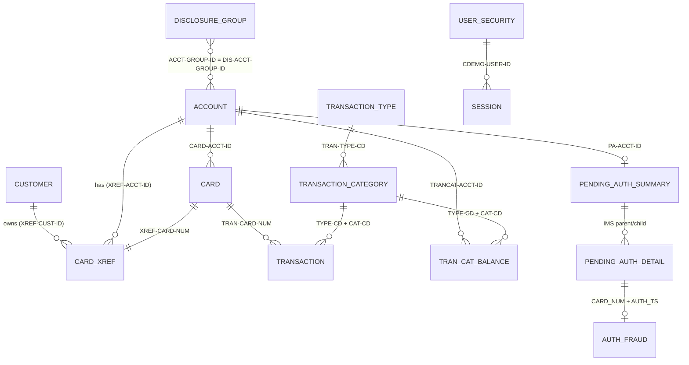

# CardDemo Data Dictionary

> Business entities extracted from COBOL copybook `PIC` clauses, Db2 DDL/DCLGEN and IMS DBDs. Field offsets/lengths are computed from the PIC and USAGE clauses (DISPLAY = 1 byte/char, COMP-3 = ⌈(digits+1)/2⌉, COMP = 2/4/8 bytes). Business names are expanded from COBOL abbreviations; semantics are inferred from names and code usage, not an authoritative glossary — confirm with the business before using as a contract.

See also: [APPLICATION_INVENTORY.md](APPLICATION_INVENTORY.md) · [DEPENDENCY_MAP.md](DEPENDENCY_MAP.md) · [HOTSPOT_REPORT.md](HOTSPOT_REPORT.md)

## 1. Entity overview

| Entity | Copybook | Record length | Physical store | Primary key | Description | Used by programs |
|---|---|---:|---|---|---|---|
| [Customer](#customer) | `CVCUS01Y` | 500 | CUSTDATA.VSAM.KSDS (CICS CUSTDAT) | CUST-ID 9(09) | Person who holds one or more card accounts; PII including SSN, DOB, government ID, FICO score. | CBCUS01C, CBEXPORT, CBIMPORT, CBTRN01C, COACTUPC, COACTVWC, COCRDSLC, COCRDUPC, COPAUA0C, COPAUS0C |
| [Account](#account) | `CVACT01Y` | 300 | ACCTDATA.VSAM.KSDS (CICS ACCTDAT) | ACCT-ID 9(11) | Credit card account with balances, credit and cash limits, life-cycle dates and current-cycle credits/debits. | CBACT01C, CBACT04C, CBEXPORT, CBIMPORT, CBSTM03A, CBTRN01C, CBTRN02C, COACCT01, COACTUPC, COACTVWC, COBIL00C, COPAUA0C, COPAUS0C, COTRN02C |
| [Card](#card) | `CVACT02Y` | 150 | CARDDATA.VSAM.KSDS (CICS CARDDAT; AIX CARDAIX by account) | CARD-NUM X(16); AIX CARD-ACCT-ID | Plastic/virtual card issued against an account. | CBACT02C, CBEXPORT, CBIMPORT, CBTRN01C, COACTVWC, COCRDLIC, COCRDSLC, COCRDUPC, COPAUS0C, COTRTLIC |
| [Card Cross-Reference](#card-cross-reference) | `CVACT03Y` | 50 | CARDXREF.VSAM.KSDS (CICS CCXREF; AIX CXACAIX by account) | XREF-CARD-NUM X(16); AIX XREF-ACCT-ID | Links card number → customer → account. Central join entity used by posting, billing, authorization and statements. | CBACT03C, CBACT04C, CBEXPORT, CBIMPORT, CBSTM03A, CBTRN01C, CBTRN02C, CBTRN03C, COACTUPC, COACTVWC, COBIL00C, COPAUA0C, COPAUS0C, COTRN02C |
| [Transaction (posted)](#transaction-posted) | `CVTRA05Y` | 350 | TRANSACT.VSAM.KSDS (CICS TRANSACT; AIX on processed timestamp) | TRAN-ID X(16); AIX TRAN-PROC-TS | Posted financial transaction (purchase, payment, interest, fee...). | CBACT04C, CBEXPORT, CBIMPORT, CBTRN01C, CBTRN02C, CBTRN03C, COBIL00C, CORPT00C, COTRN00C, COTRN01C, COTRN02C |
| [Daily Transaction (input)](#daily-transaction-input) | `CVTRA06Y` | 350 | DALYTRAN.PS (sequential feed) | (sequential) | Unposted transaction feed consumed by `CBTRN02C`; identical layout to posted transaction. | CBTRN01C, CBTRN02C |
| [Transaction Category Balance](#transaction-category-balance) | `CVTRA01Y` | 50 | TCATBALF.VSAM.KSDS | ACCT-ID + TYPE-CD + CAT-CD (17 bytes) | Running balance per account × transaction type × category; basis for interest. | CBACT04C, CBTRN02C |
| [Disclosure Group (interest rate)](#disclosure-group-interest-rate) | `CVTRA02Y` | 50 | DISCGRP.VSAM.KSDS | GROUP-ID + TYPE-CD + CAT-CD (16 bytes) | Interest rate by account group × transaction type × category (`DEFAULT` group used as fallback). | CBACT04C |
| [Transaction Type](#transaction-type) | `CVTRA03Y` | 60 | TRANTYPE.VSAM.KSDS / Db2 CARDDEMO.TRANSACTION_TYPE | TRAN-TYPE X(02) | Reference list of transaction types (e.g. purchase, payment). | CBTRN03C |
| [Transaction Category](#transaction-category) | `CVTRA04Y` | 60 | TRANCATG.VSAM.KSDS / Db2 CARDDEMO.TRANSACTION_TYPE_CATEGORY | TYPE-CD + CAT-CD (6 bytes) | Reference list of categories within a type. | CBTRN03C |
| [User (security)](#user-security) | `CSUSR01Y` | 80 | USRSEC.VSAM.KSDS (CICS USRSEC) | SEC-USR-ID X(08) | Application sign-on user with role (Admin/User). | COACTUPC, COACTVWC, COADM01C, COCRDLIC, COCRDSLC, COCRDUPC, COMEN01C, COSGN00C, COTRTLIC, COTRTUPC, COUSR00C, COUSR01C, COUSR02C, COUSR03C |
| [Statement Transaction](#statement-transaction) | `COSTM01` | 350 | TRXFL.VSAM.KSDS (temporary, CREASTMT) | CARD-NUM + TRAN-ID (32 bytes) | Transaction re-keyed by card number + transaction ID for statement production. | CBSTM03A |
| [Session Context (COMMAREA)](#session-context-commarea) | `COCOM01Y` | 160 | CICS COMMAREA | — | Context passed between all online programs: navigation, signed-on user, selected customer/account/card. | COACTUPC, COACTVWC, COADM01C, COBIL00C, COCRDLIC, COCRDSLC, COCRDUPC, COMEN01C, COPAUS0C, COPAUS1C, CORPT00C, COSGN00C, COTRN00C, COTRN01C, COTRN02C, COTRTLIC, COTRTUPC, COUSR00C, COUSR01C, COUSR02C, COUSR03C |
| [Pending Authorization Summary](#pending-authorization-summary) | `CIPAUSMY` | 6 | IMS DBPAUTP0 root segment PAUTSUM0 | PA-ACCT-ID (packed, 6 bytes) | Per-account authorization totals and limits (authorization module). | CBPAUP0C, COPAUA0C, COPAUS0C, COPAUS1C, DBUNLDGS, PAUDBLOD, PAUDBUNL |
| [Pending Authorization Detail](#pending-authorization-detail) | `CIPAUDTY` | 8 | IMS DBPAUTP0 child segment PAUTDTL1 | PA-AUTHORIZATION-KEY (8 bytes: inverted date/time) | Individual authorization request/decision for a card. | CBPAUP0C, COPAUA0C, COPAUS0C, COPAUS1C, COPAUS2C, DBUNLDGS, PAUDBLOD, PAUDBUNL |
| [Authorization Request (MQ)](#authorization-request-mq) | `CCPAURQY` | 6 | MQ request queue (CSV payload parsed by COPAUA0C) | — | Inbound authorization request from a point-of-sale/network. | COPAUA0C |
| [Authorization Response (MQ)](#authorization-response-mq) | `CCPAURLY` | 16 | MQ reply queue | — | Authorization decision returned to requester. | COPAUA0C |
| [Authorization Error Log](#authorization-error-log) | `CCPAUERY` | 122 | CICS TDQ / log | — | Error record written by the authorization engine. | COPAUA0C |
| [Export Record](#export-record) | `CVEXPORT` | 500 | EXPORT.DATA (CBEXPORT/CBIMPORT) | — | Multi-entity migration record; record type selects which REDEFINES applies. | CBEXPORT, CBIMPORT |

## 2. Entity relationships

## 3. Field categories legend

| Category | Meaning | Modernization guidance |
|---|---|---|
| Identifier | Business key or foreign key | Keep as String when leading zeros matter (account, card, customer IDs) |
| Code / status | Enumerated code; 88-level values listed where defined | Map to Java enum; validate allowed values |
| Date / Timestamp | Stored as text (`YYYY-MM-DD`, `YYYY-MM-DD-HH.MM.SS.nnnnnn`) or numeric | Convert to `LocalDate`/`LocalDateTime` with explicit parsing |
| Monetary amount | Signed fixed-point (`S9(n)V99`), zoned or packed | `BigDecimal` with scale 2; never floating point |
| Sensitive (PII/credential) | SSN, government ID, passwords, CVV | Encrypt/mask; passwords are stored in clear text today |
| Name / address / contact | Free text | Trim trailing spaces; consider Unicode |
| Filler / reserved | Unused padding | Drop in Java model; preserve for file compatibility |

## Customer

*Copybook* `CVCUS01Y` (`app/cpy/CVCUS01Y.cpy`) · *01 level* `CUSTOMER-RECORD` · *length* 500 bytes · *store* CUSTDATA.VSAM.KSDS (CICS CUSTDAT)

Person who holds one or more card accounts; PII including SSN, DOB, government ID, FICO score.

| COBOL field | Business name | PIC / usage | Storage | Offset | Bytes | Digits / chars | Category | Suggested Java type | Notes |
|---|---|---|---|---:|---:|---|---|---|---|
| `CUST-ID` | Customer ID | `9(09)` | zoned decimal | 1 | 9 | 9,0 | Identifier | int |  |
| `CUST-FIRST-NAME` | Customer First Name | `X(25)` | character | 10 | 25 | 25 | Name / address / contact | String |  |
| `CUST-MIDDLE-NAME` | Customer Middle Name | `X(25)` | character | 35 | 25 | 25 | Name / address / contact | String |  |
| `CUST-LAST-NAME` | Customer Last Name | `X(25)` | character | 60 | 25 | 25 | Name / address / contact | String |  |
| `CUST-ADDR-LINE-1` | Customer Address Line 1 | `X(50)` | character | 85 | 50 | 50 | Name / address / contact | String |  |
| `CUST-ADDR-LINE-2` | Customer Address Line 2 | `X(50)` | character | 135 | 50 | 50 | Name / address / contact | String |  |
| `CUST-ADDR-LINE-3` | Customer Address Line 3 | `X(50)` | character | 185 | 50 | 50 | Name / address / contact | String |  |
| `CUST-ADDR-STATE-CD` | Customer Address State Code | `X(02)` | character | 235 | 2 | 2 | Name / address / contact | String |  |
| `CUST-ADDR-COUNTRY-CD` | Customer Address Country Code | `X(03)` | character | 237 | 3 | 3 | Name / address / contact | String |  |
| `CUST-ADDR-ZIP` | Customer Address Zip | `X(10)` | character | 240 | 10 | 10 | Name / address / contact | String |  |
| `CUST-PHONE-NUM-1` | Customer Phone Number 1 | `X(15)` | character | 250 | 15 | 15 | Name / address / contact | String |  |
| `CUST-PHONE-NUM-2` | Customer Phone Number 2 | `X(15)` | character | 265 | 15 | 15 | Name / address / contact | String |  |
| `CUST-SSN` | Customer Social Security Number | `9(09)` | zoned decimal | 280 | 9 | 9,0 | Sensitive (PII/credential) | int |  |
| `CUST-GOVT-ISSUED-ID` | Customer Government Issued ID | `X(20)` | character | 289 | 20 | 20 | Sensitive (PII/credential) | String |  |
| `CUST-DOB-YYYY-MM-DD` | Customer Date of Birth Yyyy Mm Dd | `X(10)` | character | 309 | 10 | 10 | Date | LocalDate (String in source) |  |
| `CUST-EFT-ACCOUNT-ID` | Customer EFT Account ID | `X(10)` | character | 319 | 10 | 10 | Identifier | String |  |
| `CUST-PRI-CARD-HOLDER-IND` | Customer Primary Card Holder Indicator | `X(01)` | character | 329 | 1 | 1 | Code / status | String |  |
| `CUST-FICO-CREDIT-SCORE` | Customer FICO Credit Score | `9(03)` | zoned decimal | 330 | 3 | 3,0 | Numeric value | int |  |
| `FILLER` | Filler | `X(168)` | character | 333 | 168 | 168 | Filler / reserved | — |  |

*Field mix:* Name / address / contact 11, Identifier 2, Sensitive (PII/credential) 2, Date 1, Code / status 1, Numeric value 1, Filler / reserved 1

## Account

*Copybook* `CVACT01Y` (`app/cpy/CVACT01Y.cpy`) · *01 level* `ACCOUNT-RECORD` · *length* 300 bytes · *store* ACCTDATA.VSAM.KSDS (CICS ACCTDAT)

Credit card account with balances, credit and cash limits, life-cycle dates and current-cycle credits/debits.

| COBOL field | Business name | PIC / usage | Storage | Offset | Bytes | Digits / chars | Category | Suggested Java type | Notes |
|---|---|---|---|---:|---:|---|---|---|---|
| `ACCT-ID` | Account ID | `9(11)` | zoned decimal | 1 | 11 | 11,0 | Identifier | String (numeric id) |  |
| `ACCT-ACTIVE-STATUS` | Account Active Status | `X(01)` | character | 12 | 1 | 1 | Code / status | String |  |
| `ACCT-CURR-BAL` | Account Current Balance | `S9(10)V99` | zoned decimal | 13 | 12 | 12,2 | Monetary amount | BigDecimal |  |
| `ACCT-CREDIT-LIMIT` | Account Credit Limit | `S9(10)V99` | zoned decimal | 25 | 12 | 12,2 | Monetary amount | BigDecimal |  |
| `ACCT-CASH-CREDIT-LIMIT` | Account Cash Credit Limit | `S9(10)V99` | zoned decimal | 37 | 12 | 12,2 | Monetary amount | BigDecimal |  |
| `ACCT-OPEN-DATE` | Account Open Date | `X(10)` | character | 49 | 10 | 10 | Date | LocalDate (String in source) |  |
| `ACCT-EXPIRAION-DATE` | Account Expiration Date | `X(10)` | character | 59 | 10 | 10 | Date | LocalDate (String in source) |  |
| `ACCT-REISSUE-DATE` | Account Reissue Date | `X(10)` | character | 69 | 10 | 10 | Date | LocalDate (String in source) |  |
| `ACCT-CURR-CYC-CREDIT` | Account Current Cycle Credit | `S9(10)V99` | zoned decimal | 79 | 12 | 12,2 | Monetary amount | BigDecimal |  |
| `ACCT-CURR-CYC-DEBIT` | Account Current Cycle Debit | `S9(10)V99` | zoned decimal | 91 | 12 | 12,2 | Monetary amount | BigDecimal |  |
| `ACCT-ADDR-ZIP` | Account Address Zip | `X(10)` | character | 103 | 10 | 10 | Name / address / contact | String |  |
| `ACCT-GROUP-ID` | Account Group ID | `X(10)` | character | 113 | 10 | 10 | Identifier | String |  |
| `FILLER` | Filler | `X(178)` | character | 123 | 178 | 178 | Filler / reserved | — |  |

*Field mix:* Monetary amount 5, Date 3, Identifier 2, Code / status 1, Name / address / contact 1, Filler / reserved 1

## Card

*Copybook* `CVACT02Y` (`app/cpy/CVACT02Y.cpy`) · *01 level* `CARD-RECORD` · *length* 150 bytes · *store* CARDDATA.VSAM.KSDS (CICS CARDDAT; AIX CARDAIX by account)

Plastic/virtual card issued against an account.

| COBOL field | Business name | PIC / usage | Storage | Offset | Bytes | Digits / chars | Category | Suggested Java type | Notes |
|---|---|---|---|---:|---:|---|---|---|---|
| `CARD-NUM` | Card Number | `X(16)` | character | 1 | 16 | 16 | Identifier | String |  |
| `CARD-ACCT-ID` | Card Account ID | `9(11)` | zoned decimal | 17 | 11 | 11,0 | Identifier | String (numeric id) |  |
| `CARD-CVV-CD` | Card CVV Code | `9(03)` | zoned decimal | 28 | 3 | 3,0 | Sensitive (PII/credential) | int |  |
| `CARD-EMBOSSED-NAME` | Card Embossed Name | `X(50)` | character | 31 | 50 | 50 | Name / address / contact | String |  |
| `CARD-EXPIRAION-DATE` | Card Expiration Date | `X(10)` | character | 81 | 10 | 10 | Date | LocalDate (String in source) |  |
| `CARD-ACTIVE-STATUS` | Card Active Status | `X(01)` | character | 91 | 1 | 1 | Code / status | String |  |
| `FILLER` | Filler | `X(59)` | character | 92 | 59 | 59 | Filler / reserved | — |  |

*Field mix:* Identifier 2, Sensitive (PII/credential) 1, Name / address / contact 1, Date 1, Code / status 1, Filler / reserved 1

## Card Cross-Reference

*Copybook* `CVACT03Y` (`app/cpy/CVACT03Y.cpy`) · *01 level* `CARD-XREF-RECORD` · *length* 50 bytes · *store* CARDXREF.VSAM.KSDS (CICS CCXREF; AIX CXACAIX by account)

Links card number → customer → account. Central join entity used by posting, billing, authorization and statements.

| COBOL field | Business name | PIC / usage | Storage | Offset | Bytes | Digits / chars | Category | Suggested Java type | Notes |
|---|---|---|---|---:|---:|---|---|---|---|
| `XREF-CARD-NUM` | Cross-reference Card Number | `X(16)` | character | 1 | 16 | 16 | Identifier | String |  |
| `XREF-CUST-ID` | Cross-reference Customer ID | `9(09)` | zoned decimal | 17 | 9 | 9,0 | Identifier | int |  |
| `XREF-ACCT-ID` | Cross-reference Account ID | `9(11)` | zoned decimal | 26 | 11 | 11,0 | Identifier | String (numeric id) |  |
| `FILLER` | Filler | `X(14)` | character | 37 | 14 | 14 | Filler / reserved | — |  |

*Field mix:* Identifier 3, Filler / reserved 1

## Transaction (posted)

*Copybook* `CVTRA05Y` (`app/cpy/CVTRA05Y.cpy`) · *01 level* `TRAN-RECORD` · *length* 350 bytes · *store* TRANSACT.VSAM.KSDS (CICS TRANSACT; AIX on processed timestamp)

Posted financial transaction (purchase, payment, interest, fee...).

| COBOL field | Business name | PIC / usage | Storage | Offset | Bytes | Digits / chars | Category | Suggested Java type | Notes |
|---|---|---|---|---:|---:|---|---|---|---|
| `TRAN-ID` | Transaction ID | `X(16)` | character | 1 | 16 | 16 | Identifier | String |  |
| `TRAN-TYPE-CD` | Transaction Type Code | `X(02)` | character | 17 | 2 | 2 | Code / status | String |  |
| `TRAN-CAT-CD` | Transaction Category Code | `9(04)` | zoned decimal | 19 | 4 | 4,0 | Code / status | int |  |
| `TRAN-SOURCE` | Transaction Source | `X(10)` | character | 23 | 10 | 10 | Text | String |  |
| `TRAN-DESC` | Transaction Description | `X(100)` | character | 33 | 100 | 100 | Descriptive text | String |  |
| `TRAN-AMT` | Transaction Amount | `S9(09)V99` | zoned decimal | 133 | 11 | 11,2 | Monetary amount | BigDecimal |  |
| `TRAN-MERCHANT-ID` | Transaction Merchant ID | `9(09)` | zoned decimal | 144 | 9 | 9,0 | Identifier | int |  |
| `TRAN-MERCHANT-NAME` | Transaction Merchant Name | `X(50)` | character | 153 | 50 | 50 | Name / address / contact | String |  |
| `TRAN-MERCHANT-CITY` | Transaction Merchant City | `X(50)` | character | 203 | 50 | 50 | Name / address / contact | String |  |
| `TRAN-MERCHANT-ZIP` | Transaction Merchant Zip | `X(10)` | character | 253 | 10 | 10 | Name / address / contact | String |  |
| `TRAN-CARD-NUM` | Transaction Card Number | `X(16)` | character | 263 | 16 | 16 | Identifier | String |  |
| `TRAN-ORIG-TS` | Transaction Original Timestamp | `X(26)` | character | 279 | 26 | 26 | Timestamp | LocalDateTime (String in source) |  |
| `TRAN-PROC-TS` | Transaction Processed Timestamp | `X(26)` | character | 305 | 26 | 26 | Timestamp | LocalDateTime (String in source) |  |
| `FILLER` | Filler | `X(20)` | character | 331 | 20 | 20 | Filler / reserved | — |  |

*Field mix:* Identifier 3, Name / address / contact 3, Code / status 2, Timestamp 2, Text 1, Descriptive text 1, Monetary amount 1, Filler / reserved 1

## Daily Transaction (input)

*Copybook* `CVTRA06Y` (`app/cpy/CVTRA06Y.cpy`) · *01 level* `DALYTRAN-RECORD` · *length* 350 bytes · *store* DALYTRAN.PS (sequential feed)

Unposted transaction feed consumed by `CBTRN02C`; identical layout to posted transaction.

| COBOL field | Business name | PIC / usage | Storage | Offset | Bytes | Digits / chars | Category | Suggested Java type | Notes |
|---|---|---|---|---:|---:|---|---|---|---|
| `DALYTRAN-ID` | Dalytran ID | `X(16)` | character | 1 | 16 | 16 | Identifier | String |  |
| `DALYTRAN-TYPE-CD` | Dalytran Type Code | `X(02)` | character | 17 | 2 | 2 | Code / status | String |  |
| `DALYTRAN-CAT-CD` | Dalytran Category Code | `9(04)` | zoned decimal | 19 | 4 | 4,0 | Code / status | int |  |
| `DALYTRAN-SOURCE` | Dalytran Source | `X(10)` | character | 23 | 10 | 10 | Text | String |  |
| `DALYTRAN-DESC` | Dalytran Description | `X(100)` | character | 33 | 100 | 100 | Descriptive text | String |  |
| `DALYTRAN-AMT` | Dalytran Amount | `S9(09)V99` | zoned decimal | 133 | 11 | 11,2 | Monetary amount | BigDecimal |  |
| `DALYTRAN-MERCHANT-ID` | Dalytran Merchant ID | `9(09)` | zoned decimal | 144 | 9 | 9,0 | Identifier | int |  |
| `DALYTRAN-MERCHANT-NAME` | Dalytran Merchant Name | `X(50)` | character | 153 | 50 | 50 | Name / address / contact | String |  |
| `DALYTRAN-MERCHANT-CITY` | Dalytran Merchant City | `X(50)` | character | 203 | 50 | 50 | Name / address / contact | String |  |
| `DALYTRAN-MERCHANT-ZIP` | Dalytran Merchant Zip | `X(10)` | character | 253 | 10 | 10 | Name / address / contact | String |  |
| `DALYTRAN-CARD-NUM` | Dalytran Card Number | `X(16)` | character | 263 | 16 | 16 | Identifier | String |  |
| `DALYTRAN-ORIG-TS` | Dalytran Original Timestamp | `X(26)` | character | 279 | 26 | 26 | Timestamp | LocalDateTime (String in source) |  |
| `DALYTRAN-PROC-TS` | Dalytran Processed Timestamp | `X(26)` | character | 305 | 26 | 26 | Timestamp | LocalDateTime (String in source) |  |
| `FILLER` | Filler | `X(20)` | character | 331 | 20 | 20 | Filler / reserved | — |  |

*Field mix:* Identifier 3, Name / address / contact 3, Code / status 2, Timestamp 2, Text 1, Descriptive text 1, Monetary amount 1, Filler / reserved 1

## Transaction Category Balance

*Copybook* `CVTRA01Y` (`app/cpy/CVTRA01Y.cpy`) · *01 level* `TRAN-CAT-BAL-RECORD` · *length* 50 bytes · *store* TCATBALF.VSAM.KSDS

Running balance per account × transaction type × category; basis for interest.

| COBOL field | Business name | PIC / usage | Storage | Offset | Bytes | Digits / chars | Category | Suggested Java type | Notes |
|---|---|---|---|---:|---:|---|---|---|---|
| `TRAN-CAT-KEY` | Transaction Category Key (group) | `group` |  | 1 | 17 |  | Group |  |  |
| &nbsp;&nbsp;`TRANCAT-ACCT-ID` | Trancat Account ID | `9(11)` | zoned decimal | 1 | 11 | 11,0 | Identifier | String (numeric id) |  |
| &nbsp;&nbsp;`TRANCAT-TYPE-CD` | Trancat Type Code | `X(02)` | character | 12 | 2 | 2 | Code / status | String |  |
| &nbsp;&nbsp;`TRANCAT-CD` | Trancat Code | `9(04)` | zoned decimal | 14 | 4 | 4,0 | Code / status | int |  |
| `TRAN-CAT-BAL` | Transaction Category Balance | `S9(09)V99` | zoned decimal | 18 | 11 | 11,2 | Monetary amount | BigDecimal |  |
| `FILLER` | Filler | `X(22)` | character | 29 | 22 | 22 | Filler / reserved | — |  |

*Field mix:* Code / status 2, Identifier 1, Monetary amount 1, Filler / reserved 1

## Disclosure Group (interest rate)

*Copybook* `CVTRA02Y` (`app/cpy/CVTRA02Y.cpy`) · *01 level* `DIS-GROUP-RECORD` · *length* 50 bytes · *store* DISCGRP.VSAM.KSDS

Interest rate by account group × transaction type × category (`DEFAULT` group used as fallback).

| COBOL field | Business name | PIC / usage | Storage | Offset | Bytes | Digits / chars | Category | Suggested Java type | Notes |
|---|---|---|---|---:|---:|---|---|---|---|
| `DIS-GROUP-KEY` | Disclosure Group Key (group) | `group` |  | 1 | 16 |  | Group |  |  |
| &nbsp;&nbsp;`DIS-ACCT-GROUP-ID` | Disclosure Account Group ID | `X(10)` | character | 1 | 10 | 10 | Identifier | String |  |
| &nbsp;&nbsp;`DIS-TRAN-TYPE-CD` | Disclosure Transaction Type Code | `X(02)` | character | 11 | 2 | 2 | Code / status | String |  |
| &nbsp;&nbsp;`DIS-TRAN-CAT-CD` | Disclosure Transaction Category Code | `9(04)` | zoned decimal | 13 | 4 | 4,0 | Code / status | int |  |
| `DIS-INT-RATE` | Disclosure Interest Rate | `S9(04)V99` | zoned decimal | 17 | 6 | 6,2 | Rate / percentage | BigDecimal |  |
| `FILLER` | Filler | `X(28)` | character | 23 | 28 | 28 | Filler / reserved | — |  |

*Field mix:* Code / status 2, Identifier 1, Rate / percentage 1, Filler / reserved 1

## Transaction Type

*Copybook* `CVTRA03Y` (`app/cpy/CVTRA03Y.cpy`) · *01 level* `TRAN-TYPE-RECORD` · *length* 60 bytes · *store* TRANTYPE.VSAM.KSDS / Db2 CARDDEMO.TRANSACTION_TYPE

Reference list of transaction types (e.g. purchase, payment).

| COBOL field | Business name | PIC / usage | Storage | Offset | Bytes | Digits / chars | Category | Suggested Java type | Notes |
|---|---|---|---|---:|---:|---|---|---|---|
| `TRAN-TYPE` | Transaction Type | `X(02)` | character | 1 | 2 | 2 | Code / status | String |  |
| `TRAN-TYPE-DESC` | Transaction Type Description | `X(50)` | character | 3 | 50 | 50 | Descriptive text | String |  |
| `FILLER` | Filler | `X(08)` | character | 53 | 8 | 8 | Filler / reserved | — |  |

*Field mix:* Code / status 1, Descriptive text 1, Filler / reserved 1

## Transaction Category

*Copybook* `CVTRA04Y` (`app/cpy/CVTRA04Y.cpy`) · *01 level* `TRAN-CAT-RECORD` · *length* 60 bytes · *store* TRANCATG.VSAM.KSDS / Db2 CARDDEMO.TRANSACTION_TYPE_CATEGORY

Reference list of categories within a type.

| COBOL field | Business name | PIC / usage | Storage | Offset | Bytes | Digits / chars | Category | Suggested Java type | Notes |
|---|---|---|---|---:|---:|---|---|---|---|
| `TRAN-CAT-KEY` | Transaction Category Key (group) | `group` |  | 1 | 6 |  | Group |  |  |
| &nbsp;&nbsp;`TRAN-TYPE-CD` | Transaction Type Code | `X(02)` | character | 1 | 2 | 2 | Code / status | String |  |
| &nbsp;&nbsp;`TRAN-CAT-CD` | Transaction Category Code | `9(04)` | zoned decimal | 3 | 4 | 4,0 | Code / status | int |  |
| `TRAN-CAT-TYPE-DESC` | Transaction Category Type Description | `X(50)` | character | 7 | 50 | 50 | Descriptive text | String |  |
| `FILLER` | Filler | `X(04)` | character | 57 | 4 | 4 | Filler / reserved | — |  |

*Field mix:* Code / status 2, Descriptive text 1, Filler / reserved 1

## User (security)

*Copybook* `CSUSR01Y` (`app/cpy/CSUSR01Y.cpy`) · *01 level* `SEC-USER-DATA` · *length* 80 bytes · *store* USRSEC.VSAM.KSDS (CICS USRSEC)

Application sign-on user with role (Admin/User).

| COBOL field | Business name | PIC / usage | Storage | Offset | Bytes | Digits / chars | Category | Suggested Java type | Notes |
|---|---|---|---|---:|---:|---|---|---|---|
| `SEC-USR-ID` | ID | `X(08)` | character | 1 | 8 | 8 | Identifier | String |  |
| `SEC-USR-FNAME` | First Name | `X(20)` | character | 9 | 20 | 20 | Name / address / contact | String |  |
| `SEC-USR-LNAME` | Last Name | `X(20)` | character | 29 | 20 | 20 | Name / address / contact | String |  |
| `SEC-USR-PWD` | Password | `X(08)` | character | 49 | 8 | 8 | Sensitive (PII/credential) | String |  |
| `SEC-USR-TYPE` | Type | `X(01)` | character | 57 | 1 | 1 | Code / status | String |  |
| `SEC-USR-FILLER` | Filler | `X(23)` | character | 58 | 23 | 23 | Filler / reserved | — |  |

*Field mix:* Name / address / contact 2, Identifier 1, Sensitive (PII/credential) 1, Code / status 1, Filler / reserved 1

## Statement Transaction

*Copybook* `COSTM01` (`app/cpy/COSTM01.CPY`) · *01 level* `TRNX-RECORD` · *length* 350 bytes · *store* TRXFL.VSAM.KSDS (temporary, CREASTMT)

Transaction re-keyed by card number + transaction ID for statement production.

| COBOL field | Business name | PIC / usage | Storage | Offset | Bytes | Digits / chars | Category | Suggested Java type | Notes |
|---|---|---|---|---:|---:|---|---|---|---|
| `TRNX-KEY` | Transaction Key (group) | `group` |  | 1 | 32 |  | Group |  |  |
| &nbsp;&nbsp;`TRNX-CARD-NUM` | Transaction Card Number | `X(16)` | character | 1 | 16 | 16 | Identifier | String |  |
| &nbsp;&nbsp;`TRNX-ID` | Transaction ID | `X(16)` | character | 17 | 16 | 16 | Identifier | String |  |
| `TRNX-REST` | Transaction Rest (group) | `group` |  | 33 | 318 |  | Group |  |  |
| &nbsp;&nbsp;`TRNX-TYPE-CD` | Transaction Type Code | `X(02)` | character | 33 | 2 | 2 | Code / status | String |  |
| &nbsp;&nbsp;`TRNX-CAT-CD` | Transaction Category Code | `9(04)` | zoned decimal | 35 | 4 | 4,0 | Code / status | int |  |
| &nbsp;&nbsp;`TRNX-SOURCE` | Transaction Source | `X(10)` | character | 39 | 10 | 10 | Text | String |  |
| &nbsp;&nbsp;`TRNX-DESC` | Transaction Description | `X(100)` | character | 49 | 100 | 100 | Descriptive text | String |  |
| &nbsp;&nbsp;`TRNX-AMT` | Transaction Amount | `S9(09)V99` | zoned decimal | 149 | 11 | 11,2 | Monetary amount | BigDecimal |  |
| &nbsp;&nbsp;`TRNX-MERCHANT-ID` | Transaction Merchant ID | `9(09)` | zoned decimal | 160 | 9 | 9,0 | Identifier | int |  |
| &nbsp;&nbsp;`TRNX-MERCHANT-NAME` | Transaction Merchant Name | `X(50)` | character | 169 | 50 | 50 | Name / address / contact | String |  |
| &nbsp;&nbsp;`TRNX-MERCHANT-CITY` | Transaction Merchant City | `X(50)` | character | 219 | 50 | 50 | Name / address / contact | String |  |
| &nbsp;&nbsp;`TRNX-MERCHANT-ZIP` | Transaction Merchant Zip | `X(10)` | character | 269 | 10 | 10 | Name / address / contact | String |  |
| &nbsp;&nbsp;`TRNX-ORIG-TS` | Transaction Original Timestamp | `X(26)` | character | 279 | 26 | 26 | Timestamp | LocalDateTime (String in source) |  |
| &nbsp;&nbsp;`TRNX-PROC-TS` | Transaction Processed Timestamp | `X(26)` | character | 305 | 26 | 26 | Timestamp | LocalDateTime (String in source) |  |
| &nbsp;&nbsp;`FILLER` | Filler | `X(20)` | character | 331 | 20 | 20 | Filler / reserved | — |  |

*Field mix:* Identifier 3, Name / address / contact 3, Code / status 2, Timestamp 2, Text 1, Descriptive text 1, Monetary amount 1, Filler / reserved 1

## Session Context (COMMAREA)

*Copybook* `COCOM01Y` (`app/cpy/COCOM01Y.cpy`) · *01 level* `CARDDEMO-COMMAREA` · *length* 160 bytes · *store* CICS COMMAREA

Context passed between all online programs: navigation, signed-on user, selected customer/account/card.

| COBOL field | Business name | PIC / usage | Storage | Offset | Bytes | Digits / chars | Category | Suggested Java type | Notes |
|---|---|---|---|---:|---:|---|---|---|---|
| `CDEMO-GENERAL-INFO` | General Info (group) | `group` |  | 1 | 34 |  | Group |  |  |
| &nbsp;&nbsp;`CDEMO-FROM-TRANID` | From Tranid | `X(04)` | character | 1 | 4 | 4 | Text | String |  |
| &nbsp;&nbsp;`CDEMO-FROM-PROGRAM` | From Program | `X(08)` | character | 5 | 8 | 8 | Text | String |  |
| &nbsp;&nbsp;`CDEMO-TO-TRANID` | To Tranid | `X(04)` | character | 13 | 4 | 4 | Text | String |  |
| &nbsp;&nbsp;`CDEMO-TO-PROGRAM` | To Program | `X(08)` | character | 17 | 8 | 8 | Text | String |  |
| &nbsp;&nbsp;`CDEMO-USER-ID` | User ID | `X(08)` | character | 25 | 8 | 8 | Identifier | String |  |
| &nbsp;&nbsp;`CDEMO-USER-TYPE` | User Type | `X(01)` | character | 33 | 1 | 1 | Code / status | String | Values: 'A'=Usrtyp Admin, 'U'=Usrtyp User |
| &nbsp;&nbsp;`CDEMO-PGM-CONTEXT` | Pgm Context | `9(01)` | zoned decimal | 34 | 1 | 1,0 | Descriptive text | int | Values: 0=Pgm Enter, 1=Pgm Reenter |
| `CDEMO-CUSTOMER-INFO` | Customer Info (group) | `group` |  | 35 | 84 |  | Group |  |  |
| &nbsp;&nbsp;`CDEMO-CUST-ID` | Customer ID | `9(09)` | zoned decimal | 35 | 9 | 9,0 | Identifier | int |  |
| &nbsp;&nbsp;`CDEMO-CUST-FNAME` | Customer First Name | `X(25)` | character | 44 | 25 | 25 | Name / address / contact | String |  |
| &nbsp;&nbsp;`CDEMO-CUST-MNAME` | Customer Middle Name | `X(25)` | character | 69 | 25 | 25 | Name / address / contact | String |  |
| &nbsp;&nbsp;`CDEMO-CUST-LNAME` | Customer Last Name | `X(25)` | character | 94 | 25 | 25 | Name / address / contact | String |  |
| `CDEMO-ACCOUNT-INFO` | Account Info (group) | `group` |  | 119 | 12 |  | Group |  |  |
| &nbsp;&nbsp;`CDEMO-ACCT-ID` | Account ID | `9(11)` | zoned decimal | 119 | 11 | 11,0 | Identifier | String (numeric id) |  |
| &nbsp;&nbsp;`CDEMO-ACCT-STATUS` | Account Status | `X(01)` | character | 130 | 1 | 1 | Code / status | String |  |
| `CDEMO-CARD-INFO` | Card Info (group) | `group` |  | 131 | 16 |  | Group |  |  |
| &nbsp;&nbsp;`CDEMO-CARD-NUM` | Card Number | `9(16)` | zoned decimal | 131 | 16 | 16,0 | Identifier | String (numeric id) |  |
| `CDEMO-MORE-INFO` | More Info (group) | `group` |  | 147 | 14 |  | Group |  |  |
| &nbsp;&nbsp;`CDEMO-LAST-MAP` | Last Map | `X(7)` | character | 147 | 7 | 7 | Text | String |  |
| &nbsp;&nbsp;`CDEMO-LAST-MAPSET` | Last Mapset | `X(7)` | character | 154 | 7 | 7 | Text | String |  |

*Field mix:* Text 6, Identifier 4, Name / address / contact 3, Code / status 2, Descriptive text 1

## Pending Authorization Summary

*Copybook* `CIPAUSMY` (`app/app-authorization-ims-db2-mq/cpy/CIPAUSMY.cpy`) · *01 level* `PA-ACCT-ID` · *length* 6 bytes · *store* IMS DBPAUTP0 root segment PAUTSUM0

Per-account authorization totals and limits (authorization module).

| COBOL field | Business name | PIC / usage | Storage | Offset | Bytes | Digits / chars | Category | Suggested Java type | Notes |
|---|---|---|---|---:|---:|---|---|---|---|

*Field mix:* 

## Pending Authorization Detail

*Copybook* `CIPAUDTY` (`app/app-authorization-ims-db2-mq/cpy/CIPAUDTY.cpy`) · *01 level* `PA-AUTHORIZATION-KEY` · *length* 8 bytes · *store* IMS DBPAUTP0 child segment PAUTDTL1

Individual authorization request/decision for a card.

| COBOL field | Business name | PIC / usage | Storage | Offset | Bytes | Digits / chars | Category | Suggested Java type | Notes |
|---|---|---|---|---:|---:|---|---|---|---|
| `PA-AUTH-DATE-9C` | Authorization Date 9c | `S9(05) COMP-3` | None | 1 | 3 | 5,0 | Date | int |  |
| `PA-AUTH-TIME-9C` | Authorization Time 9c | `S9(09) COMP-3` | None | 4 | 5 | 9,0 | Numeric value | int |  |

*Field mix:* Date 1, Numeric value 1

## Authorization Request (MQ)

*Copybook* `CCPAURQY` (`app/app-authorization-ims-db2-mq/cpy/CCPAURQY.cpy`) · *01 level* `PA-RQ-AUTH-DATE` · *length* 6 bytes · *store* MQ request queue (CSV payload parsed by COPAUA0C)

Inbound authorization request from a point-of-sale/network.

| COBOL field | Business name | PIC / usage | Storage | Offset | Bytes | Digits / chars | Category | Suggested Java type | Notes |
|---|---|---|---|---:|---:|---|---|---|---|

*Field mix:* 

## Authorization Response (MQ)

*Copybook* `CCPAURLY` (`app/app-authorization-ims-db2-mq/cpy/CCPAURLY.cpy`) · *01 level* `PA-RL-CARD-NUM` · *length* 16 bytes · *store* MQ reply queue

Authorization decision returned to requester.

| COBOL field | Business name | PIC / usage | Storage | Offset | Bytes | Digits / chars | Category | Suggested Java type | Notes |
|---|---|---|---|---:|---:|---|---|---|---|

*Field mix:* 

## Authorization Error Log

*Copybook* `CCPAUERY` (`app/app-authorization-ims-db2-mq/cpy/CCPAUERY.cpy`) · *01 level* `ERROR-LOG-RECORD` · *length* 122 bytes · *store* CICS TDQ / log

Error record written by the authorization engine.

| COBOL field | Business name | PIC / usage | Storage | Offset | Bytes | Digits / chars | Category | Suggested Java type | Notes |
|---|---|---|---|---:|---:|---|---|---|---|
| `ERR-DATE` | Err Date | `X(06)` | character | 1 | 6 | 6 | Date | LocalDate (String in source) |  |
| `ERR-TIME` | Err Time | `X(06)` | character | 7 | 6 | 6 | Text | String |  |
| `ERR-APPLICATION` | Err Application | `X(08)` | character | 13 | 8 | 8 | Text | String |  |
| `ERR-PROGRAM` | Err Program | `X(08)` | character | 21 | 8 | 8 | Text | String |  |
| `ERR-LOCATION` | Err Location | `X(04)` | character | 29 | 4 | 4 | Text | String |  |
| `ERR-LEVEL` | Err Level | `X(01)` | character | 33 | 1 | 1 | Text | String | Values: 'L'=Err Log, 'I'=Err Info, 'W'=Err Warning, 'C'=Err Critical |
| `ERR-SUBSYSTEM` | Err Subsystem | `X(01)` | character | 34 | 1 | 1 | Text | String | Values: 'A'=Err App, 'C'=Err Cics, 'I'=Err Ims, 'D'=Err Db2, 'M'=Err Mq, 'F'=Err File |
| `ERR-CODE-1` | Err Code 1 | `X(09)` | character | 35 | 9 | 9 | Code / status | String |  |
| `ERR-CODE-2` | Err Code 2 | `X(09)` | character | 44 | 9 | 9 | Code / status | String |  |
| `ERR-MESSAGE` | Err Message | `X(50)` | character | 53 | 50 | 50 | Text | String |  |
| `ERR-EVENT-KEY` | Err Event Key | `X(20)` | character | 103 | 20 | 20 | Identifier | String |  |

*Field mix:* Text 7, Code / status 2, Date 1, Identifier 1

## Export Record

*Copybook* `CVEXPORT` (`app/cpy/CVEXPORT.cpy`) · *01 level* `EXPORT-RECORD` · *length* 500 bytes · *store* EXPORT.DATA (CBEXPORT/CBIMPORT)

Multi-entity migration record; record type selects which REDEFINES applies.

| COBOL field | Business name | PIC / usage | Storage | Offset | Bytes | Digits / chars | Category | Suggested Java type | Notes |
|---|---|---|---|---:|---:|---|---|---|---|
| `EXPORT-REC-TYPE` | Export Record Type | `X(1)` | character | 1 | 1 | 1 | Code / status | String |  |
| `EXPORT-TIMESTAMP` | Export Timestamp | `X(26)` | character | 2 | 26 | 26 | Timestamp | LocalDateTime (String in source) |  |
| `EXPORT-TIMESTAMP-R` | Export Timestamp R (group) | `group` |  | 2 | 26 |  | Group |  | REDEFINES EXPORT-TIMESTAMP |
| &nbsp;&nbsp;`EXPORT-DATE` | Export Date | `X(10)` | character | 2 | 10 | 10 | Date | LocalDate (String in source) |  |
| &nbsp;&nbsp;`EXPORT-DATE-TIME-SEP` | Export Date Time Sep | `X(1)` | character | 12 | 1 | 1 | Date | LocalDate (String in source) |  |
| &nbsp;&nbsp;`EXPORT-TIME` | Export Time | `X(15)` | character | 13 | 15 | 15 | Text | String |  |
| `EXPORT-SEQUENCE-NUM` | Export Sequence Number | `9(9) COMP` | None | 28 | 4 | 9,0 | Identifier | int |  |
| `EXPORT-BRANCH-ID` | Export Branch ID | `X(4)` | character | 32 | 4 | 4 | Identifier | String |  |
| `EXPORT-REGION-CODE` | Export Region Code | `X(5)` | character | 36 | 5 | 5 | Code / status | String |  |
| `EXPORT-RECORD-DATA` | Export Record Data | `X(460)` | character | 41 | 460 | 460 | Descriptive text | String |  |
| `EXPORT-CUSTOMER-DATA` | Export Customer Data (group) | `group` |  | 41 | 460 |  | Group |  | REDEFINES EXPORT-RECORD-DATA |
| &nbsp;&nbsp;`EXP-CUST-ID` | Customer ID | `9(09) COMP` | None | 41 | 4 | 9,0 | Identifier | int |  |
| &nbsp;&nbsp;`EXP-CUST-FIRST-NAME` | Customer First Name | `X(25)` | character | 45 | 25 | 25 | Name / address / contact | String |  |
| &nbsp;&nbsp;`EXP-CUST-MIDDLE-NAME` | Customer Middle Name | `X(25)` | character | 70 | 25 | 25 | Name / address / contact | String |  |
| &nbsp;&nbsp;`EXP-CUST-LAST-NAME` | Customer Last Name | `X(25)` | character | 95 | 25 | 25 | Name / address / contact | String |  |
| &nbsp;&nbsp;`EXP-CUST-ADDR-LINES` | Customer Address Lines (group) | `group` |  | 120 | 150 |  | Group |  | OCCURS 3 |
| &nbsp;&nbsp;&nbsp;&nbsp;`EXP-CUST-ADDR-LINE` | Customer Address Line | `X(50)` | character | 120 | 50 | 50 | Name / address / contact | String |  |
| &nbsp;&nbsp;`EXP-CUST-ADDR-STATE-CD` | Customer Address State Code | `X(02)` | character | 270 | 2 | 2 | Name / address / contact | String |  |
| &nbsp;&nbsp;`EXP-CUST-ADDR-COUNTRY-CD` | Customer Address Country Code | `X(03)` | character | 272 | 3 | 3 | Name / address / contact | String |  |
| &nbsp;&nbsp;`EXP-CUST-ADDR-ZIP` | Customer Address Zip | `X(10)` | character | 275 | 10 | 10 | Name / address / contact | String |  |
| &nbsp;&nbsp;`EXP-CUST-PHONE-NUMS` | Customer Phone Nums (group) | `group` |  | 285 | 30 |  | Group |  | OCCURS 2 |
| &nbsp;&nbsp;&nbsp;&nbsp;`EXP-CUST-PHONE-NUM` | Customer Phone Number | `X(15)` | character | 285 | 15 | 15 | Name / address / contact | String |  |
| &nbsp;&nbsp;`EXP-CUST-SSN` | Customer Social Security Number | `9(09)` | zoned decimal | 315 | 9 | 9,0 | Sensitive (PII/credential) | int |  |
| &nbsp;&nbsp;`EXP-CUST-GOVT-ISSUED-ID` | Customer Government Issued ID | `X(20)` | character | 324 | 20 | 20 | Sensitive (PII/credential) | String |  |
| &nbsp;&nbsp;`EXP-CUST-DOB-YYYY-MM-DD` | Customer Date of Birth Yyyy Mm Dd | `X(10)` | character | 344 | 10 | 10 | Date | LocalDate (String in source) |  |
| &nbsp;&nbsp;`EXP-CUST-EFT-ACCOUNT-ID` | Customer EFT Account ID | `X(10)` | character | 354 | 10 | 10 | Identifier | String |  |
| &nbsp;&nbsp;`EXP-CUST-PRI-CARD-HOLDER-IND` | Customer Primary Card Holder Indicator | `X(01)` | character | 364 | 1 | 1 | Code / status | String |  |
| &nbsp;&nbsp;`EXP-CUST-FICO-CREDIT-SCORE` | Customer FICO Credit Score | `9(03) COMP-3` | None | 365 | 2 | 3,0 | Numeric value | int |  |
| &nbsp;&nbsp;`FILLER` | Filler | `X(134)` | character | 367 | 134 | 134 | Filler / reserved | — |  |
| `EXPORT-ACCOUNT-DATA` | Export Account Data (group) | `group` |  | 41 | 460 |  | Group |  | REDEFINES EXPORT-RECORD-DATA |
| &nbsp;&nbsp;`EXP-ACCT-ID` | Account ID | `9(11)` | zoned decimal | 41 | 11 | 11,0 | Identifier | String (numeric id) |  |
| &nbsp;&nbsp;`EXP-ACCT-ACTIVE-STATUS` | Account Active Status | `X(01)` | character | 52 | 1 | 1 | Code / status | String |  |
| &nbsp;&nbsp;`EXP-ACCT-CURR-BAL` | Account Current Balance | `S9(10)V99 COMP-3` | None | 53 | 7 | 12,2 | Monetary amount | BigDecimal |  |
| &nbsp;&nbsp;`EXP-ACCT-CREDIT-LIMIT` | Account Credit Limit | `S9(10)V99` | zoned decimal | 60 | 12 | 12,2 | Monetary amount | BigDecimal |  |
| &nbsp;&nbsp;`EXP-ACCT-CASH-CREDIT-LIMIT` | Account Cash Credit Limit | `S9(10)V99 COMP-3` | None | 72 | 7 | 12,2 | Monetary amount | BigDecimal |  |
| &nbsp;&nbsp;`EXP-ACCT-OPEN-DATE` | Account Open Date | `X(10)` | character | 79 | 10 | 10 | Date | LocalDate (String in source) |  |
| &nbsp;&nbsp;`EXP-ACCT-EXPIRAION-DATE` | Account Expiration Date | `X(10)` | character | 89 | 10 | 10 | Date | LocalDate (String in source) |  |
| &nbsp;&nbsp;`EXP-ACCT-REISSUE-DATE` | Account Reissue Date | `X(10)` | character | 99 | 10 | 10 | Date | LocalDate (String in source) |  |
| &nbsp;&nbsp;`EXP-ACCT-CURR-CYC-CREDIT` | Account Current Cycle Credit | `S9(10)V99` | zoned decimal | 109 | 12 | 12,2 | Monetary amount | BigDecimal |  |
| &nbsp;&nbsp;`EXP-ACCT-CURR-CYC-DEBIT` | Account Current Cycle Debit | `S9(10)V99 COMP` | None | 121 | 8 | 12,2 | Monetary amount | BigDecimal |  |
| &nbsp;&nbsp;`EXP-ACCT-ADDR-ZIP` | Account Address Zip | `X(10)` | character | 129 | 10 | 10 | Name / address / contact | String |  |
| &nbsp;&nbsp;`EXP-ACCT-GROUP-ID` | Account Group ID | `X(10)` | character | 139 | 10 | 10 | Identifier | String |  |
| &nbsp;&nbsp;`FILLER` | Filler | `X(352)` | character | 149 | 352 | 352 | Filler / reserved | — |  |
| `EXPORT-TRANSACTION-DATA` | Export Transaction Data (group) | `group` |  | 41 | 460 |  | Group |  | REDEFINES EXPORT-RECORD-DATA |
| &nbsp;&nbsp;`EXP-TRAN-ID` | Transaction ID | `X(16)` | character | 41 | 16 | 16 | Identifier | String |  |
| &nbsp;&nbsp;`EXP-TRAN-TYPE-CD` | Transaction Type Code | `X(02)` | character | 57 | 2 | 2 | Code / status | String |  |
| &nbsp;&nbsp;`EXP-TRAN-CAT-CD` | Transaction Category Code | `9(04)` | zoned decimal | 59 | 4 | 4,0 | Code / status | int |  |
| &nbsp;&nbsp;`EXP-TRAN-SOURCE` | Transaction Source | `X(10)` | character | 63 | 10 | 10 | Text | String |  |
| &nbsp;&nbsp;`EXP-TRAN-DESC` | Transaction Description | `X(100)` | character | 73 | 100 | 100 | Descriptive text | String |  |
| &nbsp;&nbsp;`EXP-TRAN-AMT` | Transaction Amount | `S9(09)V99 COMP-3` | None | 173 | 6 | 11,2 | Monetary amount | BigDecimal |  |
| &nbsp;&nbsp;`EXP-TRAN-MERCHANT-ID` | Transaction Merchant ID | `9(09) COMP` | None | 179 | 4 | 9,0 | Identifier | int |  |
| &nbsp;&nbsp;`EXP-TRAN-MERCHANT-NAME` | Transaction Merchant Name | `X(50)` | character | 183 | 50 | 50 | Name / address / contact | String |  |
| &nbsp;&nbsp;`EXP-TRAN-MERCHANT-CITY` | Transaction Merchant City | `X(50)` | character | 233 | 50 | 50 | Name / address / contact | String |  |
| &nbsp;&nbsp;`EXP-TRAN-MERCHANT-ZIP` | Transaction Merchant Zip | `X(10)` | character | 283 | 10 | 10 | Name / address / contact | String |  |
| &nbsp;&nbsp;`EXP-TRAN-CARD-NUM` | Transaction Card Number | `X(16)` | character | 293 | 16 | 16 | Identifier | String |  |
| &nbsp;&nbsp;`EXP-TRAN-ORIG-TS` | Transaction Original Timestamp | `X(26)` | character | 309 | 26 | 26 | Timestamp | LocalDateTime (String in source) |  |
| &nbsp;&nbsp;`EXP-TRAN-PROC-TS` | Transaction Processed Timestamp | `X(26)` | character | 335 | 26 | 26 | Timestamp | LocalDateTime (String in source) |  |
| &nbsp;&nbsp;`FILLER` | Filler | `X(140)` | character | 361 | 140 | 140 | Filler / reserved | — |  |
| `EXPORT-CARD-XREF-DATA` | Export Card Cross-reference Data (group) | `group` |  | 41 | 460 |  | Group |  | REDEFINES EXPORT-RECORD-DATA |
| &nbsp;&nbsp;`EXP-XREF-CARD-NUM` | Cross-reference Card Number | `X(16)` | character | 41 | 16 | 16 | Identifier | String |  |
| &nbsp;&nbsp;`EXP-XREF-CUST-ID` | Cross-reference Customer ID | `9(09)` | zoned decimal | 57 | 9 | 9,0 | Identifier | int |  |
| &nbsp;&nbsp;`EXP-XREF-ACCT-ID` | Cross-reference Account ID | `9(11) COMP` | None | 66 | 8 | 11,0 | Identifier | String (numeric id) |  |
| &nbsp;&nbsp;`FILLER` | Filler | `X(427)` | character | 74 | 427 | 427 | Filler / reserved | — |  |
| `EXPORT-CARD-DATA` | Export Card Data (group) | `group` |  | 41 | 460 |  | Group |  | REDEFINES EXPORT-RECORD-DATA |
| &nbsp;&nbsp;`EXP-CARD-NUM` | Card Number | `X(16)` | character | 41 | 16 | 16 | Identifier | String |  |
| &nbsp;&nbsp;`EXP-CARD-ACCT-ID` | Card Account ID | `9(11) COMP` | None | 57 | 8 | 11,0 | Identifier | String (numeric id) |  |
| &nbsp;&nbsp;`EXP-CARD-CVV-CD` | Card CVV Code | `9(03) COMP` | None | 65 | 2 | 3,0 | Sensitive (PII/credential) | int |  |
| &nbsp;&nbsp;`EXP-CARD-EMBOSSED-NAME` | Card Embossed Name | `X(50)` | character | 67 | 50 | 50 | Name / address / contact | String |  |
| &nbsp;&nbsp;`EXP-CARD-EXPIRAION-DATE` | Card Expiration Date | `X(10)` | character | 117 | 10 | 10 | Date | LocalDate (String in source) |  |
| &nbsp;&nbsp;`EXP-CARD-ACTIVE-STATUS` | Card Active Status | `X(01)` | character | 127 | 1 | 1 | Code / status | String |  |
| &nbsp;&nbsp;`FILLER` | Filler | `X(373)` | character | 128 | 373 | 373 | Filler / reserved | — |  |

*Field mix:* Identifier 14, Name / address / contact 13, Code / status 7, Date 7, Monetary amount 6, Filler / reserved 5, Timestamp 3, Sensitive (PII/credential) 3, Text 2, Descriptive text 2, Numeric value 1

## Db2 tables

### CARDDEMO.TRANSACTION_TYPE

*Source* `app/app-transaction-type-db2/ddl/TRNTYPE.ddl`

Primary key: `TR_TYPE`

| Column | SQL type | Nullable | Business meaning | Category | Java type |
|---|---|---|---|---|---|
| `TR_TYPE` | CHAR(2) | No | Type | Code / status | String |
| `TR_DESCRIPTION` | VARCHAR(50) | No | Description | Descriptive text | String |

### CARDDEMO.TRANSACTION_TYPE_CATEGORY

*Source* `app/app-transaction-type-db2/ddl/TRNTYCAT.ddl`

Primary key: `TRC_TYPE_CODE,TRC_TYPE_CATEGORY`

| Column | SQL type | Nullable | Business meaning | Category | Java type |
|---|---|---|---|---|---|
| `TRC_TYPE_CODE` | CHAR(2) | No | Type Code | Code / status | String |
| `TRC_TYPE_CATEGORY` | CHAR(4) | No | Type Category | Code / status | String |
| `TRC_CAT_DATA` | VARCHAR(50) | No | Category Data | Descriptive text | String |

### CARDDEMO.AUTHFRDS

*Source* `app/app-authorization-ims-db2-mq/ddl/AUTHFRDS.ddl`

Primary key: `CARD_NUM,AUTH_TS`

| Column | SQL type | Nullable | Business meaning | Category | Java type |
|---|---|---|---|---|---|
| `CARD_NUM` | CHAR(16) | No | Card Number | Identifier | String |
| `AUTH_TS` | TIMESTAMP | No | Authorization Timestamp | Timestamp | LocalDateTime |
| `AUTH_TYPE` | CHAR(4) | Yes | Authorization Type | Code / status | String |
| `CARD_EXPIRY_DATE` | CHAR(4) | Yes | Card Expiry Date | Date | String |
| `MESSAGE_TYPE` | CHAR(6) | Yes | Message Type | Code / status | String |
| `MESSAGE_SOURCE` | CHAR(6) | Yes | Message Source | Text | String |
| `AUTH_ID_CODE` | CHAR(6) | Yes | Authorization ID Code | Code / status | String |
| `AUTH_RESP_CODE` | CHAR(2) | Yes | Authorization Response Code | Code / status | String |
| `AUTH_RESP_REASON` | CHAR(4) | Yes | Authorization Response Reason | Text | String |
| `PROCESSING_CODE` | CHAR(6) | Yes | Processing Code | Code / status | String |
| `TRANSACTION_AMT` | DECIMAL(12,2) | Yes | Transaction Amount | Monetary amount | BigDecimal |
| `APPROVED_AMT` | DECIMAL(12,2) | Yes | Approved Amount | Monetary amount | BigDecimal |
| `MERCHANT_CATAGORY_CODE` | CHAR(4) | Yes | Merchant Catagory Code | Code / status | String |
| `ACQR_COUNTRY_CODE` | CHAR(3) | Yes | Acquirer Country Code | Name / address / contact | String |
| `POS_ENTRY_MODE` | SMALLINT | Yes | Point-of-Sale Entry Mode | Numeric value | Short |
| `MERCHANT_ID` | CHAR(15) | Yes | Merchant ID | Identifier | String |
| `MERCHANT_NAME` | VARCHAR(22) | Yes | Merchant Name | Name / address / contact | String |
| `MERCHANT_CITY` | CHAR(13) | Yes | Merchant City | Name / address / contact | String |
| `MERCHANT_STATE` | CHAR(02) | Yes | Merchant State | Name / address / contact | String |
| `MERCHANT_ZIP` | CHAR(09) | Yes | Merchant Zip | Name / address / contact | String |
| `TRANSACTION_ID` | CHAR(15) | Yes | Transaction ID | Identifier | String |
| `MATCH_STATUS` | CHAR(1) | Yes | Match Status | Code / status | String |
| `AUTH_FRAUD` | CHAR(1) | Yes | Authorization Fraud | Text | String |
| `FRAUD_RPT_DATE` | DATE | Yes | Fraud Rpt Date | Date | LocalDate |
| `ACCT_ID` | DECIMAL(11) | Yes | Account ID | Identifier | Long |
| `CUST_ID` | DECIMAL(9) | Yes | Customer ID | Identifier | Long |

## IMS database PAUTDB (authorization module)

| DBD | Access | Segment | Parent | Bytes | Sequence field | COBOL layout |
|---|---|---|---|---:|---|---|
| `DBPAUTP0` | HIDAM/VSAM | `PAUTSUM0` | root | 100 | `ACCNTID` packed 6 bytes (unique) | `CIPAUSMY` |
| `DBPAUTP0` | HIDAM/VSAM | `PAUTDTL1` | `PAUTSUM0` | 200 | `PAUT9CTS` char 8 (unique, inverted timestamp) | `CIPAUDTY` |
| `DBPAUTX0` | INDEX/VSAM | `PAUTINDX` | — | 6 | `INDXSEQ` packed 6 | primary index of DBPAUTP0 |
| `PASFLDBD` / `PADFLDBD` | GSAM/BSAM | — | — | — | — | root/child unload files (`PASFLPCB`, `PADFLPCB`) |

## Cross-entity data element consistency

The same business element is declared with different PICTUREs across copybooks — each difference needs an explicit conversion rule in a Java/relational model.

| Business element | Declarations found (copybook: field PIC usage) |
|---|---|
| Account ID | AUTHFRDS: `ACCT-ID` S9(11)V COMP-3 COCOM01Y: `CDEMO-ACCT-ID` 9(11) CVACT01Y: `ACCT-ID` 9(11) CVACT02Y: `CARD-ACCT-ID` 9(11) CVACT03Y: `XREF-ACCT-ID` 9(11) CVCRD01Y: `CC-ACCT-ID` X(11) CVEXPORT: `EXP-ACCT-ID` 9(11) CVEXPORT: `EXP-CARD-ACCT-ID` 9(11) COMP CVEXPORT: `EXP-XREF-ACCT-ID` 9(11) COMP CVTRA01Y: `TRANCAT-ACCT-ID` 9(11) |
| Card number | AUTHFRDS: `CARD-NUM` X(16) COCOM01Y: `CDEMO-CARD-NUM` 9(16) COSTM01: `TRNX-CARD-NUM` X(16) CVACT02Y: `CARD-NUM` X(16) CVACT03Y: `XREF-CARD-NUM` X(16) CVCRD01Y: `CC-CARD-NUM` X(16) CVEXPORT: `EXP-CARD-NUM` X(16) CVEXPORT: `EXP-TRAN-CARD-NUM` X(16) CVEXPORT: `EXP-XREF-CARD-NUM` X(16) CVTRA05Y: `TRAN-CARD-NUM` X(16) CVTRA06Y: `DALYTRAN-CARD-NUM` X(16) |
| Customer ID | AUTHFRDS: `CUST-ID` S9(9)V COMP-3 COCOM01Y: `CDEMO-CUST-ID` 9(09) CUSTREC: `CUST-ID` 9(09) CVACT03Y: `XREF-CUST-ID` 9(09) CVCRD01Y: `CC-CUST-ID` X(09) CVCUS01Y: `CUST-ID` 9(09) CVEXPORT: `EXP-CUST-ID` 9(09) COMP CVEXPORT: `EXP-XREF-CUST-ID` 9(09) |
| Transaction ID | AUTHFRDS: `TRANSACTION-ID` X(15) CVEXPORT: `EXP-TRAN-ID` X(16) CVTRA05Y: `TRAN-ID` X(16) CVTRA06Y: `DALYTRAN-ID` X(16) |
| Transaction amount | AUTHFRDS: `TRANSACTION-AMT` S9(10)V9(2) COMP-3 CVEXPORT: `EXP-TRAN-AMT` S9(09)V99 COMP-3 CVTRA05Y: `TRAN-AMT` S9(09)V99 CVTRA06Y: `DALYTRAN-AMT` S9(09)V99 |
| Transaction type code | COSTM01: `TRNX-TYPE-CD` X(02) CVEXPORT: `EXP-TRAN-TYPE-CD` X(02) CVTRA01Y: `TRANCAT-TYPE-CD` X(02) CVTRA02Y: `DIS-TRAN-TYPE-CD` X(02) CVTRA03Y: `TRAN-TYPE` X(02) CVTRA04Y: `TRAN-TYPE-CD` X(02) CVTRA05Y: `TRAN-TYPE-CD` X(02) CVTRA06Y: `DALYTRAN-TYPE-CD` X(02) CVTRA07Y: `TRAN-REPORT-TYPE-CD` X(02) |
| Category code | COSTM01: `TRNX-CAT-CD` 9(04) CVEXPORT: `EXP-TRAN-CAT-CD` 9(04) CVTRA01Y: `TRANCAT-CD` 9(04) CVTRA02Y: `DIS-TRAN-CAT-CD` 9(04) CVTRA04Y: `TRAN-CAT-CD` 9(04) CVTRA05Y: `TRAN-CAT-CD` 9(04) CVTRA06Y: `DALYTRAN-CAT-CD` 9(04) CVTRA07Y: `TRAN-REPORT-CAT-CD` 9(04) DCLTRCAT: `DCL-TRC-TYPE-CATEGORY` X(4) |
| Credit limit | CVACT01Y: `ACCT-CASH-CREDIT-LIMIT` S9(10)V99 CVACT01Y: `ACCT-CREDIT-LIMIT` S9(10)V99 CVEXPORT: `EXP-ACCT-CASH-CREDIT-LIMIT` S9(10)V99 COMP-3 CVEXPORT: `EXP-ACCT-CREDIT-LIMIT` S9(10)V99 |
| Current balance | CVACT01Y: `ACCT-CURR-BAL` S9(10)V99 CVEXPORT: `EXP-ACCT-CURR-BAL` S9(10)V99 COMP-3 |

## Data quality & modernization notes

- **Dates as text**: account open/expiry/reissue dates, customer DOB and transaction timestamps are `PIC X` — no type safety; `CSUTLDTC` (CEEDAYS) is used for validation online only.
- **Typo preserved in layout**: `ACCT-EXPIRAION-DATE` (sic) is referenced by many programs; keep a mapping alias rather than renaming in place.
- **Clear-text credentials**: `SEC-USR-PWD PIC X(08)` is stored unencrypted in `USRSEC`.
- **PII**: `CUST-SSN`, `CUST-GOVT-ISSUED-ID`, `CUST-DOB-YYYY-MM-DD`, card `CARD-CVV-CD` require masking/encryption in the target platform.
- **Mixed numeric encodings** for the same element (zoned vs packed vs binary, e.g. account ID `9(11)` vs `S9(11) COMP-3`, and the export file mixing COMP/COMP-3/DISPLAY) — conversion must be field-specific, especially for EBCDIC data files.
- **Large FILLER areas** (e.g. 178 bytes in account, 168 in customer) reserve room for growth; they can be dropped from the Java domain model but must be preserved for file-format compatibility during coexistence.
- **REDEFINES/OCCURS**: `CVEXPORT` uses record-type driven REDEFINES (one Java subtype per record type); `CIPAUSMY` uses `OCCURS 5` account statuses; `COSTM01`/`CBSTM03A` use in-memory 2-D tables.
