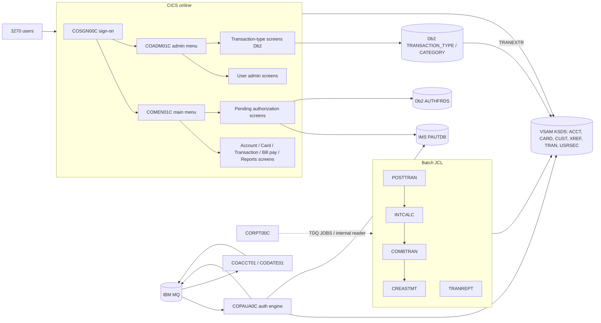
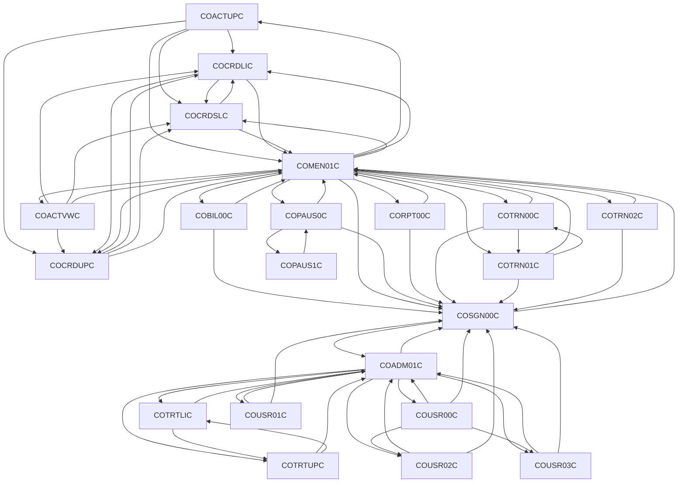
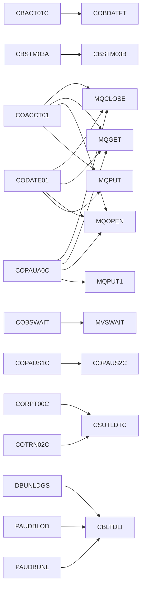
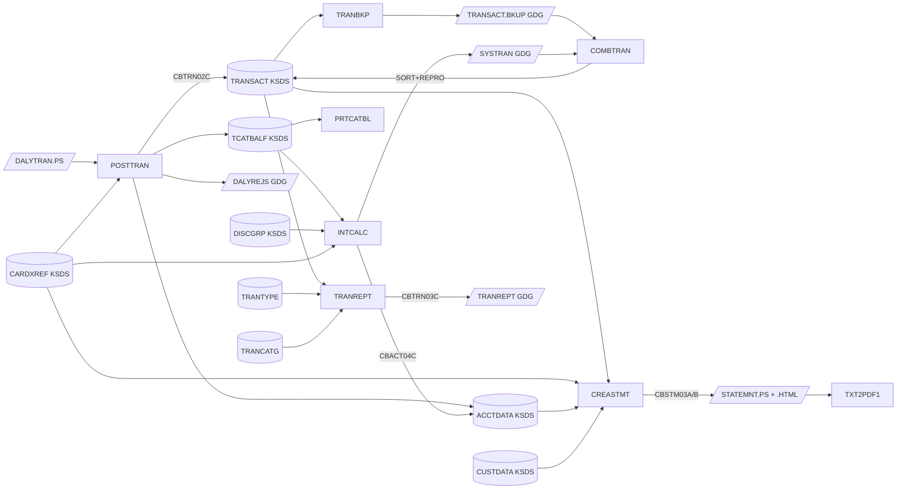
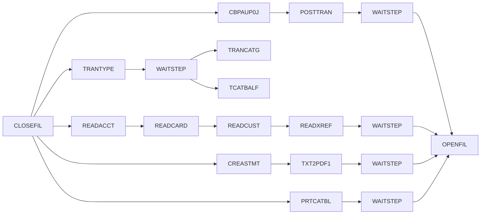

# CardDemo Dependency Map

> Call graph, screen navigation, copybook coupling and data lineage for all programs and JCL jobs, derived by static analysis of COBOL (`CALL`, `EXEC CICS XCTL/LINK/READ/WRITE/REWRITE/DELETE/STARTBR`, `EXEC SQL`, `EXEC DLI`/`CBLTDLI`, `MQ*` calls, `SELECT … ASSIGN`), JCL (`EXEC PGM`, `DD DSN/DISP`, in-stream IDCAMS/SORT/SDSF control cards), the CICS CSD and the Control-M/CA-7 schedules.

See also: [APPLICATION_INVENTORY.md](APPLICATION_INVENTORY.md) · [DATA_DICTIONARY.md](DATA_DICTIONARY.md) · [HOTSPOT_REPORT.md](HOTSPOT_REPORT.md)

## 1. System context

## 2. Online navigation graph (XCTL)

Edges are `EXEC CICS XCTL` targets resolved from literals, program-name constants and the menu option tables (`COMEN02Y`, `COADM02Y`). Most programs return to their caller via `CDEMO-FROM-PROGRAM` / `CDEMO-TO-PROGRAM` in the COMMAREA, so reverse edges are dynamic.

| Program | Transaction | XCTL targets | Reached from |
|---|---|---|---|
| `COACTUPC` | CAUP | COCRDLIC, COCRDSLC, COCRDUPC, COMEN01C | COMEN01C |
| `COACTVWC` | CAVW | COCRDLIC, COCRDSLC, COCRDUPC, COMEN01C | COMEN01C |
| `COADM01C` | CA00 | COSGN00C, COTRTLIC, COTRTUPC, COUSR00C, COUSR01C, COUSR02C, COUSR03C | COSGN00C, COTRTLIC, COTRTUPC, COUSR00C, COUSR01C, COUSR02C, COUSR03C |
| `COBIL00C` | CB00 | COMEN01C, COSGN00C | COMEN01C |
| `COCRDLIC` | CCLI | COCRDSLC, COCRDUPC, COMEN01C | COACTUPC, COACTVWC, COCRDSLC, COCRDUPC, COMEN01C |
| `COCRDSLC` | CCDL | COCRDLIC, COMEN01C | COACTUPC, COACTVWC, COCRDLIC, COCRDUPC, COMEN01C |
| `COCRDUPC` | CCUP | COCRDLIC, COCRDSLC, COMEN01C | COACTUPC, COACTVWC, COCRDLIC, COMEN01C |
| `COMEN01C` | CM00 | COACTUPC, COACTVWC, COBIL00C, COCRDLIC, COCRDSLC, COCRDUPC, COPAUS0C, CORPT00C, COSGN00C, COTRN00C, COTRN01C, COTRN02C | COACTUPC, COACTVWC, COBIL00C, COCRDLIC, COCRDSLC, COCRDUPC, COPAUS0C, CORPT00C, COSGN00C, COTRN00C, COTRN01C, COTRN02C |
| `COPAUS0C` | CPVS | COMEN01C, COPAUS1C, COSGN00C | COMEN01C, COPAUS1C |
| `COPAUS1C` | CPVD | COPAUS0C | COPAUS0C |
| `CORPT00C` | CR00 | COMEN01C, COSGN00C | COMEN01C |
| `COSGN00C` | CC00 | COADM01C, COMEN01C | COADM01C, COBIL00C, COMEN01C, COPAUS0C, CORPT00C, COTRN00C, COTRN01C, COTRN02C, COUSR00C, COUSR01C, COUSR02C, COUSR03C |
| `COTRN00C` | CT00 | COMEN01C, COSGN00C, COTRN01C | COMEN01C, COTRN01C |
| `COTRN01C` | CT01 | COMEN01C, COSGN00C, COTRN00C | COMEN01C, COTRN00C |
| `COTRN02C` | CT02 | COMEN01C, COSGN00C | COMEN01C |
| `COTRTLIC` | CTLI | COADM01C, COTRTUPC | COADM01C, COTRTUPC |
| `COTRTUPC` | CTTU | COADM01C, COTRTLIC | COADM01C, COTRTLIC |
| `COUSR00C` | CU00 | COADM01C, COSGN00C, COUSR02C, COUSR03C | COADM01C |
| `COUSR01C` | CU01 | COADM01C, COSGN00C | COADM01C |
| `COUSR02C` | CU02 | COADM01C, COSGN00C | COADM01C, COUSR00C |
| `COUSR03C` | CU03 | COADM01C, COSGN00C | COADM01C, COUSR00C |

## 3. Static call graph (CALL / LINK / external services)

| Caller | Callee | Mechanism | Callee kind | Purpose |
|---|---|---|---|---|
| `CBACT01C` | `COBDATFT` | CALL | Assembler |  |
| `CBSTM03A` | `CBSTM03B` | CALL | COBOL | File-access subroutine for CBSTM03A (open/read/close of TRNX, XREF, CUST, ACCT f |
| `COACCT01` | `MQCLOSE` | CALL | MQ API |  |
| `COACCT01` | `MQGET` | CALL | MQ API |  |
| `COACCT01` | `MQOPEN` | CALL | MQ API |  |
| `COACCT01` | `MQPUT` | CALL | MQ API |  |
| `COBSWAIT` | `MVSWAIT` | CALL | Assembler |  |
| `CODATE01` | `MQCLOSE` | CALL | MQ API |  |
| `CODATE01` | `MQGET` | CALL | MQ API |  |
| `CODATE01` | `MQOPEN` | CALL | MQ API |  |
| `CODATE01` | `MQPUT` | CALL | MQ API |  |
| `COPAUA0C` | `MQCLOSE` | CALL | MQ API |  |
| `COPAUA0C` | `MQGET` | CALL | MQ API |  |
| `COPAUA0C` | `MQOPEN` | CALL | MQ API |  |
| `COPAUA0C` | `MQPUT1` | CALL | MQ API |  |
| `COPAUS1C` | `COPAUS2C` | EXEC CICS LINK | COBOL | Fraud marking: inserts/updates CARDDEMO.AUTHFRDS in Db2 |
| `CORPT00C` | `CSUTLDTC` | CALL | COBOL | Date validation subroutine wrapping LE CEEDAYS; called by COTRN02C and CORPT00C |
| `COTRN02C` | `CSUTLDTC` | CALL | COBOL | Date validation subroutine wrapping LE CEEDAYS; called by COTRN02C and CORPT00C |
| `DBUNLDGS` | `CBLTDLI` | CALL | IMS DL/I API |  |
| `PAUDBLOD` | `CBLTDLI` | CALL | IMS DL/I API |  |
| `PAUDBUNL` | `CBLTDLI` | CALL | IMS DL/I API |  |

Also: `CORPT00C` writes generated JCL to TDQ `JOBS` (internal reader) to submit the `TRANREPT` flow; `COPAUA0C` is started by an MQ trigger on transaction `CP00`; LE services `CEEDAYS` (`CSUTLDTC`) and `CEE3ABD` (abend) are used.

## 4. Program → data store access (CRUD)

Online access from `EXEC CICS` file commands (`R` read/browse, `W` write, `U` rewrite, `D` delete), Db2 from `EXEC SQL`, IMS from `EXEC DLI`/`CBLTDLI`; batch access from `SELECT … ASSIGN` + `OPEN` mode as wired by JCL.

| Program | Data store | Access |
|---|---|---|
| `CBACT01C` | ACCTDATA.ARRYPS | W |
| `CBACT01C` | ACCTDATA.PSCOMP | W |
| `CBACT01C` | ACCTDATA.VBPS | W |
| `CBACT01C` | ACCTDATA.VSAM.KSDS | R |
| `CBACT02C` | CARDDATA.VSAM.KSDS | R |
| `CBACT03C` | CARDXREF.VSAM.KSDS | R |
| `CBACT04C` | ACCTDATA.VSAM.KSDS | RU |
| `CBACT04C` | CARDXREF.VSAM.AIX.PATH | R |
| `CBACT04C` | CARDXREF.VSAM.KSDS | R |
| `CBACT04C` | DISCGRP.VSAM.KSDS | R |
| `CBACT04C` | SYSTRAN | W |
| `CBACT04C` | TCATBALF.VSAM.KSDS | R |
| `CBCUS01C` | CUSTDATA.VSAM.KSDS | R |
| `CBEXPORT` | ACCTDATA.VSAM.KSDS | R |
| `CBEXPORT` | CARDDATA.VSAM.KSDS | R |
| `CBEXPORT` | CARDXREF.VSAM.KSDS | R |
| `CBEXPORT` | CUSTDATA.VSAM.KSDS | R |
| `CBEXPORT` | EXPORT.DATA | W |
| `CBEXPORT` | TRANSACT.VSAM.KSDS | R |
| `CBIMPORT` | ACCTDATA.IMPORT | W |
| `CBIMPORT` | CARDXREF.IMPORT | W |
| `CBIMPORT` | CUSTDATA.IMPORT | W |
| `CBIMPORT` | EXPORT.DATA | R |
| `CBIMPORT` | IMPORT.ERRORS | W |
| `CBIMPORT` | TRANSACT.IMPORT | W |
| `CBPAUP0C` | IMS PAUTDB (PAUTSUM0/PAUTDTL1) | DR |
| `CBSTM03A` | ACCTDATA.VSAM.KSDS | R |
| `CBSTM03A` | CARDXREF.VSAM.KSDS | R |
| `CBSTM03A` | CUSTDATA.VSAM.KSDS | R |
| `CBSTM03A` | STATEMNT.HTML | W |
| `CBSTM03A` | TRXFL.VSAM.KSDS | R |
| `CBTRN02C` | ACCTDATA.VSAM.KSDS | RU |
| `CBTRN02C` | CARDXREF.VSAM.KSDS | R |
| `CBTRN02C` | DALYREJS | W |
| `CBTRN02C` | DALYTRAN.PS | R |
| `CBTRN02C` | TCATBALF.VSAM.KSDS | RU |
| `CBTRN02C` | TRANSACT.VSAM.KSDS | W |
| `CBTRN03C` | CARDXREF.VSAM.KSDS | R |
| `CBTRN03C` | DATEPARM | R |
| `CBTRN03C` | TRANCATG.VSAM.KSDS | R |
| `CBTRN03C` | TRANREPT | W |
| `CBTRN03C` | TRANSACT.DALY | R |
| `CBTRN03C` | TRANTYPE.VSAM.KSDS | R |
| `COACCT01` | ACCTDAT (ACCTDATA.VSAM.KSDS) | R |
| `COACTUPC` | ACCTDAT (ACCTDATA.VSAM.KSDS) | RU |
| `COACTUPC` | CUSTDAT (CUSTDATA.VSAM.KSDS) | RU |
| `COACTUPC` | CXACAIX (CARDXREF.VSAM.AIX.PATH) | R |
| `COACTVWC` | ACCTDAT (ACCTDATA.VSAM.KSDS) | R |
| `COACTVWC` | CUSTDAT (CUSTDATA.VSAM.KSDS) | R |
| `COACTVWC` | CXACAIX (CARDXREF.VSAM.AIX.PATH) | R |
| `COBIL00C` | ACCTDAT (ACCTDATA.VSAM.KSDS) | RU |
| `COBIL00C` | CXACAIX (CARDXREF.VSAM.AIX.PATH) | R |
| `COBIL00C` | TRANSACT (TRANSACT.VSAM.KSDS) | RW |
| `COBTUPDT` | Db2 CARDDEMO.TRANSACTION_TYPE | DUW |
| `COBTUPDT` | INPFILE | R |
| `COCRDLIC` | CARDDAT (CARDDATA.VSAM.KSDS) | R |
| `COCRDSLC` | CARDAIX (CARDDATA.VSAM.AIX.PATH) | R |
| `COCRDSLC` | CARDDAT (CARDDATA.VSAM.KSDS) | R |
| `COCRDUPC` | CARDDAT (CARDDATA.VSAM.KSDS) | RU |
| `COPAUA0C` | ACCTDAT (ACCTDATA.VSAM.KSDS) | R |
| `COPAUA0C` | CCXREF (CARDXREF.VSAM.KSDS) | R |
| `COPAUA0C` | CUSTDAT (CUSTDATA.VSAM.KSDS) | R |
| `COPAUA0C` | IMS PAUTDB (PAUTSUM0/PAUTDTL1) | RUW |
| `COPAUS0C` | ACCTDAT (ACCTDATA.VSAM.KSDS) | R |
| `COPAUS0C` | CUSTDAT (CUSTDATA.VSAM.KSDS) | R |
| `COPAUS0C` | CXACAIX (CARDXREF.VSAM.AIX.PATH) | R |
| `COPAUS0C` | IMS PAUTDB (PAUTSUM0/PAUTDTL1) | R |
| `COPAUS1C` | IMS PAUTDB (PAUTSUM0/PAUTDTL1) | RU |
| `COPAUS2C` | Db2 CARDDEMO.AUTHFRDS | UW |
| `COSGN00C` | USRSEC (USRSEC.VSAM.KSDS) | R |
| `COTRN00C` | TRANSACT (TRANSACT.VSAM.KSDS) | R |
| `COTRN01C` | TRANSACT (TRANSACT.VSAM.KSDS) | R |
| `COTRN02C` | CCXREF (CARDXREF.VSAM.KSDS) | R |
| `COTRN02C` | CXACAIX (CARDXREF.VSAM.AIX.PATH) | R |
| `COTRN02C` | TRANSACT (TRANSACT.VSAM.KSDS) | RW |
| `COTRTLIC` | Db2 CARDDEMO.TRANSACTION_TYPE | DRU |
| `COTRTUPC` | Db2 CARDDEMO.TRANSACTION_TYPE | DRUW |
| `COUSR00C` | USRSEC (USRSEC.VSAM.KSDS) | R |
| `COUSR01C` | USRSEC (USRSEC.VSAM.KSDS) | W |
| `COUSR02C` | USRSEC (USRSEC.VSAM.KSDS) | RU |
| `COUSR03C` | USRSEC (USRSEC.VSAM.KSDS) | DR |
| `DBUNLDGS` | IMS PAUTDB (DBPAUTP0) | R |
| `DBUNLDGS` | IMS PAUTDB (PAUTSUM0/PAUTDTL1) | RW |
| `DBUNLDGS` | IMS PAUTDB index (DBPAUTX0) | R |
| `DBUNLDGS` | PAUTDB.CHILD.GSAM | R |
| `DBUNLDGS` | PAUTDB.ROOT.GSAM | R |
| `PAUDBLOD` | IMS PAUTDB (PAUTSUM0/PAUTDTL1) | RW |
| `PAUDBLOD` | PAUTDB.CHILD.FILEO | R |
| `PAUDBLOD` | PAUTDB.ROOT.FILEO | R |
| `PAUDBUNL` | IMS PAUTDB (DBPAUTP0) | R |
| `PAUDBUNL` | IMS PAUTDB (PAUTSUM0/PAUTDTL1) | R |
| `PAUDBUNL` | IMS PAUTDB index (DBPAUTX0) | R |
| `PAUDBUNL` | PAUTDB.CHILD.FILEO | W |
| `PAUDBUNL` | PAUTDB.ROOT.FILEO | W |

### 4.1 Data store fan-in (who touches each master file)

| Data store | Readers | Writers / updaters |
|---|---|---|
| ACCTDATA.ARRYPS |  | CBACT01C (W) |
| ACCTDATA.IMPORT |  | CBIMPORT (W) |
| ACCTDATA.PSCOMP |  | CBACT01C (W) |
| ACCTDATA.VBPS |  | CBACT01C (W) |
| ACCTDATA.VSAM.KSDS | CBACT01C, CBEXPORT, CBSTM03A, COACCT01, COACTVWC, COPAUA0C, COPAUS0C | CBACT04C (RU), CBTRN02C (RU), COACTUPC (RU), COBIL00C (RU) |
| CARDDATA.VSAM.AIX.PATH | COCRDSLC |  |
| CARDDATA.VSAM.KSDS | CBACT02C, CBEXPORT, COCRDLIC, COCRDSLC | COCRDUPC (RU) |
| CARDXREF.IMPORT |  | CBIMPORT (W) |
| CARDXREF.VSAM.AIX.PATH | CBACT04C, COACTUPC, COACTVWC, COBIL00C, COPAUS0C, COTRN02C |  |
| CARDXREF.VSAM.KSDS | CBACT03C, CBACT04C, CBEXPORT, CBSTM03A, CBTRN02C, CBTRN03C, COPAUA0C, COTRN02C |  |
| CUSTDATA.IMPORT |  | CBIMPORT (W) |
| CUSTDATA.VSAM.KSDS | CBCUS01C, CBEXPORT, CBSTM03A, COACTVWC, COPAUA0C, COPAUS0C | COACTUPC (RU) |
| DALYREJS |  | CBTRN02C (W) |
| DALYTRAN.PS | CBTRN02C |  |
| DATEPARM | CBTRN03C |  |
| DISCGRP.VSAM.KSDS | CBACT04C |  |
| Db2 CARDDEMO.AUTHFRDS |  | COPAUS2C (UW) |
| Db2 CARDDEMO.TRANSACTION_TYPE |  | COBTUPDT (DUW), COTRTLIC (DRU), COTRTUPC (DRUW) |
| EXPORT.DATA | CBIMPORT | CBEXPORT (W) |
| IMPORT.ERRORS |  | CBIMPORT (W) |
| IMS PAUTDB (DBPAUTP0) | DBUNLDGS, PAUDBUNL |  |
| IMS PAUTDB (PAUTSUM0/PAUTDTL1) | COPAUS0C, PAUDBUNL | CBPAUP0C (DR), COPAUA0C (RUW), COPAUS1C (RU), DBUNLDGS (RW), PAUDBLOD (RW) |
| IMS PAUTDB index (DBPAUTX0) | DBUNLDGS, PAUDBUNL |  |
| INPFILE | COBTUPDT |  |
| PAUTDB.CHILD.FILEO | PAUDBLOD | PAUDBUNL (W) |
| PAUTDB.CHILD.GSAM | DBUNLDGS |  |
| PAUTDB.ROOT.FILEO | PAUDBLOD | PAUDBUNL (W) |
| PAUTDB.ROOT.GSAM | DBUNLDGS |  |
| STATEMNT.HTML |  | CBSTM03A (W) |
| SYSTRAN |  | CBACT04C (W) |
| TCATBALF.VSAM.KSDS | CBACT04C | CBTRN02C (RU) |
| TRANCATG.VSAM.KSDS | CBTRN03C |  |
| TRANREPT |  | CBTRN03C (W) |
| TRANSACT.DALY | CBTRN03C |  |
| TRANSACT.IMPORT |  | CBIMPORT (W) |
| TRANSACT.VSAM.KSDS | CBEXPORT, COTRN00C, COTRN01C | CBTRN02C (W), COBIL00C (RW), COTRN02C (RW) |
| TRANTYPE.VSAM.KSDS | CBTRN03C |  |
| TRXFL.VSAM.KSDS | CBSTM03A |  |
| USRSEC.VSAM.KSDS | COSGN00C, COUSR00C | COUSR01C (W), COUSR02C (RU), COUSR03C (DR) |

## 5. Copybook coupling

| Copybook | Programs (#) | Programs |
|---|---:|---|
| `COCOM01Y` | 21 | COACTUPC, COACTVWC, COADM01C, COBIL00C, COCRDLIC, COCRDSLC, COCRDUPC, COMEN01C, COPAUS0C, COPAUS1C, CORPT00C, COSGN00C, COTRN00C, COTRN01C, COTRN02C, COTRTLIC, COTRTUPC, COUSR00C, COUSR01C, COUSR02C, COUSR03C |
| `COTTL01Y` | 21 | COACTUPC, COACTVWC, COADM01C, COBIL00C, COCRDLIC, COCRDSLC, COCRDUPC, COMEN01C, COPAUS0C, COPAUS1C, CORPT00C, COSGN00C, COTRN00C, COTRN01C, COTRN02C, COTRTLIC, COTRTUPC, COUSR00C, COUSR01C, COUSR02C, COUSR03C |
| `CSDAT01Y` | 21 | COACTUPC, COACTVWC, COADM01C, COBIL00C, COCRDLIC, COCRDSLC, COCRDUPC, COMEN01C, COPAUS0C, COPAUS1C, CORPT00C, COSGN00C, COTRN00C, COTRN01C, COTRN02C, COTRTLIC, COTRTUPC, COUSR00C, COUSR01C, COUSR02C, COUSR03C |
| `CSMSG01Y` | 21 | COACTUPC, COACTVWC, COADM01C, COBIL00C, COCRDLIC, COCRDSLC, COCRDUPC, COMEN01C, COPAUS0C, COPAUS1C, CORPT00C, COSGN00C, COTRN00C, COTRN01C, COTRN02C, COTRTLIC, COTRTUPC, COUSR00C, COUSR01C, COUSR02C, COUSR03C |
| `CSUSR01Y` | 14 | COACTUPC, COACTVWC, COADM01C, COCRDLIC, COCRDSLC, COCRDUPC, COMEN01C, COSGN00C, COTRTLIC, COTRTUPC, COUSR00C, COUSR01C, COUSR02C, COUSR03C |
| `CVACT01Y` | 14 | CBACT01C, CBACT04C, CBEXPORT, CBIMPORT, CBSTM03A, CBTRN01C, CBTRN02C, COACCT01, COACTUPC, COACTVWC, COBIL00C, COPAUA0C, COPAUS0C, COTRN02C |
| `CVACT03Y` | 14 | CBACT03C, CBACT04C, CBEXPORT, CBIMPORT, CBSTM03A, CBTRN01C, CBTRN02C, CBTRN03C, COACTUPC, COACTVWC, COBIL00C, COPAUA0C, COPAUS0C, COTRN02C |
| `CVTRA05Y` | 11 | CBACT04C, CBEXPORT, CBIMPORT, CBTRN01C, CBTRN02C, CBTRN03C, COBIL00C, CORPT00C, COTRN00C, COTRN01C, COTRN02C |
| `CVACT02Y` | 10 | CBACT02C, CBEXPORT, CBIMPORT, CBTRN01C, COACTVWC, COCRDLIC, COCRDSLC, COCRDUPC, COPAUS0C, COTRTLIC |
| `CVCUS01Y` | 10 | CBCUS01C, CBEXPORT, CBIMPORT, CBTRN01C, COACTUPC, COACTVWC, COCRDSLC, COCRDUPC, COPAUA0C, COPAUS0C |
| `CIPAUDTY` | 8 | CBPAUP0C, COPAUA0C, COPAUS0C, COPAUS1C, COPAUS2C, DBUNLDGS, PAUDBLOD, PAUDBUNL |
| `CIPAUSMY` | 7 | CBPAUP0C, COPAUA0C, COPAUS0C, COPAUS1C, DBUNLDGS, PAUDBLOD, PAUDBUNL |
| `CSMSG02Y` | 7 | COACTUPC, COACTVWC, COCRDSLC, COCRDUPC, COPAUS0C, COPAUS1C, COTRTUPC |
| `CSSTRPFY` | 7 | COACTUPC, COACTVWC, COCRDLIC, COCRDSLC, COCRDUPC, COTRTLIC, COTRTUPC |
| `CVCRD01Y` | 7 | COACTUPC, COACTVWC, COCRDLIC, COCRDSLC, COCRDUPC, COTRTLIC, COTRTUPC |
| `DCLTRTYP` | 3 | COBTUPDT, COTRTLIC, COTRTUPC |
| `IMSFUNCS` | 3 | DBUNLDGS, PAUDBLOD, PAUDBUNL |
| `PAUTBPCB` | 3 | DBUNLDGS, PAUDBLOD, PAUDBUNL |
| `CSSETATY` | 2 | COACTUPC, COTRTUPC |
| `CSUTLDWY` | 2 | COACTUPC, COTRTUPC |
| `CVEXPORT` | 2 | CBEXPORT, CBIMPORT |
| `CVTRA01Y` | 2 | CBACT04C, CBTRN02C |
| `CVTRA06Y` | 2 | CBTRN01C, CBTRN02C |
| `AUTHFRDS` | 1 | COPAUS2C |
| `CCPAUERY` | 1 | COPAUA0C |
| `CCPAURLY` | 1 | COPAUA0C |
| `CCPAURQY` | 1 | COPAUA0C |
| `COADM02Y` | 1 | COADM01C |
| `CODATECN` | 1 | CBACT01C |
| `COMEN02Y` | 1 | COMEN01C |
| `COSTM01` | 1 | CBSTM03A |
| `CSDB2RPY` | 1 | COTRTLIC |
| `CSDB2RWY` | 1 | COTRTLIC |
| `CSLKPCDY` | 1 | COACTUPC |
| `CSUTLDPY` | 1 | COACTUPC |
| `CUSTREC` | 1 | CBSTM03A |
| `CVTRA02Y` | 1 | CBACT04C |
| `CVTRA03Y` | 1 | CBTRN03C |
| `CVTRA04Y` | 1 | CBTRN03C |
| `CVTRA07Y` | 1 | CBTRN03C |
| `DCLTRCAT` | 1 | COTRTUPC |
| `PADFLPCB` | 1 | DBUNLDGS |
| `PASFLPCB` | 1 | DBUNLDGS |

Program → copybooks (full list)

| Program | Copybooks |
|---|---|
| `CBACT01C` | CODATECN, CVACT01Y |
| `CBACT02C` | CVACT02Y |
| `CBACT03C` | CVACT03Y |
| `CBACT04C` | CVACT01Y, CVACT03Y, CVTRA01Y, CVTRA02Y, CVTRA05Y |
| `CBCUS01C` | CVCUS01Y |
| `CBEXPORT` | CVACT01Y, CVACT02Y, CVACT03Y, CVCUS01Y, CVEXPORT, CVTRA05Y |
| `CBIMPORT` | CVACT01Y, CVACT02Y, CVACT03Y, CVCUS01Y, CVEXPORT, CVTRA05Y |
| `CBPAUP0C` | CIPAUDTY, CIPAUSMY |
| `CBSTM03A` | COSTM01, CUSTREC, CVACT01Y, CVACT03Y |
| `CBSTM03B` |  |
| `CBTRN01C` | CVACT01Y, CVACT02Y, CVACT03Y, CVCUS01Y, CVTRA05Y, CVTRA06Y |
| `CBTRN02C` | CVACT01Y, CVACT03Y, CVTRA01Y, CVTRA05Y, CVTRA06Y |
| `CBTRN03C` | CVACT03Y, CVTRA03Y, CVTRA04Y, CVTRA05Y, CVTRA07Y |
| `COACCT01` | CMQGMOV, CMQMDV, CMQODV, CMQPMOV, CMQTML, CMQV, CVACT01Y, PERFORM, REPLACING |
| `COACTUPC` | COACTUP, COCOM01Y, COTTL01Y, CSDAT01Y, CSLKPCDY, CSMSG01Y, CSMSG02Y, CSSETATY, CSSTRPFY, CSUSR01Y, CSUTLDPY, CSUTLDWY, CVACT01Y, CVACT03Y, CVCRD01Y, CVCUS01Y, DFHAID, DFHBMSCA |
| `COACTVWC` | COACTVW, COCOM01Y, COTTL01Y, CSDAT01Y, CSMSG01Y, CSMSG02Y, CSSTRPFY, CSUSR01Y, CVACT01Y, CVACT02Y, CVACT03Y, CVCRD01Y, CVCUS01Y, DFHAID, DFHBMSCA |
| `COADM01C` | COADM01, COADM02Y, COCOM01Y, COTTL01Y, CSDAT01Y, CSMSG01Y, CSUSR01Y, DFHAID, DFHBMSCA |
| `COBIL00C` | COBIL00, COCOM01Y, COTTL01Y, CSDAT01Y, CSMSG01Y, CVACT01Y, CVACT03Y, CVTRA05Y, DFHAID, DFHBMSCA |
| `COBSWAIT` |  |
| `COBTUPDT` | DCLTRTYP |
| `COCRDLIC` | COCOM01Y, COCRDLI, COTTL01Y, CSDAT01Y, CSMSG01Y, CSSTRPFY, CSUSR01Y, CVACT02Y, CVCRD01Y, DFHAID, DFHBMSCA |
| `COCRDSLC` | COCOM01Y, COCRDSL, COTTL01Y, CSDAT01Y, CSMSG01Y, CSMSG02Y, CSSTRPFY, CSUSR01Y, CVACT02Y, CVCRD01Y, CVCUS01Y, DFHAID, DFHBMSCA |
| `COCRDUPC` | COCOM01Y, COCRDUP, COTTL01Y, CSDAT01Y, CSMSG01Y, CSMSG02Y, CSSTRPFY, CSUSR01Y, CVACT02Y, CVCRD01Y, CVCUS01Y, DFHAID, DFHBMSCA |
| `CODATE01` | CMQGMOV, CMQMDV, CMQODV, CMQPMOV, CMQTML, CMQV, PERFORM, REPLACING |
| `COMEN01C` | COCOM01Y, COMEN01, COMEN02Y, COTTL01Y, CSDAT01Y, CSMSG01Y, CSUSR01Y, DFHAID, DFHBMSCA |
| `COPAUA0C` | CCPAUERY, CCPAURLY, CCPAURQY, CIPAUDTY, CIPAUSMY, CMQGMOV, CMQMDV, CMQODV, CMQPMOV, CMQTML, CMQV, CVACT01Y, CVACT03Y, CVCUS01Y |
| `COPAUS0C` | CIPAUDTY, CIPAUSMY, COCOM01Y, COPAU00, COTTL01Y, CSDAT01Y, CSMSG01Y, CSMSG02Y, CVACT01Y, CVACT02Y, CVACT03Y, CVCUS01Y, DFHAID, DFHBMSCA |
| `COPAUS1C` | CIPAUDTY, CIPAUSMY, COCOM01Y, COPAU01, COTTL01Y, CSDAT01Y, CSMSG01Y, CSMSG02Y, DFHAID, DFHBMSCA |
| `COPAUS2C` | AUTHFRDS, CIPAUDTY |
| `CORPT00C` | COCOM01Y, CORPT00, COTTL01Y, CSDAT01Y, CSMSG01Y, CVTRA05Y, DFHAID, DFHBMSCA |
| `COSGN00C` | COCOM01Y, COSGN00, COTTL01Y, CSDAT01Y, CSMSG01Y, CSUSR01Y, DFHAID, DFHBMSCA |
| `COTRN00C` | COCOM01Y, COTRN00, COTTL01Y, CSDAT01Y, CSMSG01Y, CVTRA05Y, DFHAID, DFHBMSCA |
| `COTRN01C` | COCOM01Y, COTRN01, COTTL01Y, CSDAT01Y, CSMSG01Y, CVTRA05Y, DFHAID, DFHBMSCA |
| `COTRN02C` | COCOM01Y, COTRN02, COTTL01Y, CSDAT01Y, CSMSG01Y, CVACT01Y, CVACT03Y, CVTRA05Y, DFHAID, DFHBMSCA |
| `COTRTLIC` | COCOM01Y, COTRTLI, COTTL01Y, CSDAT01Y, CSDB2RPY, CSDB2RWY, CSMSG01Y, CSSTRPFY, CSUSR01Y, CVACT02Y, CVCRD01Y, DCLTRTYP, DFHAID, DFHBMSCA |
| `COTRTUPC` | COCOM01Y, COTRTUP, COTTL01Y, CSDAT01Y, CSMSG01Y, CSMSG02Y, CSSETATY, CSSTRPFY, CSUSR01Y, CSUTLDWY, CVCRD01Y, DCLTRCAT, DCLTRTYP, DFHAID, DFHBMSCA |
| `COUSR00C` | COCOM01Y, COTTL01Y, COUSR00, CSDAT01Y, CSMSG01Y, CSUSR01Y, DFHAID, DFHBMSCA |
| `COUSR01C` | COCOM01Y, COTTL01Y, COUSR01, CSDAT01Y, CSMSG01Y, CSUSR01Y, DFHAID, DFHBMSCA |
| `COUSR02C` | COCOM01Y, COTTL01Y, COUSR02, CSDAT01Y, CSMSG01Y, CSUSR01Y, DFHAID, DFHBMSCA |
| `COUSR03C` | COCOM01Y, COTTL01Y, COUSR03, CSDAT01Y, CSMSG01Y, CSUSR01Y, DFHAID, DFHBMSCA |
| `CSUTLDTC` |  |
| `DBUNLDGS` | CIPAUDTY, CIPAUSMY, IMSFUNCS, PADFLPCB, PASFLPCB, PAUTBPCB |
| `PAUDBLOD` | CIPAUDTY, CIPAUSMY, IMSFUNCS, PAUTBPCB |
| `PAUDBUNL` | CIPAUDTY, CIPAUSMY, IMSFUNCS, PAUTBPCB |

## 6. Batch job data lineage

Per job step: program/utility executed and every dataset it reads (`READ`), creates/writes (`WRITE`), updates in place (`UPDATE`), deletes, defines (IDCAMS `DEFINE`) or opens/closes in CICS. `(+1)` = new GDG generation, `(0)` = current generation. HLQ `AWS.M2.CARDDEMO.` is omitted.

### Core batch

**COMBTRAN** — Sort/merge backup + system transactions and reload TRANSACT

| Step | Program | DD | Dataset | Access |
|---|---|---|---|---|
| STEP05R | SORT | SORTIN | `TRANSACT.BKUP(0)` | READ |
| STEP05R | SORT | SORTIN(concat) | `SYSTRAN(0)` | READ |
| STEP05R | SORT | SORTOUT | `TRANSACT.COMBINED(+1)` | WRITE |
| STEP10 | IDCAMS | TRANSACT | `TRANSACT.COMBINED(+1)` | READ |
| STEP10 | IDCAMS | TRANVSAM | `TRANSACT.VSAM.KSDS` | WRITE |

**INTCALC** — Compute interest & fees (CBACT04C) to SYSTRAN GDG

| Step | Program | DD | Dataset | Access |
|---|---|---|---|---|
| STEP15 | CBACT04C | TCATBALF | `TCATBALF.VSAM.KSDS` | READ |
| STEP15 | CBACT04C | XREFFILE | `CARDXREF.VSAM.KSDS` | READ |
| STEP15 | CBACT04C | XREFFIL1 | `CARDXREF.VSAM.AIX.PATH` | READ |
| STEP15 | CBACT04C | ACCTFILE | `ACCTDATA.VSAM.KSDS` | UPDATE |
| STEP15 | CBACT04C | DISCGRP | `DISCGRP.VSAM.KSDS` | READ |
| STEP15 | CBACT04C | TRANSACT | `SYSTRAN(+1)` | WRITE |

**POSTTRAN** — Post daily transactions (CBTRN02C)

| Step | Program | DD | Dataset | Access |
|---|---|---|---|---|
| STEP15 | CBTRN02C | TRANFILE | `TRANSACT.VSAM.KSDS` | WRITE |
| STEP15 | CBTRN02C | DALYTRAN | `DALYTRAN.PS` | READ |
| STEP15 | CBTRN02C | XREFFILE | `CARDXREF.VSAM.KSDS` | READ |
| STEP15 | CBTRN02C | DALYREJS | `DALYREJS(+1)` | WRITE |
| STEP15 | CBTRN02C | ACCTFILE | `ACCTDATA.VSAM.KSDS` | UPDATE |
| STEP15 | CBTRN02C | TCATBALF | `TCATBALF.VSAM.KSDS` | UPDATE |

**TRANBKP** — Back up TRANSACT to GDG and redefine the KSDS

| Step | Program | DD | Dataset | Access |
|---|---|---|---|---|
| STEP05R | IDCAMS (REPROC) | FILEIN | `TRANSACT.VSAM.KSDS` | READ |
| STEP05R | IDCAMS (REPROC) | FILEOUT | `TRANSACT.BKUP(+1)` | WRITE |
| STEP05 | IDCAMS |  | `TRANSACT.VSAM.KSDS` | DELETE |
| STEP05 | IDCAMS |  | `TRANSACT.VSAM.AIX` | DELETE |
| STEP10 | IDCAMS |  | `TRANSACT.VSAM.KSDS` | DEFINE |

### Reporting

**CREASTMT** — Produce customer statements in text and HTML (CBSTM03A/B)

| Step | Program | DD | Dataset | Access |
|---|---|---|---|---|
| DELDEF01 | IDCAMS |  | `TRXFL.VSAM.KSDS` | DEFINE |
| DELDEF01 | IDCAMS |  | `TRXFL.SEQ` | DELETE |
| DELDEF01 | IDCAMS |  | `TRXFL.VSAM.KSDS` | DELETE |
| STEP010 | SORT | SORTIN | `TRANSACT.VSAM.KSDS` | READ |
| STEP010 | SORT | SORTOUT | `TRXFL.SEQ` | WRITE |
| STEP020 | IDCAMS | INFILE | `TRXFL.SEQ` | READ |
| STEP020 | IDCAMS | OUTFILE | `TRXFL.VSAM.KSDS` | WRITE |
| STEP030 | IEFBR14 | HTMLFILE | `STATEMNT.HTML` | DELETE |
| STEP030 | IEFBR14 | STMTFILE | `STATEMNT.PS` | DELETE |
| STEP040 | CBSTM03A | TRNXFILE | `TRXFL.VSAM.KSDS` | READ |
| STEP040 | CBSTM03A | XREFFILE | `CARDXREF.VSAM.KSDS` | READ |
| STEP040 | CBSTM03A | ACCTFILE | `ACCTDATA.VSAM.KSDS` | READ |
| STEP040 | CBSTM03A | CUSTFILE | `CUSTDATA.VSAM.KSDS` | READ |
| STEP040 | CBSTM03A | HTMLFILE | `STATEMNT.HTML` | WRITE |

**PRTCATBL** — Back up and print transaction category balances

| Step | Program | DD | Dataset | Access |
|---|---|---|---|---|
| DELDEF | IEFBR14 | THEFILE | `TCATBALF.REPT` | DELETE |
| STEP05R | IDCAMS (REPROC) | FILEIN | `TCATBALF.VSAM.KSDS` | READ |
| STEP05R | IDCAMS (REPROC) | FILEOUT | `TCATBALF.BKUP(+1)` | WRITE |
| STEP10R | SORT | SORTIN | `TCATBALF.BKUP(+1)` | READ |
| STEP10R | SORT | SORTOUT | `TCATBALF.REPT` | WRITE |

**TRANREPT** — Transaction detail report for date range (CBTRN03C)

| Step | Program | DD | Dataset | Access |
|---|---|---|---|---|
| STEP01R | IDCAMS (REPROC) | FILEIN | `TRANSACT.VSAM.KSDS` | READ |
| STEP01R | IDCAMS (REPROC) | FILEOUT | `TRANSACT.BKUP(+1)` | WRITE |
| STEP05R | SORT | SORTIN | `TRANSACT.BKUP(+1)` | READ |
| STEP05R | SORT | SORTOUT | `TRANSACT.DALY(+1)` | WRITE |
| STEP10R | CBTRN03C | TRANFILE | `TRANSACT.DALY(+1)` | READ |
| STEP10R | CBTRN03C | CARDXREF | `CARDXREF.VSAM.KSDS` | READ |
| STEP10R | CBTRN03C | TRANTYPE | `TRANTYPE.VSAM.KSDS` | READ |
| STEP10R | CBTRN03C | TRANCATG | `TRANCATG.VSAM.KSDS` | READ |
| STEP10R | CBTRN03C | DATEPARM | `DATEPARM` | READ |
| STEP10R | CBTRN03C | TRANREPT | `TRANREPT(+1)` | WRITE |

**TXT2PDF1** — Convert statement text to PDF (REXX TXT2PDF)

| Step | Program | DD | Dataset | Access |
|---|---|---|---|---|
| TXT2PDF | IKJEFT1B | INDD | `STATEMNT.PS` | READ |

### Data load

**ACCTFILE** — Define & load account VSAM KSDS from flat file

| Step | Program | DD | Dataset | Access |
|---|---|---|---|---|
| STEP05 | IDCAMS |  | `ACCTDATA.VSAM.KSDS` | DELETE |
| STEP10 | IDCAMS |  | `ACCTDATA.VSAM.KSDS` | DEFINE |
| STEP15 | IDCAMS | ACCTDATA | `ACCTDATA.PS` | READ |
| STEP15 | IDCAMS | ACCTVSAM | `ACCTDATA.VSAM.KSDS` | WRITE |

**CARDFILE** — Define & load card KSDS, AIX on account; closes/opens CICS files

| Step | Program | DD | Dataset | Access |
|---|---|---|---|---|
| CLCIFIL | SDSF/CEMT |  | `CARDDATA.VSAM.KSDS` | CICS-CLOSE |
| CLCIFIL | SDSF/CEMT |  | `CARDDATA.VSAM.AIX.PATH` | CICS-CLOSE |
| STEP05 | IDCAMS |  | `CARDDATA.VSAM.KSDS` | DELETE |
| STEP05 | IDCAMS |  | `CARDDATA.VSAM.AIX` | DELETE |
| STEP10 | IDCAMS |  | `CARDDATA.VSAM.KSDS` | DEFINE |
| STEP15 | IDCAMS | CARDDATA | `CARDDATA.PS` | READ |
| STEP15 | IDCAMS | CARDVSAM | `CARDDATA.VSAM.KSDS` | WRITE |
| STEP40 | IDCAMS |  | `CARDDATA.VSAM.AIX` | DEFINE |
| STEP50 | IDCAMS |  | `CARDDATA.VSAM.AIX.PATH` | DEFINE |
| STEP60 | IDCAMS |  | `CARDDATA.VSAM.KSDS` | READ |
| STEP60 | IDCAMS |  | `CARDDATA.VSAM.AIX` | WRITE |
| OPCIFIL | SDSF/CEMT |  | `CARDDATA.VSAM.KSDS` | CICS-OPEN |
| OPCIFIL | SDSF/CEMT |  | `CARDDATA.VSAM.AIX.PATH` | CICS-OPEN |

**CUSTFILE** — Define & load customer KSDS; closes/opens CICS files

| Step | Program | DD | Dataset | Access |
|---|---|---|---|---|
| CLCIFIL | SDSF/CEMT |  | `CUSTDATA.VSAM.KSDS` | CICS-CLOSE |
| STEP05 | IDCAMS |  | `CUSTDATA.VSAM.KSDS` | DELETE |
| STEP10 | IDCAMS |  | `CUSTDATA.VSAM.KSDS` | DEFINE |
| STEP15 | IDCAMS | CUSTDATA | `CUSTDATA.PS` | READ |
| STEP15 | IDCAMS | CUSTVSAM | `CUSTDATA.VSAM.KSDS` | WRITE |
| OPCIFIL | SDSF/CEMT |  | `CUSTDATA.VSAM.KSDS` | CICS-OPEN |

**DEFCUST** — Define customer cluster (legacy/alternate)

| Step | Program | DD | Dataset | Access |
|---|---|---|---|---|
| STEP05 | IDCAMS |  | `AWS.CCDA.CUSTDATA.CLUSTER` | DELETE |
| STEP05 | IDCAMS |  | `AWS.CUSTDATA.CLUSTER` | DEFINE |

**DISCGRP** — Define & load disclosure group (interest rate) KSDS

| Step | Program | DD | Dataset | Access |
|---|---|---|---|---|
| STEP05 | IDCAMS |  | `DISCGRP.VSAM.KSDS` | DELETE |
| STEP10 | IDCAMS |  | `DISCGRP.VSAM.KSDS` | DEFINE |
| STEP15 | IDCAMS | DISCGRP | `DISCGRP.PS` | READ |
| STEP15 | IDCAMS | DISCVSAM | `DISCGRP.VSAM.KSDS` | WRITE |

**DUSRSECJ** — Create & load user security KSDS from instream data

| Step | Program | DD | Dataset | Access |
|---|---|---|---|---|
| PREDEL | IEFBR14 | DD01 | `USRSEC.PS` | DELETE |
| STEP01 | IEBGENER | SYSUT2 | `USRSEC.PS` | WRITE |
| STEP02 | IDCAMS |  | `USRSEC.VSAM.KSDS` | DEFINE |
| STEP02 | IDCAMS |  | `USRSEC.VSAM.KSDS` | DELETE |
| STEP03 | IDCAMS | IN | `USRSEC.PS` | READ |
| STEP03 | IDCAMS | OUT | `USRSEC.VSAM.KSDS` | WRITE |

**ESDSRRDS** — Demo: load user security data into ESDS and RRDS

| Step | Program | DD | Dataset | Access |
|---|---|---|---|---|
| PREDEL | IEFBR14 | DD01 | `ESDSRRDS.PS` | DELETE |
| STEP01 | IEBGENER | SYSUT2 | `ESDSRRDS.PS` | WRITE |
| STEP02 | IDCAMS |  | `USRSEC.VSAM.ESDS` | DEFINE |
| STEP02 | IDCAMS |  | `USRSEC.VSAM.ESDS` | DELETE |
| STEP03 | IDCAMS | IN | `ESDSRRDS.PS` | READ |
| STEP03 | IDCAMS | OUT | `USRSEC.VSAM.ESDS` | WRITE |
| STEP04 | IDCAMS |  | `USRSEC.VSAM.RRDS` | DEFINE |
| STEP04 | IDCAMS |  | `USRSEC.VSAM.RRDS` | DELETE |
| STEP05 | IDCAMS | IN | `ESDSRRDS.PS` | READ |
| STEP05 | IDCAMS | OUT | `USRSEC.VSAM.RRDS` | WRITE |

**TCATBALF** — Define & load transaction category balance KSDS

| Step | Program | DD | Dataset | Access |
|---|---|---|---|---|
| STEP05 | IDCAMS |  | `TCATBALF.VSAM.KSDS` | DELETE |
| STEP10 | IDCAMS |  | `TCATBALF.VSAM.KSDS` | DEFINE |
| STEP15 | IDCAMS | TCATBAL | `TCATBALF.PS` | READ |
| STEP15 | IDCAMS | TCATBALV | `TCATBALF.VSAM.KSDS` | WRITE |

**TRANCATG** — Define & load transaction category KSDS

| Step | Program | DD | Dataset | Access |
|---|---|---|---|---|
| STEP05 | IDCAMS |  | `TRANCATG.VSAM.KSDS` | DELETE |
| STEP10 | IDCAMS |  | `TRANCATG.VSAM.KSDS` | DEFINE |
| STEP15 | IDCAMS | TRANCATG | `TRANCATG.PS` | READ |
| STEP15 | IDCAMS | TCATVSAM | `TRANCATG.VSAM.KSDS` | WRITE |

**TRANFILE** — Define & load transaction KSDS with timestamp AIX

| Step | Program | DD | Dataset | Access |
|---|---|---|---|---|
| CLCIFIL | SDSF/CEMT |  | `TRANSACT.VSAM.KSDS` | CICS-CLOSE |
| CLCIFIL | SDSF/CEMT |  | `CARDXREF.VSAM.AIX.PATH` | CICS-CLOSE |
| STEP05 | IDCAMS |  | `TRANSACT.VSAM.KSDS` | DELETE |
| STEP05 | IDCAMS |  | `TRANSACT.VSAM.AIX` | DELETE |
| STEP10 | IDCAMS |  | `TRANSACT.VSAM.KSDS` | DEFINE |
| STEP15 | IDCAMS | TRANSACT | `DALYTRAN.PS.INIT` | READ |
| STEP15 | IDCAMS | TRANVSAM | `TRANSACT.VSAM.KSDS` | WRITE |
| STEP20 | IDCAMS |  | `TRANSACT.VSAM.AIX` | DEFINE |
| STEP25 | IDCAMS |  | `TRANSACT.VSAM.AIX.PATH` | DEFINE |
| STEP30 | IDCAMS |  | `TRANSACT.VSAM.KSDS` | READ |
| STEP30 | IDCAMS |  | `TRANSACT.VSAM.AIX` | WRITE |
| OPCIFIL | SDSF/CEMT |  | `TRANSACT.VSAM.KSDS` | CICS-OPEN |
| OPCIFIL | SDSF/CEMT |  | `CARDXREF.VSAM.AIX.PATH` | CICS-OPEN |

**TRANIDX** — Define transaction AIX/path and build index

| Step | Program | DD | Dataset | Access |
|---|---|---|---|---|
| STEP20 | IDCAMS |  | `TRANSACT.VSAM.AIX` | DEFINE |
| STEP25 | IDCAMS |  | `TRANSACT.VSAM.AIX.PATH` | DEFINE |
| STEP30 | IDCAMS |  | `TRANSACT.VSAM.KSDS` | READ |
| STEP30 | IDCAMS |  | `TRANSACT.VSAM.AIX` | WRITE |

**TRANTYPE** — Define & load transaction type KSDS

| Step | Program | DD | Dataset | Access |
|---|---|---|---|---|
| STEP05 | IDCAMS |  | `TRANTYPE.VSAM.KSDS` | DELETE |
| STEP10 | IDCAMS |  | `TRANTYPE.VSAM.KSDS` | DEFINE |
| STEP15 | IDCAMS | TRANTYPE | `TRANTYPE.PS` | READ |
| STEP15 | IDCAMS | TTYPVSAM | `TRANTYPE.VSAM.KSDS` | WRITE |

**XREFFILE** — Define & load card xref KSDS with account AIX

| Step | Program | DD | Dataset | Access |
|---|---|---|---|---|
| STEP05 | IDCAMS |  | `CARDXREF.VSAM.KSDS` | DELETE |
| STEP05 | IDCAMS |  | `CARDXREF.VSAM.AIX` | DELETE |
| STEP10 | IDCAMS |  | `CARDXREF.VSAM.KSDS` | DEFINE |
| STEP15 | IDCAMS | XREFDATA | `CARDXREF.PS` | READ |
| STEP15 | IDCAMS | XREFVSAM | `CARDXREF.VSAM.KSDS` | WRITE |
| STEP20 | IDCAMS |  | `CARDXREF.VSAM.AIX` | DEFINE |
| STEP25 | IDCAMS |  | `CARDXREF.VSAM.AIX.PATH` | DEFINE |
| STEP30 | IDCAMS |  | `CARDXREF.VSAM.KSDS` | READ |
| STEP30 | IDCAMS |  | `CARDXREF.VSAM.AIX` | WRITE |

### Data migration

**CBEXPORT** — Export all entities to multi-record file

| Step | Program | DD | Dataset | Access |
|---|---|---|---|---|
| STEP01 | IDCAMS |  | `EXPORT.DATA` | DEFINE |
| STEP01 | IDCAMS |  | `EXPORT.DATA` | DELETE |
| STEP02 | CBEXPORT | CUSTFILE | `CUSTDATA.VSAM.KSDS` | READ |
| STEP02 | CBEXPORT | ACCTFILE | `ACCTDATA.VSAM.KSDS` | READ |
| STEP02 | CBEXPORT | XREFFILE | `CARDXREF.VSAM.KSDS` | READ |
| STEP02 | CBEXPORT | TRANSACT | `TRANSACT.VSAM.KSDS` | READ |
| STEP02 | CBEXPORT | CARDFILE | `CARDDATA.VSAM.KSDS` | READ |
| STEP02 | CBEXPORT | EXPFILE | `EXPORT.DATA` | WRITE |

**CBIMPORT** — Import multi-record file into per-entity files

| Step | Program | DD | Dataset | Access |
|---|---|---|---|---|
| STEP01 | CBIMPORT | EXPFILE | `EXPORT.DATA` | READ |
| STEP01 | CBIMPORT | CUSTOUT | `CUSTDATA.IMPORT` | WRITE |
| STEP01 | CBIMPORT | ACCTOUT | `ACCTDATA.IMPORT` | WRITE |
| STEP01 | CBIMPORT | XREFOUT | `CARDXREF.IMPORT` | WRITE |
| STEP01 | CBIMPORT | TRNXOUT | `TRANSACT.IMPORT` | WRITE |
| STEP01 | CBIMPORT | ERROUT | `IMPORT.ERRORS` | WRITE |

### Authorization batch

**DBPAUTP0** — IMS utility unload of PAUTDB (DFSURGU0)

| Step | Program | DD | Dataset | Access |
|---|---|---|---|---|
| STEPDEL | IEFBR14 | SYSUT1 | `IMSDATA.DBPAUTP0` | DELETE |
| UNLOAD | DFSRRC00 | DFSURGU1 | `IMSDATA.DBPAUTP0` | READ |
| UNLOAD | DFSRRC00 | DDPAUTP0 | `IMS PAUTDB (DBPAUTP0)` | READ |
| UNLOAD | DFSRRC00 | DDPAUTX0 | `IMS PAUTDB index (DBPAUTX0)` | READ |

**LOADPADB** — Load PAUTDB from flat files (PAUDBLOD)

| Step | Program | DD | Dataset | Access |
|---|---|---|---|---|
| STEP01 | PAUDBLOD | INFILE1 | `PAUTDB.ROOT.FILEO` | READ |
| STEP01 | PAUDBLOD | INFILE2 | `PAUTDB.CHILD.FILEO` | READ |

**UNLDGSAM** — Unload PAUTDB to GSAM (DBUNLDGS)

| Step | Program | DD | Dataset | Access |
|---|---|---|---|---|
| STEP01 | DBUNLDGS | PASFILOP | `PAUTDB.ROOT.GSAM` | READ |
| STEP01 | DBUNLDGS | PADFILOP | `PAUTDB.CHILD.GSAM` | READ |
| STEP01 | DBUNLDGS | DDPAUTP0 | `IMS PAUTDB (DBPAUTP0)` | READ |
| STEP01 | DBUNLDGS | DDPAUTX0 | `IMS PAUTDB index (DBPAUTX0)` | READ |

**UNLDPADB** — Unload PAUTDB to flat files (PAUDBUNL)

| Step | Program | DD | Dataset | Access |
|---|---|---|---|---|
| STEP0 | IEFBR14 | DD1 | `PAUTDB.ROOT.FILEO` | DELETE |
| STEP0 | IEFBR14 | DD2 | `PAUTDB.CHILD.FILEO` | DELETE |
| STEP01 | PAUDBUNL | OUTFIL1 | `PAUTDB.ROOT.FILEO` | WRITE |
| STEP01 | PAUDBUNL | OUTFIL2 | `PAUTDB.CHILD.FILEO` | WRITE |
| STEP01 | PAUDBUNL | DDPAUTP0 | `IMS PAUTDB (DBPAUTP0)` | READ |
| STEP01 | PAUDBUNL | DDPAUTX0 | `IMS PAUTDB index (DBPAUTX0)` | READ |

### Reference data batch

**MNTTRDB2** — Maintain TRANSACTION_TYPE via COBTUPDT

| Step | Program | DD | Dataset | Access |
|---|---|---|---|---|
| STEP1 | COBTUPDT | INPFILE | `INPFILE` | READ |

**TRANEXTR** — Extract Db2 type/category tables to flat files (DSNTIAUL) for VSAM refresh

| Step | Program | DD | Dataset | Access |
|---|---|---|---|---|
| STEP10 | IEBGENER | SYSUT1 | `TRANTYPE.PS` | READ |
| STEP10 | IEBGENER | SYSUT2 | `TRANTYPE.BKUP(+1)` | WRITE |
| STEP20 | IEBGENER | SYSUT1 | `TRANCATG.PS` | READ |
| STEP20 | IEBGENER | SYSUT2 | `TRANCATG.PS.BKUP(+1)` | WRITE |
| STEP30 | IEFBR14 | DD01 | `TRANTYPE.PS` | DELETE |
| STEP30 | IEFBR14 | DD02 | `TRANCATG.PS` | DELETE |
| STEP40 | DSNTIAUL |  | `DB2:CARDDEMO.TRANSACTION_TYPE` | READ |
| STEP40 | DSNTIAUL | SYSREC00 | `TRANTYPE.PS` | WRITE |
| STEP50 | DSNTIAUL |  | `DB2:CARDDEMO.TRANSACTION_TYPE_CATEGORY` | READ |
| STEP50 | DSNTIAUL | SYSREC00 | `TRANCATG.PS` | WRITE |

### Operations

**CLOSEFIL** — Close CICS VSAM files before batch (CEMT via SDSF)

| Step | Program | DD | Dataset | Access |
|---|---|---|---|---|
| CLCIFIL | SDSF/CEMT |  | `TRANSACT.VSAM.KSDS` | CICS-CLOSE |
| CLCIFIL | SDSF/CEMT |  | `CARDXREF.VSAM.KSDS` | CICS-CLOSE |
| CLCIFIL | SDSF/CEMT |  | `ACCTDATA.VSAM.KSDS` | CICS-CLOSE |
| CLCIFIL | SDSF/CEMT |  | `CARDXREF.VSAM.AIX.PATH` | CICS-CLOSE |
| CLCIFIL | SDSF/CEMT |  | `USRSEC.VSAM.KSDS` | CICS-CLOSE |

**OPENFIL** — Re-open CICS VSAM files after batch

| Step | Program | DD | Dataset | Access |
|---|---|---|---|---|
| OPCIFIL | SDSF/CEMT |  | `TRANSACT.VSAM.KSDS` | CICS-OPEN |
| OPCIFIL | SDSF/CEMT |  | `CARDXREF.VSAM.KSDS` | CICS-OPEN |
| OPCIFIL | SDSF/CEMT |  | `ACCTDATA.VSAM.KSDS` | CICS-OPEN |
| OPCIFIL | SDSF/CEMT |  | `CARDXREF.VSAM.AIX.PATH` | CICS-OPEN |
| OPCIFIL | SDSF/CEMT |  | `USRSEC.VSAM.KSDS` | CICS-OPEN |

### Infrastructure

**DALYREJS** — Define DALYREJS GDG

| Step | Program | DD | Dataset | Access |
|---|---|---|---|---|
| STEP05 | IDCAMS |  | `DALYREJS` | DEFINE |

**DEFGDGB** — Define base GDGs (TRANSACT.BKUP, SYSTRAN, DALYREJS, TRANREPT, etc.)

| Step | Program | DD | Dataset | Access |
|---|---|---|---|---|
| STEP05 | IDCAMS |  | `TRANSACT.BKUP` | DEFINE |
| STEP05 | IDCAMS |  | `TRANSACT.DALY` | DEFINE |
| STEP05 | IDCAMS |  | `TRANREPT` | DEFINE |
| STEP05 | IDCAMS |  | `TCATBALF.BKUP` | DEFINE |
| STEP05 | IDCAMS |  | `SYSTRAN` | DEFINE |
| STEP05 | IDCAMS |  | `TRANSACT.COMBINED` | DEFINE |

**DEFGDGD** — Define reference-data GDGs and take initial backups

| Step | Program | DD | Dataset | Access |
|---|---|---|---|---|
| STEP10 | IDCAMS |  | `TRANTYPE.BKUP` | DEFINE |
| STEP20 | IEBGENER | SYSUT1 | `TRANTYPE.PS` | READ |
| STEP20 | IEBGENER | SYSUT2 | `TRANTYPE.BKUP(+1)` | WRITE |
| STEP30 | IDCAMS |  | `TRANCATG.PS.BKUP` | DEFINE |
| STEP40 | IEBGENER | SYSUT1 | `TRANCATG.PS` | READ |
| STEP40 | IEBGENER | SYSUT2 | `TRANCATG.PS.BKUP(+1)` | WRITE |
| STEP50 | IDCAMS |  | `DISCGRP.BKUP` | DEFINE |
| STEP60 | IEBGENER | SYSUT1 | `DISCGRP.PS` | READ |
| STEP60 | IEBGENER | SYSUT2 | `DISCGRP.BKUP(+1)` | WRITE |

**REPTFILE** — Define TRANREPT GDG

| Step | Program | DD | Dataset | Access |
|---|---|---|---|---|
| STEP05 | IDCAMS |  | `TRANREPT` | DEFINE |

### Utility

**INTRDRJ1** — Internal reader demo: backup then submit INTRDRJ2

| Step | Program | DD | Dataset | Access |
|---|---|---|---|---|
| IDCAMS | IDCAMS | IN | `AWS.M2.CARDEMO.FTP.TEST` | READ |
| IDCAMS | IDCAMS | OUT | `AWS.M2.CARDEMO.FTP.TEST.BKUP` | WRITE |

**INTRDRJ2** — Internal reader demo (submitted job)

| Step | Program | DD | Dataset | Access |
|---|---|---|---|---|
| IDCAMS | IDCAMS | IN | `AWS.M2.CARDEMO.FTP.TEST.BKUP` | READ |
| IDCAMS | IDCAMS | OUT | `AWS.M2.CARDEMO.FTP.TEST.BKUP.INTRDR` | WRITE |

**READACCT** — Account extract demo (CBACT01C)

| Step | Program | DD | Dataset | Access |
|---|---|---|---|---|
| PREDEL | IEFBR14 | DD01 | `ACCTDATA.PSCOMP` | DELETE |
| PREDEL | IEFBR14 | DD02 | `ACCTDATA.ARRYPS` | DELETE |
| PREDEL | IEFBR14 | DD03 | `ACCTDATA.VBPS` | DELETE |
| STEP05 | CBACT01C | ACCTFILE | `ACCTDATA.VSAM.KSDS` | READ |
| STEP05 | CBACT01C | OUTFILE | `ACCTDATA.PSCOMP` | WRITE |
| STEP05 | CBACT01C | ARRYFILE | `ACCTDATA.ARRYPS` | WRITE |
| STEP05 | CBACT01C | VBRCFILE | `ACCTDATA.VBPS` | WRITE |

**READCARD** — Print card master (CBACT02C)

| Step | Program | DD | Dataset | Access |
|---|---|---|---|---|
| STEP05 | CBACT02C | CARDFILE | `CARDDATA.VSAM.KSDS` | READ |

**READCUST** — Print customer master (CBCUS01C)

| Step | Program | DD | Dataset | Access |
|---|---|---|---|---|
| STEP05 | CBCUS01C | CUSTFILE | `CUSTDATA.VSAM.KSDS` | READ |

**READXREF** — Print card xref (CBACT03C)

| Step | Program | DD | Dataset | Access |
|---|---|---|---|---|
| STEP05 | CBACT03C | XREFFILE | `CARDXREF.VSAM.KSDS` | READ |

Jobs with no dataset I/O beyond control statements: `CBADMCDJ`, `CBPAUP0J`, `CREADB21`, `FTPJCL`, `WAITSTEP`.

## 7. Dataset-centric lineage (producers → consumers)

| Dataset | Written by (job.step) | Read by (job.step) | Online programs |
|---|---|---|---|
| `ACCTDATA.ARRYPS` | READACCT.STEP05 (CBACT01C) |  |  |
| `ACCTDATA.IMPORT` | CBIMPORT.STEP01 (CBIMPORT) |  |  |
| `ACCTDATA.PS` |  | ACCTFILE.STEP15 (IDCAMS) |  |
| `ACCTDATA.PSCOMP` | READACCT.STEP05 (CBACT01C) |  |  |
| `ACCTDATA.VBPS` | READACCT.STEP05 (CBACT01C) |  |  |
| `ACCTDATA.VSAM.KSDS` | ACCTFILE.STEP15 (IDCAMS), INTCALC.STEP15 (CBACT04C), POSTTRAN.STEP15 (CBTRN02C) | CBEXPORT.STEP02 (CBEXPORT), CREASTMT.STEP040 (CBSTM03A), INTCALC.STEP15 (CBACT04C), POSTTRAN.STEP15 (CBTRN02C), READACCT.STEP05 (CBACT01C) | COACCT01, COACTUPC, COACTVWC, COBIL00C, COPAUA0C, COPAUS0C |
| `AWS.M2.CARDEMO.FTP.TEST` |  | INTRDRJ1.IDCAMS (IDCAMS) |  |
| `AWS.M2.CARDEMO.FTP.TEST.BKUP` | INTRDRJ1.IDCAMS (IDCAMS) | INTRDRJ2.IDCAMS (IDCAMS) |  |
| `AWS.M2.CARDEMO.FTP.TEST.BKUP.INTRDR` | INTRDRJ2.IDCAMS (IDCAMS) |  |  |
| `CARDDATA.PS` |  | CARDFILE.STEP15 (IDCAMS) |  |
| `CARDDATA.VSAM.AIX` | CARDFILE.STEP60 (IDCAMS) |  |  |
| `CARDDATA.VSAM.KSDS` | CARDFILE.STEP15 (IDCAMS) | CARDFILE.STEP60 (IDCAMS), CBEXPORT.STEP02 (CBEXPORT), READCARD.STEP05 (CBACT02C) | COCRDLIC, COCRDSLC, COCRDUPC |
| `CARDXREF.IMPORT` | CBIMPORT.STEP01 (CBIMPORT) |  |  |
| `CARDXREF.PS` |  | XREFFILE.STEP15 (IDCAMS) |  |
| `CARDXREF.VSAM.AIX` | XREFFILE.STEP30 (IDCAMS) |  |  |
| `CARDXREF.VSAM.AIX.PATH` |  | INTCALC.STEP15 (CBACT04C) | COACTUPC, COACTVWC, COBIL00C, COPAUS0C, COTRN02C |
| `CARDXREF.VSAM.KSDS` | XREFFILE.STEP15 (IDCAMS) | CBEXPORT.STEP02 (CBEXPORT), CREASTMT.STEP040 (CBSTM03A), INTCALC.STEP15 (CBACT04C), POSTTRAN.STEP15 (CBTRN02C), READXREF.STEP05 (CBACT03C), TRANREPT.STEP10R (CBTRN03C), XREFFILE.STEP30 (IDCAMS) | COPAUA0C, COTRN02C |
| `CUSTDATA.IMPORT` | CBIMPORT.STEP01 (CBIMPORT) |  |  |
| `CUSTDATA.PS` |  | CUSTFILE.STEP15 (IDCAMS) |  |
| `CUSTDATA.VSAM.KSDS` | CUSTFILE.STEP15 (IDCAMS) | CBEXPORT.STEP02 (CBEXPORT), CREASTMT.STEP040 (CBSTM03A), READCUST.STEP05 (CBCUS01C) | COACTUPC, COACTVWC, COPAUA0C, COPAUS0C |
| `DALYREJS` | POSTTRAN.STEP15 (CBTRN02C) |  |  |
| `DALYTRAN.PS` |  | POSTTRAN.STEP15 (CBTRN02C) |  |
| `DALYTRAN.PS.INIT` |  | TRANFILE.STEP15 (IDCAMS) |  |
| `DATEPARM` |  | TRANREPT.STEP10R (CBTRN03C) |  |
| `DB2:CARDDEMO.TRANSACTION_TYPE` |  | TRANEXTR.STEP40 (DSNTIAUL) |  |
| `DB2:CARDDEMO.TRANSACTION_TYPE_CATEGORY` |  | TRANEXTR.STEP50 (DSNTIAUL) |  |
| `DISCGRP.BKUP` | DEFGDGD.STEP60 (IEBGENER) |  |  |
| `DISCGRP.PS` |  | DEFGDGD.STEP60 (IEBGENER), DISCGRP.STEP15 (IDCAMS) |  |
| `DISCGRP.VSAM.KSDS` | DISCGRP.STEP15 (IDCAMS) | INTCALC.STEP15 (CBACT04C) |  |
| `ESDSRRDS.PS` | ESDSRRDS.STEP01 (IEBGENER) | ESDSRRDS.STEP03 (IDCAMS), ESDSRRDS.STEP05 (IDCAMS) |  |
| `EXPORT.DATA` | CBEXPORT.STEP02 (CBEXPORT) | CBIMPORT.STEP01 (CBIMPORT) |  |
| `IMPORT.ERRORS` | CBIMPORT.STEP01 (CBIMPORT) |  |  |
| `IMS PAUTDB (DBPAUTP0)` |  | DBPAUTP0.UNLOAD (DFSRRC00), UNLDGSAM.STEP01 (DBUNLDGS), UNLDPADB.STEP01 (PAUDBUNL) |  |
| `IMS PAUTDB index (DBPAUTX0)` |  | DBPAUTP0.UNLOAD (DFSRRC00), UNLDGSAM.STEP01 (DBUNLDGS), UNLDPADB.STEP01 (PAUDBUNL) |  |
| `IMSDATA.DBPAUTP0` |  | DBPAUTP0.UNLOAD (DFSRRC00) |  |
| `INPFILE` |  | MNTTRDB2.STEP1 (COBTUPDT) |  |
| `PAUTDB.CHILD.FILEO` | UNLDPADB.STEP01 (PAUDBUNL) | LOADPADB.STEP01 (PAUDBLOD) |  |
| `PAUTDB.CHILD.GSAM` |  | UNLDGSAM.STEP01 (DBUNLDGS) |  |
| `PAUTDB.ROOT.FILEO` | UNLDPADB.STEP01 (PAUDBUNL) | LOADPADB.STEP01 (PAUDBLOD) |  |
| `PAUTDB.ROOT.GSAM` |  | UNLDGSAM.STEP01 (DBUNLDGS) |  |
| `STATEMNT.HTML` | CREASTMT.STEP040 (CBSTM03A) |  |  |
| `STATEMNT.PS` |  | TXT2PDF1.TXT2PDF (IKJEFT1B) |  |
| `SYSTRAN` | INTCALC.STEP15 (CBACT04C) | COMBTRAN.STEP05R (SORT) |  |
| `TCATBALF.BKUP` | PRTCATBL.STEP05R (IDCAMS (REPROC)) | PRTCATBL.STEP10R (SORT) |  |
| `TCATBALF.PS` |  | TCATBALF.STEP15 (IDCAMS) |  |
| `TCATBALF.REPT` | PRTCATBL.STEP10R (SORT) |  |  |
| `TCATBALF.VSAM.KSDS` | POSTTRAN.STEP15 (CBTRN02C), TCATBALF.STEP15 (IDCAMS) | INTCALC.STEP15 (CBACT04C), POSTTRAN.STEP15 (CBTRN02C), PRTCATBL.STEP05R (IDCAMS (REPROC)) |  |
| `TRANCATG.PS` | TRANEXTR.STEP50 (DSNTIAUL) | DEFGDGD.STEP40 (IEBGENER), TRANCATG.STEP15 (IDCAMS), TRANEXTR.STEP20 (IEBGENER) |  |
| `TRANCATG.PS.BKUP` | DEFGDGD.STEP40 (IEBGENER), TRANEXTR.STEP20 (IEBGENER) |  |  |
| `TRANCATG.VSAM.KSDS` | TRANCATG.STEP15 (IDCAMS) | TRANREPT.STEP10R (CBTRN03C) |  |
| `TRANREPT` | TRANREPT.STEP10R (CBTRN03C) |  |  |
| `TRANSACT.BKUP` | TRANBKP.STEP05R (IDCAMS (REPROC)), TRANREPT.STEP01R (IDCAMS (REPROC)) | COMBTRAN.STEP05R (SORT), TRANREPT.STEP05R (SORT) |  |
| `TRANSACT.COMBINED` | COMBTRAN.STEP05R (SORT) | COMBTRAN.STEP10 (IDCAMS) |  |
| `TRANSACT.DALY` | TRANREPT.STEP05R (SORT) | TRANREPT.STEP10R (CBTRN03C) |  |
| `TRANSACT.IMPORT` | CBIMPORT.STEP01 (CBIMPORT) |  |  |
| `TRANSACT.VSAM.AIX` | TRANFILE.STEP30 (IDCAMS), TRANIDX.STEP30 (IDCAMS) |  |  |
| `TRANSACT.VSAM.KSDS` | COMBTRAN.STEP10 (IDCAMS), POSTTRAN.STEP15 (CBTRN02C), TRANFILE.STEP15 (IDCAMS) | CBEXPORT.STEP02 (CBEXPORT), CREASTMT.STEP010 (SORT), TRANBKP.STEP05R (IDCAMS (REPROC)), TRANFILE.STEP30 (IDCAMS), TRANIDX.STEP30 (IDCAMS), TRANREPT.STEP01R (IDCAMS (REPROC)) | COBIL00C, COTRN00C, COTRN01C, COTRN02C |
| `TRANTYPE.BKUP` | DEFGDGD.STEP20 (IEBGENER), TRANEXTR.STEP10 (IEBGENER) |  |  |
| `TRANTYPE.PS` | TRANEXTR.STEP40 (DSNTIAUL) | DEFGDGD.STEP20 (IEBGENER), TRANEXTR.STEP10 (IEBGENER), TRANTYPE.STEP15 (IDCAMS) |  |
| `TRANTYPE.VSAM.KSDS` | TRANTYPE.STEP15 (IDCAMS) | TRANREPT.STEP10R (CBTRN03C) |  |
| `TRXFL.SEQ` | CREASTMT.STEP010 (SORT) | CREASTMT.STEP020 (IDCAMS) |  |
| `TRXFL.VSAM.KSDS` | CREASTMT.STEP020 (IDCAMS) | CREASTMT.STEP040 (CBSTM03A) |  |
| `USRSEC.PS` | DUSRSECJ.STEP01 (IEBGENER) | DUSRSECJ.STEP03 (IDCAMS) |  |
| `USRSEC.VSAM.ESDS` | ESDSRRDS.STEP03 (IDCAMS) |  |  |
| `USRSEC.VSAM.KSDS` | DUSRSECJ.STEP03 (IDCAMS) |  | COSGN00C, COUSR00C, COUSR01C, COUSR02C, COUSR03C |
| `USRSEC.VSAM.RRDS` | ESDSRRDS.STEP05 (IDCAMS) |  |  |

## 8. Core batch flow

## 9. Scheduling dependencies

**Control-M** (`app/scheduler/CardDemo.controlm`)

| Folder / cycle | Job chain (OUTCOND → INCOND) |
|---|---|
| DAILY – TransactionBackup | CLOSEFIL → TRANBKP → WAITSTEP → OPENFIL |
| WEEKLY – DisclosureGroupsRefresh | (after MNTTRDB2) CLOSEFIL → DISCGRP → WAITSTEP → OPENFIL |
| WEEKLY – TransactionTypesDBRefresh | MNTTRDB2 → … → TRANEXTR |
| MONTHLY – InterestCalculation | CLOSEFIL → INTCALC → COMBTRAN → WAITSTEP → OPENFIL |

**CA-7** (`app/scheduler/CardDemo.ca7`, job-completion triggers)

Batch jobs that update online VSAM files are bracketed by `CLOSEFIL`/`OPENFIL` (CEMT via SDSF) — there is no record-level sharing, so online availability depends on this batch window.

## 10. Integration flows (optional modules)

| Flow | Path |
|---|---|
| Card authorization | MQ request queue → trigger `CP00` → `COPAUA0C` (parse `CCPAURQY`) → READ `CCXREF`, `ACCTDAT`, `CUSTDAT` → IMS GU/ISRT/REPL `PAUTSUM0`, ISRT `PAUTDTL1` → MQPUT1 reply (`CCPAURLY`) |
| Authorization review | `COPAUS0C` (IMS summary + detail browse) → XCTL `COPAUS1C` → LINK `COPAUS2C` → INSERT/UPDATE Db2 `CARDDEMO.AUTHFRDS` |
| Authorization housekeeping | `CBPAUP0J` → `CBPAUP0C` (BMP, `PSBPAUTB`) deletes expired details/summaries; `UNLDPADB`/`LOADPADB`/`UNLDGSAM`/`DBPAUTP0` unload/reload PAUTDB |
| Transaction-type reference | `COTRTLIC`/`COTRTUPC` (online) and `MNTTRDB2`→`COBTUPDT` (batch) maintain Db2 → `TRANEXTR` (DSNTIAUL) extracts to `TRANTYPE.PS`/`TRANCATG.PS` → `TRANTYPE`/`TRANCATG` jobs reload VSAM used by `CBTRN03C` |
| Account inquiry service | MQ request → `COACCT01` → READ `ACCTDAT` → MQ reply; `CODATE01` returns system date |
| Data migration | `CBEXPORT` (5 VSAM masters → `EXPORT.DATA`) → `CBIMPORT` (→ per-entity `.IMPORT` files + `IMPORT.ERRORS`) |

## 11. Limitations

- Dynamic `XCTL PROGRAM(CDEMO-TO-PROGRAM)` returns are resolved only via literals/menu tables; runtime-only paths may be missing.
- JCL symbolic parameters (`&HLQ`, `&SYSUID`) are not substituted; `&HLQ..` prefixes are stripped for readability.
- Build/sample JCL (`samples/`, `BUILD*`, `BLDCIDB2`) is excluded from lineage; system libraries (STEPLIB, IMS RESLIB/RECON, Db2 loadlibs) are filtered.
- Batch access modes come from COBOL `OPEN` modes; a file opened `I-O` is reported as UPDATE even if only some paths rewrite.
