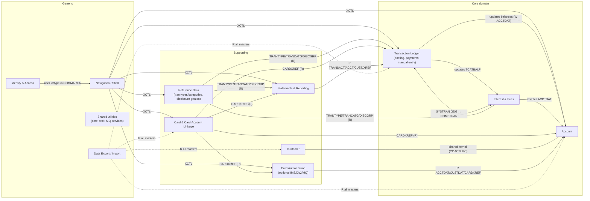

# CardDemo Domain Decomposition — Bounded Contexts & Extraction Seams

> Identifies the bounded contexts hidden inside the CardDemo COBOL estate and analyses, for each one, **where it can be cut out** (the seam), what it owns, what it shares, and how hard extraction will be. Derived from the static analysis in [APPLICATION_INVENTORY.md](APPLICATION_INVENTORY.md), [DATA_DICTIONARY.md](DATA_DICTIONARY.md), [DEPENDENCY_MAP.md](DEPENDENCY_MAP.md) and [HOTSPOT_REPORT.md](HOTSPOT_REPORT.md). Used by [MODERNIZATION_BLUEPRINT.md](MODERNIZATION_BLUEPRINT.md), [CUTOVER_PLAN.md](CUTOVER_PLAN.md) and [RISK_REGISTER.md](RISK_REGISTER.md).

## 1. Method

1. **Data ownership first** — each VSAM file / Db2 table / IMS database is assigned to the context whose business rules *create or change* it (writers), not to those that only read it.
2. **Programs follow data** — each program is assigned to the context that owns most of what it writes; read-only programs go to the context whose question they answer.
3. **Seams are the existing technical boundaries** where a call or data flow can be intercepted without editing the caller: MQ queues, CICS transaction IDs / `XCTL` targets, JCL step boundaries, and dataset hand-offs (GDGs, sequential extracts).
4. **Coupling score** for each seam = number of foreign programs that read (R) or write (W) the context's data, plus shared copybooks and COMMAREA fields.

## 2. Context map

Legend: arrows point from the **consumer** to the **provider** of data/behaviour, labelled with the coupling mechanism.

## 3. Bounded contexts

### 3.1 Summary

| # | Context | Type | Owned data (system of record) | Programs | Entry points | Seam quality |
|---|---|---|---|---|---|---|
| BC1 | Identity & Access | Generic | `USRSEC` | `COSGN00C`, `COUSR00C`–`COUSR03C` | CC00, CU00–CU03 | **Clean** — only these 5 programs touch `USRSEC` |
| BC2 | Navigation / Shell | Generic | none (menu tables `COMEN02Y`, `COADM02Y`) | `COMEN01C`, `COADM01C` | CM00, CA00 | **Clean** — pure routing |
| BC3 | Reference Data | Supporting | Db2 `TRANSACTION_TYPE`, `TRANSACTION_TYPE_CATEGORY`; VSAM `TRANTYPE`, `TRANCATG`, `DISCGRP` | `COTRTLIC`, `COTRTUPC`, `COBTUPDT` | CTLI, CTTU, `MNTTRDB2`, `TRANEXTR` | **Clean** — writers isolated; many readers |
| BC4 | Card & Card-Account Linkage | Supporting | `CARDDAT` (+`CARDAIX`), `CARDXREF` (+`CXACAIX`) | `COCRDLIC`, `COCRDSLC`, `COCRDUPC`, `CBACT02C`, `CBACT03C` | CCLI, CCDL, CCUP | **Good** for card; `CARDXREF` is read by 10 foreign programs |
| BC5 | Customer | Supporting | `CUSTDAT` | `CBCUS01C` (print); maintenance embedded in `COACTUPC` | — (no own screen) | **Entangled** — no dedicated program; updated inside Account update |
| BC6 | Account | Core | `ACCTDAT` | `COACTVWC`, `COACTUPC`, `CBACT01C`, `COACCT01` | CAVW, CAUP, CDRA (MQ) | **Poor** — 4 writers across 3 contexts (`COACTUPC`, `COBIL00C`, `CBTRN02C`, `CBACT04C`) |
| BC7 | Transaction Ledger | Core | `TRANSACT`, `DALYTRAN`, `DALYREJS`, `TCATBALF` | `CBTRN02C`, `COTRN00C`, `COTRN01C`, `COTRN02C`, `COBIL00C`, `CBTRN01C` (unused) | CT00–CT02, CB00, `POSTTRAN`, `COMBTRAN`, `TRANBKP` | **Moderate** — batch seam is clean (JCL step), online writers need key-generation change |
| BC8 | Interest & Fees | Core | `SYSTRAN` GDG (output only); reads `TCATBALF`, `DISCGRP` | `CBACT04C` | `INTCALC` | **Good** — single batch step with file inputs/outputs; only shared write is `ACCTDAT` rewrite |
| BC9 | Statements & Reporting | Supporting | outputs only: `STATEMNT.PS/HTML`, `TRANREPT`, `TRXFL` work files | `CBSTM03A`, `CBSTM03B`, `CBTRN03C`, `CORPT00C` | CR00, `CREASTMT`, `TRANREPT` | **Clean** — read-only consumers; ideal read-model |
| BC10 | Card Authorization (optional) | Supporting | IMS `PAUTDB` (`PAUTSUM0`/`PAUTDTL1`), Db2 `AUTHFRDS` | `COPAUA0C`, `COPAUS0C`, `COPAUS1C`, `COPAUS2C`, `CBPAUP0C`, `PAUDBLOD`, `PAUDBUNL`, `DBUNLDGS` | CP00 (MQ trigger), CPVS, CPVD, `CBPAUP0J` | **Very clean at the edge** (MQ request/reply), reads 3 core files |
| BC11 | Shared utilities & MQ services | Generic | none | `CSUTLDTC`, `CODATE01`, `COBSWAIT`, asm `COBDATFT`, `MVSWAIT` | CDRD (MQ) | **Clean** |
| BC12 | Data Export / Import | Generic (migration tooling) | `EXPORT.DATA`, `*.IMPORT` | `CBEXPORT`, `CBIMPORT` | `CBEXPORT`, `CBIMPORT` jobs | **Clean**; reusable for cut-over |

### 3.2 Data ownership & foreign access matrix

R = read, W = write/insert, U = rewrite/update, D = delete. **Bold** = owner.

| Data store | Owner | Foreign readers | Foreign writers |
|---|---|---|---|
| `USRSEC` | **BC1** | — | — |
| `CARDDAT` / `CARDAIX` | **BC4** | `COPAUA0C` (declared), BC12 `CBEXPORT` | — (loaded by `CARDFILE` job) |
| `CARDXREF` / `CXACAIX` | **BC4** | `COACTVWC`, `COACTUPC`, `COBIL00C`, `COTRN02C`, `CBTRN02C`, `CBACT04C`, `CBTRN03C`, `CBSTM03A`, `COPAUA0C`, `COPAUS0C` | — (loaded by `XREFFILE` job) |
| `CUSTDAT` | **BC5** | `COACTVWC`, `COPAUA0C`, `COPAUS0C`, `CBSTM03A`, `CBEXPORT` | **`COACTUPC` (U)** |
| `ACCTDAT` | **BC6** | `COPAUA0C`, `COPAUS0C`, `CBSTM03A`, `CBEXPORT`, `COACCT01` | **`COBIL00C` (U)**, **`CBTRN02C` (U)**, **`CBACT04C` (U)** |
| `TRANSACT` | **BC7** | `CBSTM03A` (via `TRXFL` sort), `CBTRN03C` (via `TRANSACT.DALY`), `CBEXPORT` | `COMBTRAN` (IDCAMS reload incl. BC8 `SYSTRAN`) |
| `TCATBALF` | **BC7** | `CBACT04C` | — |
| `DISCGRP`, `TRANTYPE`, `TRANCATG` | **BC3** | `CBACT04C`, `CBTRN03C` | — |
| Db2 `TRANSACTION_TYPE*` | **BC3** | `TRANEXTR` job | — |
| IMS `PAUTDB` | **BC10** | — | — |
| Db2 `AUTHFRDS` | **BC10** | — | — |

**Key insight**: `ACCTDAT` is the gravitational centre — it is changed by four programs belonging to three contexts. Every extraction plan must decide early **who owns the account balance**. The recommended answer is: the **Transaction Ledger owns monetary movements** and Account exposes balance-changing commands (`postDebit`, `postCredit`, `applyPayment`, `applyInterest`) instead of letting other contexts rewrite the record.

### 3.3 Shared kernel and coupling artefacts

| Artefact | Shared by | Coupling impact | Recommendation |
|---|---|---|---|
| `COCOM01Y` (`CARDDEMO-COMMAREA`, 160 bytes) | all 17 core online programs + BC10 screens | Every screen depends on its layout; carries user id/type, customer, account, card, last map | Replace with a session/context token (user id, role, selected account/card IDs) in the new UI; keep a COMMAREA⇄JSON adapter during coexistence |
| `CVACT01Y`, `CVACT03Y`, `CVCUS01Y`, `CVACT02Y`, `CVTRA05Y` record layouts | readers listed in 3.2 | Field-position coupling to physical VSAM records | Publish as versioned API/DTO contracts; foreign readers move to APIs or CDC-fed replicas |
| `CSUTLDTY`/`CSUTLDTC`, `CSDAT01Y`, `CSMSG01Y`, `COTTL01Y` | most online programs | Low business coupling | Replace with standard libraries |
| `CSLKPCDY` (phone area-code / state lookups) | `COACTUPC` | Validation reference data embedded in code | Move into BC3 Reference Data |
| `CLOSEFIL` / `OPENFIL` CEMT jobs | all batch updaters of online files | Batch and online cannot run concurrently | Remove need via transactional DB in target |

## 4. Extraction seam analysis

For each context: **seam location**, **interception technique**, **what must be untangled**, and **difficulty** (1 = trivial, 5 = very hard).

### BC1 Identity & Access — difficulty 1
- **Seam**: CICS transaction CC00 (sign-on) and the `CDEMO-USER-ID`/`CDEMO-USER-TYPE` fields in the COMMAREA. Downstream programs only check `CDEMO-USRTYP-ADMIN`/`USER`.
- **Technique**: front the CICS region (or the new UI) with enterprise IAM/OIDC; map IdP roles to `A`/`U` and inject them into the COMMAREA for legacy screens during coexistence. `USRSEC` becomes read-only, then retired.
- **Untangle**: clear-text passwords in `SEC-USR-PWD` → no migration of passwords; force enrolment/reset.

### BC2 Navigation — difficulty 1
- **Seam**: menu tables `COMEN02Y`/`COADM02Y` list target programs; `XCTL PROGRAM(CDEMO-TO-PROGRAM)` returns.
- **Technique**: the new web shell becomes the menu; each option links either to a modern page or to a legacy 3270 transaction (via terminal emulation / screen-scraping bridge) until migrated. This **is the strangler façade** for the online estate.

### BC3 Reference Data — difficulty 2
- **Seam**: Db2 tables (optional module) and the weekly `TRANEXTR` extract that refreshes VSAM `TRANTYPE`/`TRANCATG`; `DISCGRP` loaded by `DISCGRP` job.
- **Technique**: new reference-data service owns a relational schema; generate the legacy VSAM extracts from it (replacing `TRANEXTR`) so COBOL batch keeps working unchanged.
- **Untangle**: dual storage (Db2 + VSAM) — collapse to one source in target; move `CSLKPCDY` lookups here.

### BC4 Card & Card-Account Linkage — difficulty 2–3
- **Seam**: CCLI/CCDL/CCUP transactions; `CARDDAT` and `CARDXREF` VSAM files.
- **Technique**: migrate screens to a Card service; keep VSAM in sync via **reverse replication** (target DB → VSAM) while legacy readers of `CARDXREF` remain.
- **Untangle**: `CARDXREF` is the join hub (card ↔ account ↔ customer) for 10 foreign programs; model it as an explicit `CardAccountLink` aggregate with a read API. Card number is `PIC X(16)` in records but `PIC 9(16)` in the COMMAREA — normalize.

### BC5 Customer — difficulty 3
- **Seam**: none today — customer maintenance is fields 20–40 of the `COACTUPC` screen.
- **Technique**: split during Account-update modernization: the new UI calls `CustomerService.update` and `AccountService.update` separately, or a single orchestration with a saga if they become separate stores.
- **Untangle**: PII (SSN, DOB, government ID, FICO) — apply field-level encryption/masking in target; `CUST-ID` appears as `9(09)` DISPLAY and COMP-3 in different layouts.

### BC6 Account — difficulty 4
- **Seam**: CAVW/CAUP transactions, MQ `CDRA` (`COACCT01`), `ACCTDAT` file.
- **Technique**: read side first (`COACTVWC` → API backed by replicated data), then write side once balance ownership is moved to the Ledger (see 3.2).
- **Untangle**: four writers; `COACTUPC` complexity (cyclomatic ≈ 449) with two-file update relying on `SYNCPOINT ROLLBACK`; batch rewrites from `CBTRN02C`/`CBACT04C` require `CLOSEFIL`/`OPENFIL`.

### BC7 Transaction Ledger — difficulty 5
- **Seams**:
  - Batch: `POSTTRAN` JCL step — inputs `DALYTRAN.PS`, `CARDXREF`; outputs `TRANSACT`, `DALYREJS(+1)`, updated `ACCTDAT`, `TCATBALF`. A JCL step is an excellent seam: a Java job can replace `STEP15` and consume/produce **identical datasets**.
  - Online: CT00–CT02, CB00 transactions.
  - Merge: `COMBTRAN` (sort `TRANSACT.BKUP(0)` + `SYSTRAN(0)` → reload).
- **Technique**: **parallel run** — run the Java posting job on copies of the same inputs and diff outputs record by record before switching the JCL step.
- **Untangle**: no checkpoint/restart; TRAN-ID generation by browse-to-end in `COBIL00C`/`COTRN02C`; duplicated validation rules in `CBTRN01C`/`CBTRN02C`/`COTRN02C`/`COPAUA0C`; `TRAN-AMT` is `S9(09)V99` DISPLAY here but `S9(09)V99 COMP-3` / `DECIMAL(12,2)` in authorization layouts.

### BC8 Interest & Fees — difficulty 3
- **Seam**: `INTCALC` job step — reads `TCATBALF`, `CARDXREF`(+AIX), `DISCGRP`; writes `SYSTRAN(+1)` and rewrites `ACCTDAT`.
- **Technique**: replace the step with a Java job producing the same `SYSTRAN` GDG (the existing `COMBTRAN` merge keeps working). Rounding/truncation equivalence verified by golden files.
- **Untangle**: `1400-COMPUTE-FEES` is a stub — product decision needed; `DEFAULT` disclosure-group fallback logic.

### BC9 Statements & Reporting — difficulty 2
- **Seam**: `CREASTMT` (sort `TRANSACT` → `TRXFL`, then `CBSTM03A`) and `TRANREPT` (date-filtered `TRANSACT.DALY` → `CBTRN03C`); `CORPT00C` submits report JCL by writing to TDQ `JOBS` (internal reader).
- **Technique**: build a read model (CDC or nightly export) and regenerate reports/statements with a templating/reporting engine; compare outputs against legacy files. `CORPT00C` is replaced by an API that triggers the new report job.
- **Untangle**: `CBSTM03A` uses `ALTER`/`GO TO` — rewrite, do not translate.

### BC10 Card Authorization — difficulty 3 (edge) / 4 (data)
- **Seam**: MQ request queue (triggered transaction CP00) and reply queue named in the request (`MQMD-REPLYTOQ`); request/response formats `CCPAURQY`/`CCPAURLY` (CSV payload). This is the **cleanest seam in the estate**: re-point the queue (or put a router in front) and the caller never knows.
- **Technique**: implement an Authorization service consuming the same MQ messages; shadow-mode first (consume a copy, compare decisions), then switch. Migrate IMS `PAUTDB` → relational with `PAUDBUNL` unloads; `AUTHFRDS` Db2 table moves as-is.
- **Untangle**: reads `ACCTDAT`/`CUSTDAT`/`CARDXREF` directly — needs a low-latency read API or replica of BC4/BC6 data; IMS hierarchical summary/detail model → parent/child tables.

### BC11 Shared utilities & MQ services — difficulty 1
- `CODATE01`/`COACCT01` already behave as MQ services; reimplement behind the same queues. `CSUTLDTC` (wraps LE `CEEDAYS`) and assembler `COBDATFT`/`MVSWAIT` become `java.time` / scheduler waits.

### BC12 Data Export / Import — difficulty 1
- `CBEXPORT` produces a single multi-record file (`CVEXPORT`, record-type `REDEFINES`) covering customer, account, xref, transaction and card — **reuse it as the initial-load extract** for the target databases and for reconciliation.

## 5. Extraction order implied by the seams

| Order | Context | Why this position |
|---|---|---|
| 1 | BC1 Identity, BC2 Navigation | Establish the strangler façade and new auth before anything else |
| 2 | BC3 Reference Data, BC11 Utilities, BC12 Export/Import | Low coupling; provides data contracts and load tooling |
| 3 | BC9 Statements & Reporting | Read-only — proves the replicated read model |
| 4 | BC4 Card (read, then write) | Moderate coupling; template for screen migration |
| 5 | BC10 Authorization | Clean MQ seam; can proceed in parallel once read APIs for card/account exist |
| 6 | BC6 Account + BC5 Customer | Requires balance-ownership decision and COACTUPC rule extraction |
| 7 | BC7 Ledger + BC8 Interest | Highest risk; requires parallel runs and reconciliation |

Detailed phasing, entry/exit criteria and rollback are in [CUTOVER_PLAN.md](CUTOVER_PLAN.md).
