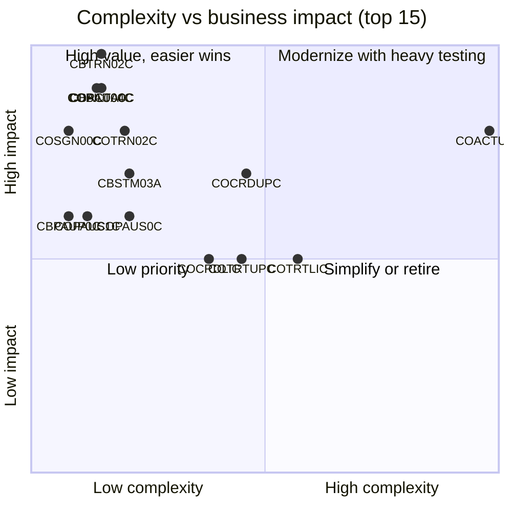

# CardDemo Hotspot Report — Top 10 Modernization Hotspots

> Ranks every COBOL program by **complexity**, **technical risk** and **business impact** to decide where modernization effort, testing and SME time should be concentrated. Metrics are measured from source; risk and impact weightings are analyst judgements documented below so they can be re-tuned.

See also: [APPLICATION_INVENTORY.md](APPLICATION_INVENTORY.md) · [DATA_DICTIONARY.md](DATA_DICTIONARY.md) · [DEPENDENCY_MAP.md](DEPENDENCY_MAP.md)

## 1. Scoring model

| Dimension | Weight | How it is computed (0–10) |
|---|---:|---|
| Complexity (measured) | 35% | 45% cyclomatic estimate + 25% executable lines + 20% `GO TO` count + 10% max IF/EVALUATE nesting, each normalized to the maximum across the 44 programs |
| Technical risk (measured + rules) | 30% | Integration tech (CICS 0.5, Db2 1.5, IMS 2, MQ 2, ASM 1) + master data stores written (1 each, max 3) + copybook coupling (≤1.5) + >10 `REDEFINES` (+1) + `ALTER` (+1.5) + >20 `GO TO` (+1) + fan-in (≤1); capped at 10 |
| Business impact (judgement) | 35% | 10 = moves money / ledger of record; 8–9 = authorizes spend, changes balances or master data, security gate; 5–7 = customer-facing output or inquiry/admin; 1–3 = utilities, demos, unused |

Overall score = 0.35·Complexity + 0.30·Risk + 0.35·Impact.

## 2. Top 10 at a glance

| Rank | Module | Domain | Tech | Exec lines | Cyclo. | GO TO | Complexity | Risk | Impact | **Score** |
|---:|---|---|---|---:|---:|---:|---:|---:|---:|---:|
| 1 | `COACTUPC` | Account | CICS+VSAM | 3,368 | 449 | 51 | 9.8 | 6.2 | 8 | **8.1** |
| 2 | `COTRTLIC` | Reference data | CICS+Db2 | 1,597 | 245 | 28 | 5.7 | 6.5 | 5 | **5.7** |
| 3 | `COPAUA0C` | Authorization | CICS+VSAM+IMS+MQ | 771 | 45 | 0 | 1.5 | 6.8 | 9 | **5.7** |
| 4 | `COCRDUPC` | Card | CICS+VSAM | 1,194 | 187 | 21 | 4.6 | 4.2 | 7 | **5.3** |
| 5 | `CBTRN02C` | Transaction | VSAM+QSAM | 619 | 52 | 0 | 1.5 | 3.5 | 10 | **5.1** |
| 6 | `COTRTUPC` | Reference data | CICS+Db2 | 1,241 | 220 | 23 | 4.5 | 5.6 | 5 | **5.0** |
| 7 | `COBIL00C` | Billing | CICS+VSAM | 420 | 40 | 0 | 1.4 | 3.6 | 9 | **4.7** |
| 8 | `COTRN02C` | Transaction | CICS+VSAM | 614 | 83 | 0 | 2.0 | 2.6 | 8 | **4.3** |
| 9 | `CBACT04C` | Interest | VSAM+QSAM | 552 | 47 | 0 | 1.5 | 1.5 | 9 | **4.2** |
| 10 | `COPAUS0C` | Authorization | CICS+VSAM+IMS | 792 | 80 | 0 | 2.1 | 4.0 | 6 | **4.0** |

## 3. Hotspot details

### 1. `COACTUPC` — Account update: edits/validates ~40 account and customer fields and rewrites ACCTDAT and CUSTDAT

- **Location**: `app/cbl/COACTUPC.cbl` · Online screen · transaction CAUP · JCL —
- **Measured**: 3,368 executable lines (4,236 total), cyclomatic ≈ 449, 85 paragraphs, 165 IF / 10 EVALUATE / 127 WHEN, 51 GO TO, nesting 5, 43 REDEFINES, 4 COMP-3 fields, 18 copybooks, explicit SYNCPOINT
- **Data written**: ACCTDAT (ACCTDATA.VSAM.KSDS), CUSTDAT (CUSTDATA.VSAM.KSDS)
- **Business impact (8/10)**: Maintains account limits/status and customer PII
- **Why it is a hotspot**: Largest and most complex program (≈4.2k lines). ~40 editable fields with hand-written field-level validation (phone area codes via `CSLKPCDY`, US state/ZIP, SSN parts, FICO, dates), 51 `GO TO`s, 43 `REDEFINES`, and a READ-for-UPDATE + REWRITE of **two** files (ACCTDAT and CUSTDAT) in one CICS unit of work, relying on `SYNCPOINT ROLLBACK` if the customer rewrite fails. Change-detection compares old/new images field by field.
- **Recommendation**: Extract validation rules into a tested rule set first (characterization tests per field); model update as a single transactional service over Account+Customer; keep the two-file update atomic and preserve the optimistic-concurrency check ("record changed by someone else").

### 2. `COTRTLIC` — Transaction type list with inline update/delete (Db2 cursor paging, 7 rows per page)

- **Location**: `app/app-transaction-type-db2/cbl/COTRTLIC.cbl` · Online screen · transaction CTLI · JCL —
- **Measured**: 1,597 executable lines (2,098 total), cyclomatic ≈ 245, 56 paragraphs, 87 IF / 16 EVALUATE / 63 WHEN, 28 GO TO, nesting 6, 12 REDEFINES, 8 COMP-3 fields, 14 copybooks, explicit SYNCPOINT
- **Data written**: Db2 CARDDEMO.TRANSACTION_TYPE
- **Business impact (5/10)**: Maintains transaction-type reference data feeding posting/reporting
- **Why it is a hotspot**: Second-largest program. Db2 cursor paging (forward/backward with re-positioning), inline update/delete of selected rows, 28 `GO TO`s and heavy screen-state handling in COMMAREA. Optional-module code with its own Db2 error framework (`CSDB2RPY/RWY`).
- **Recommendation**: Good early pilot: self-contained Db2 CRUD with simple data — replace with a REST/UI list + JPA repository; reuse as template for other list screens.

### 3. `COPAUA0C` — MQ-triggered card authorization engine: reads request, checks XREF/ACCT/CUST and IMS summary, approves/declines (reason 3100/4100/4200/4300...), inserts IMS detail and replies via MQ

- **Location**: `app/app-authorization-ims-db2-mq/cbl/COPAUA0C.cbl` · Online service (MQ-triggered) · transaction CP00 · JCL —
- **Measured**: 771 executable lines (1,026 total), cyclomatic ≈ 45, 43 paragraphs, 26 IF / 5 EVALUATE / 21 WHEN, 0 GO TO, nesting 3, 2 REDEFINES, 3 COMP-3 fields, 14 copybooks, explicit SYNCPOINT
- **Data written**: IMS PAUTDB (PAUTSUM0/PAUTDTL1)
- **Business impact (9/10)**: Real-time authorization decision (approve/decline) for card spend
- **Why it is a hotspot**: Only real-time, externally-facing component: MQ-triggered, parses CSV request into `CCPAURQY`, reads XREF/ACCT/CUST VSAM, reads/updates IMS summary, inserts IMS detail, then MQPUT1 reply. Mixes four resource managers (CICS, VSAM, IMS, MQ) in one unit of work with explicit `SYNCPOINT`; decline reasons (3100 not found, 4100 insufficient funds, 4200 card inactive, 4300 account closed, fraud) are embedded in code.
- **Recommendation**: Treat as a separate bounded context (authorization service) with a latency SLA; define the decision rules as data/tests; plan IMS→relational migration of PAUTDB together with this program.

### 4. `COCRDUPC` — Credit card update: edits embossed name, status, expiry and rewrites CARDDAT

- **Location**: `app/cbl/COCRDUPC.cbl` · Online screen · transaction CCUP · JCL —
- **Measured**: 1,194 executable lines (1,560 total), cyclomatic ≈ 187, 45 paragraphs, 75 IF / 8 EVALUATE / 59 WHEN, 21 GO TO, nesting 6, 8 REDEFINES, 0 COMP-3 fields, 13 copybooks, explicit SYNCPOINT
- **Data written**: CARDDAT (CARDDATA.VSAM.KSDS)
- **Business impact (7/10)**: Card status/expiry maintenance (controls card usability)
- **Why it is a hotspot**: Card update with complex screen state machine (`CCARD-*` flags), field edits on embossed name, status and expiry month/year, READ UPDATE + REWRITE with before/after image comparison.
- **Recommendation**: Characterize edits and concurrency check; migrate after shared CardDemo UI/COMMAREA framework is in place.

### 5. `CBTRN02C` — Daily transaction posting: validates card/account/limit/expiry, writes TRANSACT, updates TCATBAL and account cycle balances, rejects to DALYREJS

- **Location**: `app/cbl/CBTRN02C.cbl` · Batch · transaction — · JCL POSTTRAN
- **Measured**: 619 executable lines (731 total), cyclomatic ≈ 52, 26 paragraphs, 48 IF / 0 EVALUATE / 0 WHEN, 0 GO TO, nesting 3, 2 REDEFINES, 0 COMP-3 fields, 5 copybooks
- **Data written**: TRANSACT.VSAM.KSDS, ACCTDATA.VSAM.KSDS, TCATBALF.VSAM.KSDS
- **Business impact (10/10)**: Posts every daily transaction and updates account balances and category balances — core ledger
- **Why it is a hotspot**: Heart of the batch ledger: validates each daily transaction (reason codes 100 invalid card, 101 account not found, 102 over limit, 103 after account expiry), writes TRANSACT, updates TCATBALF (create-or-update) and account cycle credit/debit + balance. No commit/restart logic — a mid-run abend leaves TRANSACT/ACCTDAT/TCATBALF partially updated; recovery relies on TRANBKP backups.
- **Recommendation**: Re-implement as idempotent, restartable chunked job (e.g. Spring Batch) with reconciliation counts; run parallel against production extracts and compare TRANSACT/ACCT/TCATBAL outputs byte-for-byte before cut-over.

### 6. `COTRTUPC` — Transaction type add/update/delete (Db2)

- **Location**: `app/app-transaction-type-db2/cbl/COTRTUPC.cbl` · Online screen · transaction CTTU · JCL —
- **Measured**: 1,241 executable lines (1,702 total), cyclomatic ≈ 220, 63 paragraphs, 49 IF / 13 EVALUATE / 104 WHEN, 23 GO TO, nesting 3, 2 REDEFINES, 1 COMP-3 fields, 15 copybooks, explicit SYNCPOINT
- **Data written**: Db2 CARDDEMO.TRANSACTION_TYPE
- **Business impact (5/10)**: Maintains transaction-type reference data
- **Why it is a hotspot**: Db2 add/update/delete for transaction types with a multi-state screen flow (confirm/edit/delete), 23 `GO TO`s; changes propagate to VSAM only via the weekly `TRANEXTR` → `TRANTYPE` refresh, so the two stores can diverge.
- **Recommendation**: Migrate together with COTRTLIC; eliminate dual storage (Db2 + VSAM copy) in the target design.

### 7. `COBIL00C` — Bill payment: pays full account balance, writes a payment transaction and rewrites ACCTDAT

- **Location**: `app/cbl/COBIL00C.cbl` · Online screen · transaction CB00 · JCL —
- **Measured**: 420 executable lines (572 total), cyclomatic ≈ 40, 16 paragraphs, 10 IF / 9 EVALUATE / 32 WHEN, 0 GO TO, nesting 4, 0 REDEFINES, 1 COMP-3 fields, 10 copybooks
- **Data written**: ACCTDAT (ACCTDATA.VSAM.KSDS), TRANSACT (TRANSACT.VSAM.KSDS)
- **Business impact (9/10)**: Customer bill payment — debits balance and writes payment transaction
- **Why it is a hotspot**: Pays the full current balance: reads ACCTDAT (UPDATE) via CXACAIX, generates next TRAN-ID by browsing TRANSACT to the end (STARTBR/READPREV) — a serialization hotspot — writes the payment transaction and rewrites the account.
- **Recommendation**: Replace key generation with a sequence; wrap write+rewrite in one transaction; add idempotency for double submits.

### 8. `COTRN02C` — Add transaction: validates account/card, amount, dates (via CSUTLDTC) and writes TRANSACT

- **Location**: `app/cbl/COTRN02C.cbl` · Online screen · transaction CT02 · JCL —
- **Measured**: 614 executable lines (783 total), cyclomatic ≈ 83, 18 paragraphs, 14 IF / 13 EVALUATE / 63 WHEN, 0 GO TO, nesting 4, 0 REDEFINES, 0 COMP-3 fields, 10 copybooks
- **Data written**: TRANSACT (TRANSACT.VSAM.KSDS)
- **Business impact (8/10)**: Manual transaction entry directly into the ledger file
- **Why it is a hotspot**: Manual transaction entry: validates account/card via XREF/AIX, amounts and dates (`CSUTLDTC`/CEEDAYS), generates TRAN-ID by browsing to the last key, writes TRANSACT. Bypasses the batch posting edits of CBTRN02C (no balance update).
- **Recommendation**: Align validation with CBTRN02C rules in a shared domain service; replace browse-for-max key generation.

### 9. `CBACT04C` — Interest calculator: for each category balance applies disclosure-group rate ((bal*rate)/1200), writes interest transactions and updates account balances

- **Location**: `app/cbl/CBACT04C.cbl` · Batch · transaction — · JCL INTCALC
- **Measured**: 552 executable lines (652 total), cyclomatic ≈ 47, 22 paragraphs, 43 IF / 0 EVALUATE / 0 WHEN, 0 GO TO, nesting 4, 2 REDEFINES, 0 COMP-3 fields, 5 copybooks
- **Data written**: ACCTDATA.VSAM.KSDS
- **Business impact (9/10)**: Calculates and posts monthly interest/fees to every account
- **Why it is a hotspot**: Monthly interest: control-break over TCATBALF by account, looks up disclosure-group rate (falls back to `DEFAULT` group), computes `(balance × rate) / 1200`, writes interest transactions to SYSTRAN and rewrites ACCTDAT. `1400-COMPUTE-FEES` is a stub. Financial-calculation rounding is implicit COBOL truncation.
- **Recommendation**: Lock down rounding/truncation semantics with golden-file tests; implement fees explicitly or document as out of scope.

### 10. `COPAUS0C` — Pending authorization summary screen for an account (IMS PAUTSUM0 + child browse)

- **Location**: `app/app-authorization-ims-db2-mq/cbl/COPAUS0C.cbl` · Online screen · transaction CPVS · JCL —
- **Measured**: 792 executable lines (1,032 total), cyclomatic ≈ 80, 20 paragraphs, 25 IF / 11 EVALUATE / 46 WHEN, 0 GO TO, nesting 4, 2 REDEFINES, 0 COMP-3 fields, 14 copybooks, explicit SYNCPOINT
- **Data written**: none (read-only)
- **Business impact (6/10)**: Operations view of pending authorizations
- **Why it is a hotspot**: IMS summary/detail browsing from CICS combined with VSAM lookups; paging over IMS child segments.
- **Recommendation**: Migrate with PAUTDB data migration.

## 4. Full ranking (all programs)

| Rank | Program | Domain | Complexity | Risk | Impact | Score |
|---:|---|---|---:|---:|---:|---:|
| 1 | `COACTUPC` | Account | 9.8 | 6.2 | 8 | 8.1 |
| 2 | `COTRTLIC` | Reference data | 5.7 | 6.5 | 5 | 5.7 |
| 3 | `COPAUA0C` | Authorization | 1.5 | 6.8 | 9 | 5.7 |
| 4 | `COCRDUPC` | Card | 4.6 | 4.2 | 7 | 5.3 |
| 5 | `CBTRN02C` | Transaction | 1.5 | 3.5 | 10 | 5.1 |
| 6 | `COTRTUPC` | Reference data | 4.5 | 5.6 | 5 | 5.0 |
| 7 | `COBIL00C` | Billing | 1.4 | 3.6 | 9 | 4.7 |
| 8 | `COTRN02C` | Transaction | 2.0 | 2.6 | 8 | 4.3 |
| 9 | `CBACT04C` | Interest | 1.5 | 1.5 | 9 | 4.2 |
| 10 | `COPAUS0C` | Authorization | 2.1 | 4.0 | 6 | 4.0 |
| 11 | `COPAUS1C` | Authorization | 1.2 | 4.6 | 6 | 3.9 |
| 12 | `CBSTM03A` | Statement | 2.1 | 2.0 | 7 | 3.8 |
| 13 | `COCRDLIC` | Card | 3.8 | 2.2 | 5 | 3.7 |
| 14 | `COSGN00C` | Security | 0.8 | 2.2 | 8 | 3.7 |
| 15 | `CBPAUP0C` | Authorization | 0.8 | 3.3 | 6 | 3.4 |
| 16 | `COUSR02C` | Security | 1.3 | 2.5 | 6 | 3.3 |
| 17 | `COACTVWC` | Account | 1.7 | 2.0 | 6 | 3.3 |
| 18 | `COPAUS2C` | Authorization | 0.5 | 3.3 | 6 | 3.3 |
| 19 | `COCRDSLC` | Card | 2.3 | 2.3 | 5 | 3.3 |
| 20 | `COUSR03C` | Security | 1.1 | 2.5 | 6 | 3.2 |
| 21 | `COUSR01C` | Security | 0.9 | 2.4 | 6 | 3.1 |
| 22 | `COTRN00C` | Transaction | 2.1 | 1.5 | 5 | 3.0 |
| 23 | `COUSR00C` | Security | 2.1 | 1.4 | 5 | 2.9 |
| 24 | `CBTRN03C` | Reporting | 1.5 | 0.5 | 6 | 2.8 |
| 25 | `COACCT01` | Account | 0.9 | 3.4 | 4 | 2.7 |
| 26 | `COBTUPDT` | Reference data | 0.5 | 2.7 | 5 | 2.7 |
| 27 | `CORPT00C` | Reporting | 1.5 | 1.4 | 5 | 2.7 |
| 28 | `COTRN01C` | Transaction | 1.0 | 1.5 | 5 | 2.6 |
| 29 | `COMEN01C` | Navigation | 1.0 | 2.2 | 4 | 2.4 |
| 30 | `COADM01C` | Navigation | 0.9 | 2.2 | 4 | 2.4 |
| 31 | `PAUDBLOD` | Authorization | 0.8 | 3.5 | 3 | 2.4 |
| 32 | `DBUNLDGS` | Authorization | 0.6 | 3.6 | 3 | 2.4 |
| 33 | `CBEXPORT` | Data migration | 0.7 | 0.6 | 5 | 2.2 |
| 34 | `CBSTM03B` | Statement | 1.1 | 0.1 | 5 | 2.2 |
| 35 | `CBIMPORT` | Data migration | 0.6 | 0.6 | 5 | 2.2 |
| 36 | `PAUDBUNL` | Authorization | 0.7 | 2.5 | 3 | 2.0 |
| 37 | `CODATE01` | Utility | 0.8 | 3.3 | 2 | 2.0 |
| 38 | `CSUTLDTC` | Utility | 0.4 | 0.2 | 4 | 1.6 |
| 39 | `CBACT01C` | Account | 0.9 | 1.3 | 2 | 1.4 |
| 40 | `CBTRN01C` | Transaction | 1.2 | 0.5 | 2 | 1.3 |
| 41 | `COBSWAIT` | Utility | 0.0 | 1.1 | 1 | 0.7 |
| 42 | `CBACT03C` | Card | 0.6 | 0.2 | 1 | 0.6 |
| 43 | `CBCUS01C` | Customer | 0.6 | 0.2 | 1 | 0.6 |
| 44 | `CBACT02C` | Card | 0.6 | 0.2 | 1 | 0.6 |

## 5. Cross-cutting risks

- **Shared master files without transactional boundaries in batch**: ACCTDAT is updated by `CBTRN02C`, `CBACT04C`, `COACTUPC`, `COBIL00C`; TRANSACT is written by `CBTRN02C`, `COBIL00C`, `COTRN02C` and rebuilt by `COMBTRAN`. Batch has no checkpoint/restart; online and batch are separated only by `CLOSEFIL`/`OPENFIL`.
- **Key generation by browse-to-end** (`COBIL00C`, `COTRN02C`) — race conditions once moved off single-region CICS.
- **Duplicated validation logic**: transaction validity rules exist in `CBTRN01C`, `CBTRN02C`, `COTRN02C` and `COPAUA0C` with differences; consolidate into one domain service.
- **Dual reference-data stores**: transaction types live in Db2 (optional module) and VSAM (`TRANTYPE`/`TRANCATG`) synchronized weekly by `TRANEXTR`.
- **Security**: clear-text passwords in `USRSEC`; PII (SSN, DOB, government ID) in `CUSTDAT` and the export file.
- **Legacy constructs**: `ALTER` (`CBSTM03A`), 200+ `GO TO`s across the online programs, assembler dependencies (`COBDATFT`, `MVSWAIT`), EBCDIC packed-decimal data files.
- **Shared COMMAREA (`COCOM01Y`)** couples all 17 core online programs; changes ripple across every screen.

## 6. Suggested modernization sequence

1. **Foundation**: data model from [DATA_DICTIONARY.md](DATA_DICTIONARY.md), EBCDIC/packed-decimal converters, golden test data from `app/data`, IAM replacement for `COSGN00C`/`COUSR0xC`.
2. **Pilot (low risk, high learning)**: `COTRTLIC`/`COTRTUPC`/`COBTUPDT` (self-contained Db2 CRUD) and read-only inquiries (`COACTVWC`, `COCRDSLC`, `COTRN01C`).
3. **Core maintenance screens**: `COCRDLIC`/`COCRDUPC`, then `COACTUPC` (largest validation surface) behind characterization tests.
4. **Ledger batch**: `CBTRN02C` → `CBACT04C` → `COMBTRAN` flow, with parallel runs and reconciliation; then `COBIL00C`/`COTRN02C` on the same domain service.
5. **Outputs**: `CBSTM03A/B`, `CBTRN03C` re-implemented on reporting/templating tools.
6. **Authorization context**: `COPAUA0C`, `COPAUS0C-2C`, `CBPAUP0C` with IMS PAUTDB → relational migration and MQ contract tests.
7. **Retire**: `CBTRN01C` (unreferenced), print/demo utilities (`CBACT01C-03C`, `CBCUS01C`), `COBSWAIT`, `UNUSED1Y`.
