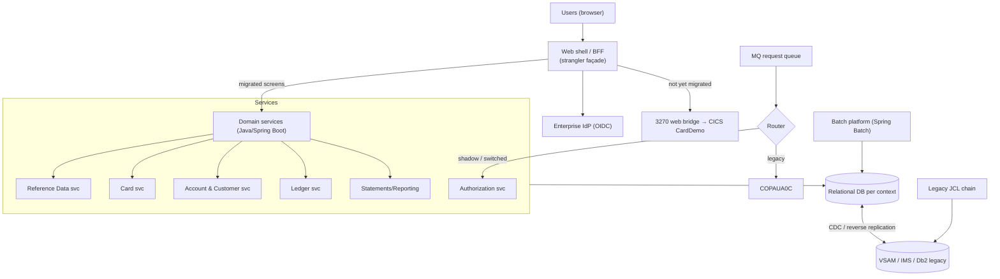

# CardDemo Modernization Blueprint

> Evaluates **Strangler Fig**, **Replatform**, **Refactor** (automated/assisted COBOL→Java conversion) and **Rewrite** (re-architect and re-implement) for every functional area of CardDemo and recommends a target strategy, target architecture and guardrails. Grounded in the static analysis in [APPLICATION_INVENTORY.md](APPLICATION_INVENTORY.md), [DATA_DICTIONARY.md](DATA_DICTIONARY.md), [DEPENDENCY_MAP.md](DEPENDENCY_MAP.md), [HOTSPOT_REPORT.md](HOTSPOT_REPORT.md) and the bounded contexts in [DOMAIN_DECOMPOSITION.md](DOMAIN_DECOMPOSITION.md). Phasing is in [CUTOVER_PLAN.md](CUTOVER_PLAN.md); risks in [RISK_REGISTER.md](RISK_REGISTER.md).

## 1. Executive summary

- **Recommended overall approach: Strangler Fig as the delivery pattern, with Rewrite for the core domain and Refactor for the long tail.** A web/API façade takes over navigation and sign-on first, then each bounded context is replaced behind it while legacy CICS/batch keeps running on synchronized data.
- **Replatform** (rehost the COBOL unchanged on a mainframe-emulation runtime such as AWS Mainframe Modernization/Micro Focus — the dataset names `AWS.M2.CARDDEMO.*` show this code base was already prepared for that) is recommended **only as a bridge** for the batch ledger if a datacenter-exit deadline precedes the rewrite.
- **Rewrite** (domain-driven Java services) is recommended where business rules are valuable but the code is not: Ledger posting, Interest, Account/Customer update, Authorization, Statements.
- **Refactor** (automated COBOL→Java conversion, then clean-up) fits small, procedural, low-rule programs: user admin, simple inquiries, utilities, reference-data CRUD — but only where the result will be owned and maintained, otherwise rewrite directly.
- **Retire**: `CBTRN01C` (unreferenced), print utilities `CBACT01C`–`CBACT03C`, `CBCUS01C`, `COBSWAIT`, assembler `MVSWAIT`/`COBDATFT`, `UNUSED1Y`, `CLOSEFIL`/`OPENFIL` jobs.

## 2. Current-state facts that drive the decision

| Fact (measured) | Consequence |
|---|---|
| 44 COBOL programs, ~23k executable lines; 24 online CICS programs (21 screens, 3 MQ services), 17 batch, 3 subroutines | Small enough for a full rewrite of the core within 12–18 months; too large to big-bang safely |
| One program (`COACTUPC`, cyclomatic ≈ 449) is ~2× more complex than any other | Rule-extraction effort is concentrated; plan dedicated SME time |
| 17 core screens share one 160-byte COMMAREA (`COCOM01Y`) and XCTL navigation | A UI façade can replace the menu and route per screen → natural strangler entry |
| Batch is a chain of JCL steps exchanging sequential files / GDGs (`POSTTRAN`, `INTCALC`, `COMBTRAN`, `CREASTMT`, `TRANREPT`) | Each step can be swapped individually and verified by file diff |
| `ACCTDAT` updated by 4 programs (online + batch), protected only by `CLOSEFIL`/`OPENFIL` | Data ownership must be redesigned; synchronization during coexistence is the hardest part |
| Authorization is already MQ request/reply (`COPAUA0C`) | Cleanest seam — swap the queue consumer |
| Data is EBCDIC with COMP-3 / signed DISPLAY numerics and text dates | Need a certified converter + reconciliation tooling (reuse `CBEXPORT` layout) |
| Optional Db2 / IMS / MQ modules | Three additional runtimes; IMS PAUTDB requires hierarchical→relational remodel |

## 3. Strategy definitions and evaluation criteria

| Strategy | Definition in this blueprint | Strengths | Weaknesses |
|---|---|---|---|
| **Strangler Fig** | Incrementally route functions from legacy to new components behind a façade (UI shell, MQ router, JCL step substitution) while both run | Low cut-over risk, continuous delivery of value, reversible | Requires data synchronization and dual running; longer total duration |
| **Replatform** | Move COBOL/CICS/JCL/VSAM unchanged (or recompiled) to an emulated runtime on cloud | Fast, preserves behaviour, exits mainframe hardware | Keeps COBOL skills dependency and design debt; licence cost; does not improve agility |
| **Refactor** | Automated/assisted translation of COBOL to Java preserving structure, followed by incremental clean-up | Preserves behaviour line-by-line; fast for simple code | "JOBOL" (COBOL-shaped Java) for complex programs; `GO TO`/`ALTER`/`REDEFINES` translate poorly |
| **Rewrite** | Re-design around bounded contexts, re-implement rules in idiomatic Java with characterization tests | Clean domain model, modern data store, best long-term agility | Highest effort; risk of missing implicit rules; needs strong test oracle |

Scoring (1 = poor fit, 5 = excellent fit) uses: **complexity & code quality**, **business-rule value**, **coupling/seam quality** (from [DOMAIN_DECOMPOSITION.md](DOMAIN_DECOMPOSITION.md)), **change frequency expected**, **regulatory/financial sensitivity**.

## 4. Evaluation by functional area

### 4.1 Scorecard

| Functional area (context) | Programs | Strangler | Replatform | Refactor | Rewrite | **Recommendation** |
|---|---|:---:|:---:|:---:|:---:|---|
| Identity & Access (BC1) | `COSGN00C`, `COUSR00C`–`03C` | 5 | 2 | 2 | 4 | **Replace with IAM product** (strangler via façade); retire `USRSEC` |
| Navigation (BC2) | `COMEN01C`, `COADM01C` | 5 | 2 | 1 | 4 | **Rewrite as web shell** — becomes the strangler façade |
| Reference Data (BC3) | `COTRTLIC`, `COTRTUPC`, `COBTUPDT` | 4 | 3 | 4 | 4 | **Refactor or rewrite** as CRUD service (pilot); publish VSAM extracts for legacy batch |
| Card (BC4) | `COCRDLIC`, `COCRDSLC`, `COCRDUPC`, `CBACT02C`, `CBACT03C` | 5 | 3 | 3 | 4 | **Strangler + rewrite**; retire print jobs |
| Customer (BC5) | inside `COACTUPC`; `CBCUS01C` | 4 | 3 | 2 | 5 | **Rewrite** with Account; split into its own service |
| Account (BC6) | `COACTVWC`, `COACTUPC`, `CBACT01C`, `COACCT01` | 4 | 3 | 1 | 5 | **Rewrite** (read side first, write side after ledger ownership is moved) |
| Transaction Ledger (BC7) | `CBTRN02C`, `COTRN00C`–`02C`, `COBIL00C` | 4 | 4 | 3 | 5 | **Rewrite with parallel run**; optional replatform bridge for batch |
| Interest & Fees (BC8) | `CBACT04C` | 4 | 4 | 4 | 4 | **Rewrite** as batch job producing identical `SYSTRAN`; refactor acceptable |
| Statements & Reporting (BC9) | `CBSTM03A`, `CBSTM03B`, `CBTRN03C`, `CORPT00C` | 5 | 3 | 1 | 5 | **Rewrite** on reporting/templating stack over a read model |
| Card Authorization (BC10) | `COPAUA0C`, `COPAUS0C`–`2C`, `CBPAUP0C`, IMS utilities | 5 | 2 | 2 | 5 | **Strangler at MQ + rewrite**; IMS → relational |
| Utilities & MQ services (BC11) | `CSUTLDTC`, `CODATE01`, `COBSWAIT`, ASM | 3 | 2 | 3 | 5 | **Replace with platform libraries**; retire ASM |
| Export / Import (BC12) | `CBEXPORT`, `CBIMPORT` | n/a | 4 | 3 | 3 | **Keep (replatform/run as-is)** as migration tooling, retire after cut-over |

### 4.2 Rationale per area

#### Identity & Access
- *Strangler 5*: sign-on is the first screen (CC00) — putting IAM in front is invisible to the rest of the estate (only `CDEMO-USER-ID`/`CDEMO-USER-TYPE` are consumed).
- *Refactor 2*: translating clear-text password checks (`SEC-USR-PWD PIC X(08)`) perpetuates a security defect.
- **Decision**: buy, don't build — OIDC/SAML IdP; role claims `admin`/`user` map to `A`/`U`.

#### Navigation
- Pure routing, ~400 lines. The new shell lists menu options from `COMEN02Y`/`COADM02Y` and deep-links either to new pages or to legacy transactions through a 3270-to-web bridge during coexistence.

#### Reference Data
- Self-contained Db2 CRUD with simple data — **best pilot**: proves the CI/CD pipeline, Java stack, Db2→target DB migration, and the "publish legacy extract" pattern (generate `TRANTYPE`/`TRANCATG` VSAM loads from the new DB, replacing `TRANEXTR`).
- Programs are large (`COTRTLIC` 1,597 lines) mainly from screen-paging plumbing; refactor output would be dominated by BMS handling, so a rewrite of the UI with refactored validation is efficient.

#### Card
- Read-mostly, single owned file; moderate complexity (`COCRDUPC` cyclomatic 187). List/detail/update screens become a reusable UI template for later contexts.
- `CARDXREF` stays authoritative in VSAM until Ledger/Account migrate → reverse replication required.

#### Customer & Account
- Highest rule density online (`COACTUPC`: 165 IF, 127 WHEN, 51 GO TO, 43 REDEFINES). Refactor would preserve a monolithic update across two aggregates and the `GO TO` flow → **rewrite** with rules extracted into a validation module and covered by per-field characterization tests.
- Read side (`COACTVWC`, MQ `COACCT01`) can move early against replicated data.
- Write side waits for the ledger ownership decision ([DOMAIN_DECOMPOSITION.md §3.2](DOMAIN_DECOMPOSITION.md)).

#### Transaction Ledger & Interest
- Money-moving, regulator-visible, batch-centric. Code itself is moderate (`CBTRN02C` 619 lines, cyclomatic 52), but correctness, restartability and reconciliation dominate the risk.
- **Rewrite** with an idempotent, restartable batch framework (e.g. Spring Batch) and a relational ledger; prove equivalence by **parallel runs on identical inputs** comparing `TRANSACT`, `ACCTDAT`, `TCATBALF`, `DALYREJS` and `SYSTRAN` outputs.
- **Replatform 4**: if the mainframe must be exited before the rewrite completes, rehost the batch chain unchanged (JCL→ runtime-native job definitions) as an intermediate state — the JCL step seams survive rehosting.
- Online writers `COBIL00C`/`COTRN02C` move with the ledger because they share TRAN-ID generation and posting rules.

#### Statements & Reporting
- Read-only; `CBSTM03A` uses `ALTER` and 2-D in-memory tables → translation is unattractive. Rebuild with a reporting/templating engine over a read model; verify against legacy outputs for the same `TRANSACT` snapshot.

#### Card Authorization
- Already a service behind MQ: build a new consumer, run in **shadow mode** (same requests, compare decisions with `COPAUA0C` replies), then switch the queue. The IMS summary/detail model maps to `auth_summary`/`auth_detail` tables; `AUTHFRDS` moves as-is.
- Requires low-latency reads of account/customer/xref → depends on Card and Account read APIs or replicas.

## 5. Target architecture

Key design decisions:

| Decision | Choice | Reason |
|---|---|---|
| Façade | Web shell + BFF owning navigation and session (replaces COMMAREA) | Allows per-screen routing |
| Data during coexistence | Legacy remains system of record per context until that context's cut-over; CDC (legacy → new) before, reverse replication (new → legacy) after | Avoids dual-write; legacy batch keeps running |
| Data types | `BigDecimal` for all `V99` amounts; `LocalDate`/`Instant` for `X(10)`/`X(26)` text dates; string IDs where leading zeros matter (card number, account ID displayed) | Fidelity with COMP-3/DISPLAY semantics (see [DATA_DICTIONARY.md](DATA_DICTIONARY.md)) |
| Batch | Restartable, chunked jobs with reconciliation totals; scheduler retains Control-M/CA-7 dependencies until cut-over | Removes `CLOSEFIL`/`OPENFIL` constraint at the end |
| Testing oracle | Characterization tests built from legacy runs (golden files from `app/data`, captured COMMAREA/screen I/O, MQ request/reply pairs) | Behavioural equivalence before cut-over |
| Security | No password migration; PII encrypted at rest, masked in non-prod | Fixes `USRSEC` clear-text, `CUSTDAT` PII exposure |

## 6. Strategy by hotspot module

| Hotspot rank ([HOTSPOT_REPORT.md](HOTSPOT_REPORT.md)) | Module | Strategy | Notes |
|---:|---|---|---|
| 1 | `COACTUPC` | Rewrite (split Account/Customer) | Rule extraction workshop; per-field characterization tests |
| 2 | `COTRTLIC` | Refactor validation + rewrite UI | Pilot |
| 3 | `COPAUA0C` | Strangler (MQ shadow) + rewrite | Decision-comparison harness |
| 4 | `COCRDUPC` | Rewrite | Template for update screens |
| 5 | `CBTRN02C` | Rewrite + parallel run (optional replatform bridge) | Reconciliation of 4 outputs |
| 6 | `COTRTUPC` | Refactor validation + rewrite UI | With `COTRTLIC` |
| 7 | `COBIL00C` | Rewrite on Ledger service | Sequence-based TRAN-ID |
| 8 | `COTRN02C` | Rewrite on Ledger service | Shared validation with posting |
| 9 | `CBACT04C` | Rewrite (or refactor) | Golden-file rounding tests; fee stub decision |
| 10 | `COPAUS0C` | Rewrite with IMS→relational | After auth engine |

## 7. Guardrails

1. **No big bang** — every context has a reversible switch (menu routing flag, MQ router, JCL step substitution).
2. **One writer per data store at any time** — ownership flips at context cut-over; never dual-write.
3. **Equivalence before cut-over** — parallel-run diff of zero unexplained differences for N consecutive business days (N defined per phase in [CUTOVER_PLAN.md](CUTOVER_PLAN.md)).
4. **Business rules captured as executable tests**, reviewed by SMEs, before code is written.
5. **Retire as you go** — each phase removes the legacy programs, copybooks, JCL and CSD entries it replaced.
