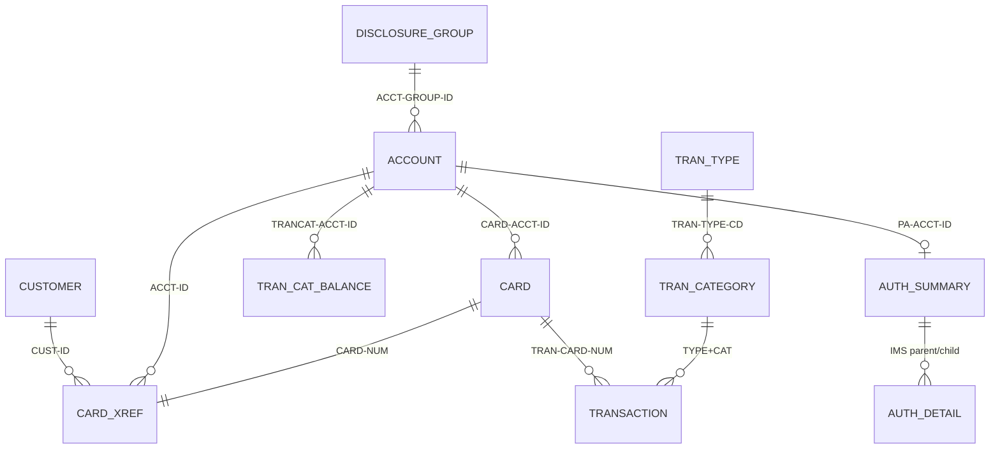

# CardDemo COBOL Estate — Data Dictionary

Field-level dictionary for all 41 copybooks in `app/cpy` and the optional sub-application `cpy` directories, grouped by business entity. BMS symbolic-map copybooks (`cpy-bms`) and DB2 DCLGEN members are screen/DB artifacts and are summarised in [APPLICATION_INVENTORY.md](APPLICATION_INVENTORY.md) instead.

**Column notes**

- *PIC / Type / Bytes*: extracted from the source; bytes computed from PIC and USAGE (COMP-3 = ⌈(digits+1)/2⌉, COMP = 2/4/8). Group lengths include OCCURS multiplication.
- *Business meaning*: inferred from the field name and how programs use it.
- *Validation rules*: explicit 88-level conditions from the copybook, plus rules **enforced in program logic** (program and paragraph cited). Rules without a program citation are inferred from the PIC clause only.

## Entity overview

| Entity | Copybooks | Storage |
|---|---|---|
| Account | `CVACT01Y` | Credit-card account master (`ACCTDAT` / `AWS.M2.CARDDEMO.ACCTDATA.VSAM.KSDS`, key ACCT-ID). |
| Customer | `CVCUS01Y`, `CUSTREC` | Customer master (`CUSTDAT` / `AWS.M2.CARDDEMO.CUSTDATA.VSAM.KSDS`, key CUST-ID). |
| Card | `CVACT02Y`, `CVACT03Y`, `CVCRD01Y` | Card master (`CARDDAT`, key CARD-NUM, AIX by account) and the card→account→customer cross-reference (`CCXREF`, AIX `CXACAIX` by account). |
| Transaction | `CVTRA05Y`, `CVTRA06Y`, `CVTRA01Y`, `CVTRA02Y`, `CVTRA03Y`, `CVTRA04Y`, `CVTRA07Y`, `COSTM01`, `CSDB2RWY`, `CSDB2RPY` | Posted and daily transactions, category balances, interest-rate disclosure groups, transaction type/category reference data (VSAM and DB2), report and statement layouts. |
| Authorization (optional IMS/DB2/MQ module) | `CIPAUSMY`, `CIPAUDTY`, `CCPAURQY`, `CCPAURLY`, `CCPAUERY`, `IMSFUNCS`, `PAUTBPCB`, `PASFLPCB`, `PADFLPCB` | Pending-authorization IMS segments, MQ request/response messages, error log and IMS PCB masks. These relate to Card/Account but are kept separate because they belong to the optional module. |
| Cross-entity / migration | `CVEXPORT` | Multi-record export layout carrying customer, account, xref, transaction and card records in one file. |
| User / security | `CSUSR01Y` | Sign-on user security record (`USRSEC`). |
| Shared control, UI and utility | `COCOM01Y`, `COMEN02Y`, `COADM02Y`, `COTTL01Y`, `CSDAT01Y`, `CSMSG01Y`, `CSMSG02Y`, `CSSETATY`, `CSSTRPFY`, `CSUTLDWY`, `CSUTLDPY`, `CSLKPCDY`, `CODATECN`, `UNUSED1Y` | COMMAREA, menu tables, screen titles, date/time work areas, messages, abend work area, PF-key mapping, date-validation routines and lookup tables. |

## 1. Account

Credit-card account master (`ACCTDAT` / `AWS.M2.CARDDEMO.ACCTDATA.VSAM.KSDS`, key ACCT-ID).

### 1.1 `CVACT01Y` — Account entity (RECLN 300).

- **Source:** `app/cpy/CVACT01Y.cpy`
- **01 records:** ACCOUNT-RECORD (300 bytes)
- **Used by:** CBACT01C, CBACT04C, CBEXPORT, CBIMPORT, CBSTM03A, CBTRN01C, CBTRN02C, COACCT01, COACTUPC, COACTVWC, COBIL00C, COPAUA0C, COPAUS0C, COTRN02C

| Lvl | Field | PIC | Type / usage | Bytes | Occurs / redefines | Business meaning (inferred) | Validation rules |
|---|---|---|---|---|---|---|---|
| 01 | ACCOUNT-RECORD | — | Group | 300 |  | Record / group |  |
| 05 | &nbsp;&nbsp;ACCT-ID | 9(11) | Zoned decimal | 11 |  | Account identifier | Numeric 11 digits, non-zero; must exist in ACCTDAT (COACTVWC/COACTUPC 1210-EDIT-ACCOUNT, CBTRN02C reason 101). |
| 05 | &nbsp;&nbsp;ACCT-ACTIVE-STATUS | X(01) | Alphanumeric | 1 |  | Account active status | Y/N flag (COACTUPC 1220-EDIT-YESNO). |
| 05 | &nbsp;&nbsp;ACCT-CURR-BAL | S9(10)V99 | Zoned decimal (signed), 2 dp | 12 |  | Account current balance | Signed 9V2; batch posting adds every transaction amount (CBTRN02C); interest added monthly (CBACT04C); bill payment subtracts full balance (COBIL00C). |
| 05 | &nbsp;&nbsp;ACCT-CREDIT-LIMIT | S9(10)V99 | Zoned decimal (signed), 2 dp | 12 |  | Account credit limit | Signed 9V2 (COACTUPC 1250-EDIT-SIGNED-9V2); transaction rejected 102 when cycle credit − cycle debit + amount exceeds it (CBTRN02C); authorization declined when amount > limit − balance (COPAUA0C). |
| 05 | &nbsp;&nbsp;ACCT-CASH-CREDIT-LIMIT | S9(10)V99 | Zoned decimal (signed), 2 dp | 12 |  | Account cash credit limit | Signed 9V2 (COACTUPC). |
| 05 | &nbsp;&nbsp;ACCT-OPEN-DATE | X(10) | Alphanumeric | 10 |  | Account open date | YYYY-MM-DD, valid calendar date (COACTUPC via CSUTLDPY/CEEDAYS). |
| 05 | &nbsp;&nbsp;ACCT-EXPIRAION-DATE | X(10) | Alphanumeric | 10 |  | Account expiration date | YYYY-MM-DD valid date; daily transactions dated after it are rejected with reason 103 (CBTRN02C). Note source spelling "EXPIRAION". |
| 05 | &nbsp;&nbsp;ACCT-REISSUE-DATE | X(10) | Alphanumeric | 10 |  | Account reissue date | YYYY-MM-DD valid date (COACTUPC). |
| 05 | &nbsp;&nbsp;ACCT-CURR-CYC-CREDIT | S9(10)V99 | Zoned decimal (signed), 2 dp | 12 |  | Account current cycle credit | Accumulates positive amounts (CBTRN02C); reset to 0 by interest run (CBACT04C). |
| 05 | &nbsp;&nbsp;ACCT-CURR-CYC-DEBIT | S9(10)V99 | Zoned decimal (signed), 2 dp | 12 |  | Account current cycle debit | Accumulates negative amounts (CBTRN02C); reset to 0 by interest run (CBACT04C). |
| 05 | &nbsp;&nbsp;ACCT-ADDR-ZIP | X(10) | Alphanumeric | 10 |  | Account address ZIP/postal code |  |
| 05 | &nbsp;&nbsp;ACCT-GROUP-ID | X(10) | Alphanumeric | 10 |  | Account group identifier | Disclosure-group key into DISCGRP; falls back to "DEFAULT" when not found (CBACT04C). |
| 05 | &nbsp;&nbsp;FILLER | X(178) | Alphanumeric | 178 |  | Reserved / unused space |  |

## 2. Customer

Customer master (`CUSTDAT` / `AWS.M2.CARDDEMO.CUSTDATA.VSAM.KSDS`, key CUST-ID).

### 2.1 `CVCUS01Y` — Customer entity (RECLN 500).

- **Source:** `app/cpy/CVCUS01Y.cpy`
- **01 records:** CUSTOMER-RECORD (500 bytes)
- **Used by:** CBCUS01C, CBEXPORT, CBIMPORT, CBTRN01C, COACTUPC, COACTVWC, COCRDSLC, COCRDUPC, COPAUA0C, COPAUS0C

| Lvl | Field | PIC | Type / usage | Bytes | Occurs / redefines | Business meaning (inferred) | Validation rules |
|---|---|---|---|---|---|---|---|
| 01 | CUSTOMER-RECORD | — | Group | 500 |  | Record / group |  |
| 05 | &nbsp;&nbsp;CUST-ID | 9(09) | Zoned decimal | 9 |  | Customer identifier | Numeric unsigned |
| 05 | &nbsp;&nbsp;CUST-FIRST-NAME | X(25) | Alphanumeric | 25 |  | Customer first name | Required, alphabetic/space only (COACTUPC 1225-EDIT-ALPHA-REQD). |
| 05 | &nbsp;&nbsp;CUST-MIDDLE-NAME | X(25) | Alphanumeric | 25 |  | Customer middle name | Optional, alphabetic (COACTUPC 1235-EDIT-ALPHA-OPT). |
| 05 | &nbsp;&nbsp;CUST-LAST-NAME | X(25) | Alphanumeric | 25 |  | Customer last name | Required, alphabetic/space only (COACTUPC). |
| 05 | &nbsp;&nbsp;CUST-ADDR-LINE-1 | X(50) | Alphanumeric | 50 |  | Customer address line 1 | Required alphanumeric (COACTUPC). |
| 05 | &nbsp;&nbsp;CUST-ADDR-LINE-2 | X(50) | Alphanumeric | 50 |  | Customer address line 2 |  |
| 05 | &nbsp;&nbsp;CUST-ADDR-LINE-3 | X(50) | Alphanumeric | 50 |  | Customer address line 3 |  |
| 05 | &nbsp;&nbsp;CUST-ADDR-STATE-CD | X(02) | Alphanumeric | 2 |  | Customer address state code | Must be a valid US state code from CSLKPCDY (COACTUPC 1270-EDIT-US-STATE-CD). |
| 05 | &nbsp;&nbsp;CUST-ADDR-COUNTRY-CD | X(03) | Alphanumeric | 3 |  | Customer address country code | Required alphabetic (COACTUPC). |
| 05 | &nbsp;&nbsp;CUST-ADDR-ZIP | X(10) | Alphanumeric | 10 |  | Customer address ZIP/postal code | Numeric; state + first two ZIP digits must be a valid combination in CSLKPCDY (COACTUPC). |
| 05 | &nbsp;&nbsp;CUST-PHONE-NUM-1 | X(15) | Alphanumeric | 15 |  | Customer phone number 1 | US format (999)999-9999; area code must be in CSLKPCDY list (COACTUPC 1260-EDIT-US-PHONE-NUM). |
| 05 | &nbsp;&nbsp;CUST-PHONE-NUM-2 | X(15) | Alphanumeric | 15 |  | Customer phone number 2 | Same as CUST-PHONE-NUM-1 (optional). |
| 05 | &nbsp;&nbsp;CUST-SSN | 9(09) | Zoned decimal | 9 |  | Customer Social Security number | Nine digits split 3-2-4; part 1 must not be 000, 666 or 900-999; parts 2 and 3 must be numeric (COACTUPC 1265-EDIT-US-SSN, 88 INVALID-SSN-PART1). |
| 05 | &nbsp;&nbsp;CUST-GOVT-ISSUED-ID | X(20) | Alphanumeric | 20 |  | Customer government issued identifier |  |
| 05 | &nbsp;&nbsp;CUST-DOB-YYYY-MM-DD | X(10) | Alphanumeric | 10 |  | Customer date of birth year month day | Valid calendar date, not in the future (COACTUPC via CSUTLDPY). |
| 05 | &nbsp;&nbsp;CUST-EFT-ACCOUNT-ID | X(10) | Alphanumeric | 10 |  | Customer EFT account identifier | Required numeric (COACTUPC). |
| 05 | &nbsp;&nbsp;CUST-PRI-CARD-HOLDER-IND | X(01) | Alphanumeric | 1 |  | Customer primary card holder indicator | Y/N flag (COACTUPC). |
| 05 | &nbsp;&nbsp;CUST-FICO-CREDIT-SCORE | 9(03) | Zoned decimal | 3 |  | Customer FICO credit score | Numeric, 300-850 (COACTUPC 1275-EDIT-FICO-SCORE). |
| 05 | &nbsp;&nbsp;FILLER | X(168) | Alphanumeric | 168 |  | Reserved / unused space |  |

### 2.2 `CUSTREC` — Customer entity layout used by statement program CBSTM03A (RECLN 500; DOB named CUST-DOB-YYYYMMDD).

- **Source:** `app/cpy/CUSTREC.cpy`
- **01 records:** CUSTOMER-RECORD (500 bytes)
- **Used by:** CBSTM03A

| Lvl | Field | PIC | Type / usage | Bytes | Occurs / redefines | Business meaning (inferred) | Validation rules |
|---|---|---|---|---|---|---|---|
| 01 | CUSTOMER-RECORD | — | Group | 500 |  | Record / group |  |
| 05 | &nbsp;&nbsp;CUST-ID | 9(09) | Zoned decimal | 9 |  | Customer identifier | Numeric unsigned |
| 05 | &nbsp;&nbsp;CUST-FIRST-NAME | X(25) | Alphanumeric | 25 |  | Customer first name | Required, alphabetic/space only (COACTUPC 1225-EDIT-ALPHA-REQD). |
| 05 | &nbsp;&nbsp;CUST-MIDDLE-NAME | X(25) | Alphanumeric | 25 |  | Customer middle name | Optional, alphabetic (COACTUPC 1235-EDIT-ALPHA-OPT). |
| 05 | &nbsp;&nbsp;CUST-LAST-NAME | X(25) | Alphanumeric | 25 |  | Customer last name | Required, alphabetic/space only (COACTUPC). |
| 05 | &nbsp;&nbsp;CUST-ADDR-LINE-1 | X(50) | Alphanumeric | 50 |  | Customer address line 1 | Required alphanumeric (COACTUPC). |
| 05 | &nbsp;&nbsp;CUST-ADDR-LINE-2 | X(50) | Alphanumeric | 50 |  | Customer address line 2 |  |
| 05 | &nbsp;&nbsp;CUST-ADDR-LINE-3 | X(50) | Alphanumeric | 50 |  | Customer address line 3 |  |
| 05 | &nbsp;&nbsp;CUST-ADDR-STATE-CD | X(02) | Alphanumeric | 2 |  | Customer address state code | Must be a valid US state code from CSLKPCDY (COACTUPC 1270-EDIT-US-STATE-CD). |
| 05 | &nbsp;&nbsp;CUST-ADDR-COUNTRY-CD | X(03) | Alphanumeric | 3 |  | Customer address country code | Required alphabetic (COACTUPC). |
| 05 | &nbsp;&nbsp;CUST-ADDR-ZIP | X(10) | Alphanumeric | 10 |  | Customer address ZIP/postal code | Numeric; state + first two ZIP digits must be a valid combination in CSLKPCDY (COACTUPC). |
| 05 | &nbsp;&nbsp;CUST-PHONE-NUM-1 | X(15) | Alphanumeric | 15 |  | Customer phone number 1 | US format (999)999-9999; area code must be in CSLKPCDY list (COACTUPC 1260-EDIT-US-PHONE-NUM). |
| 05 | &nbsp;&nbsp;CUST-PHONE-NUM-2 | X(15) | Alphanumeric | 15 |  | Customer phone number 2 | Same as CUST-PHONE-NUM-1 (optional). |
| 05 | &nbsp;&nbsp;CUST-SSN | 9(09) | Zoned decimal | 9 |  | Customer Social Security number | Nine digits split 3-2-4; part 1 must not be 000, 666 or 900-999; parts 2 and 3 must be numeric (COACTUPC 1265-EDIT-US-SSN, 88 INVALID-SSN-PART1). |
| 05 | &nbsp;&nbsp;CUST-GOVT-ISSUED-ID | X(20) | Alphanumeric | 20 |  | Customer government issued identifier |  |
| 05 | &nbsp;&nbsp;CUST-DOB-YYYYMMDD | X(10) | Alphanumeric | 10 |  | Customer date of birth yyyymmdd |  |
| 05 | &nbsp;&nbsp;CUST-EFT-ACCOUNT-ID | X(10) | Alphanumeric | 10 |  | Customer EFT account identifier | Required numeric (COACTUPC). |
| 05 | &nbsp;&nbsp;CUST-PRI-CARD-HOLDER-IND | X(01) | Alphanumeric | 1 |  | Customer primary card holder indicator | Y/N flag (COACTUPC). |
| 05 | &nbsp;&nbsp;CUST-FICO-CREDIT-SCORE | 9(03) | Zoned decimal | 3 |  | Customer FICO credit score | Numeric, 300-850 (COACTUPC 1275-EDIT-FICO-SCORE). |
| 05 | &nbsp;&nbsp;FILLER | X(168) | Alphanumeric | 168 |  | Reserved / unused space |  |

## 3. Card

Card master (`CARDDAT`, key CARD-NUM, AIX by account) and the card→account→customer cross-reference (`CCXREF`, AIX `CXACAIX` by account).

### 3.1 `CVACT02Y` — Card entity (RECLN 150).

- **Source:** `app/cpy/CVACT02Y.cpy`
- **01 records:** CARD-RECORD (150 bytes)
- **Used by:** CBACT02C, CBEXPORT, CBIMPORT, CBTRN01C, COACTVWC, COCRDLIC, COCRDSLC, COCRDUPC, COPAUS0C, COTRTLIC

| Lvl | Field | PIC | Type / usage | Bytes | Occurs / redefines | Business meaning (inferred) | Validation rules |
|---|---|---|---|---|---|---|---|
| 01 | CARD-RECORD | — | Group | 150 |  | Record / group |  |
| 05 | &nbsp;&nbsp;CARD-NUM | X(16) | Alphanumeric | 16 |  | Card number | 16-digit card number; must exist in CCXREF (CBTRN02C reason 100, COPAUA0C reason 3100); numeric 16 digits on screens (COCRDLIC/COCRDSLC). |
| 05 | &nbsp;&nbsp;CARD-ACCT-ID | 9(11) | Zoned decimal | 11 |  | Card account identifier | 11-digit account id; must be numeric (COCRDLIC/COCRDSLC filters). |
| 05 | &nbsp;&nbsp;CARD-CVV-CD | 9(03) | Zoned decimal | 3 |  | Card CVV code | Numeric unsigned |
| 05 | &nbsp;&nbsp;CARD-EMBOSSED-NAME | X(50) | Alphanumeric | 50 |  | Card embossed name | Alphabetic and spaces only (COCRDUPC). |
| 05 | &nbsp;&nbsp;CARD-EXPIRAION-DATE | X(10) | Alphanumeric | 10 |  | Card expiration date | Month 1-12 (88 VALID-MONTH) and year 1950-2099 (88 VALID-YEAR) (COCRDUPC). |
| 05 | &nbsp;&nbsp;CARD-ACTIVE-STATUS | X(01) | Alphanumeric | 1 |  | Card active status | Y/N (COCRDUPC). |
| 05 | &nbsp;&nbsp;FILLER | X(59) | Alphanumeric | 59 |  | Reserved / unused space |  |

### 3.2 `CVACT03Y` — Card cross-reference (RECLN 50).

- **Source:** `app/cpy/CVACT03Y.cpy`
- **01 records:** CARD-XREF-RECORD (50 bytes)
- **Used by:** CBACT03C, CBACT04C, CBEXPORT, CBIMPORT, CBSTM03A, CBTRN01C, CBTRN02C, CBTRN03C, COACTUPC, COACTVWC, COBIL00C, COPAUA0C, COPAUS0C, COTRN02C

| Lvl | Field | PIC | Type / usage | Bytes | Occurs / redefines | Business meaning (inferred) | Validation rules |
|---|---|---|---|---|---|---|---|
| 01 | CARD-XREF-RECORD | — | Group | 50 |  | Record / group |  |
| 05 | &nbsp;&nbsp;XREF-CARD-NUM | X(16) | Alphanumeric | 16 |  | Card number | Primary key of CCXREF; lookup key for posting and authorization. |
| 05 | &nbsp;&nbsp;XREF-CUST-ID | 9(09) | Zoned decimal | 9 |  | Customer identifier | Numeric unsigned |
| 05 | &nbsp;&nbsp;XREF-ACCT-ID | 9(11) | Zoned decimal | 11 |  | Account identifier | Alternate key (CXACAIX) used to find card/customer from account. |
| 05 | &nbsp;&nbsp;FILLER | X(14) | Alphanumeric | 14 |  | Reserved / unused space |  |

### 3.3 `CVCRD01Y` — Card/online work area: AID flags, return-program, screen message and selected account/card/customer ids.

- **Source:** `app/cpy/CVCRD01Y.cpy`
- **01 records:** CC-WORK-AREAS (213 bytes)
- **Used by:** COACTUPC, COACTVWC, COCRDLIC, COCRDSLC, COCRDUPC, COTRTLIC, COTRTUPC

| Lvl | Field | PIC | Type / usage | Bytes | Occurs / redefines | Business meaning (inferred) | Validation rules |
|---|---|---|---|---|---|---|---|
| 01 | CC-WORK-AREAS | — | Group | 213 |  | Record / group |  |
| 05 | &nbsp;&nbsp;CC-WORK-AREA | — | Group | 213 |  | Century work area |  |
| 10 | &nbsp;&nbsp;&nbsp;&nbsp;CCARD-AID | X(5) | Alphanumeric | 5 |  | Aid | 88-levels: CCARD-AID-ENTER='ENTER'; CCARD-AID-CLEAR='CLEAR'; CCARD-AID-PA1='PA1 '; CCARD-AID-PA2='PA2 '; CCARD-AID-PFK01='PFK01'; CCARD-AID-PFK02='PFK02'; … (+10 more) |
| 10 | &nbsp;&nbsp;&nbsp;&nbsp;CCARD-NEXT-PROG | X(8) | Alphanumeric | 8 |  | Next program |  |
| 10 | &nbsp;&nbsp;&nbsp;&nbsp;CCARD-NEXT-MAPSET | X(7) | Alphanumeric | 7 |  | Next BMS mapset |  |
| 10 | &nbsp;&nbsp;&nbsp;&nbsp;CCARD-NEXT-MAP | X(7) | Alphanumeric | 7 |  | Next BMS map |  |
| 10 | &nbsp;&nbsp;&nbsp;&nbsp;CCARD-ERROR-MSG | X(75) | Alphanumeric | 75 |  | Error message |  |
| 10 | &nbsp;&nbsp;&nbsp;&nbsp;CCARD-RETURN-MSG | X(75) | Alphanumeric | 75 |  | Return message | 88-levels: CCARD-RETURN-MSG-OFF=LOW-VALUES |
| 10 | &nbsp;&nbsp;&nbsp;&nbsp;CC-ACCT-ID | X(11) | Alphanumeric | 11 |  | Century account identifier | Initial VALUE SPACES |
| 10 | &nbsp;&nbsp;&nbsp;&nbsp;CC-ACCT-ID-N | 9(11) | Zoned decimal | 11 | REDEFINES CC-ACCT-ID | Century account identifier n | Numeric unsigned |
| 10 | &nbsp;&nbsp;&nbsp;&nbsp;CC-CARD-NUM | X(16) | Alphanumeric | 16 |  | Century card number | Initial VALUE SPACES |
| 10 | &nbsp;&nbsp;&nbsp;&nbsp;CC-CARD-NUM-N | 9(16) | Zoned decimal | 16 | REDEFINES CC-CARD-NUM | Century card number n | Numeric unsigned |
| 10 | &nbsp;&nbsp;&nbsp;&nbsp;CC-CUST-ID | X(09) | Alphanumeric | 9 |  | Century customer identifier | Initial VALUE SPACES |
| 10 | &nbsp;&nbsp;&nbsp;&nbsp;CC-CUST-ID-N | 9(9) | Zoned decimal | 9 | REDEFINES CC-CUST-ID | Century customer identifier n | Numeric unsigned |

## 4. Transaction

Posted and daily transactions, category balances, interest-rate disclosure groups, transaction type/category reference data (VSAM and DB2), report and statement layouts.

### 4.1 `CVTRA05Y` — Posted transaction master (RECLN 350).

- **Source:** `app/cpy/CVTRA05Y.cpy`
- **01 records:** TRAN-RECORD (350 bytes)
- **Used by:** CBACT04C, CBEXPORT, CBIMPORT, CBTRN01C, CBTRN02C, CBTRN03C, COBIL00C, CORPT00C, COTRN00C, COTRN01C, COTRN02C

| Lvl | Field | PIC | Type / usage | Bytes | Occurs / redefines | Business meaning (inferred) | Validation rules |
|---|---|---|---|---|---|---|---|
| 01 | TRAN-RECORD | — | Group | 350 |  | Record / group |  |
| 05 | &nbsp;&nbsp;TRAN-ID | X(16) | Alphanumeric | 16 |  | Transaction identifier | 16-char key; online add = last id + 1 (COTRN02C/COBIL00C); interest = PARM-DATE + suffix (CBACT04C). |
| 05 | &nbsp;&nbsp;TRAN-TYPE-CD | X(02) | Alphanumeric | 2 |  | Transaction type code | Must exist in TRANTYPE reference (CBTRN03C lookup); '01' purchase/interest, '02' payment as generated by CBACT04C/COBIL00C. |
| 05 | &nbsp;&nbsp;TRAN-CAT-CD | 9(04) | Zoned decimal | 4 |  | Code | Numeric 4; with type forms category key (TRANCATG, TCATBAL, DISCGRP). |
| 05 | &nbsp;&nbsp;TRAN-SOURCE | X(10) | Alphanumeric | 10 |  | Transaction source |  |
| 05 | &nbsp;&nbsp;TRAN-DESC | X(100) | Alphanumeric | 100 |  | Transaction description |  |
| 05 | &nbsp;&nbsp;TRAN-AMT | S9(09)V99 | Zoned decimal (signed), 2 dp | 11 |  | Transaction amount | Signed 9V2; online entry edited as signed amount in format ±99999999.99 (COTRN02C). |
| 05 | &nbsp;&nbsp;TRAN-MERCHANT-ID | 9(09) | Zoned decimal | 9 |  | Transaction merchant identifier | Numeric 9 (COTRN02C). |
| 05 | &nbsp;&nbsp;TRAN-MERCHANT-NAME | X(50) | Alphanumeric | 50 |  | Transaction merchant name |  |
| 05 | &nbsp;&nbsp;TRAN-MERCHANT-CITY | X(50) | Alphanumeric | 50 |  | Transaction merchant city |  |
| 05 | &nbsp;&nbsp;TRAN-MERCHANT-ZIP | X(10) | Alphanumeric | 10 |  | Transaction merchant ZIP/postal code |  |
| 05 | &nbsp;&nbsp;TRAN-CARD-NUM | X(16) | Alphanumeric | 16 |  | Transaction card number |  |
| 05 | &nbsp;&nbsp;TRAN-ORIG-TS | X(26) | Alphanumeric | 26 |  | Transaction origination timestamp | DB2-style timestamp YYYY-MM-DD-HH.MM.SS.nnnnnn; date part validated via CSUTLDTC on entry (COTRN02C). |
| 05 | &nbsp;&nbsp;TRAN-PROC-TS | X(26) | Alphanumeric | 26 |  | Transaction processing timestamp | Set to current timestamp when posted (CBTRN02C). |
| 05 | &nbsp;&nbsp;FILLER | X(20) | Alphanumeric | 20 |  | Reserved / unused space |  |

### 4.2 `CVTRA06Y` — Daily transaction input (RECLN 350) — same shape as CVTRA05Y.

- **Source:** `app/cpy/CVTRA06Y.cpy`
- **01 records:** DALYTRAN-RECORD (350 bytes)
- **Used by:** CBTRN01C, CBTRN02C

| Lvl | Field | PIC | Type / usage | Bytes | Occurs / redefines | Business meaning (inferred) | Validation rules |
|---|---|---|---|---|---|---|---|
| 01 | DALYTRAN-RECORD | — | Group | 350 |  | Record / group |  |
| 05 | &nbsp;&nbsp;DALYTRAN-ID | X(16) | Alphanumeric | 16 |  | Identifier |  |
| 05 | &nbsp;&nbsp;DALYTRAN-TYPE-CD | X(02) | Alphanumeric | 2 |  | Type code |  |
| 05 | &nbsp;&nbsp;DALYTRAN-CAT-CD | 9(04) | Zoned decimal | 4 |  | Category code | Numeric unsigned |
| 05 | &nbsp;&nbsp;DALYTRAN-SOURCE | X(10) | Alphanumeric | 10 |  | Source |  |
| 05 | &nbsp;&nbsp;DALYTRAN-DESC | X(100) | Alphanumeric | 100 |  | Description |  |
| 05 | &nbsp;&nbsp;DALYTRAN-AMT | S9(09)V99 | Zoned decimal (signed), 2 dp | 11 |  | Amount | Positive amounts accumulate to cycle credit, negative to cycle debit (CBTRN02C). |
| 05 | &nbsp;&nbsp;DALYTRAN-MERCHANT-ID | 9(09) | Zoned decimal | 9 |  | Merchant identifier | Numeric unsigned |
| 05 | &nbsp;&nbsp;DALYTRAN-MERCHANT-NAME | X(50) | Alphanumeric | 50 |  | Merchant name |  |
| 05 | &nbsp;&nbsp;DALYTRAN-MERCHANT-CITY | X(50) | Alphanumeric | 50 |  | Merchant city |  |
| 05 | &nbsp;&nbsp;DALYTRAN-MERCHANT-ZIP | X(10) | Alphanumeric | 10 |  | Merchant ZIP/postal code |  |
| 05 | &nbsp;&nbsp;DALYTRAN-CARD-NUM | X(16) | Alphanumeric | 16 |  | Card number | Must be in CCXREF else reject reason 100 (CBTRN02C). |
| 05 | &nbsp;&nbsp;DALYTRAN-ORIG-TS | X(26) | Alphanumeric | 26 |  | Origination timestamp | Date part compared to ACCT-EXPIRAION-DATE (reason 103). |
| 05 | &nbsp;&nbsp;DALYTRAN-PROC-TS | X(26) | Alphanumeric | 26 |  | Processing timestamp |  |
| 05 | &nbsp;&nbsp;FILLER | X(20) | Alphanumeric | 20 |  | Reserved / unused space |  |

### 4.3 `CVTRA01Y` — Transaction category balance (RECLN 50; key acct+type+category).

- **Source:** `app/cpy/CVTRA01Y.cpy`
- **01 records:** TRAN-CAT-BAL-RECORD (50 bytes)
- **Used by:** CBACT04C, CBTRN02C

| Lvl | Field | PIC | Type / usage | Bytes | Occurs / redefines | Business meaning (inferred) | Validation rules |
|---|---|---|---|---|---|---|---|
| 01 | TRAN-CAT-BAL-RECORD | — | Group | 50 |  | Record / group |  |
| 05 | &nbsp;&nbsp;TRAN-CAT-KEY | — | Group | 17 |  | Key |  |
| 10 | &nbsp;&nbsp;&nbsp;&nbsp;TRANCAT-ACCT-ID | 9(11) | Zoned decimal | 11 |  | Trancat account identifier | Numeric unsigned |
| 10 | &nbsp;&nbsp;&nbsp;&nbsp;TRANCAT-TYPE-CD | X(02) | Alphanumeric | 2 |  | Trancat type code |  |
| 10 | &nbsp;&nbsp;&nbsp;&nbsp;TRANCAT-CD | 9(04) | Zoned decimal | 4 |  | Trancat code | Numeric unsigned |
| 05 | &nbsp;&nbsp;TRAN-CAT-BAL | S9(09)V99 | Zoned decimal (signed), 2 dp | 11 |  | Balance | Balance per account/type/category; created if missing, incremented on every post (CBTRN02C); basis for interest (CBACT04C). |
| 05 | &nbsp;&nbsp;FILLER | X(22) | Alphanumeric | 22 |  | Reserved / unused space |  |

### 4.4 `CVTRA02Y` — Disclosure group / interest rate (RECLN 50; key group+type+category).

- **Source:** `app/cpy/CVTRA02Y.cpy`
- **01 records:** DIS-GROUP-RECORD (50 bytes)
- **Used by:** CBACT04C

| Lvl | Field | PIC | Type / usage | Bytes | Occurs / redefines | Business meaning (inferred) | Validation rules |
|---|---|---|---|---|---|---|---|
| 01 | DIS-GROUP-RECORD | — | Group | 50 |  | Record / group |  |
| 05 | &nbsp;&nbsp;DIS-GROUP-KEY | — | Group | 16 |  | Group key |  |
| 10 | &nbsp;&nbsp;&nbsp;&nbsp;DIS-ACCT-GROUP-ID | X(10) | Alphanumeric | 10 |  | Account group identifier | Matches ACCT-GROUP-ID; 'DEFAULT' row used as fallback (CBACT04C). |
| 10 | &nbsp;&nbsp;&nbsp;&nbsp;DIS-TRAN-TYPE-CD | X(02) | Alphanumeric | 2 |  | Transaction type code |  |
| 10 | &nbsp;&nbsp;&nbsp;&nbsp;DIS-TRAN-CAT-CD | 9(04) | Zoned decimal | 4 |  | Transaction category code | Numeric unsigned |
| 05 | &nbsp;&nbsp;DIS-INT-RATE | S9(04)V99 | Zoned decimal (signed), 2 dp | 6 |  | Interest rate | Annual percentage rate; monthly interest = TRAN-CAT-BAL × rate / 1200 (CBACT04C). |
| 05 | &nbsp;&nbsp;FILLER | X(28) | Alphanumeric | 28 |  | Reserved / unused space |  |

### 4.5 `CVTRA03Y` — Transaction type reference (RECLN 60).

- **Source:** `app/cpy/CVTRA03Y.cpy`
- **01 records:** TRAN-TYPE-RECORD (60 bytes)
- **Used by:** CBTRN03C

| Lvl | Field | PIC | Type / usage | Bytes | Occurs / redefines | Business meaning (inferred) | Validation rules |
|---|---|---|---|---|---|---|---|
| 01 | TRAN-TYPE-RECORD | — | Group | 60 |  | Record / group |  |
| 05 | &nbsp;&nbsp;TRAN-TYPE | X(02) | Alphanumeric | 2 |  | Transaction type |  |
| 05 | &nbsp;&nbsp;TRAN-TYPE-DESC | X(50) | Alphanumeric | 50 |  | Transaction type description |  |
| 05 | &nbsp;&nbsp;FILLER | X(08) | Alphanumeric | 8 |  | Reserved / unused space |  |

### 4.6 `CVTRA04Y` — Transaction category reference (RECLN 60).

- **Source:** `app/cpy/CVTRA04Y.cpy`
- **01 records:** TRAN-CAT-RECORD (60 bytes)
- **Used by:** CBTRN03C

| Lvl | Field | PIC | Type / usage | Bytes | Occurs / redefines | Business meaning (inferred) | Validation rules |
|---|---|---|---|---|---|---|---|
| 01 | TRAN-CAT-RECORD | — | Group | 60 |  | Record / group |  |
| 05 | &nbsp;&nbsp;TRAN-CAT-KEY | — | Group | 6 |  | Key |  |
| 10 | &nbsp;&nbsp;&nbsp;&nbsp;TRAN-TYPE-CD | X(02) | Alphanumeric | 2 |  | Transaction type code | Must exist in TRANTYPE reference (CBTRN03C lookup); '01' purchase/interest, '02' payment as generated by CBACT04C/COBIL00C. |
| 10 | &nbsp;&nbsp;&nbsp;&nbsp;TRAN-CAT-CD | 9(04) | Zoned decimal | 4 |  | Code | Numeric 4; with type forms category key (TRANCATG, TCATBAL, DISCGRP). |
| 05 | &nbsp;&nbsp;TRAN-CAT-TYPE-DESC | X(50) | Alphanumeric | 50 |  | Type description |  |
| 05 | &nbsp;&nbsp;FILLER | X(04) | Alphanumeric | 4 |  | Reserved / unused space |  |

### 4.7 `CVTRA07Y` — Transaction report headers, detail line and totals.

- **Source:** `app/cpy/CVTRA07Y.cpy`
- **01 records:** REPORT-NAME-HEADER (115 bytes), TRANSACTION-DETAIL-REPORT (114 bytes), TRANSACTION-HEADER-1 (114 bytes), TRANSACTION-HEADER-2 (133 bytes), REPORT-PAGE-TOTALS (112 bytes), REPORT-ACCOUNT-TOTALS (112 bytes), REPORT-GRAND-TOTALS (112 bytes)
- **Used by:** CBTRN03C

| Lvl | Field | PIC | Type / usage | Bytes | Occurs / redefines | Business meaning (inferred) | Validation rules |
|---|---|---|---|---|---|---|---|
| 01 | REPORT-NAME-HEADER | — | Group | 115 |  | Record / group |  |
| 05 | &nbsp;&nbsp;REPT-SHORT-NAME | X(38) | Alphanumeric | 38 |  | Rept short name | Initial VALUE 'DALYREPT' |
| 05 | &nbsp;&nbsp;REPT-LONG-NAME | X(41) | Alphanumeric | 41 |  | Rept long name | Initial VALUE 'Daily Transaction Report' |
| 05 | &nbsp;&nbsp;REPT-DATE-HEADER | X(12) | Alphanumeric | 12 |  | Rept date header | Initial VALUE 'Date Range: ' |
| 05 | &nbsp;&nbsp;REPT-START-DATE | X(10) | Alphanumeric | 10 |  | Rept start date | Initial VALUE SPACES |
| 05 | &nbsp;&nbsp;FILLER | X(04) | Alphanumeric | 4 |  | Reserved / unused space | Initial VALUE ' to ' |
| 05 | &nbsp;&nbsp;REPT-END-DATE | X(10) | Alphanumeric | 10 |  | Rept end date | Initial VALUE SPACES |
| 01 | TRANSACTION-DETAIL-REPORT | — | Group | 114 |  | Record / group |  |
| 05 | &nbsp;&nbsp;TRAN-REPORT-TRANS-ID | X(16) | Alphanumeric | 16 |  | Transaction report transaction identifier |  |
| 05 | &nbsp;&nbsp;FILLER | X(01) | Alphanumeric | 1 |  | Reserved / unused space | Initial VALUE SPACES |
| 05 | &nbsp;&nbsp;TRAN-REPORT-ACCOUNT-ID | X(11) | Alphanumeric | 11 |  | Transaction report account identifier |  |
| 05 | &nbsp;&nbsp;FILLER | X(01) | Alphanumeric | 1 |  | Reserved / unused space | Initial VALUE SPACES |
| 05 | &nbsp;&nbsp;TRAN-REPORT-TYPE-CD | X(02) | Alphanumeric | 2 |  | Transaction report type code |  |
| 05 | &nbsp;&nbsp;FILLER | X(01) | Alphanumeric | 1 |  | Reserved / unused space | Initial VALUE '-' |
| 05 | &nbsp;&nbsp;TRAN-REPORT-TYPE-DESC | X(15) | Alphanumeric | 15 |  | Transaction report type description |  |
| 05 | &nbsp;&nbsp;FILLER | X(01) | Alphanumeric | 1 |  | Reserved / unused space | Initial VALUE SPACES |
| 05 | &nbsp;&nbsp;TRAN-REPORT-CAT-CD | 9(04) | Zoned decimal | 4 |  | Transaction report category code | Numeric unsigned |
| 05 | &nbsp;&nbsp;FILLER | X(01) | Alphanumeric | 1 |  | Reserved / unused space | Initial VALUE '-' |
| 05 | &nbsp;&nbsp;TRAN-REPORT-CAT-DESC | X(29) | Alphanumeric | 29 |  | Transaction report category description |  |
| 05 | &nbsp;&nbsp;FILLER | X(01) | Alphanumeric | 1 |  | Reserved / unused space | Initial VALUE SPACES |
| 05 | &nbsp;&nbsp;TRAN-REPORT-SOURCE | X(10) | Alphanumeric | 10 |  | Transaction report source |  |
| 05 | &nbsp;&nbsp;FILLER | X(04) | Alphanumeric | 4 |  | Reserved / unused space | Initial VALUE SPACES |
| 05 | &nbsp;&nbsp;TRAN-REPORT-AMT | -ZZZ,ZZZ,ZZZ.ZZ | Numeric-edited | 15 |  | Transaction report amount |  |
| 05 | &nbsp;&nbsp;FILLER | X(02) | Alphanumeric | 2 |  | Reserved / unused space | Initial VALUE SPACES |
| 01 | TRANSACTION-HEADER-1 | — | Group | 114 |  | Record / group |  |
| 05 | &nbsp;&nbsp;FILLER | X(17) | Alphanumeric | 17 |  | Reserved / unused space | Initial VALUE 'Transaction ID' |
| 05 | &nbsp;&nbsp;FILLER | X(12) | Alphanumeric | 12 |  | Reserved / unused space | Initial VALUE 'Account ID' |
| 05 | &nbsp;&nbsp;FILLER | X(19) | Alphanumeric | 19 |  | Reserved / unused space | Initial VALUE 'Transaction Type' |
| 05 | &nbsp;&nbsp;FILLER | X(35) | Alphanumeric | 35 |  | Reserved / unused space | Initial VALUE 'Tran Category' |
| 05 | &nbsp;&nbsp;FILLER | X(14) | Alphanumeric | 14 |  | Reserved / unused space | Initial VALUE 'Tran Source' |
| 05 | &nbsp;&nbsp;FILLER | X | Alphanumeric | 1 |  | Reserved / unused space | Initial VALUE SPACES |
| 05 | &nbsp;&nbsp;FILLER | X(16) | Alphanumeric | 16 |  | Reserved / unused space | Initial VALUE ' Amount' |
| 01 | TRANSACTION-HEADER-2 | X(133) | Alphanumeric | 133 |  | Record / group | Initial VALUE ALL '-' |
| 01 | REPORT-PAGE-TOTALS | — | Group | 112 |  | Record / group |  |
| 05 | &nbsp;&nbsp;FILLER | X(11) | Alphanumeric | 11 |  | Reserved / unused space | Initial VALUE 'Page Total' |
| 05 | &nbsp;&nbsp;FILLER | X(86) | Alphanumeric | 86 |  | Reserved / unused space | Initial VALUE ALL '.' |
| 05 | &nbsp;&nbsp;REPT-PAGE-TOTAL | +ZZZ,ZZZ,ZZZ.ZZ | Numeric-edited | 15 |  | Rept page total |  |
| 01 | REPORT-ACCOUNT-TOTALS | — | Group | 112 |  | Record / group |  |
| 05 | &nbsp;&nbsp;FILLER | X(13) | Alphanumeric | 13 |  | Reserved / unused space | Initial VALUE 'Account Total' |
| 05 | &nbsp;&nbsp;FILLER | X(84) | Alphanumeric | 84 |  | Reserved / unused space | Initial VALUE ALL '.' |
| 05 | &nbsp;&nbsp;REPT-ACCOUNT-TOTAL | +ZZZ,ZZZ,ZZZ.ZZ | Numeric-edited | 15 |  | Rept account total |  |
| 01 | REPORT-GRAND-TOTALS | — | Group | 112 |  | Record / group |  |
| 05 | &nbsp;&nbsp;FILLER | X(11) | Alphanumeric | 11 |  | Reserved / unused space | Initial VALUE 'Grand Total' |
| 05 | &nbsp;&nbsp;FILLER | X(86) | Alphanumeric | 86 |  | Reserved / unused space | Initial VALUE ALL '.' |
| 05 | &nbsp;&nbsp;REPT-GRAND-TOTAL | +ZZZ,ZZZ,ZZZ.ZZ | Numeric-edited | 15 |  | Rept grand total |  |

### 4.8 `COSTM01` — Transaction layout re-keyed by card number for statement generation (TRXFL file).

- **Source:** `app/cpy/COSTM01.CPY`
- **01 records:** TRNX-RECORD (350 bytes)
- **Used by:** CBSTM03A

| Lvl | Field | PIC | Type / usage | Bytes | Occurs / redefines | Business meaning (inferred) | Validation rules |
|---|---|---|---|---|---|---|---|
| 01 | TRNX-RECORD | — | Group | 350 |  | Record / group |  |
| 05 | &nbsp;&nbsp;TRNX-KEY | — | Group | 32 |  | Key |  |
| 10 | &nbsp;&nbsp;&nbsp;&nbsp;TRNX-CARD-NUM | X(16) | Alphanumeric | 16 |  | Card number |  |
| 10 | &nbsp;&nbsp;&nbsp;&nbsp;TRNX-ID | X(16) | Alphanumeric | 16 |  | Identifier |  |
| 05 | &nbsp;&nbsp;TRNX-REST | — | Group | 318 |  | Rest |  |
| 10 | &nbsp;&nbsp;&nbsp;&nbsp;TRNX-TYPE-CD | X(02) | Alphanumeric | 2 |  | Type code |  |
| 10 | &nbsp;&nbsp;&nbsp;&nbsp;TRNX-CAT-CD | 9(04) | Zoned decimal | 4 |  | Category code | Numeric unsigned |
| 10 | &nbsp;&nbsp;&nbsp;&nbsp;TRNX-SOURCE | X(10) | Alphanumeric | 10 |  | Source |  |
| 10 | &nbsp;&nbsp;&nbsp;&nbsp;TRNX-DESC | X(100) | Alphanumeric | 100 |  | Description |  |
| 10 | &nbsp;&nbsp;&nbsp;&nbsp;TRNX-AMT | S9(09)V99 | Zoned decimal (signed), 2 dp | 11 |  | Amount | Numeric signed with implied decimals |
| 10 | &nbsp;&nbsp;&nbsp;&nbsp;TRNX-MERCHANT-ID | 9(09) | Zoned decimal | 9 |  | Merchant identifier | Numeric unsigned |
| 10 | &nbsp;&nbsp;&nbsp;&nbsp;TRNX-MERCHANT-NAME | X(50) | Alphanumeric | 50 |  | Merchant name |  |
| 10 | &nbsp;&nbsp;&nbsp;&nbsp;TRNX-MERCHANT-CITY | X(50) | Alphanumeric | 50 |  | Merchant city |  |
| 10 | &nbsp;&nbsp;&nbsp;&nbsp;TRNX-MERCHANT-ZIP | X(10) | Alphanumeric | 10 |  | Merchant ZIP/postal code |  |
| 10 | &nbsp;&nbsp;&nbsp;&nbsp;TRNX-ORIG-TS | X(26) | Alphanumeric | 26 |  | Origination timestamp |  |
| 10 | &nbsp;&nbsp;&nbsp;&nbsp;TRNX-PROC-TS | X(26) | Alphanumeric | 26 |  | Processing timestamp |  |
| 10 | &nbsp;&nbsp;&nbsp;&nbsp;FILLER | X(20) | Alphanumeric | 20 |  | Reserved / unused space |  |

### 4.9 `CSDB2RWY` — Working storage for DB2 error handling (SQLCODE display, DSNTIAR message area).

- **Source:** `app/app-transaction-type-db2/cpy/CSDB2RWY.cpy`
- **Used by:** COTRTLIC

| Lvl | Field | PIC | Type / usage | Bytes | Occurs / redefines | Business meaning (inferred) | Validation rules |
|---|---|---|---|---|---|---|---|
| 05 | &nbsp;&nbsp;WS-DB2-COMMON-VARS | — | Group | 81 |  | Db2 common vars |  |
| 10 | &nbsp;&nbsp;&nbsp;&nbsp;WS-DISP-SQLCODE | ----9 | Numeric-edited | 5 |  | Disp sqlcode |  |
| 10 | &nbsp;&nbsp;&nbsp;&nbsp;WS-DUMMY-DB2-INT | S9(4) | Packed decimal (signed) (COMP-3) | 3 |  | Dummy db2 interest | Numeric signed Initial VALUE 0 |
| 10 | &nbsp;&nbsp;&nbsp;&nbsp;WS-DB2-PROCESSING-FLAG | X(1) | Alphanumeric | 1 |  | Db2 processing flag | 88-levels: WS-DB2-OK='0'; WS-DB2-ERROR='1' |
| 10 | &nbsp;&nbsp;&nbsp;&nbsp;WS-DB2-CURRENT-ACTION | X(72) | Alphanumeric | 72 |  | Db2 current action | Initial VALUE SPACES |
| 05 | &nbsp;&nbsp;WS-DSNTIAC-FORMATTED | — | Group | 722 |  | Dsntiac formatted |  |
| 10 | &nbsp;&nbsp;&nbsp;&nbsp;WS-DSNTIAC-MESG-LEN | S9(4) | Binary (signed) (COMP) | 2 |  | Dsntiac mesg length | Numeric signed Initial VALUE +720 |
| 10 | &nbsp;&nbsp;&nbsp;&nbsp;WS-DSNTIAC-FMTD-TEXT | — | Group | 720 |  | Dsntiac fmtd text |  |
| 15 | &nbsp;&nbsp;&nbsp;&nbsp;&nbsp;&nbsp;WS-DSNTIAC-FMTD-TEXT-LINE | X(72) | Alphanumeric | 72 | OCCURS 10 | Dsntiac fmtd text line | Initial VALUE SPACES |
| 05 | &nbsp;&nbsp;WS-DSNTIAC-LRECL | S9(4) | Binary (signed) (COMP) | 2 |  | Dsntiac lrecl | Numeric signed Initial VALUE +72 |
| 05 | &nbsp;&nbsp;WS-DSNTIAC-ERROR | — | Group | 12 |  | Dsntiac error |  |
| 10 | &nbsp;&nbsp;&nbsp;&nbsp;WS-DSNTIAC-ERR-MSG | X(10) | Alphanumeric | 10 |  | Dsntiac error message | Initial VALUE 'DSNTIAC CD' |
| 10 | &nbsp;&nbsp;&nbsp;&nbsp;WS-DSNTIAC-ERR-CD-X | X(02) | Alphanumeric | 2 |  | Dsntiac error code x | Initial VALUE SPACES |
| 10 | &nbsp;&nbsp;&nbsp;&nbsp;WS-DSNTIAC-ERR-CD | 9(02) | Zoned decimal | 2 | REDEFINES WS-DSNTIAC-ERR-CD-X | Dsntiac error code | Numeric unsigned |

### 4.10 `CSDB2RPY` — PROCEDURE-division fragment: DB2 connectivity check and SQLCODE/DSNTIAR error formatting.

- **Source:** `app/app-transaction-type-db2/cpy/CSDB2RPY.cpy`
- **Used by:** COTRTLIC
- **Content:** procedure-division code fragment (no data items).

## 5. Authorization (optional IMS/DB2/MQ module)

Pending-authorization IMS segments, MQ request/response messages, error log and IMS PCB masks. These relate to Card/Account but are kept separate because they belong to the optional module.

### 5.1 `CIPAUSMY` — IMS segment PAUTSUM0 — pending authorization summary per account (root).

- **Source:** `app/app-authorization-ims-db2-mq/cpy/CIPAUSMY.cpy`
- **Used by:** CBPAUP0C, COPAUA0C, COPAUS0C, COPAUS1C, DBUNLDGS, PAUDBLOD, PAUDBUNL

| Lvl | Field | PIC | Type / usage | Bytes | Occurs / redefines | Business meaning (inferred) | Validation rules |
|---|---|---|---|---|---|---|---|
| 05 | &nbsp;&nbsp;PA-ACCT-ID | S9(11) | Packed decimal (signed) (COMP-3) | 6 |  | Account identifier | Numeric signed |
| 05 | &nbsp;&nbsp;PA-CUST-ID | 9(09) | Zoned decimal | 9 |  | Customer identifier | Numeric unsigned |
| 05 | &nbsp;&nbsp;PA-AUTH-STATUS | X(01) | Alphanumeric | 1 |  | Authorization status |  |
| 05 | &nbsp;&nbsp;PA-ACCOUNT-STATUS | X(02) | Alphanumeric | 2 | OCCURS 5 | Account status |  |
| 05 | &nbsp;&nbsp;PA-CREDIT-LIMIT | S9(09)V99 | Packed decimal (signed), 2 dp (COMP-3) | 6 |  | Credit limit | Numeric signed with implied decimals |
| 05 | &nbsp;&nbsp;PA-CASH-LIMIT | S9(09)V99 | Packed decimal (signed), 2 dp (COMP-3) | 6 |  | Cash limit | Numeric signed with implied decimals |
| 05 | &nbsp;&nbsp;PA-CREDIT-BALANCE | S9(09)V99 | Packed decimal (signed), 2 dp (COMP-3) | 6 |  | Credit balance | Numeric signed with implied decimals |
| 05 | &nbsp;&nbsp;PA-CASH-BALANCE | S9(09)V99 | Packed decimal (signed), 2 dp (COMP-3) | 6 |  | Cash balance | Numeric signed with implied decimals |
| 05 | &nbsp;&nbsp;PA-APPROVED-AUTH-CNT | S9(04) | Binary (signed) (COMP) | 2 |  | Approved authorization count | Numeric signed |
| 05 | &nbsp;&nbsp;PA-DECLINED-AUTH-CNT | S9(04) | Binary (signed) (COMP) | 2 |  | Declined authorization count | Numeric signed |
| 05 | &nbsp;&nbsp;PA-APPROVED-AUTH-AMT | S9(09)V99 | Packed decimal (signed), 2 dp (COMP-3) | 6 |  | Approved authorization amount | Numeric signed with implied decimals |
| 05 | &nbsp;&nbsp;PA-DECLINED-AUTH-AMT | S9(09)V99 | Packed decimal (signed), 2 dp (COMP-3) | 6 |  | Declined authorization amount | Numeric signed with implied decimals |
| 05 | &nbsp;&nbsp;FILLER | X(34) | Alphanumeric | 34 |  | Reserved / unused space |  |

### 5.2 `CIPAUDTY` — IMS segment PAUTDTL1 — pending authorization detail (child).

- **Source:** `app/app-authorization-ims-db2-mq/cpy/CIPAUDTY.cpy`
- **Used by:** CBPAUP0C, COPAUA0C, COPAUS0C, COPAUS1C, COPAUS2C, DBUNLDGS, PAUDBLOD, PAUDBUNL

| Lvl | Field | PIC | Type / usage | Bytes | Occurs / redefines | Business meaning (inferred) | Validation rules |
|---|---|---|---|---|---|---|---|
| 05 | &nbsp;&nbsp;PA-AUTHORIZATION-KEY | — | Group | 8 |  | Authorization key |  |
| 10 | &nbsp;&nbsp;&nbsp;&nbsp;PA-AUTH-DATE-9C | S9(05) | Packed decimal (signed) (COMP-3) | 3 |  | Authorization date 9c | Stored as 99999 − YYDDD (descending key); details older than expiry days (default 5) are purged (CBPAUP0C). |
| 10 | &nbsp;&nbsp;&nbsp;&nbsp;PA-AUTH-TIME-9C | S9(09) | Packed decimal (signed) (COMP-3) | 5 |  | Authorization time 9c | Numeric signed |
| 05 | &nbsp;&nbsp;PA-AUTH-ORIG-DATE | X(06) | Alphanumeric | 6 |  | Authorization origination date |  |
| 05 | &nbsp;&nbsp;PA-AUTH-ORIG-TIME | X(06) | Alphanumeric | 6 |  | Authorization origination time |  |
| 05 | &nbsp;&nbsp;PA-CARD-NUM | X(16) | Alphanumeric | 16 |  | Card number |  |
| 05 | &nbsp;&nbsp;PA-AUTH-TYPE | X(04) | Alphanumeric | 4 |  | Authorization type |  |
| 05 | &nbsp;&nbsp;PA-CARD-EXPIRY-DATE | X(04) | Alphanumeric | 4 |  | Card expiry date |  |
| 05 | &nbsp;&nbsp;PA-MESSAGE-TYPE | X(06) | Alphanumeric | 6 |  | Message type |  |
| 05 | &nbsp;&nbsp;PA-MESSAGE-SOURCE | X(06) | Alphanumeric | 6 |  | Message source |  |
| 05 | &nbsp;&nbsp;PA-AUTH-ID-CODE | X(06) | Alphanumeric | 6 |  | Authorization identifier code |  |
| 05 | &nbsp;&nbsp;PA-AUTH-RESP-CODE | X(02) | Alphanumeric | 2 |  | Authorization response code | 88-levels: PA-AUTH-APPROVED='00' |
| 05 | &nbsp;&nbsp;PA-AUTH-RESP-REASON | X(04) | Alphanumeric | 4 |  | Authorization response reason |  |
| 05 | &nbsp;&nbsp;PA-PROCESSING-CODE | 9(06) | Zoned decimal | 6 |  | Processing code | Numeric unsigned |
| 05 | &nbsp;&nbsp;PA-TRANSACTION-AMT | S9(10)V99 | Packed decimal (signed), 2 dp (COMP-3) | 7 |  | Transaction amount | Numeric signed with implied decimals |
| 05 | &nbsp;&nbsp;PA-APPROVED-AMT | S9(10)V99 | Packed decimal (signed), 2 dp (COMP-3) | 7 |  | Approved amount | Numeric signed with implied decimals |
| 05 | &nbsp;&nbsp;PA-MERCHANT-CATAGORY-CODE | X(04) | Alphanumeric | 4 |  | Merchant catagory code |  |
| 05 | &nbsp;&nbsp;PA-ACQR-COUNTRY-CODE | X(03) | Alphanumeric | 3 |  | Acquirer country code |  |
| 05 | &nbsp;&nbsp;PA-POS-ENTRY-MODE | 9(02) | Zoned decimal | 2 |  | Point-of-sale entry mode | Numeric unsigned |
| 05 | &nbsp;&nbsp;PA-MERCHANT-ID | X(15) | Alphanumeric | 15 |  | Merchant identifier |  |
| 05 | &nbsp;&nbsp;PA-MERCHANT-NAME | X(22) | Alphanumeric | 22 |  | Merchant name |  |
| 05 | &nbsp;&nbsp;PA-MERCHANT-CITY | X(13) | Alphanumeric | 13 |  | Merchant city |  |
| 05 | &nbsp;&nbsp;PA-MERCHANT-STATE | X(02) | Alphanumeric | 2 |  | Merchant state |  |
| 05 | &nbsp;&nbsp;PA-MERCHANT-ZIP | X(09) | Alphanumeric | 9 |  | Merchant ZIP/postal code |  |
| 05 | &nbsp;&nbsp;PA-TRANSACTION-ID | X(15) | Alphanumeric | 15 |  | Transaction identifier |  |
| 05 | &nbsp;&nbsp;PA-MATCH-STATUS | X(01) | Alphanumeric | 1 |  | Match status | 88-levels: PA-MATCH-PENDING='P'; PA-MATCH-AUTH-DECLINED='D'; PA-MATCH-PENDING-EXPIRED='E'; PA-MATCHED-WITH-TRAN='M' |
| 05 | &nbsp;&nbsp;PA-AUTH-FRAUD | X(01) | Alphanumeric | 1 |  | Authorization fraud | 88-levels: PA-FRAUD-CONFIRMED='F'; PA-FRAUD-REMOVED='R' |
| 05 | &nbsp;&nbsp;PA-FRAUD-RPT-DATE | X(08) | Alphanumeric | 8 |  | Fraud report date |  |
| 05 | &nbsp;&nbsp;FILLER | X(17) | Alphanumeric | 17 |  | Reserved / unused space |  |

### 5.3 `CCPAURQY` — Authorization request message (MQ input, comma-delimited fields).

- **Source:** `app/app-authorization-ims-db2-mq/cpy/CCPAURQY.cpy`
- **Used by:** COPAUA0C

| Lvl | Field | PIC | Type / usage | Bytes | Occurs / redefines | Business meaning (inferred) | Validation rules |
|---|---|---|---|---|---|---|---|
| 05 | &nbsp;&nbsp;PA-RQ-AUTH-DATE | X(06) | Alphanumeric | 6 |  | Request authorization date |  |
| 05 | &nbsp;&nbsp;PA-RQ-AUTH-TIME | X(06) | Alphanumeric | 6 |  | Request authorization time |  |
| 05 | &nbsp;&nbsp;PA-RQ-CARD-NUM | X(16) | Alphanumeric | 16 |  | Request card number |  |
| 05 | &nbsp;&nbsp;PA-RQ-AUTH-TYPE | X(04) | Alphanumeric | 4 |  | Request authorization type |  |
| 05 | &nbsp;&nbsp;PA-RQ-CARD-EXPIRY-DATE | X(04) | Alphanumeric | 4 |  | Request card expiry date |  |
| 05 | &nbsp;&nbsp;PA-RQ-MESSAGE-TYPE | X(06) | Alphanumeric | 6 |  | Request message type |  |
| 05 | &nbsp;&nbsp;PA-RQ-MESSAGE-SOURCE | X(06) | Alphanumeric | 6 |  | Request message source |  |
| 05 | &nbsp;&nbsp;PA-RQ-PROCESSING-CODE | 9(06) | Zoned decimal | 6 |  | Request processing code | Numeric unsigned |
| 05 | &nbsp;&nbsp;PA-RQ-TRANSACTION-AMT | +9(10).99 | Numeric-edited | 14 |  | Request transaction amount | Approved if ≤ available credit (limit − balance) (COPAUA0C 6000-MAKE-DECISION). |
| 05 | &nbsp;&nbsp;PA-RQ-MERCHANT-CATAGORY-CODE | X(04) | Alphanumeric | 4 |  | Request merchant catagory code |  |
| 05 | &nbsp;&nbsp;PA-RQ-ACQR-COUNTRY-CODE | X(03) | Alphanumeric | 3 |  | Request acquirer country code |  |
| 05 | &nbsp;&nbsp;PA-RQ-POS-ENTRY-MODE | 9(02) | Zoned decimal | 2 |  | Request point-of-sale entry mode | Numeric unsigned |
| 05 | &nbsp;&nbsp;PA-RQ-MERCHANT-ID | X(15) | Alphanumeric | 15 |  | Request merchant identifier |  |
| 05 | &nbsp;&nbsp;PA-RQ-MERCHANT-NAME | X(22) | Alphanumeric | 22 |  | Request merchant name |  |
| 05 | &nbsp;&nbsp;PA-RQ-MERCHANT-CITY | X(13) | Alphanumeric | 13 |  | Request merchant city |  |
| 05 | &nbsp;&nbsp;PA-RQ-MERCHANT-STATE | X(02) | Alphanumeric | 2 |  | Request merchant state |  |
| 05 | &nbsp;&nbsp;PA-RQ-MERCHANT-ZIP | X(09) | Alphanumeric | 9 |  | Request merchant ZIP/postal code |  |
| 05 | &nbsp;&nbsp;PA-RQ-TRANSACTION-ID | X(15) | Alphanumeric | 15 |  | Request transaction identifier |  |

### 5.4 `CCPAURLY` — Authorization response message (MQ reply).

- **Source:** `app/app-authorization-ims-db2-mq/cpy/CCPAURLY.cpy`
- **Used by:** COPAUA0C

| Lvl | Field | PIC | Type / usage | Bytes | Occurs / redefines | Business meaning (inferred) | Validation rules |
|---|---|---|---|---|---|---|---|
| 05 | &nbsp;&nbsp;PA-RL-CARD-NUM | X(16) | Alphanumeric | 16 |  | Reply card number |  |
| 05 | &nbsp;&nbsp;PA-RL-TRANSACTION-ID | X(15) | Alphanumeric | 15 |  | Reply transaction identifier |  |
| 05 | &nbsp;&nbsp;PA-RL-AUTH-ID-CODE | X(06) | Alphanumeric | 6 |  | Reply authorization identifier code |  |
| 05 | &nbsp;&nbsp;PA-RL-AUTH-RESP-CODE | X(02) | Alphanumeric | 2 |  | Reply authorization response code | '00' approved, '05' declined (COPAUA0C). |
| 05 | &nbsp;&nbsp;PA-RL-AUTH-RESP-REASON | X(04) | Alphanumeric | 4 |  | Reply authorization response reason | '0000' approved, '3100' card/account/customer not found, '4100' insufficient funds, '4200' card not active, other 4xxx/5xxx for closed account/fraud (COPAUA0C). |
| 05 | &nbsp;&nbsp;PA-RL-APPROVED-AMT | +9(10).99 | Numeric-edited | 14 |  | Reply approved amount |  |

### 5.5 `CCPAUERY` — Authorization error-log record.

- **Source:** `app/app-authorization-ims-db2-mq/cpy/CCPAUERY.cpy`
- **01 records:** ERROR-LOG-RECORD (122 bytes)
- **Used by:** COPAUA0C

| Lvl | Field | PIC | Type / usage | Bytes | Occurs / redefines | Business meaning (inferred) | Validation rules |
|---|---|---|---|---|---|---|---|
| 01 | ERROR-LOG-RECORD | — | Group | 122 |  | Record / group |  |
| 05 | &nbsp;&nbsp;ERR-DATE | X(06) | Alphanumeric | 6 |  | Date |  |
| 05 | &nbsp;&nbsp;ERR-TIME | X(06) | Alphanumeric | 6 |  | Time |  |
| 05 | &nbsp;&nbsp;ERR-APPLICATION | X(08) | Alphanumeric | 8 |  | Application |  |
| 05 | &nbsp;&nbsp;ERR-PROGRAM | X(08) | Alphanumeric | 8 |  | Program |  |
| 05 | &nbsp;&nbsp;ERR-LOCATION | X(04) | Alphanumeric | 4 |  | Location |  |
| 05 | &nbsp;&nbsp;ERR-LEVEL | X(01) | Alphanumeric | 1 |  | Level | 88-levels: ERR-LOG='L'; ERR-INFO='I'; ERR-WARNING='W'; ERR-CRITICAL='C' |
| 05 | &nbsp;&nbsp;ERR-SUBSYSTEM | X(01) | Alphanumeric | 1 |  | Subsystem | 88-levels: ERR-APP='A'; ERR-CICS='C'; ERR-IMS='I'; ERR-DB2='D'; ERR-MQ='M'; ERR-FILE='F' |
| 05 | &nbsp;&nbsp;ERR-CODE-1 | X(09) | Alphanumeric | 9 |  | Code 1 |  |
| 05 | &nbsp;&nbsp;ERR-CODE-2 | X(09) | Alphanumeric | 9 |  | Code 2 |  |
| 05 | &nbsp;&nbsp;ERR-MESSAGE | X(50) | Alphanumeric | 50 |  | Message |  |
| 05 | &nbsp;&nbsp;ERR-EVENT-KEY | X(20) | Alphanumeric | 20 |  | Event key |  |

### 5.6 `IMSFUNCS` — DL/I function-code literals (GU, GN, GNP, ISRT, REPL, DLET, CHKP...).

- **Source:** `app/app-authorization-ims-db2-mq/cpy/IMSFUNCS.cpy`
- **01 records:** FUNC-CODES (40 bytes)
- **Used by:** DBUNLDGS, PAUDBLOD, PAUDBUNL

| Lvl | Field | PIC | Type / usage | Bytes | Occurs / redefines | Business meaning (inferred) | Validation rules |
|---|---|---|---|---|---|---|---|
| 01 | FUNC-CODES | — | Group | 40 |  | Record / group |  |
| 05 | &nbsp;&nbsp;FUNC-GU | X(04) | Alphanumeric | 4 |  | Func gu | Initial VALUE 'GU ' |
| 05 | &nbsp;&nbsp;FUNC-GHU | X(04) | Alphanumeric | 4 |  | Func ghu | Initial VALUE 'GHU ' |
| 05 | &nbsp;&nbsp;FUNC-GN | X(04) | Alphanumeric | 4 |  | Func gn | Initial VALUE 'GN ' |
| 05 | &nbsp;&nbsp;FUNC-GHN | X(04) | Alphanumeric | 4 |  | Func ghn | Initial VALUE 'GHN ' |
| 05 | &nbsp;&nbsp;FUNC-GNP | X(04) | Alphanumeric | 4 |  | Func gnp | Initial VALUE 'GNP ' |
| 05 | &nbsp;&nbsp;FUNC-GHNP | X(04) | Alphanumeric | 4 |  | Func ghnp | Initial VALUE 'GHNP' |
| 05 | &nbsp;&nbsp;FUNC-REPL | X(04) | Alphanumeric | 4 |  | Func repl | Initial VALUE 'REPL' |
| 05 | &nbsp;&nbsp;FUNC-ISRT | X(04) | Alphanumeric | 4 |  | Func isrt | Initial VALUE 'ISRT' |
| 05 | &nbsp;&nbsp;FUNC-DLET | X(04) | Alphanumeric | 4 |  | Func dlet | Initial VALUE 'DLET' |
| 05 | &nbsp;&nbsp;PARMCOUNT | S9(05) | Binary (signed) (COMP-5) | 4 |  | Parmcount | Numeric signed Initial VALUE +4 COMP-5 |

### 5.7 `PAUTBPCB` — PCB mask for pending-authorization database PCB.

- **Source:** `app/app-authorization-ims-db2-mq/cpy/PAUTBPCB.CPY`
- **01 records:** PAUTBPCB (291 bytes)
- **Used by:** DBUNLDGS, PAUDBLOD, PAUDBUNL

| Lvl | Field | PIC | Type / usage | Bytes | Occurs / redefines | Business meaning (inferred) | Validation rules |
|---|---|---|---|---|---|---|---|
| 01 | PAUTBPCB | — | Group | 291 |  | Record / group |  |
| 05 | &nbsp;&nbsp;PAUT-DBDNAME | X(08) | Alphanumeric | 8 |  | Paut dbdname |  |
| 05 | &nbsp;&nbsp;PAUT-SEG-LEVEL | X(02) | Alphanumeric | 2 |  | Paut seg level |  |
| 05 | &nbsp;&nbsp;PAUT-PCB-STATUS | X(02) | Alphanumeric | 2 |  | Paut pcb status |  |
| 05 | &nbsp;&nbsp;PAUT-PCB-PROCOPT | X(04) | Alphanumeric | 4 |  | Paut pcb procopt |  |
| 05 | &nbsp;&nbsp;FILLER | S9(05) | Binary (signed) (COMP) | 4 |  | Reserved / unused space | Numeric signed |
| 05 | &nbsp;&nbsp;PAUT-SEG-NAME | X(08) | Alphanumeric | 8 |  | Paut seg name |  |
| 05 | &nbsp;&nbsp;PAUT-KEYFB-NAME | S9(05) | Binary (signed) (COMP) | 4 |  | Paut keyfb name | Numeric signed |
| 05 | &nbsp;&nbsp;PAUT-NUM-SENSEGS | S9(05) | Binary (signed) (COMP) | 4 |  | Paut number sensegs | Numeric signed |
| 05 | &nbsp;&nbsp;PAUT-KEYFB | X(255) | Alphanumeric | 255 |  | Paut keyfb |  |

### 5.8 `PASFLPCB` — PCB mask for pending-auth summary GSAM/DB PCB.

- **Source:** `app/app-authorization-ims-db2-mq/cpy/PASFLPCB.CPY`
- **01 records:** PASFLPCB (136 bytes)
- **Used by:** DBUNLDGS

| Lvl | Field | PIC | Type / usage | Bytes | Occurs / redefines | Business meaning (inferred) | Validation rules |
|---|---|---|---|---|---|---|---|
| 01 | PASFLPCB | — | Group | 136 |  | Record / group |  |
| 05 | &nbsp;&nbsp;PASFL-DBDNAME | X(08) | Alphanumeric | 8 |  | Pasfl dbdname |  |
| 05 | &nbsp;&nbsp;PASFL-SEG-LEVEL | X(02) | Alphanumeric | 2 |  | Pasfl seg level |  |
| 05 | &nbsp;&nbsp;PASFL-PCB-STATUS | X(02) | Alphanumeric | 2 |  | Pasfl pcb status |  |
| 05 | &nbsp;&nbsp;PASFL-PCB-PROCOPT | X(04) | Alphanumeric | 4 |  | Pasfl pcb procopt |  |
| 05 | &nbsp;&nbsp;FILLER | S9(05) | Binary (signed) (COMP) | 4 |  | Reserved / unused space | Numeric signed |
| 05 | &nbsp;&nbsp;PASFL-SEG-NAME | X(08) | Alphanumeric | 8 |  | Pasfl seg name |  |
| 05 | &nbsp;&nbsp;PASFL-KEYFB-NAME | S9(05) | Binary (signed) (COMP) | 4 |  | Pasfl keyfb name | Numeric signed |
| 05 | &nbsp;&nbsp;PASFL-NUM-SENSEGS | S9(05) | Binary (signed) (COMP) | 4 |  | Pasfl number sensegs | Numeric signed |
| 05 | &nbsp;&nbsp;PASFL-KEYFB | X(100) | Alphanumeric | 100 |  | Pasfl keyfb |  |

### 5.9 `PADFLPCB` — PCB mask for pending-auth detail GSAM/DB PCB.

- **Source:** `app/app-authorization-ims-db2-mq/cpy/PADFLPCB.CPY`
- **01 records:** PADFLPCB (291 bytes)
- **Used by:** DBUNLDGS

| Lvl | Field | PIC | Type / usage | Bytes | Occurs / redefines | Business meaning (inferred) | Validation rules |
|---|---|---|---|---|---|---|---|
| 01 | PADFLPCB | — | Group | 291 |  | Record / group |  |
| 05 | &nbsp;&nbsp;PADFL-DBDNAME | X(08) | Alphanumeric | 8 |  | Padfl dbdname |  |
| 05 | &nbsp;&nbsp;PADFL-SEG-LEVEL | X(02) | Alphanumeric | 2 |  | Padfl seg level |  |
| 05 | &nbsp;&nbsp;PADFL-PCB-STATUS | X(02) | Alphanumeric | 2 |  | Padfl pcb status |  |
| 05 | &nbsp;&nbsp;PADFL-PCB-PROCOPT | X(04) | Alphanumeric | 4 |  | Padfl pcb procopt |  |
| 05 | &nbsp;&nbsp;FILLER | S9(05) | Binary (signed) (COMP) | 4 |  | Reserved / unused space | Numeric signed |
| 05 | &nbsp;&nbsp;PADFL-SEG-NAME | X(08) | Alphanumeric | 8 |  | Padfl seg name |  |
| 05 | &nbsp;&nbsp;PADFL-KEYFB-NAME | S9(05) | Binary (signed) (COMP) | 4 |  | Padfl keyfb name | Numeric signed |
| 05 | &nbsp;&nbsp;PADFL-NUM-SENSEGS | S9(05) | Binary (signed) (COMP) | 4 |  | Padfl number sensegs | Numeric signed |
| 05 | &nbsp;&nbsp;PADFL-KEYFB | X(255) | Alphanumeric | 255 |  | Padfl keyfb |  |

## 6. Cross-entity / migration

Multi-record export layout carrying customer, account, xref, transaction and card records in one file.

### 6.1 `CVEXPORT` — Multi-record export layout (500 bytes) with REDEFINES per record type.

- **Source:** `app/cpy/CVEXPORT.cpy`
- **01 records:** EXPORT-RECORD (500 bytes)
- **Used by:** CBEXPORT, CBIMPORT

| Lvl | Field | PIC | Type / usage | Bytes | Occurs / redefines | Business meaning (inferred) | Validation rules |
|---|---|---|---|---|---|---|---|
| 01 | EXPORT-RECORD | — | Group | 500 |  | Record / group |  |
| 05 | &nbsp;&nbsp;EXPORT-REC-TYPE | X(1) | Alphanumeric | 1 |  | Export record type |  |
| 05 | &nbsp;&nbsp;EXPORT-TIMESTAMP | X(26) | Alphanumeric | 26 |  | Export timestamp |  |
| 05 | &nbsp;&nbsp;EXPORT-TIMESTAMP-R | — | Group | 26 | REDEFINES EXPORT-TIMESTAMP | Export timestamp r |  |
| 10 | &nbsp;&nbsp;&nbsp;&nbsp;EXPORT-DATE | X(10) | Alphanumeric | 10 |  | Export date |  |
| 10 | &nbsp;&nbsp;&nbsp;&nbsp;EXPORT-DATE-TIME-SEP | X(1) | Alphanumeric | 1 |  | Export date time sep |  |
| 10 | &nbsp;&nbsp;&nbsp;&nbsp;EXPORT-TIME | X(15) | Alphanumeric | 15 |  | Export time |  |
| 05 | &nbsp;&nbsp;EXPORT-SEQUENCE-NUM | 9(9) | Binary (COMP) | 4 |  | Export sequence number | Numeric unsigned |
| 05 | &nbsp;&nbsp;EXPORT-BRANCH-ID | X(4) | Alphanumeric | 4 |  | Export branch identifier |  |
| 05 | &nbsp;&nbsp;EXPORT-REGION-CODE | X(5) | Alphanumeric | 5 |  | Export region code |  |
| 05 | &nbsp;&nbsp;EXPORT-RECORD-DATA | X(460) | Alphanumeric | 460 |  | Export record data |  |
| 05 | &nbsp;&nbsp;EXPORT-CUSTOMER-DATA | — | Group | 460 | REDEFINES EXPORT-RECORD-DATA | Export customer data |  |
| 10 | &nbsp;&nbsp;&nbsp;&nbsp;EXP-CUST-ID | 9(09) | Binary (COMP) | 4 |  | Customer identifier | Numeric unsigned |
| 10 | &nbsp;&nbsp;&nbsp;&nbsp;EXP-CUST-FIRST-NAME | X(25) | Alphanumeric | 25 |  | Customer first name |  |
| 10 | &nbsp;&nbsp;&nbsp;&nbsp;EXP-CUST-MIDDLE-NAME | X(25) | Alphanumeric | 25 |  | Customer middle name |  |
| 10 | &nbsp;&nbsp;&nbsp;&nbsp;EXP-CUST-LAST-NAME | X(25) | Alphanumeric | 25 |  | Customer last name |  |
| 10 | &nbsp;&nbsp;&nbsp;&nbsp;EXP-CUST-ADDR-LINES | — | Group | 150 | OCCURS 3 | Customer address lines |  |
| 15 | &nbsp;&nbsp;&nbsp;&nbsp;&nbsp;&nbsp;EXP-CUST-ADDR-LINE | X(50) | Alphanumeric | 50 |  | Customer address line |  |
| 10 | &nbsp;&nbsp;&nbsp;&nbsp;EXP-CUST-ADDR-STATE-CD | X(02) | Alphanumeric | 2 |  | Customer address state code |  |
| 10 | &nbsp;&nbsp;&nbsp;&nbsp;EXP-CUST-ADDR-COUNTRY-CD | X(03) | Alphanumeric | 3 |  | Customer address country code |  |
| 10 | &nbsp;&nbsp;&nbsp;&nbsp;EXP-CUST-ADDR-ZIP | X(10) | Alphanumeric | 10 |  | Customer address ZIP/postal code |  |
| 10 | &nbsp;&nbsp;&nbsp;&nbsp;EXP-CUST-PHONE-NUMS | — | Group | 30 | OCCURS 2 | Customer phone nums |  |
| 15 | &nbsp;&nbsp;&nbsp;&nbsp;&nbsp;&nbsp;EXP-CUST-PHONE-NUM | X(15) | Alphanumeric | 15 |  | Customer phone number |  |
| 10 | &nbsp;&nbsp;&nbsp;&nbsp;EXP-CUST-SSN | 9(09) | Zoned decimal | 9 |  | Customer Social Security number | Numeric unsigned |
| 10 | &nbsp;&nbsp;&nbsp;&nbsp;EXP-CUST-GOVT-ISSUED-ID | X(20) | Alphanumeric | 20 |  | Customer government issued identifier |  |
| 10 | &nbsp;&nbsp;&nbsp;&nbsp;EXP-CUST-DOB-YYYY-MM-DD | X(10) | Alphanumeric | 10 |  | Customer date of birth year month day |  |
| 10 | &nbsp;&nbsp;&nbsp;&nbsp;EXP-CUST-EFT-ACCOUNT-ID | X(10) | Alphanumeric | 10 |  | Customer EFT account identifier |  |
| 10 | &nbsp;&nbsp;&nbsp;&nbsp;EXP-CUST-PRI-CARD-HOLDER-IND | X(01) | Alphanumeric | 1 |  | Customer primary card holder indicator |  |
| 10 | &nbsp;&nbsp;&nbsp;&nbsp;EXP-CUST-FICO-CREDIT-SCORE | 9(03) | Packed decimal (COMP-3) | 2 |  | Customer FICO credit score | Numeric unsigned |
| 10 | &nbsp;&nbsp;&nbsp;&nbsp;FILLER | X(134) | Alphanumeric | 134 |  | Reserved / unused space |  |
| 05 | &nbsp;&nbsp;EXPORT-ACCOUNT-DATA | — | Group | 460 | REDEFINES EXPORT-RECORD-DATA | Export account data |  |
| 10 | &nbsp;&nbsp;&nbsp;&nbsp;EXP-ACCT-ID | 9(11) | Zoned decimal | 11 |  | Account identifier | Numeric unsigned |
| 10 | &nbsp;&nbsp;&nbsp;&nbsp;EXP-ACCT-ACTIVE-STATUS | X(01) | Alphanumeric | 1 |  | Account active status |  |
| 10 | &nbsp;&nbsp;&nbsp;&nbsp;EXP-ACCT-CURR-BAL | S9(10)V99 | Packed decimal (signed), 2 dp (COMP-3) | 7 |  | Account current balance | Numeric signed with implied decimals |
| 10 | &nbsp;&nbsp;&nbsp;&nbsp;EXP-ACCT-CREDIT-LIMIT | S9(10)V99 | Zoned decimal (signed), 2 dp | 12 |  | Account credit limit | Numeric signed with implied decimals |
| 10 | &nbsp;&nbsp;&nbsp;&nbsp;EXP-ACCT-CASH-CREDIT-LIMIT | S9(10)V99 | Packed decimal (signed), 2 dp (COMP-3) | 7 |  | Account cash credit limit | Numeric signed with implied decimals |
| 10 | &nbsp;&nbsp;&nbsp;&nbsp;EXP-ACCT-OPEN-DATE | X(10) | Alphanumeric | 10 |  | Account open date |  |
| 10 | &nbsp;&nbsp;&nbsp;&nbsp;EXP-ACCT-EXPIRAION-DATE | X(10) | Alphanumeric | 10 |  | Account expiration date |  |
| 10 | &nbsp;&nbsp;&nbsp;&nbsp;EXP-ACCT-REISSUE-DATE | X(10) | Alphanumeric | 10 |  | Account reissue date |  |
| 10 | &nbsp;&nbsp;&nbsp;&nbsp;EXP-ACCT-CURR-CYC-CREDIT | S9(10)V99 | Zoned decimal (signed), 2 dp | 12 |  | Account current cycle credit | Numeric signed with implied decimals |
| 10 | &nbsp;&nbsp;&nbsp;&nbsp;EXP-ACCT-CURR-CYC-DEBIT | S9(10)V99 | Binary (signed), 2 dp (COMP) | 8 |  | Account current cycle debit | Numeric signed with implied decimals |
| 10 | &nbsp;&nbsp;&nbsp;&nbsp;EXP-ACCT-ADDR-ZIP | X(10) | Alphanumeric | 10 |  | Account address ZIP/postal code |  |
| 10 | &nbsp;&nbsp;&nbsp;&nbsp;EXP-ACCT-GROUP-ID | X(10) | Alphanumeric | 10 |  | Account group identifier |  |
| 10 | &nbsp;&nbsp;&nbsp;&nbsp;FILLER | X(352) | Alphanumeric | 352 |  | Reserved / unused space |  |
| 05 | &nbsp;&nbsp;EXPORT-TRANSACTION-DATA | — | Group | 460 | REDEFINES EXPORT-RECORD-DATA | Export transaction data |  |
| 10 | &nbsp;&nbsp;&nbsp;&nbsp;EXP-TRAN-ID | X(16) | Alphanumeric | 16 |  | Transaction identifier |  |
| 10 | &nbsp;&nbsp;&nbsp;&nbsp;EXP-TRAN-TYPE-CD | X(02) | Alphanumeric | 2 |  | Transaction type code |  |
| 10 | &nbsp;&nbsp;&nbsp;&nbsp;EXP-TRAN-CAT-CD | 9(04) | Zoned decimal | 4 |  | Transaction category code | Numeric unsigned |
| 10 | &nbsp;&nbsp;&nbsp;&nbsp;EXP-TRAN-SOURCE | X(10) | Alphanumeric | 10 |  | Transaction source |  |
| 10 | &nbsp;&nbsp;&nbsp;&nbsp;EXP-TRAN-DESC | X(100) | Alphanumeric | 100 |  | Transaction description |  |
| 10 | &nbsp;&nbsp;&nbsp;&nbsp;EXP-TRAN-AMT | S9(09)V99 | Packed decimal (signed), 2 dp (COMP-3) | 6 |  | Transaction amount | Numeric signed with implied decimals |
| 10 | &nbsp;&nbsp;&nbsp;&nbsp;EXP-TRAN-MERCHANT-ID | 9(09) | Binary (COMP) | 4 |  | Transaction merchant identifier | Numeric unsigned |
| 10 | &nbsp;&nbsp;&nbsp;&nbsp;EXP-TRAN-MERCHANT-NAME | X(50) | Alphanumeric | 50 |  | Transaction merchant name |  |
| 10 | &nbsp;&nbsp;&nbsp;&nbsp;EXP-TRAN-MERCHANT-CITY | X(50) | Alphanumeric | 50 |  | Transaction merchant city |  |
| 10 | &nbsp;&nbsp;&nbsp;&nbsp;EXP-TRAN-MERCHANT-ZIP | X(10) | Alphanumeric | 10 |  | Transaction merchant ZIP/postal code |  |
| 10 | &nbsp;&nbsp;&nbsp;&nbsp;EXP-TRAN-CARD-NUM | X(16) | Alphanumeric | 16 |  | Transaction card number |  |
| 10 | &nbsp;&nbsp;&nbsp;&nbsp;EXP-TRAN-ORIG-TS | X(26) | Alphanumeric | 26 |  | Transaction origination timestamp |  |
| 10 | &nbsp;&nbsp;&nbsp;&nbsp;EXP-TRAN-PROC-TS | X(26) | Alphanumeric | 26 |  | Transaction processing timestamp |  |
| 10 | &nbsp;&nbsp;&nbsp;&nbsp;FILLER | X(140) | Alphanumeric | 140 |  | Reserved / unused space |  |
| 05 | &nbsp;&nbsp;EXPORT-CARD-XREF-DATA | — | Group | 460 | REDEFINES EXPORT-RECORD-DATA | Export card cross-reference data |  |
| 10 | &nbsp;&nbsp;&nbsp;&nbsp;EXP-XREF-CARD-NUM | X(16) | Alphanumeric | 16 |  | Cross-reference card number |  |
| 10 | &nbsp;&nbsp;&nbsp;&nbsp;EXP-XREF-CUST-ID | 9(09) | Zoned decimal | 9 |  | Cross-reference customer identifier | Numeric unsigned |
| 10 | &nbsp;&nbsp;&nbsp;&nbsp;EXP-XREF-ACCT-ID | 9(11) | Binary (COMP) | 8 |  | Cross-reference account identifier | Numeric unsigned |
| 10 | &nbsp;&nbsp;&nbsp;&nbsp;FILLER | X(427) | Alphanumeric | 427 |  | Reserved / unused space |  |
| 05 | &nbsp;&nbsp;EXPORT-CARD-DATA | — | Group | 460 | REDEFINES EXPORT-RECORD-DATA | Export card data |  |
| 10 | &nbsp;&nbsp;&nbsp;&nbsp;EXP-CARD-NUM | X(16) | Alphanumeric | 16 |  | Card number |  |
| 10 | &nbsp;&nbsp;&nbsp;&nbsp;EXP-CARD-ACCT-ID | 9(11) | Binary (COMP) | 8 |  | Card account identifier | Numeric unsigned |
| 10 | &nbsp;&nbsp;&nbsp;&nbsp;EXP-CARD-CVV-CD | 9(03) | Binary (COMP) | 2 |  | Card CVV code | Numeric unsigned |
| 10 | &nbsp;&nbsp;&nbsp;&nbsp;EXP-CARD-EMBOSSED-NAME | X(50) | Alphanumeric | 50 |  | Card embossed name |  |
| 10 | &nbsp;&nbsp;&nbsp;&nbsp;EXP-CARD-EXPIRAION-DATE | X(10) | Alphanumeric | 10 |  | Card expiration date |  |
| 10 | &nbsp;&nbsp;&nbsp;&nbsp;EXP-CARD-ACTIVE-STATUS | X(01) | Alphanumeric | 1 |  | Card active status |  |
| 10 | &nbsp;&nbsp;&nbsp;&nbsp;FILLER | X(373) | Alphanumeric | 373 |  | Reserved / unused space |  |

## 7. User / security

Sign-on user security record (`USRSEC`).

### 7.1 `CSUSR01Y` — User security record (RECLN 80).

- **Source:** `app/cpy/CSUSR01Y.cpy`
- **01 records:** SEC-USER-DATA (80 bytes)
- **Used by:** COACTUPC, COACTVWC, COADM01C, COCRDLIC, COCRDSLC, COCRDUPC, COMEN01C, COSGN00C, COTRTLIC, COTRTUPC, COUSR00C, COUSR01C, COUSR02C, COUSR03C

| Lvl | Field | PIC | Type / usage | Bytes | Occurs / redefines | Business meaning (inferred) | Validation rules |
|---|---|---|---|---|---|---|---|
| 01 | SEC-USER-DATA | — | Group | 80 |  | Record / group |  |
| 05 | &nbsp;&nbsp;SEC-USR-ID | X(08) | Alphanumeric | 8 |  | User identifier | Required; must exist in USRSEC at sign-on (COSGN00C); add rejects duplicates via DUPREC (COUSR01C). |
| 05 | &nbsp;&nbsp;SEC-USR-FNAME | X(20) | Alphanumeric | 20 |  | User first name |  |
| 05 | &nbsp;&nbsp;SEC-USR-LNAME | X(20) | Alphanumeric | 20 |  | User last name |  |
| 05 | &nbsp;&nbsp;SEC-USR-PWD | X(08) | Alphanumeric | 8 |  | User password | Required; compared to entered password (COSGN00C). |
| 05 | &nbsp;&nbsp;SEC-USR-TYPE | X(01) | Alphanumeric | 1 |  | User type | 'A' admin → admin menu, 'U' regular user (COSGN00C). |
| 05 | &nbsp;&nbsp;SEC-USR-FILLER | X(23) | Alphanumeric | 23 |  | User filler |  |

## 8. Shared control, UI and utility

COMMAREA, menu tables, screen titles, date/time work areas, messages, abend work area, PF-key mapping, date-validation routines and lookup tables.

### 8.1 `COCOM01Y` — CARDDEMO-COMMAREA passed on every XCTL: navigation (from/to program & transaction), user identity/type, selected customer/account/card context.

- **Source:** `app/cpy/COCOM01Y.cpy`
- **01 records:** CARDDEMO-COMMAREA (160 bytes)
- **Used by:** COACTUPC, COACTVWC, COADM01C, COBIL00C, COCRDLIC, COCRDSLC, COCRDUPC, COMEN01C, COPAUS0C, COPAUS1C, CORPT00C, COSGN00C, COTRN00C, COTRN01C, COTRN02C, COTRTLIC, COTRTUPC, COUSR00C, COUSR01C, COUSR02C, COUSR03C

| Lvl | Field | PIC | Type / usage | Bytes | Occurs / redefines | Business meaning (inferred) | Validation rules |
|---|---|---|---|---|---|---|---|
| 01 | CARDDEMO-COMMAREA | — | Group | 160 |  | Record / group |  |
| 05 | &nbsp;&nbsp;CDEMO-GENERAL-INFO | — | Group | 34 |  | General info |  |
| 10 | &nbsp;&nbsp;&nbsp;&nbsp;CDEMO-FROM-TRANID | X(04) | Alphanumeric | 4 |  | From CICS transaction id |  |
| 10 | &nbsp;&nbsp;&nbsp;&nbsp;CDEMO-FROM-PROGRAM | X(08) | Alphanumeric | 8 |  | From program |  |
| 10 | &nbsp;&nbsp;&nbsp;&nbsp;CDEMO-TO-TRANID | X(04) | Alphanumeric | 4 |  | To CICS transaction id |  |
| 10 | &nbsp;&nbsp;&nbsp;&nbsp;CDEMO-TO-PROGRAM | X(08) | Alphanumeric | 8 |  | To program |  |
| 10 | &nbsp;&nbsp;&nbsp;&nbsp;CDEMO-USER-ID | X(08) | Alphanumeric | 8 |  | User identifier |  |
| 10 | &nbsp;&nbsp;&nbsp;&nbsp;CDEMO-USER-TYPE | X(01) | Alphanumeric | 1 |  | User type | 88-levels: CDEMO-USRTYP-ADMIN='A'; CDEMO-USRTYP-USER='U' |
| 10 | &nbsp;&nbsp;&nbsp;&nbsp;CDEMO-PGM-CONTEXT | 9(01) | Zoned decimal | 1 |  | Program context | 88-levels: CDEMO-PGM-ENTER=0; CDEMO-PGM-REENTER=1 Numeric unsigned |
| 05 | &nbsp;&nbsp;CDEMO-CUSTOMER-INFO | — | Group | 84 |  | Customer info |  |
| 10 | &nbsp;&nbsp;&nbsp;&nbsp;CDEMO-CUST-ID | 9(09) | Zoned decimal | 9 |  | Customer identifier | Numeric unsigned |
| 10 | &nbsp;&nbsp;&nbsp;&nbsp;CDEMO-CUST-FNAME | X(25) | Alphanumeric | 25 |  | Customer first name |  |
| 10 | &nbsp;&nbsp;&nbsp;&nbsp;CDEMO-CUST-MNAME | X(25) | Alphanumeric | 25 |  | Customer mname |  |
| 10 | &nbsp;&nbsp;&nbsp;&nbsp;CDEMO-CUST-LNAME | X(25) | Alphanumeric | 25 |  | Customer last name |  |
| 05 | &nbsp;&nbsp;CDEMO-ACCOUNT-INFO | — | Group | 12 |  | Account info |  |
| 10 | &nbsp;&nbsp;&nbsp;&nbsp;CDEMO-ACCT-ID | 9(11) | Zoned decimal | 11 |  | Account identifier | Numeric unsigned |
| 10 | &nbsp;&nbsp;&nbsp;&nbsp;CDEMO-ACCT-STATUS | X(01) | Alphanumeric | 1 |  | Account status |  |
| 05 | &nbsp;&nbsp;CDEMO-CARD-INFO | — | Group | 16 |  | Card info |  |
| 10 | &nbsp;&nbsp;&nbsp;&nbsp;CDEMO-CARD-NUM | 9(16) | Zoned decimal | 16 |  | Card number | Numeric unsigned |
| 05 | &nbsp;&nbsp;CDEMO-MORE-INFO | — | Group | 14 |  | More info |  |
| 10 | &nbsp;&nbsp;&nbsp;&nbsp;CDEMO-LAST-MAP | X(7) | Alphanumeric | 7 |  | Last BMS map |  |
| 10 | &nbsp;&nbsp;&nbsp;&nbsp;CDEMO-LAST-MAPSET | X(7) | Alphanumeric | 7 |  | Last BMS mapset |  |

### 8.2 `COMEN02Y` — Main-menu option table (option number, label, target program, user type).

- **Source:** `app/cpy/COMEN02Y.cpy`
- **01 records:** CARDDEMO-MAIN-MENU-OPTIONS (508 bytes)
- **Used by:** COMEN01C

| Lvl | Field | PIC | Type / usage | Bytes | Occurs / redefines | Business meaning (inferred) | Validation rules |
|---|---|---|---|---|---|---|---|
| 01 | CARDDEMO-MAIN-MENU-OPTIONS | — | Group | 508 |  | Record / group |  |
| 05 | &nbsp;&nbsp;CDEMO-MENU-OPT-COUNT | 9(02) | Zoned decimal | 2 |  | Menu option count | Numeric unsigned Initial VALUE 11 |
| 05 | &nbsp;&nbsp;CDEMO-MENU-OPTIONS-DATA | — | Group | 506 |  | Menu options data |  |
| 10 | &nbsp;&nbsp;&nbsp;&nbsp;FILLER | 9(02) | Zoned decimal | 2 |  | Reserved / unused space | Numeric unsigned Initial VALUE 1 |
| 10 | &nbsp;&nbsp;&nbsp;&nbsp;FILLER | X(35) | Alphanumeric | 35 |  | Reserved / unused space | Initial VALUE 'Account View ' |
| 10 | &nbsp;&nbsp;&nbsp;&nbsp;FILLER | X(08) | Alphanumeric | 8 |  | Reserved / unused space | Initial VALUE 'COACTVWC' |
| 10 | &nbsp;&nbsp;&nbsp;&nbsp;FILLER | X(01) | Alphanumeric | 1 |  | Reserved / unused space | Initial VALUE 'U' |
| 10 | &nbsp;&nbsp;&nbsp;&nbsp;FILLER | 9(02) | Zoned decimal | 2 |  | Reserved / unused space | Numeric unsigned Initial VALUE 2 |
| 10 | &nbsp;&nbsp;&nbsp;&nbsp;FILLER | X(35) | Alphanumeric | 35 |  | Reserved / unused space | Initial VALUE 'Account Update ' |
| 10 | &nbsp;&nbsp;&nbsp;&nbsp;FILLER | X(08) | Alphanumeric | 8 |  | Reserved / unused space | Initial VALUE 'COACTUPC' |
| 10 | &nbsp;&nbsp;&nbsp;&nbsp;FILLER | X(01) | Alphanumeric | 1 |  | Reserved / unused space | Initial VALUE 'U' |
| 10 | &nbsp;&nbsp;&nbsp;&nbsp;FILLER | 9(02) | Zoned decimal | 2 |  | Reserved / unused space | Numeric unsigned Initial VALUE 3 |
| 10 | &nbsp;&nbsp;&nbsp;&nbsp;FILLER | X(35) | Alphanumeric | 35 |  | Reserved / unused space | Initial VALUE 'Credit Card List ' |
| 10 | &nbsp;&nbsp;&nbsp;&nbsp;FILLER | X(08) | Alphanumeric | 8 |  | Reserved / unused space | Initial VALUE 'COCRDLIC' |
| 10 | &nbsp;&nbsp;&nbsp;&nbsp;FILLER | X(01) | Alphanumeric | 1 |  | Reserved / unused space | Initial VALUE 'U' |
| 10 | &nbsp;&nbsp;&nbsp;&nbsp;FILLER | 9(02) | Zoned decimal | 2 |  | Reserved / unused space | Numeric unsigned Initial VALUE 4 |
| 10 | &nbsp;&nbsp;&nbsp;&nbsp;FILLER | X(35) | Alphanumeric | 35 |  | Reserved / unused space | Initial VALUE 'Credit Card View ' |
| 10 | &nbsp;&nbsp;&nbsp;&nbsp;FILLER | X(08) | Alphanumeric | 8 |  | Reserved / unused space | Initial VALUE 'COCRDSLC' |
| 10 | &nbsp;&nbsp;&nbsp;&nbsp;FILLER | X(01) | Alphanumeric | 1 |  | Reserved / unused space | Initial VALUE 'U' |
| 10 | &nbsp;&nbsp;&nbsp;&nbsp;FILLER | 9(02) | Zoned decimal | 2 |  | Reserved / unused space | Numeric unsigned Initial VALUE 5 |
| 10 | &nbsp;&nbsp;&nbsp;&nbsp;FILLER | X(35) | Alphanumeric | 35 |  | Reserved / unused space | Initial VALUE 'Credit Card Update ' |
| 10 | &nbsp;&nbsp;&nbsp;&nbsp;FILLER | X(08) | Alphanumeric | 8 |  | Reserved / unused space | Initial VALUE 'COCRDUPC' |
| 10 | &nbsp;&nbsp;&nbsp;&nbsp;FILLER | X(01) | Alphanumeric | 1 |  | Reserved / unused space | Initial VALUE 'U' |
| 10 | &nbsp;&nbsp;&nbsp;&nbsp;FILLER | 9(02) | Zoned decimal | 2 |  | Reserved / unused space | Numeric unsigned Initial VALUE 6 |
| 10 | &nbsp;&nbsp;&nbsp;&nbsp;FILLER | X(35) | Alphanumeric | 35 |  | Reserved / unused space | Initial VALUE 'Transaction List ' |
| 10 | &nbsp;&nbsp;&nbsp;&nbsp;FILLER | X(08) | Alphanumeric | 8 |  | Reserved / unused space | Initial VALUE 'COTRN00C' |
| 10 | &nbsp;&nbsp;&nbsp;&nbsp;FILLER | X(01) | Alphanumeric | 1 |  | Reserved / unused space | Initial VALUE 'U' |
| 10 | &nbsp;&nbsp;&nbsp;&nbsp;FILLER | 9(02) | Zoned decimal | 2 |  | Reserved / unused space | Numeric unsigned Initial VALUE 7 |
| 10 | &nbsp;&nbsp;&nbsp;&nbsp;FILLER | X(35) | Alphanumeric | 35 |  | Reserved / unused space | Initial VALUE 'Transaction View ' |
| 10 | &nbsp;&nbsp;&nbsp;&nbsp;FILLER | X(08) | Alphanumeric | 8 |  | Reserved / unused space | Initial VALUE 'COTRN01C' |
| 10 | &nbsp;&nbsp;&nbsp;&nbsp;FILLER | X(01) | Alphanumeric | 1 |  | Reserved / unused space | Initial VALUE 'U' |
| 10 | &nbsp;&nbsp;&nbsp;&nbsp;FILLER | 9(02) | Zoned decimal | 2 |  | Reserved / unused space | Numeric unsigned Initial VALUE 8 |
| 10 | &nbsp;&nbsp;&nbsp;&nbsp;FILLER | X(35) | Alphanumeric | 35 |  | Reserved / unused space | Initial VALUE 'Transaction Add ' |
| 10 | &nbsp;&nbsp;&nbsp;&nbsp;FILLER | X(08) | Alphanumeric | 8 |  | Reserved / unused space | Initial VALUE 'COTRN02C' |
| 10 | &nbsp;&nbsp;&nbsp;&nbsp;FILLER | X(01) | Alphanumeric | 1 |  | Reserved / unused space | Initial VALUE 'U' |
| 10 | &nbsp;&nbsp;&nbsp;&nbsp;FILLER | 9(02) | Zoned decimal | 2 |  | Reserved / unused space | Numeric unsigned Initial VALUE 9 |
| 10 | &nbsp;&nbsp;&nbsp;&nbsp;FILLER | X(35) | Alphanumeric | 35 |  | Reserved / unused space | Initial VALUE 'Transaction Reports ' |
| 10 | &nbsp;&nbsp;&nbsp;&nbsp;FILLER | X(08) | Alphanumeric | 8 |  | Reserved / unused space | Initial VALUE 'CORPT00C' |
| 10 | &nbsp;&nbsp;&nbsp;&nbsp;FILLER | X(01) | Alphanumeric | 1 |  | Reserved / unused space | Initial VALUE 'U' |
| 10 | &nbsp;&nbsp;&nbsp;&nbsp;FILLER | 9(02) | Zoned decimal | 2 |  | Reserved / unused space | Numeric unsigned Initial VALUE 10 |
| 10 | &nbsp;&nbsp;&nbsp;&nbsp;FILLER | X(35) | Alphanumeric | 35 |  | Reserved / unused space | Initial VALUE 'Bill Payment ' |
| 10 | &nbsp;&nbsp;&nbsp;&nbsp;FILLER | X(08) | Alphanumeric | 8 |  | Reserved / unused space | Initial VALUE 'COBIL00C' |
| 10 | &nbsp;&nbsp;&nbsp;&nbsp;FILLER | X(01) | Alphanumeric | 1 |  | Reserved / unused space | Initial VALUE 'U' |
| 10 | &nbsp;&nbsp;&nbsp;&nbsp;FILLER | 9(02) | Zoned decimal | 2 |  | Reserved / unused space | Numeric unsigned Initial VALUE 11 |
| 10 | &nbsp;&nbsp;&nbsp;&nbsp;FILLER | X(35) | Alphanumeric | 35 |  | Reserved / unused space | Initial VALUE 'Pending Authorization View ' |
| 10 | &nbsp;&nbsp;&nbsp;&nbsp;FILLER | X(08) | Alphanumeric | 8 |  | Reserved / unused space | Initial VALUE 'COPAUS0C' |
| 10 | &nbsp;&nbsp;&nbsp;&nbsp;FILLER | X(01) | Alphanumeric | 1 |  | Reserved / unused space | Initial VALUE 'U' |
| 05 | &nbsp;&nbsp;CDEMO-MENU-OPTIONS | — | Group | 552 | REDEFINES CDEMO-MENU-OPTIONS-DATA | Menu options |  |
| 10 | &nbsp;&nbsp;&nbsp;&nbsp;CDEMO-MENU-OPT | — | Group | 552 | OCCURS 12 | Menu option |  |
| 15 | &nbsp;&nbsp;&nbsp;&nbsp;&nbsp;&nbsp;CDEMO-MENU-OPT-NUM | 9(02) | Zoned decimal | 2 |  | Menu option number | Numeric unsigned |
| 15 | &nbsp;&nbsp;&nbsp;&nbsp;&nbsp;&nbsp;CDEMO-MENU-OPT-NAME | X(35) | Alphanumeric | 35 |  | Menu option name |  |
| 15 | &nbsp;&nbsp;&nbsp;&nbsp;&nbsp;&nbsp;CDEMO-MENU-OPT-PGMNAME | X(08) | Alphanumeric | 8 |  | Menu option pgmname |  |
| 15 | &nbsp;&nbsp;&nbsp;&nbsp;&nbsp;&nbsp;CDEMO-MENU-OPT-USRTYPE | X(01) | Alphanumeric | 1 |  | Menu option usrtype |  |

### 8.3 `COADM02Y` — Admin menu option table (option number, label, target program).

- **Source:** `app/cpy/COADM02Y.cpy`
- **01 records:** CARDDEMO-ADMIN-MENU-OPTIONS (272 bytes)
- **Used by:** COADM01C

| Lvl | Field | PIC | Type / usage | Bytes | Occurs / redefines | Business meaning (inferred) | Validation rules |
|---|---|---|---|---|---|---|---|
| 01 | CARDDEMO-ADMIN-MENU-OPTIONS | — | Group | 272 |  | Record / group |  |
| 05 | &nbsp;&nbsp;CDEMO-ADMIN-OPT-COUNT | 9(02) | Zoned decimal | 2 |  | Admin option count | Numeric unsigned Initial VALUE 6 |
| 05 | &nbsp;&nbsp;CDEMO-ADMIN-OPTIONS-DATA | — | Group | 270 |  | Admin options data |  |
| 10 | &nbsp;&nbsp;&nbsp;&nbsp;FILLER | 9(02) | Zoned decimal | 2 |  | Reserved / unused space | Numeric unsigned Initial VALUE 1 |
| 10 | &nbsp;&nbsp;&nbsp;&nbsp;FILLER | X(35) | Alphanumeric | 35 |  | Reserved / unused space | Initial VALUE 'User List (Security) ' |
| 10 | &nbsp;&nbsp;&nbsp;&nbsp;FILLER | X(08) | Alphanumeric | 8 |  | Reserved / unused space | Initial VALUE 'COUSR00C' |
| 10 | &nbsp;&nbsp;&nbsp;&nbsp;FILLER | 9(02) | Zoned decimal | 2 |  | Reserved / unused space | Numeric unsigned Initial VALUE 2 |
| 10 | &nbsp;&nbsp;&nbsp;&nbsp;FILLER | X(35) | Alphanumeric | 35 |  | Reserved / unused space | Initial VALUE 'User Add (Security) ' |
| 10 | &nbsp;&nbsp;&nbsp;&nbsp;FILLER | X(08) | Alphanumeric | 8 |  | Reserved / unused space | Initial VALUE 'COUSR01C' |
| 10 | &nbsp;&nbsp;&nbsp;&nbsp;FILLER | 9(02) | Zoned decimal | 2 |  | Reserved / unused space | Numeric unsigned Initial VALUE 3 |
| 10 | &nbsp;&nbsp;&nbsp;&nbsp;FILLER | X(35) | Alphanumeric | 35 |  | Reserved / unused space | Initial VALUE 'User Update (Security) ' |
| 10 | &nbsp;&nbsp;&nbsp;&nbsp;FILLER | X(08) | Alphanumeric | 8 |  | Reserved / unused space | Initial VALUE 'COUSR02C' |
| 10 | &nbsp;&nbsp;&nbsp;&nbsp;FILLER | 9(02) | Zoned decimal | 2 |  | Reserved / unused space | Numeric unsigned Initial VALUE 4 |
| 10 | &nbsp;&nbsp;&nbsp;&nbsp;FILLER | X(35) | Alphanumeric | 35 |  | Reserved / unused space | Initial VALUE 'User Delete (Security) ' |
| 10 | &nbsp;&nbsp;&nbsp;&nbsp;FILLER | X(08) | Alphanumeric | 8 |  | Reserved / unused space | Initial VALUE 'COUSR03C' |
| 10 | &nbsp;&nbsp;&nbsp;&nbsp;FILLER | 9(02) | Zoned decimal | 2 |  | Reserved / unused space | Numeric unsigned Initial VALUE 5 |
| 10 | &nbsp;&nbsp;&nbsp;&nbsp;FILLER | X(35) | Alphanumeric | 35 |  | Reserved / unused space | Initial VALUE 'Transaction Type List/Update (Db2) ' |
| 10 | &nbsp;&nbsp;&nbsp;&nbsp;FILLER | X(08) | Alphanumeric | 8 |  | Reserved / unused space | Initial VALUE 'COTRTLIC' |
| 10 | &nbsp;&nbsp;&nbsp;&nbsp;FILLER | 9(02) | Zoned decimal | 2 |  | Reserved / unused space | Numeric unsigned Initial VALUE 6 |
| 10 | &nbsp;&nbsp;&nbsp;&nbsp;FILLER | X(35) | Alphanumeric | 35 |  | Reserved / unused space | Initial VALUE 'Transaction Type Maintenance (Db2) ' |
| 10 | &nbsp;&nbsp;&nbsp;&nbsp;FILLER | X(08) | Alphanumeric | 8 |  | Reserved / unused space | Initial VALUE 'COTRTUPC' |
| 05 | &nbsp;&nbsp;CDEMO-ADMIN-OPTIONS | — | Group | 405 | REDEFINES CDEMO-ADMIN-OPTIONS-DATA | Admin options |  |
| 10 | &nbsp;&nbsp;&nbsp;&nbsp;CDEMO-ADMIN-OPT | — | Group | 405 | OCCURS 9 | Admin option |  |
| 15 | &nbsp;&nbsp;&nbsp;&nbsp;&nbsp;&nbsp;CDEMO-ADMIN-OPT-NUM | 9(02) | Zoned decimal | 2 |  | Admin option number | Numeric unsigned |
| 15 | &nbsp;&nbsp;&nbsp;&nbsp;&nbsp;&nbsp;CDEMO-ADMIN-OPT-NAME | X(35) | Alphanumeric | 35 |  | Admin option name |  |
| 15 | &nbsp;&nbsp;&nbsp;&nbsp;&nbsp;&nbsp;CDEMO-ADMIN-OPT-PGMNAME | X(08) | Alphanumeric | 8 |  | Admin option pgmname |  |

### 8.4 `COTTL01Y` — Screen title literals.

- **Source:** `app/cpy/COTTL01Y.cpy`
- **01 records:** CCDA-SCREEN-TITLE (120 bytes)
- **Used by:** COACTUPC, COACTVWC, COADM01C, COBIL00C, COCRDLIC, COCRDSLC, COCRDUPC, COMEN01C, COPAUS0C, COPAUS1C, CORPT00C, COSGN00C, COTRN00C, COTRN01C, COTRN02C, COTRTLIC, COTRTUPC, COUSR00C, COUSR01C, COUSR02C, COUSR03C

| Lvl | Field | PIC | Type / usage | Bytes | Occurs / redefines | Business meaning (inferred) | Validation rules |
|---|---|---|---|---|---|---|---|
| 01 | CCDA-SCREEN-TITLE | — | Group | 120 |  | Record / group |  |
| 05 | &nbsp;&nbsp;CCDA-TITLE01 | X(40) | Alphanumeric | 40 |  | Ccda title01 | Initial VALUE ' AWS Mainframe Modernization ' |
| 05 | &nbsp;&nbsp;CCDA-TITLE02 | X(40) | Alphanumeric | 40 |  | Ccda title02 | Initial VALUE ' CardDemo ' |
| 05 | &nbsp;&nbsp;CCDA-THANK-YOU | X(40) | Alphanumeric | 40 |  | Ccda thank you | Initial VALUE 'Thank you for using CCDA application... ' |

### 8.5 `CSDAT01Y` — Current date/time work area and formatted variants.

- **Source:** `app/cpy/CSDAT01Y.cpy`
- **01 records:** WS-DATE-TIME (58 bytes)
- **Used by:** COACTUPC, COACTVWC, COADM01C, COBIL00C, COCRDLIC, COCRDSLC, COCRDUPC, COMEN01C, COPAUS0C, COPAUS1C, CORPT00C, COSGN00C, COTRN00C, COTRN01C, COTRN02C, COTRTLIC, COTRTUPC, COUSR00C, COUSR01C, COUSR02C, COUSR03C

| Lvl | Field | PIC | Type / usage | Bytes | Occurs / redefines | Business meaning (inferred) | Validation rules |
|---|---|---|---|---|---|---|---|
| 01 | WS-DATE-TIME | — | Group | 58 |  | Record / group |  |
| 05 | &nbsp;&nbsp;WS-CURDATE-DATA | — | Group | 16 |  | Curdate data |  |
| 10 | &nbsp;&nbsp;&nbsp;&nbsp;WS-CURDATE | — | Group | 8 |  | Curdate |  |
| 15 | &nbsp;&nbsp;&nbsp;&nbsp;&nbsp;&nbsp;WS-CURDATE-YEAR | 9(04) | Zoned decimal | 4 |  | Curdate year | Numeric unsigned |
| 15 | &nbsp;&nbsp;&nbsp;&nbsp;&nbsp;&nbsp;WS-CURDATE-MONTH | 9(02) | Zoned decimal | 2 |  | Curdate month | Numeric unsigned |
| 15 | &nbsp;&nbsp;&nbsp;&nbsp;&nbsp;&nbsp;WS-CURDATE-DAY | 9(02) | Zoned decimal | 2 |  | Curdate day | Numeric unsigned |
| 10 | &nbsp;&nbsp;&nbsp;&nbsp;WS-CURDATE-N | 9(08) | Zoned decimal | 8 | REDEFINES WS-CURDATE | Curdate n | Numeric unsigned |
| 10 | &nbsp;&nbsp;&nbsp;&nbsp;WS-CURTIME | — | Group | 8 |  | Curtime |  |
| 15 | &nbsp;&nbsp;&nbsp;&nbsp;&nbsp;&nbsp;WS-CURTIME-HOURS | 9(02) | Zoned decimal | 2 |  | Curtime hours | Numeric unsigned |
| 15 | &nbsp;&nbsp;&nbsp;&nbsp;&nbsp;&nbsp;WS-CURTIME-MINUTE | 9(02) | Zoned decimal | 2 |  | Curtime minute | Numeric unsigned |
| 15 | &nbsp;&nbsp;&nbsp;&nbsp;&nbsp;&nbsp;WS-CURTIME-SECOND | 9(02) | Zoned decimal | 2 |  | Curtime second | Numeric unsigned |
| 15 | &nbsp;&nbsp;&nbsp;&nbsp;&nbsp;&nbsp;WS-CURTIME-MILSEC | 9(02) | Zoned decimal | 2 |  | Curtime milsec | Numeric unsigned |
| 10 | &nbsp;&nbsp;&nbsp;&nbsp;WS-CURTIME-N | 9(08) | Zoned decimal | 8 | REDEFINES WS-CURTIME | Curtime n | Numeric unsigned |
| 05 | &nbsp;&nbsp;WS-CURDATE-MM-DD-YY | — | Group | 8 |  | Curdate month day year |  |
| 10 | &nbsp;&nbsp;&nbsp;&nbsp;WS-CURDATE-MM | 9(02) | Zoned decimal | 2 |  | Curdate month | Numeric unsigned |
| 10 | &nbsp;&nbsp;&nbsp;&nbsp;FILLER | X(01) | Alphanumeric | 1 |  | Reserved / unused space | Initial VALUE '/' |
| 10 | &nbsp;&nbsp;&nbsp;&nbsp;WS-CURDATE-DD | 9(02) | Zoned decimal | 2 |  | Curdate day | Numeric unsigned |
| 10 | &nbsp;&nbsp;&nbsp;&nbsp;FILLER | X(01) | Alphanumeric | 1 |  | Reserved / unused space | Initial VALUE '/' |
| 10 | &nbsp;&nbsp;&nbsp;&nbsp;WS-CURDATE-YY | 9(02) | Zoned decimal | 2 |  | Curdate year | Numeric unsigned |
| 05 | &nbsp;&nbsp;WS-CURTIME-HH-MM-SS | — | Group | 8 |  | Curtime hour month second |  |
| 10 | &nbsp;&nbsp;&nbsp;&nbsp;WS-CURTIME-HH | 9(02) | Zoned decimal | 2 |  | Curtime hour | Numeric unsigned |
| 10 | &nbsp;&nbsp;&nbsp;&nbsp;FILLER | X(01) | Alphanumeric | 1 |  | Reserved / unused space | Initial VALUE ':' |
| 10 | &nbsp;&nbsp;&nbsp;&nbsp;WS-CURTIME-MM | 9(02) | Zoned decimal | 2 |  | Curtime month | Numeric unsigned |
| 10 | &nbsp;&nbsp;&nbsp;&nbsp;FILLER | X(01) | Alphanumeric | 1 |  | Reserved / unused space | Initial VALUE ':' |
| 10 | &nbsp;&nbsp;&nbsp;&nbsp;WS-CURTIME-SS | 9(02) | Zoned decimal | 2 |  | Curtime second | Numeric unsigned |
| 05 | &nbsp;&nbsp;WS-TIMESTAMP | — | Group | 26 |  | Timestamp |  |
| 10 | &nbsp;&nbsp;&nbsp;&nbsp;WS-TIMESTAMP-DT-YYYY | 9(04) | Zoned decimal | 4 |  | Timestamp date year | Numeric unsigned |
| 10 | &nbsp;&nbsp;&nbsp;&nbsp;FILLER | X(01) | Alphanumeric | 1 |  | Reserved / unused space | Initial VALUE '-' |
| 10 | &nbsp;&nbsp;&nbsp;&nbsp;WS-TIMESTAMP-DT-MM | 9(02) | Zoned decimal | 2 |  | Timestamp date month | Numeric unsigned |
| 10 | &nbsp;&nbsp;&nbsp;&nbsp;FILLER | X(01) | Alphanumeric | 1 |  | Reserved / unused space | Initial VALUE '-' |
| 10 | &nbsp;&nbsp;&nbsp;&nbsp;WS-TIMESTAMP-DT-DD | 9(02) | Zoned decimal | 2 |  | Timestamp date day | Numeric unsigned |
| 10 | &nbsp;&nbsp;&nbsp;&nbsp;FILLER | X(01) | Alphanumeric | 1 |  | Reserved / unused space | Initial VALUE ' ' |
| 10 | &nbsp;&nbsp;&nbsp;&nbsp;WS-TIMESTAMP-TM-HH | 9(02) | Zoned decimal | 2 |  | Timestamp tm hour | Numeric unsigned |
| 10 | &nbsp;&nbsp;&nbsp;&nbsp;FILLER | X(01) | Alphanumeric | 1 |  | Reserved / unused space | Initial VALUE ':' |
| 10 | &nbsp;&nbsp;&nbsp;&nbsp;WS-TIMESTAMP-TM-MM | 9(02) | Zoned decimal | 2 |  | Timestamp tm month | Numeric unsigned |
| 10 | &nbsp;&nbsp;&nbsp;&nbsp;FILLER | X(01) | Alphanumeric | 1 |  | Reserved / unused space | Initial VALUE ':' |
| 10 | &nbsp;&nbsp;&nbsp;&nbsp;WS-TIMESTAMP-TM-SS | 9(02) | Zoned decimal | 2 |  | Timestamp tm second | Numeric unsigned |
| 10 | &nbsp;&nbsp;&nbsp;&nbsp;FILLER | X(01) | Alphanumeric | 1 |  | Reserved / unused space | Initial VALUE '.' |
| 10 | &nbsp;&nbsp;&nbsp;&nbsp;WS-TIMESTAMP-TM-MS6 | 9(06) | Zoned decimal | 6 |  | Timestamp tm ms6 | Numeric unsigned |

### 8.6 `CSMSG01Y` — Common user messages.

- **Source:** `app/cpy/CSMSG01Y.cpy`
- **01 records:** CCDA-COMMON-MESSAGES (100 bytes)
- **Used by:** COACTUPC, COACTVWC, COADM01C, COBIL00C, COCRDLIC, COCRDSLC, COCRDUPC, COMEN01C, COPAUS0C, COPAUS1C, CORPT00C, COSGN00C, COTRN00C, COTRN01C, COTRN02C, COTRTLIC, COTRTUPC, COUSR00C, COUSR01C, COUSR02C, COUSR03C

| Lvl | Field | PIC | Type / usage | Bytes | Occurs / redefines | Business meaning (inferred) | Validation rules |
|---|---|---|---|---|---|---|---|
| 01 | CCDA-COMMON-MESSAGES | — | Group | 100 |  | Record / group |  |
| 05 | &nbsp;&nbsp;CCDA-MSG-THANK-YOU | X(50) | Alphanumeric | 50 |  | Ccda message thank you | Initial VALUE 'Thank you for using CardDemo application... ' |
| 05 | &nbsp;&nbsp;CCDA-MSG-INVALID-KEY | X(50) | Alphanumeric | 50 |  | Ccda message invalid key | Initial VALUE 'Invalid key pressed. Please see below... ' |

### 8.7 `CSMSG02Y` — Abend work area (ABEND-CODE, culprit, reason, message).

- **Source:** `app/cpy/CSMSG02Y.cpy`
- **01 records:** ABEND-DATA (134 bytes)
- **Used by:** COACTUPC, COACTVWC, COCRDSLC, COCRDUPC, COPAUS0C, COPAUS1C, COTRTUPC

| Lvl | Field | PIC | Type / usage | Bytes | Occurs / redefines | Business meaning (inferred) | Validation rules |
|---|---|---|---|---|---|---|---|
| 01 | ABEND-DATA | — | Group | 134 |  | Record / group |  |
| 05 | &nbsp;&nbsp;ABEND-CODE | X(4) | Alphanumeric | 4 |  | Abend code | Initial VALUE SPACES |
| 05 | &nbsp;&nbsp;ABEND-CULPRIT | X(8) | Alphanumeric | 8 |  | Abend culprit | Initial VALUE SPACES |
| 05 | &nbsp;&nbsp;ABEND-REASON | X(50) | Alphanumeric | 50 |  | Abend reason | Initial VALUE SPACES |
| 05 | &nbsp;&nbsp;ABEND-MSG | X(72) | Alphanumeric | 72 |  | Abend message | Initial VALUE SPACES |

### 8.8 `CSSETATY` — PROCEDURE-division fragment (COPY REPLACING) that sets BMS field attributes/colour for invalid or blank inputs.

- **Source:** `app/cpy/CSSETATY.cpy`
- **Used by:** COACTUPC, COTRTUPC
- **Content:** procedure-division code fragment (no data items).

### 8.9 `CSSTRPFY` — PROCEDURE-division fragment mapping EIBAID to CCARD-AID PF-key flags.

- **Source:** `app/cpy/CSSTRPFY.cpy`
- **Used by:** COACTUPC, COACTVWC, COCRDLIC, COCRDSLC, COCRDUPC, COTRTLIC, COTRTUPC
- **Content:** procedure-division code fragment (no data items).

### 8.10 `CSUTLDWY` — Working storage for CSUTLDPY date edits (CCYY/MM/DD parts, flags, CEEDAYS feedback).

- **Source:** `app/cpy/CSUTLDWY.cpy`
- **Used by:** COACTUPC, COTRTUPC

| Lvl | Field | PIC | Type / usage | Bytes | Occurs / redefines | Business meaning (inferred) | Validation rules |
|---|---|---|---|---|---|---|---|
| 10 | &nbsp;&nbsp;&nbsp;&nbsp;WS-EDIT-DATE-CCYYMMDD | — | Group | 8 |  | Edit date ccyymmdd |  |
| 20 | &nbsp;&nbsp;&nbsp;&nbsp;&nbsp;&nbsp;&nbsp;&nbsp;WS-EDIT-DATE-CCYY | — | Group | 4 |  | Edit date ccyy |  |
| 25 | &nbsp;&nbsp;&nbsp;&nbsp;&nbsp;&nbsp;&nbsp;&nbsp;WS-EDIT-DATE-CC | X(2) | Alphanumeric | 2 |  | Edit date century |  |
| 25 | &nbsp;&nbsp;&nbsp;&nbsp;&nbsp;&nbsp;&nbsp;&nbsp;WS-EDIT-DATE-CC-N | 9(2) | Zoned decimal | 2 | REDEFINES WS-EDIT-DATE-CC | Edit date century n | 88-levels: THIS-CENTURY=20; LAST-CENTURY=19 Numeric unsigned |
| 25 | &nbsp;&nbsp;&nbsp;&nbsp;&nbsp;&nbsp;&nbsp;&nbsp;WS-EDIT-DATE-YY | X(2) | Alphanumeric | 2 |  | Edit date year |  |
| 25 | &nbsp;&nbsp;&nbsp;&nbsp;&nbsp;&nbsp;&nbsp;&nbsp;WS-EDIT-DATE-YY-N | 9(2) | Zoned decimal | 2 | REDEFINES WS-EDIT-DATE-YY | Edit date year n | Numeric unsigned |
| 20 | &nbsp;&nbsp;&nbsp;&nbsp;&nbsp;&nbsp;&nbsp;&nbsp;WS-EDIT-DATE-CCYY-N | 9(4) | Zoned decimal | 4 | REDEFINES WS-EDIT-DATE-CCYY | Edit date ccyy n | Numeric unsigned |
| 20 | &nbsp;&nbsp;&nbsp;&nbsp;&nbsp;&nbsp;&nbsp;&nbsp;WS-EDIT-DATE-MM | X(2) | Alphanumeric | 2 |  | Edit date month |  |
| 20 | &nbsp;&nbsp;&nbsp;&nbsp;&nbsp;&nbsp;&nbsp;&nbsp;WS-EDIT-DATE-MM-N | 9(2) | Zoned decimal | 2 | REDEFINES WS-EDIT-DATE-MM | Edit date month n | 88-levels: WS-VALID-MONTH=1 THROUGH 12; WS-31-DAY-MONTH=1, 3, 5, 7, 8, 10, 12; WS-FEBRUARY=2 Numeric unsigned |
| 20 | &nbsp;&nbsp;&nbsp;&nbsp;&nbsp;&nbsp;&nbsp;&nbsp;WS-EDIT-DATE-DD | X(2) | Alphanumeric | 2 |  | Edit date day |  |
| 20 | &nbsp;&nbsp;&nbsp;&nbsp;&nbsp;&nbsp;&nbsp;&nbsp;WS-EDIT-DATE-DD-N | 9(2) | Zoned decimal | 2 | REDEFINES WS-EDIT-DATE-DD | Edit date day n | 88-levels: WS-VALID-DAY=1 THROUGH 31; WS-DAY-31=31; WS-DAY-30=30; WS-DAY-29=29; WS-VALID-FEB-DAY=1 THROUGH 28 Numeric unsigned |
| 10 | &nbsp;&nbsp;&nbsp;&nbsp;WS-EDIT-DATE-CCYYMMDD-N | 9(8) | Zoned decimal | 8 | REDEFINES WS-EDIT-DATE-CCYYMMDD | Edit date ccyymmdd n | Numeric unsigned |
| 10 | &nbsp;&nbsp;&nbsp;&nbsp;WS-EDIT-DATE-BINARY | S9(9) | Binary (signed) (BINARY) | 4 |  | Edit date binary | Numeric signed |
| 10 | &nbsp;&nbsp;&nbsp;&nbsp;WS-CURRENT-DATE | — | Group | 12 |  | Current date |  |
| 20 | &nbsp;&nbsp;&nbsp;&nbsp;&nbsp;&nbsp;&nbsp;&nbsp;WS-CURRENT-DATE-YYYYMMDD | X(8) | Alphanumeric | 8 |  | Current date yyyymmdd |  |
| 20 | &nbsp;&nbsp;&nbsp;&nbsp;&nbsp;&nbsp;&nbsp;&nbsp;WS-CURRENT-DATE-YYYYMMDD-N | 9(8) | Zoned decimal | 8 | REDEFINES WS-CURRENT-DATE-YYYYMMDD | Current date yyyymmdd n | Numeric unsigned |
| 20 | &nbsp;&nbsp;&nbsp;&nbsp;&nbsp;&nbsp;&nbsp;&nbsp;WS-CURRENT-DATE-BINARY | S9(9) | Binary (signed) (BINARY) | 4 |  | Current date binary | Numeric signed |
| 10 | &nbsp;&nbsp;&nbsp;&nbsp;WS-EDIT-DATE-FLGS | — | Group | 3 |  | Edit date flgs | 88-levels: WS-EDIT-DATE-IS-VALID=LOW-VALUES; WS-EDIT-DATE-IS-INVALID='000' |
| 20 | &nbsp;&nbsp;&nbsp;&nbsp;&nbsp;&nbsp;&nbsp;&nbsp;WS-EDIT-YEAR-FLG | X(01) | Alphanumeric | 1 |  | Edit year flg | 88-levels: FLG-YEAR-ISVALID=LOW-VALUES; FLG-YEAR-NOT-OK='0'; FLG-YEAR-BLANK='B' |
| 20 | &nbsp;&nbsp;&nbsp;&nbsp;&nbsp;&nbsp;&nbsp;&nbsp;WS-EDIT-MONTH | X(01) | Alphanumeric | 1 |  | Edit month | 88-levels: FLG-MONTH-ISVALID=LOW-VALUES; FLG-MONTH-NOT-OK='0'; FLG-MONTH-BLANK='B' |
| 20 | &nbsp;&nbsp;&nbsp;&nbsp;&nbsp;&nbsp;&nbsp;&nbsp;WS-EDIT-DAY | X(01) | Alphanumeric | 1 |  | Edit day | 88-levels: FLG-DAY-ISVALID=LOW-VALUES; FLG-DAY-NOT-OK='0'; FLG-DAY-BLANK='B' |
| 10 | &nbsp;&nbsp;&nbsp;&nbsp;WS-DATE-FORMAT | X(08) | Alphanumeric | 8 |  | Date format | Initial VALUE 'YYYYMMDD' |
| 10 | &nbsp;&nbsp;&nbsp;&nbsp;WS-DATE-VALIDATION-RESULT | — | Group | 80 |  | Date validation result |  |
| 20 | &nbsp;&nbsp;&nbsp;&nbsp;&nbsp;&nbsp;&nbsp;&nbsp;WS-SEVERITY | X(04) | Alphanumeric | 4 |  | Severity |  |
| 20 | &nbsp;&nbsp;&nbsp;&nbsp;&nbsp;&nbsp;&nbsp;&nbsp;WS-SEVERITY-N | 9(4) | Zoned decimal | 4 | REDEFINES WS-SEVERITY | Severity n | Numeric unsigned |
| 20 | &nbsp;&nbsp;&nbsp;&nbsp;&nbsp;&nbsp;&nbsp;&nbsp;FILLER | X(11) | Alphanumeric | 11 |  | Reserved / unused space | Initial VALUE 'Mesg Code:' |
| 20 | &nbsp;&nbsp;&nbsp;&nbsp;&nbsp;&nbsp;&nbsp;&nbsp;WS-MSG-NO | X(04) | Alphanumeric | 4 |  | Message number |  |
| 20 | &nbsp;&nbsp;&nbsp;&nbsp;&nbsp;&nbsp;&nbsp;&nbsp;WS-MSG-NO-N | — | Group |  | REDEFINES WS-MSG-NO | Message number n |  |
| 20 | &nbsp;&nbsp;&nbsp;&nbsp;&nbsp;&nbsp;&nbsp;&nbsp;FILLER | X(01) | Alphanumeric | 1 |  | Reserved / unused space | Initial VALUE SPACE |
| 20 | &nbsp;&nbsp;&nbsp;&nbsp;&nbsp;&nbsp;&nbsp;&nbsp;WS-RESULT | X(15) | Alphanumeric | 15 |  | Result |  |
| 20 | &nbsp;&nbsp;&nbsp;&nbsp;&nbsp;&nbsp;&nbsp;&nbsp;FILLER | X(01) | Alphanumeric | 1 |  | Reserved / unused space | Initial VALUE SPACE |
| 20 | &nbsp;&nbsp;&nbsp;&nbsp;&nbsp;&nbsp;&nbsp;&nbsp;FILLER | X(09) | Alphanumeric | 9 |  | Reserved / unused space | Initial VALUE 'TstDate:' |
| 20 | &nbsp;&nbsp;&nbsp;&nbsp;&nbsp;&nbsp;&nbsp;&nbsp;WS-DATE | X(10) | Alphanumeric | 10 |  | Date |  |
| 20 | &nbsp;&nbsp;&nbsp;&nbsp;&nbsp;&nbsp;&nbsp;&nbsp;FILLER | X(01) | Alphanumeric | 1 |  | Reserved / unused space | Initial VALUE SPACE |
| 20 | &nbsp;&nbsp;&nbsp;&nbsp;&nbsp;&nbsp;&nbsp;&nbsp;FILLER | X(10) | Alphanumeric | 10 |  | Reserved / unused space | Initial VALUE 'Mask used:' |
| 20 | &nbsp;&nbsp;&nbsp;&nbsp;&nbsp;&nbsp;&nbsp;&nbsp;WS-DATE-FMT | X(10) | Alphanumeric | 10 |  | Date fmt |  |
| 20 | &nbsp;&nbsp;&nbsp;&nbsp;&nbsp;&nbsp;&nbsp;&nbsp;FILLER | X(01) | Alphanumeric | 1 |  | Reserved / unused space | Initial VALUE SPACE |
| 20 | &nbsp;&nbsp;&nbsp;&nbsp;&nbsp;&nbsp;&nbsp;&nbsp;FILLER | X(03) | Alphanumeric | 3 |  | Reserved / unused space | Initial VALUE SPACES |

### 8.11 `CSUTLDPY` — PROCEDURE-division date-validation paragraphs (EDIT-DATE-CCYYMMDD etc.) calling CEEDAYS.

- **Source:** `app/cpy/CSUTLDPY.cpy`
- **Used by:** COACTUPC
- **Content:** procedure-division code fragment (no data items).

### 8.12 `CSLKPCDY` — Lookup tables as 88-level value lists: valid North-American phone area codes, US state codes and valid state+ZIP-prefix combinations.

- **Source:** `app/cpy/CSLKPCDY.cpy`
- **01 records:** WS-US-PHONE-AREA-CODE-TO-EDIT (3 bytes), US-STATE-CODE-TO-EDIT (2 bytes), US-STATE-ZIPCODE-TO-EDIT (7 bytes)
- **Used by:** COACTUPC
- **Note:** 5 88-level value lists; values abbreviated below.

| Lvl | Field | PIC | Type / usage | Bytes | Occurs / redefines | Business meaning (inferred) | Validation rules |
|---|---|---|---|---|---|---|---|
| 01 | WS-US-PHONE-AREA-CODE-TO-EDIT | XXX | Alphanumeric | 3 |  | Record / group | 88-levels: VALID-PHONE-AREA-CODE='201', '202', '203', '204', '205', '206', '207', '208', '209…; VALID-GENERAL-PURP-CODE='201', '202', '203', '204', '205', '206', '207', '208', '209…; VALID-EASY-RECOG-AREA-CODE='200', '211', '222', '233', '244', '255', '266', '277', '288… |
| 01 | US-STATE-CODE-TO-EDIT | X(2) | Alphanumeric | 2 |  | Record / group | 88-levels: VALID-US-STATE-CODE='AL', 'AK', 'AZ', 'AR', 'CA', 'CO', 'CT', 'DE', 'FL', 'GA', … |
| 01 | US-STATE-ZIPCODE-TO-EDIT | — | Group | 7 |  | Record / group |  |
| 02 | US-STATE-AND-FIRST-ZIP2 | X(4) | Alphanumeric | 4 |  | Us state and first zip2 | 88-levels: VALID-US-STATE-ZIP-CD2-COMBO='AA34', 'AE90', 'AE91', 'AE92', 'AE93', 'AE94', 'AE95', 'AE9… |
| 02 | LAST-3-OF-ZIP | X(3) | Alphanumeric | 3 |  | Last 3 of ZIP/postal code |  |

### 8.13 `CODATECN` — Parameter block for assembler date-conversion routine COBDATFT.

- **Source:** `app/cpy/CODATECN.cpy`
- **01 records:** CODATECN-REC (80 bytes)
- **Used by:** CBACT01C

| Lvl | Field | PIC | Type / usage | Bytes | Occurs / redefines | Business meaning (inferred) | Validation rules |
|---|---|---|---|---|---|---|---|
| 01 | CODATECN-REC | — | Group | 80 |  | Record / group |  |
| 05 | &nbsp;&nbsp;CODATECN-IN-REC | — | Group | 21 |  | Codatecn in record |  |
| 10 | &nbsp;&nbsp;&nbsp;&nbsp;CODATECN-TYPE | X | Alphanumeric | 1 |  | Codatecn type | 88-levels: YYYYMMDD-IN="1"; YYYY-MM-DD-IN="2" |
| 10 | &nbsp;&nbsp;&nbsp;&nbsp;CODATECN-INP-DATE | X(20) | Alphanumeric | 20 |  | Codatecn inp date |  |
| 10 | &nbsp;&nbsp;&nbsp;&nbsp;CODATECN-1INP | — | Group | 20 | REDEFINES CODATECN-INP-DATE | Codatecn 1inp |  |
| 15 | &nbsp;&nbsp;&nbsp;&nbsp;&nbsp;&nbsp;CODATECN-1YYYY | XXXX | Alphanumeric | 4 |  | Codatecn 1yyyy |  |
| 15 | &nbsp;&nbsp;&nbsp;&nbsp;&nbsp;&nbsp;CODATECN-1MM | XX | Alphanumeric | 2 |  | Codatecn 1mm |  |
| 15 | &nbsp;&nbsp;&nbsp;&nbsp;&nbsp;&nbsp;CODATECN-1DD | XX | Alphanumeric | 2 |  | Codatecn 1dd |  |
| 15 | &nbsp;&nbsp;&nbsp;&nbsp;&nbsp;&nbsp;CODATECN-1FIL | X(12) | Alphanumeric | 12 |  | Codatecn 1fil |  |
| 10 | &nbsp;&nbsp;&nbsp;&nbsp;CODATECN-2INP | — | Group | 20 | REDEFINES CODATECN-INP-DATE | Codatecn 2inp |  |
| 15 | &nbsp;&nbsp;&nbsp;&nbsp;&nbsp;&nbsp;CODATECN-1O-YYYY | XXXX | Alphanumeric | 4 |  | Codatecn 1o year |  |
| 15 | &nbsp;&nbsp;&nbsp;&nbsp;&nbsp;&nbsp;CODATECN-1I-S1 | X | Alphanumeric | 1 |  | Codatecn 1i s1 |  |
| 15 | &nbsp;&nbsp;&nbsp;&nbsp;&nbsp;&nbsp;CODATECN-1MM | XX | Alphanumeric | 2 |  | Codatecn 1mm |  |
| 15 | &nbsp;&nbsp;&nbsp;&nbsp;&nbsp;&nbsp;CODATECN-1I-S2 | X | Alphanumeric | 1 |  | Codatecn 1i s2 |  |
| 15 | &nbsp;&nbsp;&nbsp;&nbsp;&nbsp;&nbsp;CODATECN-2YY | XX | Alphanumeric | 2 |  | Codatecn 2yy |  |
| 15 | &nbsp;&nbsp;&nbsp;&nbsp;&nbsp;&nbsp;CODATECN-2FIL | X(10) | Alphanumeric | 10 |  | Codatecn 2fil |  |
| 05 | &nbsp;&nbsp;CODATECN-OUT-REC | — | Group | 21 |  | Codatecn out record |  |
| 10 | &nbsp;&nbsp;&nbsp;&nbsp;CODATECN-OUTTYPE | X | Alphanumeric | 1 |  | Codatecn outtype | 88-levels: YYYY-MM-DD-OP="1"; YYYYMMDD-OP="2" |
| 10 | &nbsp;&nbsp;&nbsp;&nbsp;CODATECN-0UT-DATE | X(20) | Alphanumeric | 20 |  | Codatecn 0ut date |  |
| 10 | &nbsp;&nbsp;&nbsp;&nbsp;CODATECN-1OUT | — | Group | 20 | REDEFINES CODATECN-0UT-DATE | Codatecn 1out |  |
| 15 | &nbsp;&nbsp;&nbsp;&nbsp;&nbsp;&nbsp;CODATECN-1O-YYYY | XXXX | Alphanumeric | 4 |  | Codatecn 1o year |  |
| 15 | &nbsp;&nbsp;&nbsp;&nbsp;&nbsp;&nbsp;CODATECN-1O-S1 | X | Alphanumeric | 1 |  | Codatecn 1o s1 |  |
| 15 | &nbsp;&nbsp;&nbsp;&nbsp;&nbsp;&nbsp;CODATECN-1O-MM | XX | Alphanumeric | 2 |  | Codatecn 1o month |  |
| 15 | &nbsp;&nbsp;&nbsp;&nbsp;&nbsp;&nbsp;CODATECN-1O-S2 | X | Alphanumeric | 1 |  | Codatecn 1o s2 |  |
| 15 | &nbsp;&nbsp;&nbsp;&nbsp;&nbsp;&nbsp;CODATECN-1O-DD | XX | Alphanumeric | 2 |  | Codatecn 1o day |  |
| 15 | &nbsp;&nbsp;&nbsp;&nbsp;&nbsp;&nbsp;CODATECN-1OFIl | X(10) | Alphanumeric | 10 |  | Codatecn 1ofil |  |
| 10 | &nbsp;&nbsp;&nbsp;&nbsp;CODATECN-2OUT | — | Group | 20 | REDEFINES CODATECN-0UT-DATE | Codatecn 2out |  |
| 15 | &nbsp;&nbsp;&nbsp;&nbsp;&nbsp;&nbsp;CODATECN-2O-YYYY | XXXX | Alphanumeric | 4 |  | Codatecn 2o year |  |
| 15 | &nbsp;&nbsp;&nbsp;&nbsp;&nbsp;&nbsp;CODATECN-2O-MM | XX | Alphanumeric | 2 |  | Codatecn 2o month |  |
| 15 | &nbsp;&nbsp;&nbsp;&nbsp;&nbsp;&nbsp;CODATECN-2O-DD | XX | Alphanumeric | 2 |  | Codatecn 2o day |  |
| 15 | &nbsp;&nbsp;&nbsp;&nbsp;&nbsp;&nbsp;CODATECN-2OFIl | X(12) | Alphanumeric | 12 |  | Codatecn 2ofil |  |
| 05 | &nbsp;&nbsp;CODATECN-ERROR-MSG | X(38) | Alphanumeric | 38 |  | Codatecn error message |  |

### 8.14 `UNUSED1Y` — Unused user-data layout (not referenced by any program).

- **Source:** `app/cpy/UNUSED1Y.cpy`
- **01 records:** UNUSED-DATA (80 bytes)
- **Used by:** _not referenced by any program_

| Lvl | Field | PIC | Type / usage | Bytes | Occurs / redefines | Business meaning (inferred) | Validation rules |
|---|---|---|---|---|---|---|---|
| 01 | UNUSED-DATA | — | Group | 80 |  | Record / group |  |
| 05 | &nbsp;&nbsp;UNUSED-ID | X(08) | Alphanumeric | 8 |  | Unused identifier |  |
| 05 | &nbsp;&nbsp;UNUSED-FNAME | X(20) | Alphanumeric | 20 |  | Unused first name |  |
| 05 | &nbsp;&nbsp;UNUSED-LNAME | X(20) | Alphanumeric | 20 |  | Unused last name |  |
| 05 | &nbsp;&nbsp;UNUSED-PWD | X(08) | Alphanumeric | 8 |  | Unused password |  |
| 05 | &nbsp;&nbsp;UNUSED-TYPE | X(01) | Alphanumeric | 1 |  | Unused type |  |
| 05 | &nbsp;&nbsp;UNUSED-FILLER | X(23) | Alphanumeric | 23 |  | Unused filler |  |

## Appendix — Program-enforced business rules by entity

| Entity | Rule | Enforced in |
|---|---|---|
| Transaction | Daily transaction rejected 100 if card not in xref, 101 if account missing, 102 if cycle credit − cycle debit + amount > credit limit, 103 if transaction date > account expiration date; rejects written with reason to DALYREJS GDG and job ends RC=4 | CBTRN02C 1500-VALIDATE-TRAN |
| Account | Posting: balance += amount; amount ≥ 0 → cycle credit, else cycle debit; category balance record created or updated | CBTRN02C 2700-UPDATE-TCATBAL, 2800-UPDATE-ACCOUNT-REC |
| Account | Monthly interest per category = balance × disclosure-group rate / 1200; interest transaction type 01 / category 05 / source "System"; account balance += interest; cycle credit/debit reset to 0 | CBACT04C 1300-COMPUTE-INTEREST, 1050-UPDATE-ACCOUNT |
| Account | Bill payment pays entire current balance and writes type 02 / category 2 transaction | COBIL00C |
| Account/Customer | Account update performs optimistic-concurrency check (re-read and compare before REWRITE) | COACTUPC 1205-COMPARE-OLD-NEW |
| Customer | SSN, FICO (300–850), US phone/area-code, state code and state+ZIP edits | COACTUPC 1260–1280 |
| Card | Card list filters: account 11-digit numeric, card 16-digit numeric; update edits embossed name (alpha), status (Y/N), expiry month (1–12) and year (1950–2099) | COCRDLIC, COCRDUPC |
| Authorization | Approve when amount ≤ available credit (IMS summary limit − balance, else account limit − balance); response 00/05 with reason codes 0000/3100/4100/4200… | COPAUA0C 6000-MAKE-DECISION |
| Authorization | Pending-auth details older than P-EXPIRY-DAYS (default 5) are deleted; summary deleted when no counts remain; checkpoint every P-CHKP-FREQ | CBPAUP0C |
| User | Sign-on requires user id and password matching USRSEC; type A routes to admin menu | COSGN00C |
| Reference data | Transaction type add/update/delete in DB2 TRANSACTION_TYPE via batch A/U/D records or online screens | COBTUPDT, COTRTLIC, COTRTUPC |
