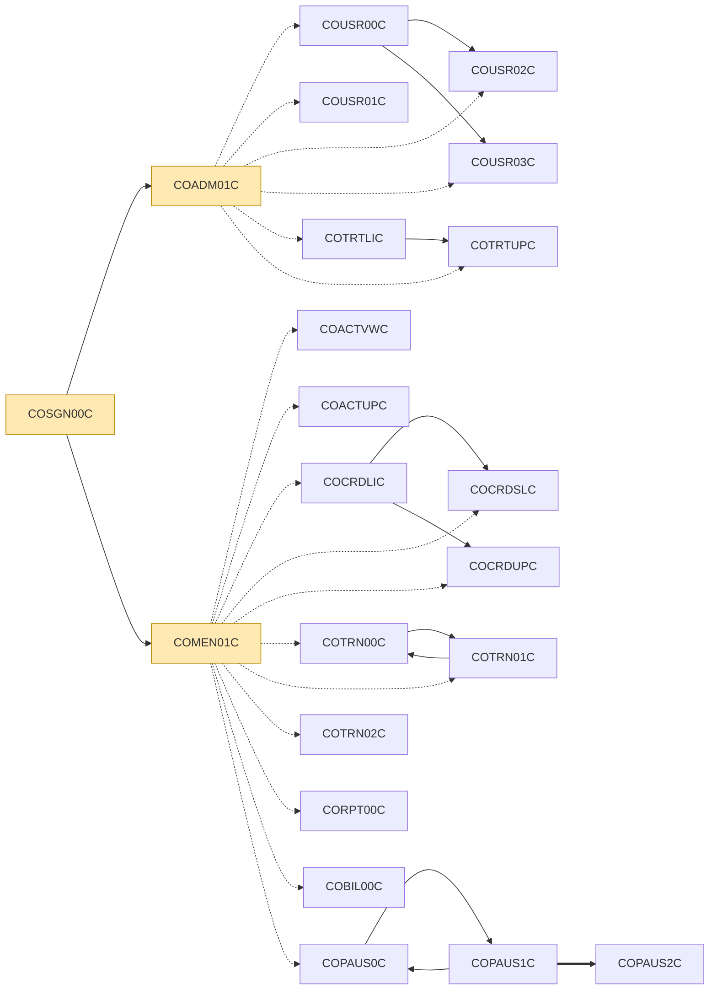
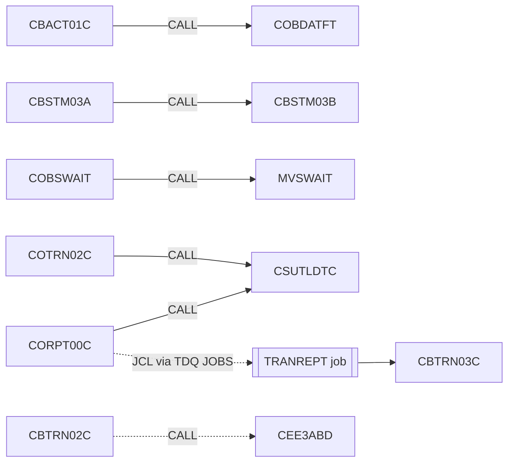
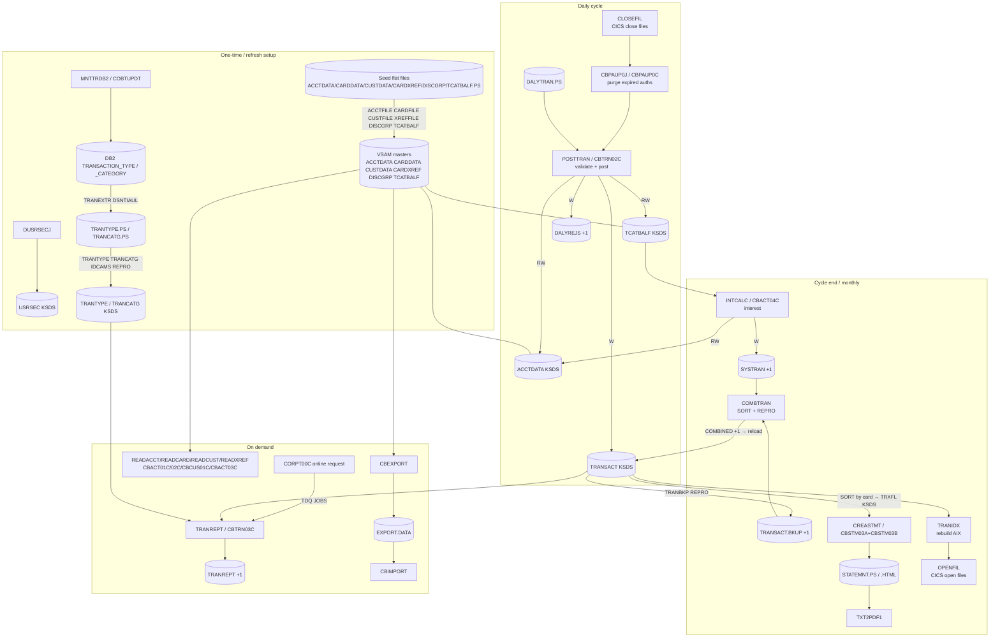
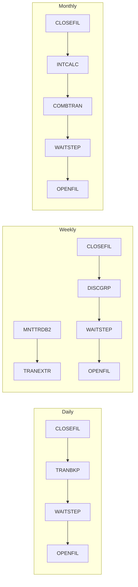
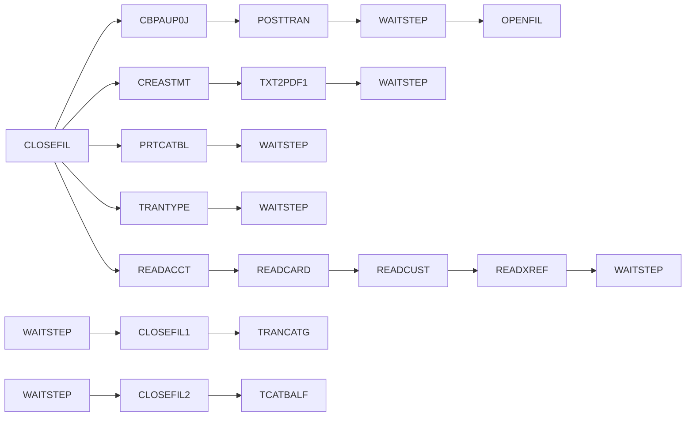

# CardDemo COBOL Estate — Dependency Map

Program call graph, CICS transfer graph, dataset lineage and the end-to-end batch pipeline, derived from `CALL`, `EXEC CICS XCTL/LINK`, menu tables, JCL DD statements, IDCAMS/SORT control cards, CICS CSD definitions and the Control-M / CA7 schedules in `app/scheduler`. See [APPLICATION_INVENTORY.md](APPLICATION_INVENTORY.md) for per-program I/O detail.

## 1. Inter-program call graph

Mechanisms found in the estate:

| Mechanism | Meaning | Count |
|---|---|---|
| `CALL 'literal'` | Static batch/online subroutine call (load module dependency) | 5 |
| `EXEC CICS XCTL PROGRAM(...)` | Transfer control to another CICS program (no return) | 40 |
| `EXEC CICS LINK PROGRAM(...)` | Call CICS program and return | 1 |
| Menu table + `XCTL PROGRAM(variable)` | Target chosen at run time from `COMEN02Y`/`COADM02Y` option tables | 17 |
| `XCTL PROGRAM(variable)` (other) | Return-to-caller using `CDEMO-FROM-PROGRAM` / `CDEMO-TO-PROGRAM` in the COMMAREA | 2 |
| `PERFORM` | Intra-program paragraph invocation only — no `PERFORM` in the estate crosses a program boundary (see §1.5) | — |

### 1.1 Online navigation graph (CICS)

Forward navigation only; every screen program also XCTLs back to its caller/menu on PF3 (listed in §1.4).

Legend: dotted = menu-table dispatch, solid = static XCTL, thick = LINK.

### 1.2 Batch / subroutine CALL graph

`COBDATFT` and `MVSWAIT` are assembler modules in `app/asm`; `CSUTLDTC` wraps the LE service `CEEDAYS`. `CEE3ABD` (LE abend) is called by most batch programs for abnormal termination and is omitted above except as an example.

### 1.3 CICS transaction → program (CSD)

| Transaction | Program | CSD |
|---|---|---|
| CA00 | COADM01C | `app/csd/CARDDEMO.CSD` |
| CAUP | COACTUPC | `app/csd/CARDDEMO.CSD` |
| CAVW | COACTVWC | `app/csd/CARDDEMO.CSD` |
| CB00 | COBIL00C | `app/csd/CARDDEMO.CSD` |
| CC00 | COSGN00C | `app/csd/CARDDEMO.CSD` |
| CCDL | COCRDSLC | `app/csd/CARDDEMO.CSD` |
| CCLI | COCRDLIC | `app/csd/CARDDEMO.CSD` |
| CCUP | COCRDUPC | `app/csd/CARDDEMO.CSD` |
| CDRA | COACCT01 | `app/app-vsam-mq/csd/CRDDEMOM.csd` |
| CDRD | CODATE01 | `app/app-vsam-mq/csd/CRDDEMOM.csd` |
| CDV1 | COCRDSEC | `app/csd/CARDDEMO.CSD` |
| CM00 | COMEN01C | `app/csd/CARDDEMO.CSD` |
| CP00 | COPAUA0C | `app/app-authorization-ims-db2-mq/csd/CRDDEMO2.csd` |
| CPVD | COPAUS1C | `app/app-authorization-ims-db2-mq/csd/CRDDEMO2.csd` |
| CPVS | COPAUS0C | `app/app-authorization-ims-db2-mq/csd/CRDDEMO2.csd` |
| CR00 | CORPT00C | `app/csd/CARDDEMO.CSD` |
| CT00 | COTRN00C | `app/csd/CARDDEMO.CSD` |
| CT01 | COTRN01C | `app/csd/CARDDEMO.CSD` |
| CT02 | COTRN02C | `app/csd/CARDDEMO.CSD` |
| CTLI | COTRTLIC | `app/app-transaction-type-db2/csd/CRDDEMOD.csd` |
| CTTU | COTRTUPC | `app/app-transaction-type-db2/csd/CRDDEMOD.csd` |
| CU00 | COUSR00C | `app/csd/CARDDEMO.CSD` |
| CU01 | COUSR01C | `app/csd/CARDDEMO.CSD` |
| CU02 | COUSR02C | `app/csd/CARDDEMO.CSD` |
| CU03 | COUSR03C | `app/csd/CARDDEMO.CSD` |

### 1.4 Complete edge list

| Caller | Callee | Mechanism | Evidence |
|---|---|---|---|
| CBACT01C | COBDATFT | CALL (static) | `app/cbl/CBACT01C.cbl` |
| CBSTM03A | CBSTM03B | CALL (static) | `app/cbl/CBSTM03A.CBL` |
| COACTUPC | COMEN01C | CICS XCTL | `app/cbl/COACTUPC.cbl` |
| COACTVWC | COMEN01C | CICS XCTL | `app/cbl/COACTVWC.cbl` |
| COADM01C | COSGN00C | CICS XCTL | `app/cbl/COADM01C.cbl` |
| COADM01C | CDEMO-ADMIN-OPT-PGMNAME(WS-OPTION | CICS XCTL (dynamic) | `app/cbl/COADM01C.cbl` |
| COADM01C | COUSR00C | Menu dispatch (table-driven XCTL) | `app/cpy/COADM02Y.cpy` |
| COADM01C | COUSR01C | Menu dispatch (table-driven XCTL) | `app/cpy/COADM02Y.cpy` |
| COADM01C | COUSR02C | Menu dispatch (table-driven XCTL) | `app/cpy/COADM02Y.cpy` |
| COADM01C | COUSR03C | Menu dispatch (table-driven XCTL) | `app/cpy/COADM02Y.cpy` |
| COADM01C | COTRTLIC | Menu dispatch (table-driven XCTL) | `app/cpy/COADM02Y.cpy` |
| COADM01C | COTRTUPC | Menu dispatch (table-driven XCTL) | `app/cpy/COADM02Y.cpy` |
| COBIL00C | COMEN01C | CICS XCTL | `app/cbl/COBIL00C.cbl` |
| COBIL00C | COSGN00C | CICS XCTL | `app/cbl/COBIL00C.cbl` |
| COBSWAIT | MVSWAIT | CALL (static) | `app/cbl/COBSWAIT.cbl` |
| COCRDLIC | COCRDSLC | CICS XCTL | `app/cbl/COCRDLIC.cbl` |
| COCRDLIC | COCRDUPC | CICS XCTL | `app/cbl/COCRDLIC.cbl` |
| COCRDLIC | COMEN01C | CICS XCTL | `app/cbl/COCRDLIC.cbl` |
| COCRDSLC | COMEN01C | CICS XCTL | `app/cbl/COCRDSLC.cbl` |
| COCRDUPC | COMEN01C | CICS XCTL | `app/cbl/COCRDUPC.cbl` |
| COMEN01C | COSGN00C | CICS XCTL | `app/cbl/COMEN01C.cbl` |
| COMEN01C | CDEMO-MENU-OPT-PGMNAME(WS-OPTION | CICS XCTL (dynamic) | `app/cbl/COMEN01C.cbl` |
| COMEN01C | COACTVWC | Menu dispatch (table-driven XCTL) | `app/cpy/COMEN02Y.cpy` |
| COMEN01C | COACTUPC | Menu dispatch (table-driven XCTL) | `app/cpy/COMEN02Y.cpy` |
| COMEN01C | COCRDLIC | Menu dispatch (table-driven XCTL) | `app/cpy/COMEN02Y.cpy` |
| COMEN01C | COCRDSLC | Menu dispatch (table-driven XCTL) | `app/cpy/COMEN02Y.cpy` |
| COMEN01C | COCRDUPC | Menu dispatch (table-driven XCTL) | `app/cpy/COMEN02Y.cpy` |
| COMEN01C | COTRN00C | Menu dispatch (table-driven XCTL) | `app/cpy/COMEN02Y.cpy` |
| COMEN01C | COTRN01C | Menu dispatch (table-driven XCTL) | `app/cpy/COMEN02Y.cpy` |
| COMEN01C | COTRN02C | Menu dispatch (table-driven XCTL) | `app/cpy/COMEN02Y.cpy` |
| COMEN01C | CORPT00C | Menu dispatch (table-driven XCTL) | `app/cpy/COMEN02Y.cpy` |
| COMEN01C | COBIL00C | Menu dispatch (table-driven XCTL) | `app/cpy/COMEN02Y.cpy` |
| COMEN01C | COPAUS0C | Menu dispatch (table-driven XCTL) | `app/cpy/COMEN02Y.cpy` |
| COPAUS0C | COMEN01C | CICS XCTL | `app/app-authorization-ims-db2-mq/cbl/COPAUS0C.cbl` |
| COPAUS0C | COPAUS1C | CICS XCTL | `app/app-authorization-ims-db2-mq/cbl/COPAUS0C.cbl` |
| COPAUS0C | COSGN00C | CICS XCTL | `app/app-authorization-ims-db2-mq/cbl/COPAUS0C.cbl` |
| COPAUS1C | COPAUS0C | CICS XCTL | `app/app-authorization-ims-db2-mq/cbl/COPAUS1C.cbl` |
| COPAUS1C | COPAUS2C | CICS LINK | `app/app-authorization-ims-db2-mq/cbl/COPAUS1C.cbl` |
| CORPT00C | CSUTLDTC | CALL (static) | `app/cbl/CORPT00C.cbl` |
| CORPT00C | COMEN01C | CICS XCTL | `app/cbl/CORPT00C.cbl` |
| CORPT00C | COSGN00C | CICS XCTL | `app/cbl/CORPT00C.cbl` |
| COSGN00C | COADM01C | CICS XCTL | `app/cbl/COSGN00C.cbl` |
| COSGN00C | COMEN01C | CICS XCTL | `app/cbl/COSGN00C.cbl` |
| COTRN00C | COMEN01C | CICS XCTL | `app/cbl/COTRN00C.cbl` |
| COTRN00C | COSGN00C | CICS XCTL | `app/cbl/COTRN00C.cbl` |
| COTRN00C | COTRN01C | CICS XCTL | `app/cbl/COTRN00C.cbl` |
| COTRN01C | COMEN01C | CICS XCTL | `app/cbl/COTRN01C.cbl` |
| COTRN01C | COSGN00C | CICS XCTL | `app/cbl/COTRN01C.cbl` |
| COTRN01C | COTRN00C | CICS XCTL | `app/cbl/COTRN01C.cbl` |
| COTRN02C | CSUTLDTC | CALL (static) | `app/cbl/COTRN02C.cbl` |
| COTRN02C | COMEN01C | CICS XCTL | `app/cbl/COTRN02C.cbl` |
| COTRN02C | COSGN00C | CICS XCTL | `app/cbl/COTRN02C.cbl` |
| COTRTLIC | COADM01C | CICS XCTL | `app/app-transaction-type-db2/cbl/COTRTLIC.cbl` |
| COTRTLIC | COTRTUPC | CICS XCTL | `app/app-transaction-type-db2/cbl/COTRTLIC.cbl` |
| COTRTUPC | COADM01C | CICS XCTL | `app/app-transaction-type-db2/cbl/COTRTUPC.cbl` |
| COUSR00C | COADM01C | CICS XCTL | `app/cbl/COUSR00C.cbl` |
| COUSR00C | COSGN00C | CICS XCTL | `app/cbl/COUSR00C.cbl` |
| COUSR00C | COUSR02C | CICS XCTL | `app/cbl/COUSR00C.cbl` |
| COUSR00C | COUSR03C | CICS XCTL | `app/cbl/COUSR00C.cbl` |
| COUSR01C | COADM01C | CICS XCTL | `app/cbl/COUSR01C.cbl` |
| COUSR01C | COSGN00C | CICS XCTL | `app/cbl/COUSR01C.cbl` |
| COUSR02C | COADM01C | CICS XCTL | `app/cbl/COUSR02C.cbl` |
| COUSR02C | COSGN00C | CICS XCTL | `app/cbl/COUSR02C.cbl` |
| COUSR03C | COADM01C | CICS XCTL | `app/cbl/COUSR03C.cbl` |
| COUSR03C | COSGN00C | CICS XCTL | `app/cbl/COUSR03C.cbl` |

External/runtime services: **CBACT01C** → CEE3ABD; **CBACT02C** → CEE3ABD; **CBACT03C** → CEE3ABD; **CBACT04C** → CEE3ABD; **CBCUS01C** → CEE3ABD; **CBEXPORT** → CEE3ABD; **CBIMPORT** → CEE3ABD; **CBPAUP0C** → CBLTDLI; **CBSTM03A** → CEE3ABD; **CBTRN01C** → CEE3ABD; **CBTRN02C** → CEE3ABD; **CBTRN03C** → CEE3ABD; **COACCT01** → MQCLOSE, MQGET, MQOPEN, MQPUT; **CODATE01** → MQCLOSE, MQGET, MQOPEN, MQPUT; **COPAUA0C** → CBLTDLI, MQCLOSE, MQGET, MQOPEN, MQPUT1; **COPAUS0C** → CBLTDLI; **COPAUS1C** → CBLTDLI; **CSUTLDTC** → CEEDAYS; **DBUNLDGS** → CBLTDLI; **PAUDBLOD** → CBLTDLI; **PAUDBUNL** → CBLTDLI

### 1.5 PERFORM structure (intra-program)

`PERFORM` statements reference paragraphs inside the same program (or paragraphs brought in by PROCEDURE-division copybooks `CSUTLDPY`, `CSSTRPFY`, `CSDB2RPY`, `CSSETATY`). The table quantifies internal control-flow size; programs using `GO TO` / `ALTER` are harder to restructure.

| Program | Paragraphs | PERFORM stmts | GO TO | Main-line PERFORM sequence (batch) |
|---|---|---|---|---|
| CBTRN03C | 26 | 73 | 0 | 0000-TRANFILE-OPEN → 0100-REPTFILE-OPEN → 0200-CARDXREF-OPEN → 0300-TRANTYPE-OPEN → 0400-TRANCATG-OPEN → 0500-DATEPARM-OPEN → 0550-DATEPARM-READ → 1000-TRANFILE-GET-NEXT → 1120-WRITE-ACCOUNT-TOTALS → 1500-A-LOOKUP-XREF … |
| COTRTLIC | 57 | 69 | 28 |  |
| CBTRN02C | 26 | 62 | 0 | 0000-DALYTRAN-OPEN → 0100-TRANFILE-OPEN → 0200-XREFFILE-OPEN → 0300-DALYREJS-OPEN → 0400-ACCTFILE-OPEN → 0500-TCATBALF-OPEN → 1000-DALYTRAN-GET-NEXT → 1500-VALIDATE-TRAN → 2000-POST-TRANSACTION → 2500-WRITE-REJECT-REC |
| COACTUPC | 85 | 61 | 51 |  |
| COTRN02C | 18 | 61 | 0 |  |
| CBACT04C | 22 | 57 | 0 | 0000-TCATBALF-OPEN → 0100-XREFFILE-OPEN → 0200-DISCGRP-OPEN → 0300-ACCTFILE-OPEN → 0400-TRANFILE-OPEN → 1000-TCATBALF-GET-NEXT → 1050-UPDATE-ACCOUNT → 1100-GET-ACCT-DATA → 1110-GET-XREF-DATA → 1200-GET-INTEREST-RATE … |
| CBEXPORT | 21 | 50 | 0 | 1000-INITIALIZE → 2000-EXPORT-CUSTOMERS → 3000-EXPORT-ACCOUNTS → 4000-EXPORT-XREFS → 5000-EXPORT-TRANSACTIONS → 5500-EXPORT-CARDS → 6000-FINALIZE |
| COPAUS0C | 20 | 48 | 0 |  |
| COTRN00C | 16 | 46 | 0 |  |
| COUSR00C | 16 | 45 | 0 |  |
| CBTRN01C | 18 | 43 | 0 | 0000-DALYTRAN-OPEN → 0100-CUSTFILE-OPEN → 0200-XREFFILE-OPEN → 0300-CARDFILE-OPEN → 0400-ACCTFILE-OPEN → 0500-TRANFILE-OPEN → 1000-DALYTRAN-GET-NEXT → 2000-LOOKUP-XREF → 3000-READ-ACCOUNT |
| COTRTUPC | 63 | 40 | 23 |  |
| COPAUA0C | 43 | 38 | 0 |  |
| COBIL00C | 16 | 38 | 0 |  |
| CBACT01C | 16 | 36 | 0 | 0000-ACCTFILE-OPEN → 2000-OUTFILE-OPEN → 3000-ARRFILE-OPEN → 4000-VBRFILE-OPEN → 1000-ACCTFILE-GET-NEXT |
| CORPT00C | 10 | 35 | 1 |  |
| COPAUS1C | 15 | 34 | 0 |  |
| CBSTM03A | 25 | 33 | 14 |  |
| COCRDLIC | 39 | 33 | 16 |  |
| COACCT01 | 13 | 32 | 0 |  |
| COUSR02C | 11 | 31 | 0 |  |
| CBIMPORT | 16 | 30 | 0 | 1000-INITIALIZE → 2000-PROCESS-EXPORT-FILE → 3000-VALIDATE-IMPORT → 4000-FINALIZE |
| CODATE01 | 13 | 28 | 0 |  |
| COCRDUPC | 45 | 26 | 21 |  |
| COUSR03C | 11 | 26 | 0 |  |
| COUSR01C | 9 | 20 | 0 |  |
| CBPAUP0C | 17 | 19 | 0 | 1000-INITIALIZE → 2000-FIND-NEXT-AUTH-SUMMARY → 3000-FIND-NEXT-AUTH-DTL → 4000-CHECK-IF-EXPIRED → 5000-DELETE-AUTH-DTL → IF → 6000-DELETE-AUTH-SUMMARY → 9000-TAKE-CHECKPOINT → PERFORM |
| COCRDSLC | 34 | 19 | 9 |  |
| COACTVWC | 34 | 18 | 9 |  |
| COTRN01C | 9 | 17 | 0 |  |
| COBTUPDT | 9 | 15 | 0 |  |
| COADM01C | 8 | 15 | 0 |  |
| COMEN01C | 7 | 15 | 0 |  |
| PAUDBLOD | 17 | 12 | 0 | 1000-INITIALIZE → 2000-READ-ROOT-SEG-FILE → 3000-READ-CHILD-SEG-FILE → 4000-FILE-CLOSE |
| CBACT02C | 5 | 11 | 0 | 0000-CARDFILE-OPEN → 1000-CARDFILE-GET-NEXT |
| CBACT03C | 5 | 11 | 0 | 0000-XREFFILE-OPEN → 1000-XREFFILE-GET-NEXT |
| CBCUS01C | 5 | 11 | 0 | 0000-CUSTFILE-OPEN → 1000-CUSTFILE-GET-NEXT |
| COSGN00C | 6 | 11 | 0 |  |
| DBUNLDGS | 15 | 10 | 0 | 1000-INITIALIZE → 2000-FIND-NEXT-AUTH-SUMMARY → 4000-FILE-CLOSE |
| PAUDBUNL | 11 | 8 | 0 | 1000-INITIALIZE → 2000-FIND-NEXT-AUTH-SUMMARY → 4000-FILE-CLOSE |
| CBSTM03B | 14 | 4 | 13 | 1000-TRNXFILE-PROC → 2000-XREFFILE-PROC → 3000-CUSTFILE-PROC → 4000-ACCTFILE-PROC |
| COPAUS2C | 2 | 1 | 0 |  |
| CSUTLDTC | 2 | 1 | 0 | A000-MAIN |
| COBSWAIT | 0 | 0 | 0 |  |

## 2. Dataset lineage

Roles: **D** = defined/created (IDCAMS DEFINE, IEFBR14/new allocation), **X** = deleted, **W** = written, **R** = read. Each entry is `JOB.STEP(program)`. Online access is resolved through CSD FILE definitions. GDG generations are folded into their base name.

### 2.1 Master files (VSAM KSDS / AIX)

| Dataset | D / X | Written by | Read by | Online (CICS) |
|---|---|---|---|---|
| AWS.M2.CARDDEMO.ACCTDATA.VSAM.KSDS (`ACCTDAT`) | D: ACCTFILE.STEP10(IDCAMS) X: ACCTFILE.STEP05(IDCAMS) | ACCTFILE.STEP15(IDCAMS) INTCALC.STEP15(CBACT04C) POSTTRAN.STEP15(CBTRN02C) | CBEXPORT.STEP02(CBEXPORT) CREASTMT.STEP040(CBSTM03A) INTCALC.STEP15(CBACT04C) POSTTRAN.STEP15(CBTRN02C) READACCT.STEP05(CBACT01C) | COPAUA0C[READ] COPAUS0C[READ] COACCT01[READ] COACTUPC[READ/REWRITE] COACTVWC[READ] COBIL00C[READ/REWRITE] |
| AWS.M2.CARDDEMO.CARDDATA.VSAM.AIX | D: CARDFILE.STEP40(IDCAMS) X: CARDFILE.STEP05(IDCAMS) | CARDFILE.STEP60(IDCAMS) | — | — |
| AWS.M2.CARDDEMO.CARDDATA.VSAM.AIX.PATH (`CARDAIX`) | — | — | — | COCRDSLC[READ] |
| AWS.M2.CARDDEMO.CARDDATA.VSAM.KSDS (`CARDDAT`) | D: CARDFILE.STEP10(IDCAMS) X: CARDFILE.STEP05(IDCAMS) | CARDFILE.STEP15(IDCAMS) | CARDFILE.STEP60(IDCAMS) CBEXPORT.STEP02(CBEXPORT) READCARD.STEP05(CBACT02C) | COCRDLIC[ENDBR/READNEXT/READPREV/STARTBR] COCRDSLC[READ] COCRDUPC[READ/REWRITE] |
| AWS.M2.CARDDEMO.CARDXREF.VSAM.AIX | D: XREFFILE.STEP20(IDCAMS) X: XREFFILE.STEP05(IDCAMS) | XREFFILE.STEP30(IDCAMS) | — | — |
| AWS.M2.CARDDEMO.CARDXREF.VSAM.AIX.PATH (`CXACAIX`) | — | — | INTCALC.STEP15(CBACT04C) | COPAUS0C[READ] COACTUPC[READ] COACTVWC[READ] COBIL00C[READ] COTRN02C[READ] |
| AWS.M2.CARDDEMO.CARDXREF.VSAM.KSDS (`CCXREF`) | D: XREFFILE.STEP10(IDCAMS) X: XREFFILE.STEP05(IDCAMS) | XREFFILE.STEP15(IDCAMS) | CBEXPORT.STEP02(CBEXPORT) CREASTMT.STEP040(CBSTM03A) INTCALC.STEP15(CBACT04C) POSTTRAN.STEP15(CBTRN02C) READXREF.STEP05(CBACT03C) TRANREPT.STEP10R(CBTRN03C) XREFFILE.STEP30(IDCAMS) | COPAUA0C[READ] COTRN02C[READ] |
| AWS.M2.CARDDEMO.CUSTDATA.VSAM.KSDS (`CUSTDAT`) | D: CUSTFILE.STEP10(IDCAMS) X: CUSTFILE.STEP05(IDCAMS) | CUSTFILE.STEP15(IDCAMS) | CBEXPORT.STEP02(CBEXPORT) CREASTMT.STEP040(CBSTM03A) READCUST.STEP05(CBCUS01C) | COPAUA0C[READ] COPAUS0C[READ] COACTUPC[READ/REWRITE] COACTVWC[READ] |
| AWS.M2.CARDDEMO.DISCGRP.VSAM.KSDS | D: DISCGRP.STEP10(IDCAMS) X: DISCGRP.STEP05(IDCAMS) | DISCGRP.STEP15(IDCAMS) | INTCALC.STEP15(CBACT04C) | — |
| AWS.M2.CARDDEMO.TCATBALF.VSAM.KSDS | D: TCATBALF.STEP10(IDCAMS) X: TCATBALF.STEP05(IDCAMS) | POSTTRAN.STEP15(CBTRN02C) TCATBALF.STEP15(IDCAMS) | INTCALC.STEP15(CBACT04C) POSTTRAN.STEP15(CBTRN02C) PRTCATBL.STEP05R(IDCAMS) | — |
| AWS.M2.CARDDEMO.TRANCATG.VSAM.KSDS | D: TRANCATG.STEP10(IDCAMS) X: TRANCATG.STEP05(IDCAMS) | TRANCATG.STEP15(IDCAMS) | TRANREPT.STEP10R(CBTRN03C) | — |
| AWS.M2.CARDDEMO.TRANSACT.VSAM.AIX | D: TRANFILE.STEP20(IDCAMS) TRANIDX.STEP20(IDCAMS) X: TRANBKP.STEP05(IDCAMS) TRANFILE.STEP05(IDCAMS) | TRANFILE.STEP30(IDCAMS) TRANIDX.STEP30(IDCAMS) | — | — |
| AWS.M2.CARDDEMO.TRANSACT.VSAM.KSDS (`TRANSACT`) | D: TRANBKP.STEP10(IDCAMS) TRANFILE.STEP10(IDCAMS) X: TRANBKP.STEP05(IDCAMS) TRANFILE.STEP05(IDCAMS) | COMBTRAN.STEP10(IDCAMS) POSTTRAN.STEP15(CBTRN02C) TRANFILE.STEP15(IDCAMS) | CBEXPORT.STEP02(CBEXPORT) CREASTMT.STEP010(SORT) TRANBKP.STEP05R(IDCAMS) TRANFILE.STEP30(IDCAMS) TRANIDX.STEP30(IDCAMS) TRANREPT.STEP05R(IDCAMS) | COBIL00C[ENDBR/READPREV/STARTBR/WRITE] COTRN00C[ENDBR/READNEXT/READPREV/STARTBR] COTRN01C[READ] COTRN02C[ENDBR/READPREV/STARTBR/WRITE] |
| AWS.M2.CARDDEMO.TRANTYPE.VSAM.KSDS | D: TRANTYPE.STEP10(IDCAMS) X: TRANTYPE.STEP05(IDCAMS) | TRANTYPE.STEP15(IDCAMS) | TRANREPT.STEP10R(CBTRN03C) | — |
| AWS.M2.CARDDEMO.TRXFL.VSAM.KSDS | D: CREASTMT.DELDEF01(IDCAMS) X: CREASTMT.DELDEF01(IDCAMS) | CREASTMT.STEP020(IDCAMS) | CREASTMT.STEP040(CBSTM03A) | — |
| AWS.M2.CARDDEMO.USRSEC.VSAM.ESDS | D: ESDSRRDS.STEP02(IDCAMS) X: ESDSRRDS.STEP02(IDCAMS) | ESDSRRDS.STEP03(IDCAMS) | — | — |
| AWS.M2.CARDDEMO.USRSEC.VSAM.KSDS (`USRSEC`) | D: DUSRSECJ.STEP02(IDCAMS) X: DUSRSECJ.STEP02(IDCAMS) | DUSRSECJ.STEP03(IDCAMS) | — | COSGN00C[READ] COUSR00C[ENDBR/READNEXT/READPREV/STARTBR] COUSR01C[WRITE] COUSR02C[READ/REWRITE] COUSR03C[DELETE/READ] |
| AWS.M2.CARDDEMO.USRSEC.VSAM.RRDS | D: ESDSRRDS.STEP04(IDCAMS) X: ESDSRRDS.STEP04(IDCAMS) | ESDSRRDS.STEP05(IDCAMS) | — | — |

### 2.2 Transaction flow & GDGs

| Dataset | D / X | Written by | Read by | Online (CICS) |
|---|---|---|---|---|
| AWS.M2.CARDDEMO.DALYREJS | — | POSTTRAN.STEP15(CBTRN02C) | — | — |
| AWS.M2.CARDDEMO.DALYTRAN.PS | — | — | POSTTRAN.STEP15(CBTRN02C) | — |
| AWS.M2.CARDDEMO.DALYTRAN.PS.INIT | — | — | TRANFILE.STEP15(IDCAMS) | — |
| AWS.M2.CARDDEMO.STATEMNT.HTML | X: CREASTMT.STEP030(IEFBR14) | CREASTMT.STEP040(CBSTM03A) | — | — |
| AWS.M2.CARDDEMO.STATEMNT.PS | X: CREASTMT.STEP030(IEFBR14) | CREASTMT.STEP040(CBSTM03A) | TXT2PDF1.TXT2PDF(IKJEFT1B) | — |
| AWS.M2.CARDDEMO.SYSTRAN | — | INTCALC.STEP15(CBACT04C) | COMBTRAN.STEP05R(SORT) | — |
| AWS.M2.CARDDEMO.TCATBALF.BKUP | — | PRTCATBL.STEP05R(IDCAMS) | PRTCATBL.STEP10R(SORT) | — |
| AWS.M2.CARDDEMO.TCATBALF.PS | — | — | TCATBALF.STEP15(IDCAMS) | — |
| AWS.M2.CARDDEMO.TCATBALF.REPT | D: PRTCATBL.DELDEF(IEFBR14) | PRTCATBL.STEP10R(SORT) | — | — |
| AWS.M2.CARDDEMO.TRANREPT | — | TRANREPT.STEP10R(CBTRN03C) | — | — |
| AWS.M2.CARDDEMO.TRANSACT.BKUP | — | TRANBKP.STEP05R(IDCAMS) TRANREPT.STEP05R(IDCAMS) | COMBTRAN.STEP05R(SORT) TRANREPT.STEP05R(SORT) | — |
| AWS.M2.CARDDEMO.TRANSACT.COMBINED | — | COMBTRAN.STEP05R(SORT) | COMBTRAN.STEP10(IDCAMS) | — |
| AWS.M2.CARDDEMO.TRANSACT.DALY | — | TRANREPT.STEP05R(SORT) | TRANREPT.STEP10R(CBTRN03C) | — |
| AWS.M2.CARDDEMO.TRANSACT.IMPORT | — | CBIMPORT.STEP01(CBIMPORT) | — | — |
| AWS.M2.CARDDEMO.TRXFL.SEQ | X: CREASTMT.DELDEF01(IDCAMS) | CREASTMT.STEP010(SORT) | CREASTMT.STEP020(IDCAMS) | — |

### 2.3 Reference / seed flat files

| Dataset | D / X | Written by | Read by | Online (CICS) |
|---|---|---|---|---|
| AWS.CCDA.CUSTDATA.CLUSTER | X: DEFCUST.STEP05(IDCAMS) | — | — | — |
| AWS.CUSTDATA.CLUSTER | D: DEFCUST.STEP05(IDCAMS) | — | — | — |
| AWS.M2.CARDDEMO.ACCTDATA.ARRYPS | X: READACCT.PREDEL(IEFBR14) | READACCT.STEP05(CBACT01C) | — | — |
| AWS.M2.CARDDEMO.ACCTDATA.IMPORT | — | CBIMPORT.STEP01(CBIMPORT) | — | — |
| AWS.M2.CARDDEMO.ACCTDATA.PS | — | — | ACCTFILE.STEP15(IDCAMS) | — |
| AWS.M2.CARDDEMO.ACCTDATA.PSCOMP | X: READACCT.PREDEL(IEFBR14) | READACCT.STEP05(CBACT01C) | — | — |
| AWS.M2.CARDDEMO.ACCTDATA.VBPS | X: READACCT.PREDEL(IEFBR14) | READACCT.STEP05(CBACT01C) | — | — |
| AWS.M2.CARDDEMO.CARDDATA.PS | — | — | CARDFILE.STEP15(IDCAMS) | — |
| AWS.M2.CARDDEMO.CARDXREF.IMPORT | — | CBIMPORT.STEP01(CBIMPORT) | — | — |
| AWS.M2.CARDDEMO.CARDXREF.PS | — | — | XREFFILE.STEP15(IDCAMS) | — |
| AWS.M2.CARDDEMO.CUSTDATA.IMPORT | — | CBIMPORT.STEP01(CBIMPORT) | — | — |
| AWS.M2.CARDDEMO.CUSTDATA.PS | — | — | CUSTFILE.STEP15(IDCAMS) | — |
| AWS.M2.CARDDEMO.DATEPARM | — | — | TRANREPT.STEP10R(CBTRN03C) | — |
| AWS.M2.CARDDEMO.DISCGRP.BKUP | — | DEFGDGD.STEP60(IEBGENER) | — | — |
| AWS.M2.CARDDEMO.DISCGRP.PS | — | — | DEFGDGD.STEP60(IEBGENER) DISCGRP.STEP15(IDCAMS) | — |
| AWS.M2.CARDDEMO.ESDSRRDS.PS | X: ESDSRRDS.PREDEL(IEFBR14) | ESDSRRDS.STEP01(IEBGENER) | ESDSRRDS.STEP03(IDCAMS) ESDSRRDS.STEP05(IDCAMS) | — |
| AWS.M2.CARDDEMO.TRANCATG.PS | X: TRANEXTR.STEP30(IEFBR14) | TRANEXTR.STEP50(DSNTIAUL) | TRANEXTR.STEP20(IEBGENER) DEFGDGD.STEP40(IEBGENER) TRANCATG.STEP15(IDCAMS) | — |
| AWS.M2.CARDDEMO.TRANCATG.PS.BKUP | — | TRANEXTR.STEP20(IEBGENER) DEFGDGD.STEP40(IEBGENER) | — | — |
| AWS.M2.CARDDEMO.TRANTYPE.BKUP | — | TRANEXTR.STEP10(IEBGENER) DEFGDGD.STEP20(IEBGENER) | — | — |
| AWS.M2.CARDDEMO.TRANTYPE.PS | X: TRANEXTR.STEP30(IEFBR14) | TRANEXTR.STEP40(DSNTIAUL) | TRANEXTR.STEP10(IEBGENER) DEFGDGD.STEP20(IEBGENER) TRANTYPE.STEP15(IDCAMS) | — |
| AWS.M2.CARDDEMO.USRSEC.PS | X: DUSRSECJ.PREDEL(IEFBR14) | DUSRSECJ.STEP01(IEBGENER) | DUSRSECJ.STEP03(IDCAMS) | — |
| AWS.M2.CARDEMO.FTP.TEST.BKUP | — | — | INTRDRJ1.IDCAMS(IDCAMS) INTRDRJ2.IDCAMS(IDCAMS) | — |
| AWS.M2.CARDEMO.FTP.TEST.BKUP.INTRDR | — | — | INTRDRJ2.IDCAMS(IDCAMS) | — |

### 2.4 Other (export, IMS unload, misc)

| Dataset | D / X | Written by | Read by | Online (CICS) |
|---|---|---|---|---|
| AWS.M2.CARDDEMO.EXPORT.DATA | D: CBEXPORT.STEP01(IDCAMS) X: CBEXPORT.STEP01(IDCAMS) | CBEXPORT.STEP02(CBEXPORT) | CBIMPORT.STEP01(CBIMPORT) | — |
| AWS.M2.CARDDEMO.IMPORT.ERRORS | — | CBIMPORT.STEP01(CBIMPORT) | — | — |
| AWS.M2.CARDDEMO.IMSDATA.DBPAUTP0 | D: DBPAUTP0.STEPDEL(IEFBR14) | — | DBPAUTP0.UNLOAD(DFSRRC00) | — |
| AWS.M2.CARDDEMO.JCL(INTRDRJ2) | — | — | INTRDRJ1.STEP01(IEBGENER) | — |
| AWS.M2.CARDDEMO.PAUTDB.CHILD.FILEO | X: UNLDPADB.STEP0(IEFBR14) | UNLDPADB.STEP01(PAUDBUNL) | LOADPADB.STEP01(PAUDBLOD) | — |
| AWS.M2.CARDDEMO.PAUTDB.CHILD.GSAM | — | — | UNLDGSAM.STEP01(DBUNLDGS) | — |
| AWS.M2.CARDDEMO.PAUTDB.ROOT.FILEO | X: UNLDPADB.STEP0(IEFBR14) | UNLDPADB.STEP01(PAUDBUNL) | LOADPADB.STEP01(PAUDBLOD) | — |
| AWS.M2.CARDDEMO.PAUTDB.ROOT.GSAM | — | — | UNLDGSAM.STEP01(DBUNLDGS) | — |
| AWS.M2.CARDEMO.FTP.TEST | — | — | INTRDRJ1.IDCAMS(IDCAMS) | — |
| AWS.M2.LBD.TXT2PDF.EXEC | — | — | TXT2PDF1.TXT2PDF(IKJEFT1B) | — |
| INPFILE | — | — | MNTTRDB2.STEP1(COBTUPDT) | — |
| OEM.CICSTS.DFHCSD | — | — | CBADMCDJ.STEP1(DFHCSDUP) | — |
| OEM.IMS.IMSP.PAUTHDB | — | — | DBPAUTP0.UNLOAD(DFSRRC00) UNLDGSAM.STEP01(DBUNLDGS) UNLDPADB.STEP01(PAUDBUNL) | — |
| OEM.IMS.IMSP.PAUTHDBX | — | — | DBPAUTP0.UNLOAD(DFSRRC00) UNLDGSAM.STEP01(DBUNLDGS) UNLDPADB.STEP01(PAUDBUNL) | — |
| OEM.IMS.IMSP.RECON1 | — | — | DBPAUTP0.UNLOAD(DFSRRC00) | — |
| OEM.IMS.IMSP.RECON2 | — | — | DBPAUTP0.UNLOAD(DFSRRC00) | — |
| OEM.IMS.IMSP.RECON3 | — | — | DBPAUTP0.UNLOAD(DFSRRC00) | — |

### 2.5 DB2 and IMS stores

| Store | Defined / loaded by | Written by | Read by |
|---|---|---|---|
| DB2 `CARDDEMO.TRANSACTION_TYPE` | CREADB2 (DDL `app/app-transaction-type-db2/ddl`) | COBTUPDT (MNTTRDB2), COTRTLIC, COTRTUPC | TRANEXTR.STEP40 (DSNTIAUL → TRANTYPE.PS), COTRTLIC, COTRTUPC |
| DB2 `CARDDEMO.TRANSACTION_TYPE_CATEGORY` | CREADB2 | — | TRANEXTR.STEP50 (DSNTIAUL → TRANCATG.PS) |
| DB2 `CARDDEMO.AUTHFRDS` | DDL `app/app-authorization-ims-db2-mq/ddl` | COPAUS2C (via COPAUS1C LINK) | — |
| IMS PAUTDB (`PAUTSUM0` root / `PAUTDTL1` child) | LOADPADB (PAUDBLOD) | COPAUA0C (ISRT/REPL), COPAUS1C (REPL), CBPAUP0C (DLET) | COPAUS0C, COPAUS1C, PAUDBUNL (UNLDPADB), DBUNLDGS (UNLDGSAM), DBPAUTP0 |
| MQ request/reply queues | — | COPAUA0C (MQPUT1 reply), COACCT01, CODATE01 | COPAUA0C (MQGET, trigger CP00), COACCT01 (CDRA), CODATE01 (CDRD) |

## 3. End-to-end batch pipeline

### 3.1 Data flow

### 3.2 Documented run order (README)

`CLOSEFIL → ACCTFILE → CARDFILE → XREFFILE → CUSTFILE → TRANBKP → TRANEXTR* → TRANCATG → TRANTYPE → DISCGRP → TCATBALF → DUSRSECJ → POSTTRAN → INTCALC → TRANBKP → COMBTRAN → CREASTMT → TRANIDX → OPENFIL → WAITSTEP`, plus `CBPAUP0J*` (\* optional modules). Steps 2–12 (re)initialise the files; `POSTTRAN` onward is the processing cycle.

### 3.3 Scheduler definitions (`app/scheduler`)

**Control-M (`CardDemo.controlm`)**

**CA7 (`CardDemo.ca7`) trigger chains**

### 3.4 Critical-path observations

- **POSTTRAN (CBTRN02C) is the single write-gate for posted transactions**: it is the only batch writer of `TRANSACT` besides the reload in COMBTRAN, and it updates `ACCTDATA` and `TCATBALF`, which INTCALC consumes next.
- **INTCALC → COMBTRAN coupling via SYSTRAN GDG**: interest transactions are not written to `TRANSACT` directly; COMBTRAN merges `TRANSACT.BKUP(0)` and `SYSTRAN(0)` and reloads the KSDS, so TRANBKP must run between INTCALC and COMBTRAN.
- **Online/batch contention**: every batch chain is bracketed by CLOSEFIL/OPENFIL because CICS programs (COACTUPC, COBIL00C, COTRN02C, COCRDUPC, COPAUA0C) update the same KSDS files.
- **Reference-data chain crosses technologies**: DB2 `TRANSACTION_TYPE` → DSNTIAUL flat file → VSAM `TRANTYPE` → CBTRN03C report lookups.
- **CREASTMT** re-sorts `TRANSACT` by card number into a temporary `TRXFL` KSDS consumed only through CBSTM03B.
